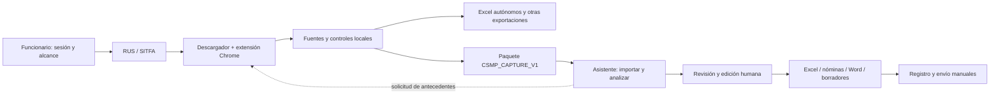

# Resumen del proyecto NURUS / Descargador SITFA-RUS / Asistente CSMP

**Fecha de corte:** 9 de octubre de 2026.  
**Repositorio de trabajo:** [MatiGaete2023/flow](https://github.com/MatiGaete2023/flow).  
**Rama:** `feat/ejecucion-plan-20261008`. **PR:** [#1, en borrador](https://github.com/MatiGaete2023/flow/pull/1).  
**Versiones actuales:** Asistente `0.5.0.dev4`; Descargador y extensión Chrome `2.7.5`; contrato `CSMP_CAPTURE_V1` `1.0.0`.  
**Código compilado y verificado en Windows:** `0795cda5c402672050e39c3806762caf99d82245`.

Este documento reúne los fundamentos, decisiones, planificación, problemas, soluciones implementadas, evidencia de pruebas y próximos pasos. Describe un **MVP técnico implementado con validación automatizada y entregas Windows**, con aceptación institucional pendiente. No declara terminado todo el plan: historia SITFA/PDF por trámite, ampliación de reglas contextuales y pruebas institucionales requieren trabajo adicional.

Las cifras de pruebas corresponden al código y entorno indicados. Los documentos anteriores se conservan como historia; una versión o un resultado antiguo no identifica necesariamente la entrega actual. Este resumen no modifica las especificaciones originales ni aprueba reglas nuevas.

## 1. Propósito y fundamentos

El proyecto busca ayudar al funcionario a obtener antecedentes desde RUS/SITFA, revisar múltiples registros o ingresos y preparar observaciones y productos operativos: Excel, nóminas, proyectos Word y borradores Outlook. El software organiza y comprueba información; el funcionario decide el contenido y realiza las actuaciones oficiales.

El diseño separa dos herramientas autónomas:

- **Descargador:** consulta las pantallas autorizadas mediante una extensión Chrome y un puente local; conserva fuentes, verifica identidad y cobertura y exporta archivos. Debe servir también a quien solo necesita Excel.
- **Asistente:** importa archivos locales, relaciona antecedentes, aplica las reglas tradicionales, permite revisar y editar el trabajo y genera productos. Debe poder procesar un paquete sin Chrome ni Descargador instalado.

Los principios que gobiernan la implementación son:

1. **Identidad remota comprobada.** La relación entre listado y bitácora exige tribunal, causa e ingreso. El nombre o RIT por sí solos no autorizan un cruce, especialmente cuando una causa tiene varios ingresos o personas.
2. **Fuentes y cobertura explícitas.** Una consulta fallida, no realizada o parcial no equivale a una consulta vacía comprobada. Una bitácora vacía en un período no demuestra ausencia histórica de actuaciones.
3. **Fidelidad y trazabilidad.** Conservar originales, bytes, hashes, fechas, filtros, páginas y procedencia; evitar truncamientos silenciosos y explicaciones desactualizadas.
4. **Decisión humana preservada.** Reimportar, recalcular o recuperar no debe borrar exclusiones, observaciones editadas, contactos, adjuntos ni proyectos. Las correspondencias ambiguas requieren conciliación.
5. **Reglas tradicionales estables.** Conservar umbrales, textos y aplicación por tribunal, incluidos los catálogos de Laja, Mulchén y Tomé. Las propuestas CT no se activan por una aprobación general del desarrollo.
6. **Actuaciones oficiales manuales.** No escribir automáticamente en RUS/SATURNO ni enviar correos. Outlook crea borradores mediante revisión y confirmación; `registration.submit` está inhabilitado en producción.
7. **Sesión recuperable sin autoridad institucional.** Guardar trabajo, preferencias e historial técnico de descargas permite continuar; no acredita una observación registrada, una firma revisada ni un correo enviado.
8. **Confidencialidad.** Los adjuntos reales del usuario se trataron como evidencia de diagnóstico, no como instrucciones ni fixtures publicables. El repositorio y la CI contienen evidencia ficticia; no deben recibir HAR, HTML, bitácoras, documentos ni credenciales institucionales reales.

## 2. Origen y decisiones de alcance

El plan original refería a NuRus. El usuario indicó que las herramientas, documentos y avances debían quedar en **flow**. Se importó el baseline NuRus `251d5c4025749edd4767183ebd3d2baf3bb9baed` como snapshot trazable, sin sustituir el historial de flow ni fusionar ramas históricas.

La entrega P0 conservó 674 archivos del baseline, inventarios, configuración y 17 productos de referencia ficticios. El commit de importación fue `bd826d524761f24204323e7ad87c287045dc40d3`; el cierre P0, `d74880bf7f1b3d53791e39c5245756848103bf0b`.

Se recibieron siete adjuntos originales: las especificaciones 01, 02, 03 y 04, el plan 05 y copias idénticas de 01 y 05. Se conservaron todos sin editar y con SHA-256. Las copias no duplican requisitos. La incorporación del documento 02, en `6c520f8e49e40c6c7d5379492e6064a55b28c0fb`, amplió la matriz inicial de 95 a **115 requisitos** y obligó a contrastar sus referencias a una rama antigua con el baseline efectivo `0.5.0.dev4`.

El usuario autorizó continuar el desarrollo hasta completar tareas y productos. También indicó que no había entorno Windows institucional ni evidencia adicional disponible y que SITFA/RUS se utilizarían después. Se avanzó con el MVP y las pruebas técnicas, dejando expresamente diferidas las validaciones que necesitan ese entorno. Más adelante aportó JSON, capturas y un HAR para diagnosticar regresiones; esas aportaciones no equivalen a una aceptación completa de las respuestas institucionales.

## 3. Arquitectura y circulación de datos



El gráfico describe el circuito objetivo y las partes disponibles del MVP; no implica que todas las fuentes remotas, especialmente historia y PDF por trámite, estén implementadas.

| Componente | Responsabilidad e implementación |
|---|---|
| Descargador Python | Consultas, lotes, resultados, recuperación y exportación; código en [descargador](descargador). |
| Extensión Chrome | Lectura de pantallas y vínculos comprobados, identidad y captura nativa de evidencia; [extension/pagina.js](descargador/extension/pagina.js). No ejecuta el JavaScript recibido como instrucción. |
| Parser compartido | Lectura de bitácoras y codificaciones preservando bytes; [bitacora_html.py](src/nurus/bitacora_html.py) y [capture/diaries.py](src/nurus/capture/diaries.py). |
| Contrato de intercambio | ZIP local con manifiesto y CSV, hashes, límites, identidad y cobertura; [capture/contract.py](src/nurus/capture/contract.py). |
| Exportador | Construye el paquete desde consultas ya obtenidas y comprobadas; [export_csmp_capture.py](descargador/export_csmp_capture.py). No vuelve a consultar para exportar. |
| Importador y continuidad | Construye un candidato de trabajo antes de sustituir la sesión; [capture_input.py](src/nurus/personal/capture_input.py) y [capture_reconciliation.py](src/nurus/personal/capture_reconciliation.py). |
| Hallazgos y productos | Coherencia de reglas/evidencias, edición, Excel, solicitudes, Word y borradores; [capture_findings.py](src/nurus/personal/capture_findings.py), [capture_products.py](src/nurus/personal/capture_products.py) y [outputs.py](src/nurus/personal/outputs.py). |
| Entrega y verificaciones | Lockfiles, workflows Windows, verificación de EXE/paquete/instalador y herramientas reproducibles en [requirements](requirements) y [tools](tools). |

### Contrato y límites operativos

`CSMP_CAPTURE_V1` contiene `manifest.json` y siete tablas posibles: consultas, registros, incidencias, bitácoras, calendarios, historia/trámites y documentos. Consultas, registros e incidencias son obligatorias; las otras fuentes tienen estados explícitos. Admitir una tabla en el contrato no significa que su extractor remoto exista.

Se distinguen `NO_SOLICITADA`, `NO_CONSULTADA`, `VACIA_COMPROBADA`, `FALLIDA`, `PARCIAL` y `COMPLETA`. La cobertura se comprueba por consulta, fuente e ingreso y se agrega sin ocultar faltantes. Los campos raw y normalizados se conservan separados. La fecha de captura no sustituye la fecha del evento; el análisis fija fecha de corte y configuración.

El lector valida sin extraer el ZIP: rechaza rutas inseguras, colisiones, archivos no declarados, hashes incorrectos y otras estructuras incompatibles. La publicación utiliza un temporal validado y un destino nuevo. Una importación rechazada conserva el trabajo previo.

| Límite | Conducta y motivo |
|---|---|
| Transporte | Hasta 80 MiB y 200.000 filas agregadas, además de límites por archivo/campo y expansión. No garantiza que todo paquete pueda analizarse como un solo trabajo. |
| Análisis | Máximo operativo de 20.000 registros, incluidos calendarios independientes; lotes mayores deben dividirse. |
| Excel | 32.767 unidades UTF-16 por celda. La conversión a celdas rechaza exceso antes de asignarlo; los reportes de bitácoras permiten partición verificable del texto largo. |
| Solicitudes | Hasta 4 MiB UTF-8 y 20.000 entradas; escritor y lector comparten los límites y el exceso no publica un archivo final. |

El CSV técnico preserva texto literal y no debe utilizarse como una hoja sin conversión. Los Excel derivados escriben los datos externos como texto para evitar interpretación de fórmulas.

## 4. Documentos clave y orden de lectura

| Documento | Función |
|---|---|
| [CONTINUAR.md](CONTINUAR.md) | Punto de continuación: rama, código verificado, últimas correcciones y pendientes. |
| [Originales y hashes](docs/plan_20261008/README.md) | Custodia de los siete adjuntos y precedencia de especificaciones. |
| [01 — Descargador](docs/plan_20261008/01_ESPECIFICACION_DESCARGADOR_RUS_SITFA.md) | Captura, controles, autonomía Excel y paquete. |
| [02 — Asistente](docs/plan_20261008/02_ESPECIFICACION_TECNICA_ASISTENTE_CSMP.md) | Importación, arquitectura, edición y productos; [análisis de incorporación](docs/ANALISIS_ESPECIFICACION_02_20261008.md). |
| [03 — Reglas y observaciones](docs/plan_20261008/03_REGLAS_ANALISIS_OBSERVACIONES_CSMP.md) | Fuentes, reglas tradicionales, propuestas contextuales y límites de interpretación. |
| [04 — Flujo integrado](docs/plan_20261008/04_FLUJO_TRABAJO_INTEGRADO_CSMP.md) | Fronteras entre herramientas y trabajo del funcionario. |
| [05 — Plan maestro](docs/plan_20261008/05_PLAN_COMPLETO_EJECUCION_NURUS_CSMP_20261008.md) | Fases P0–P13, dependencias y puertas de aceptación G0–G13. |
| [Baseline P0](docs/EJECUCION_BASELINE_20261008.md) | Procedencia, inventarios, pruebas iniciales y golden. |
| [Matriz funcional](docs/MATRIZ_FUNCIONAL_20261008.md) y [trazabilidad acumulativa](docs/TRAZABILIDAD_EJECUCION_20261008.md) | Los 115 requisitos y 79 tareas/entregables del plan. La matriz inicial es histórica; contrastarla con la trazabilidad y el código actual. |
| [Implementación MVP](docs/IMPLEMENTACION_MVP_20261008.md) y [guía de entrega](docs/GUIA_ENTREGA_MVP_20261008.md) | Alcance implementado, cambios de flujo y limitaciones. |
| [Contrato y diccionario](contracts/csmp_capture_v1/README.md) | Esquema, CSV, identidad, integridad y compatibilidad. |
| [Informe de revisión](docs/INFORME_REVISION_20261009.md) y [correcciones](docs/CORRECCIONES_REVISION_20261009.md) | Diagnóstico histórico H01–H09/M01–M03 y solución verificada. |
| [Regresiones del usuario](docs/REGRESIONES_PRUEBAS_USUARIO_20261009.md) | Causas y correcciones de Outlook, bitácoras, evidencia vacía, vínculos, reutilización y adjuntos. |
| [Corrección del ZIP 2.7.5](docs/CORRECCION_REFERENCIAS_ZIP_20261009.md) | Recuperación o exclusión explícita de controles antiguos no disponibles. |
| [Manual ilustrado](docs/manual_descargador_2_7_4/README.md) | PDF de 17 páginas, HTML autónomo ampliable y práctica ficticia de 800 bitácoras. Sus imágenes son 2.7.4; se complementan con la guía 2.7.5. |
| [Aceptación institucional pendiente](docs/ACEPTACION_INSTITUCIONAL_PENDIENTE.md) | Casos reales diferidos, actas, custodia y criterios. Validar un acta no ejecuta pruebas ni aprueba gates. |

Para retomar: leer primero este resumen y `CONTINUAR.md`; después el documento de la función que se vaya a modificar, su trazabilidad y las pruebas correspondientes. Los documentos originales contienen requisitos y fotografías de ramas anteriores, no una constancia automática de capacidades actuales.

## 5. Planificación y estado por fase

El plan define un camino crítico del MVP: **P0 → P2 → P4 → P5 → P6 → P8 → P11 → P13**. P1 condiciona la afirmación de lectura real de bitácoras y el análisis temporal confiable. P9–P10 son la ampliación condicionada por fuentes y aprobación; no bloquean el MVP tabular.

No se asigna porcentaje global ni fecha de cierre ficticia. Cada fase combina entregables y una puerta de aceptación; implementación técnica y aceptación institucional son estados distintos.

| Fase / puerta | Objetivo | Estado al corte y condición restante |
|---|---|---|
| P0 / G0 | Congelar baseline, inventario y no regresión | Entrega realizada y continuación autorizada. Originales y golden conservados. |
| P1 / G1 | Estabilizar y aceptar lectura de bitácoras | Vínculos, codificación, pruebas y diagnóstico corregidos. Falta cotejo institucional por modalidad, pestaña, identidad, contenido y cobertura. |
| P2 / G2 | Formalizar contrato único | Esquema, diccionario, fixtures, productor/consumidor y validación implementados y probados. |
| P3 / G3 | Descargador autónomo y Excel de bitácoras | Implementado, incluida recuperación offline; aceptación de fuentes reales condicionada a G1. |
| P4 / G4 | Exportar paquete desde consultas verificadas | Implementado y probado sin reconsultas; reutilización con identidad, versiones y exclusiones. |
| P5 / G5 | Importar, relacionar y recuperar en Asistente | Implementado: validación previa, fecha de corte, reimportación, conciliación y Excel legado. Falta aceptación institucional de casos. |
| P6 / G6 | Desacoplar herramientas y retirar autoridad local indebida | Flujo principal local, sin consultas ni lanzamiento de Descargador desde Asistente; escritura institucional bloqueada y recuperación preservada. |
| P7 / G7 | Análisis temporal con evidencia | Parcial. Cronología/preview ficticio limitado; producción contextual `NO_EVALUABLE` mientras falten evidencia y aceptación. |
| P8 / G8 | Revisión masiva y productos | Implementación local y pruebas; falta cotejo de Excel 2010, Outlook 365 clásico y productos por operador. |
| P9 / G9 | Historia SITFA y PDF por trámite | Extractor remoto no implementado: falta contrato observado de identidad, columnas, paginación y referencias. |
| P10 / G10 | Reglas contextuales nuevas | Catálogo CT-01–CT-10 desactivado. Preview limitado CT-01/02; CT-03–CT-10 sin motor ampliado implementado. Cada regla exige casos y aprobación funcional propia. |
| P11 / G11 | Integración y aceptación base | Cadena local, EXE y CI probados; casos institucionales pendientes. |
| P12 / G12 | Aceptación ampliada | Bloqueada por P9/P10 y validación real; no sustituible por simulación. |
| P13 / G13 | Distribución controlada y documentación | Artefactos Windows y documentación entregados; falta aceptación Windows 10 institucional, políticas Chrome/Office y autorización de promoción. |

### Hitos de implementación

| Checkpoint | Resultado |
|---|---|
| `251d5c4` / `bd826d5` / `d74880b` | Baseline NuRus, importación a flow y P0. |
| `6c520f8` | Documento 02 incorporado y matriz de 115 requisitos. |
| [Implementación MVP](docs/IMPLEMENTACION_MVP_20261008.md) | Contrato, exportación/importación, desacoplamiento, revisión y productos; historial de commits en Git y CONTINUAR. |
| `99ed217` | H01–H09 y M01–M03 corregidos y verificados. |
| `d6ec1b4` / `e3a6369` | Regresiones del usuario corregidas y entrega Windows 2.7.4 verificada. |
| `f8a1fcc` | Manual ilustrado y práctica offline; entrega documental. |
| `2c80857` / `0795cda` | Referencias antiguas ausentes recuperables/excluibles y ventana revisable con desplazamiento; entrega 2.7.5 verificada. |
| Checkpoints documentales posteriores | Registro de evidencia, etiquetas de futuras compilaciones y este resumen; no implican una recompilación del código funcional. |

## 6. Revisión técnica: nueve hallazgos solucionados

La revisión inicial encontró ocho defectos reproducidos y una brecha de verificación de futuras entregas. Los cinco de prioridad alta y cuatro de prioridad media fueron implementados en `99ed217`; las entregas posteriores los incluyen. Las evidencias del diagnóstico previo permanecen conservadas.

| ID / prioridad | Problema y efecto | Solución implementada | Comprobación |
|---|---|---|---|
| H01 / Alta | openpyxl truncaba texto antes de comprobar longitud: 33.000 caracteres quedaban en 32.767. | Validar originales en unidades UTF-16 antes de asignar celdas; servicio [excel_cells.py](src/nurus/services/excel_cells.py); rechazo atómico del exceso. | Límites ASCII y caracteres fuera del plano básico; trabajo anterior intacto. |
| H02 / Alta | Recalcular cambiaba la regla, pero dejaba hallazgos de la evaluación anterior. | Servicio único de hallazgos; confirmar fila y contexto conjuntamente al editar, deshacer, recuperar y sincronizar. | E05/E06 coherentes, sin duplicados ni pérdida de decisiones humanas. |
| H03 / Alta | Una captura equivalente con otro digest perdía decisiones en el trabajo activo. | Conciliar por identidad remota y ámbito; remapear IDs/productos; decisión explícita ante cambios o ambigüedad y archivo de sesión anterior. | Capturas equivalentes/complementarias, dos ingresos, conflictos, KEEP/RESET y GUI con 600 registros. |
| H04 / Alta | Cobertura global completa ocultaba consultas/ingresos parciales y suprimía solicitudes. | [coverage.py](src/nurus/capture/coverage.py) calcula por fuente/ingreso; contrato rechaza sobredeclaración; solicitud usa alcance individual. | Mezcla de completo, parcial, fallido y vacío comprobado; contradicciones rechazadas. |
| H05 / Alta | Calendario parcial se exportaba como completo. | Agregar todas las consultas y el plan pendiente, también consultas sin archivo o fallidas. | Faltantes y páginas pendientes conservan parcialidad. |
| H06 / Media | Acta aceptaba cifras imposibles: 1 observado y 200.000 coincidentes. | Comprobar relaciones y particiones de conteos; PASÓ exige coherencia y ausencia de fallos/desconocidos. | Combinaciones imposibles rechazadas; conteos opcionales admitidos. |
| H07 / Media | Escritor publicaba solicitudes que el propio lector rechazaba por tamaño. | Límite compartido de bytes UTF-8 y entradas; validar antes de publicar. | Umbral, multibyte y exceso sin archivo final ni sobreescritura. |
| H08 / Media | Advertencias de identidad visible se perdían al exportar/importar bitácoras. | Convertirlas en incidencias con ámbito; conservar en Work, evidencia y hoja Incidencias, sin reasignar por nombre. | Discrepancias y advertencias sobreviven descarga → ZIP → importación → persistencia → Excel. |
| H09 / Media | Verificación completa de desinstalación estaba ligada a un artefacto histórico. | Prueba reutilizable sobre el instalador recién construido: instalación, reinstalación, SHA, productos, eliminación real y datos externos. | CI falla si el lanzador termina dejando la carpeta; prueba del build actual sin depender de un ZIP antiguo. |

Pruebas principales: [test_review_corrections.py](tests/test_review_corrections.py), [productor](descargador/test_capture_review_corrections.py) y [test_installer_removal.py](tests/test_installer_removal.py). Detalle y evidencia: [informe de correcciones](docs/CORRECCIONES_REVISION_20261009.md).

### Tres mejoras de ingeniería implementadas

| ID | Mejora | Implementación y límite |
|---|---|---|
| M01 | Rendimiento y cancelación | Eliminar el recálculo de dimensiones Excel en cada fila, añadir checkpoints de cancelación y fijar máximo de análisis de 20.000 registros. Benchmark sintético de importación: 2.000/10.000/20.000 registros, 8,589/33,118/72,324 s con tracemalloc; no es una promesa de tiempo institucional. |
| M02 | Dependencias reproducibles | Locks con versiones y hashes por Windows Python 3.12–3.14 y Linux Python 3.12, inventario de dependencias y `pip check`. La fijación de dependencias no promete identidad binaria entre reconstrucciones. |
| M03 | Coherencia y mantenimiento | Separación gradual de cobertura/conciliación, estructuras tipadas y servicio compartido de hallazgos; Ruff focalizado en errores sintácticos y nombres indefinidos. No se reescribieron los motores tradicionales. |

## 7. Problemas reportados en pruebas del usuario y correcciones

### 7.1. Borradores Outlook: `'NoneType' object has no attribute 'to'`

La revisión conjunta incluía comprobaciones de Excel sin borrador (`target=None`). Guardar todos trataba esas comprobaciones como correos y accedía a `draft.to`. Se filtran exclusivamente comprobaciones de correo y se mantiene el resumen de incidencias/exclusiones pertinente. Las pruebas con ventana real y adaptador ficticio verifican guardar solo correos válidos, cancelar sin guardar y repetir sin duplicarlos. **Outlook real sigue pendiente de contraste.**

### 7.2. Bitácoras que no se descargaban por codificación

Los diagnósticos mostraron siete aperturas fallidas por imponer UTF-8 sobre bytes antiguos. El parser compartido ahora admite UTF-8 con/sin BOM y Windows-1252, incluidos alias HTML ISO-8859-1/Latin-1. Sin declaración, intenta UTF-8 estricto y luego Windows-1252 estricto. No sustituye caracteres ilegibles; declaración desconocida o bytes inválidos se rechazan. Los originales y SHA-256 se conservan sobre bytes. La solución se aplica a descarga, reutilización, importadores y HAR base64.

### 7.3. Evidencia de consulta vacía sin tribunal, modalidad ni fechas

Las pruebas antiguas creaban PDF, pero no exigían que una respuesta con controles inicializados en blanco mostrara el contexto en la imagen. La extensión recupera los controles en la vista local de evidencia y añade una franja visible **Consulta solicitada** con tribunal/código, modalidad, pestaña y período o **Sin filtro de fechas**. Se comprueban tabla vacía, contexto, visibilidad, hash y estabilidad antes/después de la captura nativa Chrome. Un cambio impide producir el PDF. Esto corresponde a evidencia de consulta vacía, **no al extractor pendiente de PDF por trámite de P9**.

### 7.4. Espera e Informes: `SIN_VINCULO`

El extractor solo admitía el tipo 12 de Cumplimiento. El HAR aportado confirmó seis argumentos numéricos de `ShowObservaciones`, con tipo **11 en Espera** y **13 en Informes**. Python, extensión y parser conservan el tipo literal y el orden comprobado, manteniendo validaciones de tribunal/causa/ingreso/etapa/modalidad. No se inventan IDs ni se ejecuta el JavaScript recibido.

Se probaron 80 lecturas ficticias con extensión instalada: dos tribunales, cuatro modalidades, dos páginas, Espera/Cumplimiento y tres opciones de Informes, con ambas codificaciones. El HAR no contenía todas las respuestas reales de ventanas 11/13; falta su cotejo institucional. El tipo 10 de órdenes de búsqueda **no se presenta como bitácora validada de Seguimiento**.

### 7.5. Recuperación de 800 bitácoras, Excel y hojas descargadas por separado

Resultados dependía de la última carpeta y buscaba `resumen.json`, dejando fuera lotes con `bitacoras.json`. El historial ahora conserva referencias entre ejecuciones y destinos. Se pueden añadir carpetas de hojas y controles anteriores con sus HTML, generar Excel sin Chrome y crear el paquete con varias descargas.

La reutilización discrimina por tribunal/causa/ingreso verificados. Reúne copias iguales; entre contenidos diferentes elige una captura posterior solo con fecha y zona inequívocas; un conflicto requiere selección. Una copia fallida no sustituye una válida. Cada lectura produce **Bitacoras_RUS.xlsx** y **Excel bitácoras autónomo…** consolida datos anteriores offline. Conservar la fecha original evita presentar reutilización como actualización remota.

La prueba de 800 bitácoras ficticias produjo Excel con 800 ingresos y un ZIP de dos hojas con dos bitácoras coincidentes y 798 ajenas excluidas, conservando originales. El [manual ilustrado](docs/manual_descargador_2_7_4/README.md) explica este circuito y aporta una práctica offline.

### 7.6. Edición obligatoria de todos los adjuntos

Preparar correos genera los adjuntos automáticamente. **Editar adjunto (opcional)** modifica solo el correo seleccionado. Las sesiones anteriores materializan los pendientes al guardar. También se corrigió una colisión de variables que impedía conservar ciertas ediciones al preparar nuevamente.

La prueba GUI con 25 correos editó el décimo y comprobó que los otros 24 archivos, rutas y hashes se mantuvieran; verificó recuperación, conservación de celda/texto/adjunto manual y guardado sin duplicados con adaptador ficticio. La revisión final de destinatarios, texto y adjuntos sigue precediendo la creación de borradores.

### 7.7. ZIP bloqueado por un `bitacoras.json` antiguo ausente — 2.7.5

El historial ocultaba controles recordados que ya no existían, mientras el exportador seguía recibiendo todas sus rutas. Una referencia antigua invisible bloqueaba el ZIP con `No such file or directory`, aunque las bitácoras actuales estuvieran disponibles.

La solución en [archivo_local.py](descargador/archivo_local.py), [ventana_resultados.py](descargador/ventana_resultados.py) y el lector compartido:

- Mostrar rutas ausentes como **NO_DISPONIBLE** y controles existentes ilegibles como **ERROR_CONTROL**.
- Contar lotes disponibles y faltantes por separado.
- Abrir **Bitácoras no disponibles para el paquete** antes de guardar, con **Localizar seleccionado…**, **Excluir seleccionados**, **Excluir todos los no disponibles**, **Continuar** y **Cancelar**.
- Aplicar exclusiones solo al paquete actual, conservando historial, archivos y fuentes válidas. Localizar un control no evita su validación posterior.
- Aplicar **Quitar lote del paquete** a todas las filas seleccionadas y usar la misma revisión en consolidación Excel.
- Permitir revisar listas largas mediante tamaño mínimo y desplazamiento horizontal/vertical; cancelar no escribe el ZIP.

Las [seis regresiones específicas](descargador/test_referencias_ausentes.py) incluyen veinte referencias ausentes y 64 bitácoras válidas, exclusión explícita, ZIP con las correspondientes, restauración/traslado de carpeta, cancelación, multiselección y conservación de bytes/preferencias. La [guía 2.7.5](docs/CORRECCION_REFERENCIAS_ZIP_20261009.md) contiene instrucciones y una captura ficticia.

## 8. Pruebas realizadas y evidencia disponible

### Resultados, separados por checkpoint

| Código / entorno | Resultado y alcance |
|---|---|
| P0, Linux con Xvfb | Asistente 503 aprobadas/6 omitidas; Descargador 167 aprobadas/57 subpruebas; 17 productos golden. Se conservaron los fallos iniciales por falta de DISPLAY. |
| `99ed217`, correcciones de revisión | Linux: Asistente 602/11; Descargador 171/57; ocho sondas corregidas y 17 productos con paridad. Windows: Asistente 612/1 por Python y verificación del instalador actual. |
| `e3a6369`, entrega 2.7.4 | Linux: Asistente 605/11; Descargador 192/59; paridad de 17 productos. Windows: Asistente 615/1 por Python 3.12/3.13/3.14; Descargador 192/59, navegador, EXE y conjunto. |
| `0795cda`, entrega actual 2.7.5, Linux/Xvfb | Descargador 198 aprobadas/59 subpruebas; seis regresiones específicas, nueve pruebas finales de interfaz y 36 pruebas focalizadas del intercambio/bitácoras del Asistente. Estas selecciones no se suman como una suite distinta ni se presentan como nueva corrida completa Linux del Asistente. |
| `0795cda`, Windows CI | Asistente **615 aprobadas y 1 omitida en cada versión Python 3.12/3.13/3.14**; Descargador **198 aprobadas y 59 subpruebas**. EXE autónomos, conjunto y ciclo de instalación/reinstalación/desinstalación verificados. |

La CI actual del Descargador también verificó JavaScript de lectura, las 80 bitácoras ficticias con extensión, PDF nativo de consulta vacía y parser/contrato dentro del EXE. La del Asistente comprobó productos y recuperación desde el EXE, interoperabilidad del conjunto, SHA y conservación de datos externos al reinstalar/desinstalar. Los resultados de versiones anteriores no se usan como prueba de funcionalidades añadidas después.

| Evidencia | Ubicación |
|---|---|
| Baseline y golden | [docs/evidencia_p0](docs/evidencia_p0) |
| Revisión antes de corregir | [docs/evidencia_revision_20261009](docs/evidencia_revision_20261009) |
| H01–H09/M01–M03 | [docs/evidencia_correcciones_20261009](docs/evidencia_correcciones_20261009) |
| Regresiones 2.7.4 | [docs/evidencia_regresiones_usuario_20261009](docs/evidencia_regresiones_usuario_20261009) |
| Referencias ausentes y CI actual | [docs/evidencia_referencias_20261009](docs/evidencia_referencias_20261009) |
| CI Asistente/conjunto actual | [Run 37979286900](https://github.com/MatiGaete2023/flow/actions/runs/37979286900) |
| CI Descargador actual | [Run 37979286940](https://github.com/MatiGaete2023/flow/actions/runs/37979286940) |

**Límite de la evidencia:** las pruebas automatizadas usan datos ficticios. Windows CI no acredita Windows 10 institucional, políticas locales Chrome, Excel 2010 ni Outlook 365 real. No se realizaron envíos ni escrituras institucionales. Los digests de artefactos son los informados por GitHub; no se afirma su recomputación local.

### Artefactos actuales para pruebas

Todos los siguientes corresponden al código `0795cda5c402672050e39c3806762caf99d82245`:

| Entrega | Enlace |
|---|---|
| Descargador y extensión 2.7.5 | [Descargador-SITFA-2.7.5-Windows](https://github.com/MatiGaete2023/flow/actions/runs/37979286940/artifacts/11639937234) |
| Paquete conjunto | [CSMP + Descargador + extensión](https://github.com/MatiGaete2023/flow/actions/runs/37979286900/artifacts/11640457954) |
| Asistente autónomo | [CSMP-Integral-Windows-dev4](https://github.com/MatiGaete2023/flow/actions/runs/37979286900/artifacts/11640407932) |
| Instalador Asistente | [CSMP-Instalador-Windows-dev4](https://github.com/MatiGaete2023/flow/actions/runs/37979286900/artifacts/11640877263) |

El nombre del artefacto conjunto de esta ejecución termina históricamente en `SITFA-274`; **sus binarios y JSON internos son 2.7.5**. La etiqueta de futuras compilaciones se corrigió a `SITFA-275`. Los artefactos requieren acceso al repositorio y caducan según retención de Actions; los fuentes y documentos permanecen en la rama. Comprobar siempre metadatos internos, SHA y extensión, además del nombre del ZIP.

## 9. Flujo de uso para probar la entrega actual

1. Cerrar ambos programas y conservar configuración, sesiones y carpetas completas de descargas anteriores.
2. Usar una entrega coherente. Desde fuentes: descargar el ZIP de esta rama, extraer en una carpeta nueva, ejecutar `Instalar_CSMP.bat`, abrir `Abrir_CSMP.bat` y el nuevo `descargador/Iniciar.cmd`. Alternativamente usar los artefactos del mismo SHA.
3. Para consultas nuevas, cargar/recargar la extensión **2.7.5** de esa entrega y conectar con el código actual. La recuperación/exportación de archivos existentes funciona sin Chrome.
4. Seleccionar tribunal, modalidad, pestaña y fechas; descargar las hojas requeridas. Revisar páginas, cantidad y estados; no confundir fallo con consulta vacía.
5. Leer las bitácoras disponibles y revisar `Bitacoras_RUS.xlsx`, control y errores. Conservar juntos `bitacoras.json` y todos sus HTML.
6. En Resultados, **Añadir descarga o lote anterior…** para reunir las carpetas de hojas, también si principal e informes se descargaron por separado.
7. Usar **Añadir bitácoras anteriores…** para recuperar controles con sus HTML. No es necesario volver a consultar para reutilizar esos datos.
8. Si aparecen referencias antiguas ausentes, localizarlas o excluirlas explícitamente del paquete. No editar manifiestos ni hashes para eludir validación.
9. Usar **Excel bitácoras autónomo…** si se quiere consolidación offline. Verificar texto, identidad, fechas y alcance.
10. Pulsar **Crear paquete para Asistente (ZIP)…**. Este es el paquete normalizado; **ZIP de originales del lote** es otra exportación y no lo sustituye. Revisar coincidencias, exclusiones y estados antes de guardarlo.
11. En Asistente, **Trabajo → Importar paquete**. Revisar integridad, cobertura, fecha de corte y eventual conciliación; corregir o excluir registros según corresponda.
12. Preparar productos; editar únicamente el adjunto que se desee mediante **Editar adjunto (opcional)**. Revisar destinatarios/texto/adjuntos y confirmar creación de borradores. Registro RUS y envío se realizan manualmente.

La descarga conjunta no implica que bitácoras y paquete ZIP se produzcan automáticamente. Deben elegirse esas operaciones en Resultados. El manual ilustrado 2.7.4 más la corrección 2.7.5 explican las pantallas y permiten practicar sin sesión institucional.

## 10. Pasos pendientes y pruebas de aceptación

### Orden recomendado

1. **Repetir los casos del usuario sobre 2.7.5.** Comprobar ZIP con referencias antiguas, Excel consolidado, recuperación de lotes y edición opcional. Registrar versión/SHA usado y resultado por caso.
2. **Cerrar G1 de bitácoras con operador autorizado.** Contrastar Espera 11, Cumplimiento 12 e Informes 13: identidad, entradas, autor, fecha, texto íntegro, paginación, filtros y respuestas. Ensayar cuatro modalidades y las pestañas que se anunciarán soportadas. Mantener límites explícitos si alguna variante falla.
3. **Aceptar el MVP en el entorno real.** Windows 10 sin admin, extensión y políticas Chrome, importación autónoma, configuración/sesiones, Excel 2010 y Outlook 365 clásico. Confirmar que Outlook nuevo no reemplaza el backend COM utilizado.
4. **Caracterizar historia SITFA antes de desarrollar P9.** Obtener bajo autorización el contrato de tabla y respuestas; distinguir causa de ingreso, paginación, columnas, referencias y errores. Con evidencia suficiente, implementar primero historia tabular y luego PDF por selección explícita con identidad/hash/tamaño. No deducir endpoints a partir de títulos.
5. **Completar P7/P10 por regla.** Documentar dato requerido, fuente/cobertura, condición, texto, acción, prioridad e incertidumbre; desarrollar casos suficientes/insuficientes, contradicciones y empates; aprobar individualmente antes de activar. Conservar paridad del baseline y rollback.
6. **Ejecutar P12 y cerrar distribución P13.** Validar la ampliación aprobada, actualizar documentación que cambie con ella y obtener la decisión de promoción. Mantener la rama y PR en borrador hasta autorización de merge/release.

### Casos concretos para el operador

| Caso | Resultado esperado |
|---|---|
| Bitácoras de Espera/Cumplimiento/Informes | Vínculo literal correcto; misma identidad y contenido que ventana institucional; error visible ante respuesta incongruente. |
| Dos ingresos de una causa | Ninguna bitácora u observación transferida al otro ingreso por coincidencia de nombre/RIT. |
| Vacío, parcial y fallo | Estados distintos; ninguna ausencia inferida desde un fallo o página pendiente. |
| Consulta sin registros con/sin fechas | PDF muestra tribunal, modalidad, pestaña y período/sin filtro; cambios durante captura se rechazan. |
| Lote anterior completo y hojas nuevas | Recuperación offline; Excel autónomo; solo bitácoras correspondientes en el ZIP; fecha original conservada. |
| Referencia antigua movida/ausente | NO_DISPONIBLE visible; localizar o excluir permite continuar; cancelar no escribe; archivos/historial permanecen. |
| Importación corrupta o incompatible | Rechazo sin pérdida de sesión, ediciones, selección ni productos actuales. |
| Reimportación equivalente/complementaria | Decisiones conservadas cuando la identidad es inequívoca; conflicto explícito cuando no lo es; productos dependientes obsoletos cuando cambian fuentes. |
| 25 borradores y una edición | Adjuntos automáticos, modificación solo del seleccionado, otros 24 intactos; borradores correctos, sin envío ni duplicados. |
| Libro y proyecto Word reales | Apertura, texto íntegro, fórmulas externas tratadas como texto, plantillas/tribunal/variables correctos; revisión humana de contenido. |
| Instalación/reinstalación/recuperación | Versiones coherentes, recursos presentes, datos externos conservados y recuperación sin reemplazar configuración personal. |

Registrar las actas con [flow_acceptance.py](tools/flow_acceptance.py), usando el SHA/versiones reales y separando `SINTETICA_LOCAL`, `SINTETICA_WINDOWS` e `INSTITUCIONAL`. La evidencia personal permanece en custodia local; al repositorio llegan solo resultados admisibles y referencias anónimas. Una plantilla comienza `NO_EJECUTADO`; validar su estructura no demuestra ejecución, autenticidad ni aprobación del gate.

### Verificación técnica reproducible

Desde la raíz del repositorio, en un entorno nuevo Linux/Python 3.12 con pantalla disponible para pruebas GUI:

```sh
python -m pip install --require-hashes -r requirements/linux-py312.lock
python -m pip install --no-deps --no-build-isolation .
python -m pytest -q
python -m pytest descargador -q
python tools/flow_review_probes.py --verify
node descargador/test_bitacoras_extension.cjs
python tools/flow_capture_cli.py validate contracts/csmp_capture_v1/fixtures/completa.zip
python tools/flow_capture_pipeline.py /ruta/nueva/prueba --rows 100 500 2000
python tools/flow_baseline_golden.py --output /ruta/nueva/golden --expected docs/evidencia_p0/golden/semantic.json
```

Usar una ruta nueva para no sustituir evidencia anterior. En Linux, las pruebas Tk requieren DISPLAY o Xvfb; las omisiones de Windows/COM no certifican Office. Para construcción Windows utilizar los locks y workflows de la versión Python correspondiente. Las pruebas del navegador con extensión y del instalador tienen procedimientos propios de CI; no están reemplazadas por la sola suite Python.

## 11. Punto de continuación y criterio de cierre

La base para continuar es esta rama, con **Descargador/extensión 2.7.5 y código funcional verificado `0795cda`**. Los artefactos `e3a6369` son 2.7.4 y no incluyen la recuperación de referencias ausentes. Los checkpoints documentales posteriores no cambian qué código se compiló.

Antes de modificar una función, comprobar estado Git, leer su especificación y pruebas, preservar originales/decisiones y registrar el nuevo SHA con evidencia relevante. No regenerar golden para ocultar diferencias ni presentar las CT desactivadas o el contrato de historia como funcionalidad remota terminada.

**Cierre técnico actual:** MVP local, nueve hallazgos, tres mejoras de ingeniería y regresiones descritas implementados y verificados con evidencia sintética y CI. **Cierre institucional pendiente:** respuestas RUS/SITFA por variante, Office/Windows autorizado, historia/PDF, reglas ampliadas y gates asociados. La promoción final exige esa aceptación para el alcance anunciado y una instrucción expresa de distribución/merge/release.
