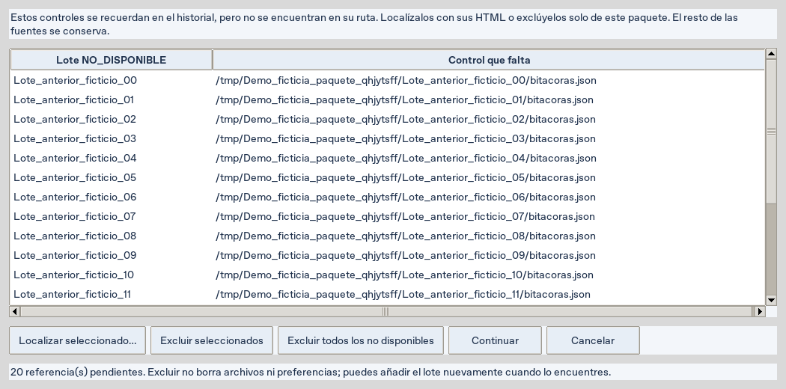

# Crear el paquete cuando falta un lote anterior — Descargador 2.7.5

El error `No such file or directory ... bitacoras.json` indica que una referencia
del historial apunta a un control que fue movido o que ya no está en esa ruta.
No acredita pérdida de las bitácoras actuales. Antes, esa referencia no aparecía
en el historial visible y, aun así, se incorporaba a la exportación y la bloqueaba.

La versión **2.7.5** muestra esas referencias como **NO_DISPONIBLE** y distingue
los lotes disponibles de las rutas ausentes. Un control existente pero ilegible
se muestra como **ERROR_CONTROL**; sus originales siguen verificándose al exportar.

## Actualizar desde el ZIP del repositorio

1. Cierra Descargador y Asistente. Conserva tus carpetas de descarga completas;
   no necesitas repetir las consultas para aplicar esta corrección.
2. Descarga la rama `feat/ejecucion-plan-20261008` y extrae todo en una carpeta nueva.
   Ejecuta `Instalar_CSMP.bat` si usas el Asistente instalado desde el repositorio.
   Abre el nuevo `descargador/Iniciar.cmd`.
3. En `chrome://extensions` carga o recarga la carpeta `descargador/extension`
   de esta copia y comprueba **2.7.5**. La conexión es necesaria para consultas
   nuevas; recuperar y exportar los archivos existentes funciona sin Chrome.

## Resolver las referencias y crear el ZIP

1. Abre **Resultados…**. Añade las carpetas de hojas y los controles de bitácoras
   que quieres reunir. Comprueba el resumen **Paquete**.
2. Pulsa **Crear paquete para Asistente (ZIP)…**. Si faltan controles, aparece
   **Bitácoras no disponibles para el paquete** antes de elegir dónde guardar.
3. Si conservas el lote en otra carpeta, selecciona su referencia y pulsa
   **Localizar seleccionado…**. Elige `bitacoras.json` en la carpeta que conserva
   sus HTML originales. Se comprueban los archivos y las identidades al exportar.
4. Si no deseas usar esas referencias en este paquete, pulsa **Excluir seleccionados**
   o **Excluir todos los no disponibles**. Esta elección afecta a este paquete:
   no borra archivos, historial ni las descargas ya añadidas.
5. Pulsa **Continuar**, guarda un ZIP nuevo y espera **Paquete creado:**.
   Revisa las bitácoras correspondientes y las ajenas excluidas; importa el ZIP
   desde **Trabajo → Importar paquete** del Asistente.

Captura de la revisión 2.7.5, con veinte rutas ficticias ausentes. El contador,
los botones y el desplazamiento permiten revisar la lista completa.

**Cancelar** cierra la revisión sin iniciar la escritura del ZIP. El botón
**Revisar referencias no disponibles…** abre esta revisión antes de exportar.
También puedes seleccionar varias filas del historial y usar **Quitar lote del paquete**:
ahora aplica a todas las seleccionadas. Añadir una fuente de nuevo la reincorpora.

El botón **Excel bitácoras autónomo…** aplica la misma revisión cuando consolida
los lotes disponibles en conjunto. Un lote individual ausente requiere localizarlo
o seleccionar otra descarga para consolidar los otros lotes; no entra en un bucle.
Los controles existentes y sus hashes no se omiten para sortear una validación.

## Verificación y alcance

- Suite del Descargador: **198 pruebas y 59 subpruebas aprobadas** en Linux/Xvfb.
- Regresión específica: **6 pruebas aprobadas**, incluido un historial con
  **20 controles ausentes y 64 bitácoras válidas**, excluir explícitamente las
  ausentes, crear el ZIP con las correspondientes y conservar bytes/preferencias.
- Recuperación de una carpeta movida y de la ruta original restaurada; cancelación
  sin ZIP, exclusión múltiple, control ilegible visible y Excel sin recursión.
- Intercambio/bitácoras del Asistente: **36 pruebas aprobadas**. Sonda JavaScript
  de vínculos de lectura aprobada. Solo fixtures; no se consultó SITFA real.

Descargador Windows **verificado**: [ejecución CI 37979286940](https://github.com/MatiGaete2023/flow/actions/runs/37979286940),
código `0795cda5c402672050e39c3806762caf99d82245`. Sus 198 pruebas/59 subpruebas,
lectura de 80 bitácoras ficticias con extensión, captura PDF y verificación del
EXE/contrato compartido terminaron correctamente.

Asistente y conjunto también verificados en [CI 37979286900](https://github.com/MatiGaete2023/flow/actions/runs/37979286900):
615 pruebas aprobadas y 1 omitida por versión Python 3.12/3.13/3.14, EXE autónomo,
conjunto e instalador/reinstalación aprobados sobre el mismo SHA. El artefacto
conjunto 11640457954 conserva la etiqueta histórica SITFA-274 en esta ejecución;
su versión interna es 2.7.5. Las siguientes compilaciones usarán SITFA-275.

[Descargar el Descargador 2.7.5 para Windows](https://github.com/MatiGaete2023/flow/actions/runs/37979286940/artifacts/11639937234).
Si usas este artefacto, extrae el ZIP completo y abre `SITFA_Descargador.exe`
desde la carpeta del programa; conserva sus archivos acompañantes. Pulsa
**Instalar extensión…** para localizar la extensión 2.7.5 de esa distribución.
El artefacto de Actions requiere iniciar sesión en GitHub y está sujeto a su
período de conservación; el código corregido permanece en la rama del repositorio.

El manual ilustrado 2.7.4 conserva sus imágenes originales y se complementa
con esta corrección de selección de fuentes. Las capturas del usuario y los
datos institucionales no se incorporaron al repositorio.
