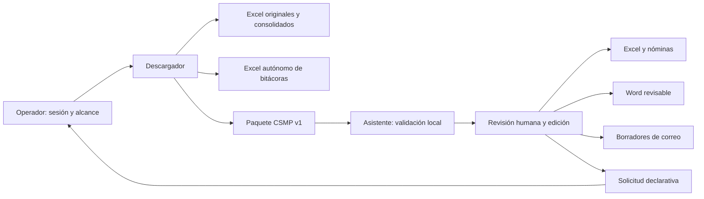

# Entrega MVP NURUS / CSMP — 8 de octubre de 2026

CSMP 0.5.0.dev4 y Descargador/extensión 2.7.3; contrato CSMP_CAPTURE/REQUEST
1.0.0. Integración en pruebas, sin promoción a versión institucional vigente.
Los dos programas funcionan autónomamente y pueden distribuirse juntos.

Actualización del 9 de octubre: corregidos el guardado por lote de borradores,
las bitácoras con codificación antigua y el contexto visible del PDF vacío.
Al actualizar desde ZIP, ejecutar de nuevo `Instalar_CSMP.bat` y cargar/recargar
la carpeta `descargador/extension` 2.7.3 en Chrome; iniciar una conexión nueva.
El detalle está en `REGRESIONES_PRUEBAS_USUARIO_20261009.md`.

## Instalación y verificación

Usar los artefactos de una misma ejecución CI/SHA. El paquete conjunto contiene
Abrir_CSMP.cmd, Abrir_Descargador.cmd, extensión, manuales y tres JSON de
verificación y una plantilla de acta institucional no ejecutada del mismo SHA.
Las comprobaciones usan paquetes vacíos, completos y parciales ficticios.
El Asistente verifica también importación, edición Excel, recuperación/reimportación,
nóminas, Word y solicitudes desde su propio EXE, sin Office ni Descargador.
`VERIFICACION_CSMP.json` incluye `capture_pipeline_verified` y la explicación
estructurada `capture_pipeline`; los hashes corresponden a productos temporales
de prueba, que se eliminan al terminar la comprobación.
No mezclar una extensión anterior con otro EXE. Los metadatos de build y las
capacidades se encuentran en los JSON de verificación de ambos programas.

Descomprimir en carpeta nueva del usuario. Conservar intacta la distribución
anterior y respaldar sesiones/configuración local antes de sustituirla. Probar
una captura ficticia y luego seguir el protocolo institucional autorizado.
Para volver atrás cerrar los programas y abrir la carpeta anterior; los originales
no se modifican. Si se cambió configuración, restaurar el respaldo correspondiente.
No importar un ZIP v1 en un Asistente anterior sin soporte para ese contrato.

La CI comprueba ejecutables, instalador/reinstalación y conservación de un dato
sentinela. Esto no sustituye pruebas sin admin en Windows 10, Excel 2010,
Outlook 365 o políticas Chrome de la institución.

## Documentación y alcance

- MANUAL_DESCARGADOR_MVP_20261008.md: captura, cobertura y tres exportaciones.
- MANUAL_ASISTENTE_MVP_20261008.md: importación, edición, productos y recuperación.
- ACEPTACION_INSTITUCIONAL_PENDIENTE.md: pruebas reales y acta por gate.
- En el repositorio, TRAZABILIDAD_EJECUCION_20261008.md y evidencia_desarrollo_20261008
  relacionan las tareas, 115 requisitos, comandos, hashes y resultados.

Historia/PDF por trámite y reglas CT de producción no forman parte de esta entrega.
Sin identidad remota no se relacionan eventos por nombre/RIT. No se registra RUS
ni se envían correos automáticamente. La aprobación de release/merge y sustitución
de la versión institucional corresponde al usuario tras revisar la entrega.

Soporte: conservar lote/ZIP/sesión, anotar SHA y reproducir sobre datos ficticios.
No publicar datos reales de NNA ni capturas privadas. Cada aceptación pendiente
debe señalar operador, entorno, fuente, resultado y limitación; NO EJECUTADO
no equivale a PASÓ.
