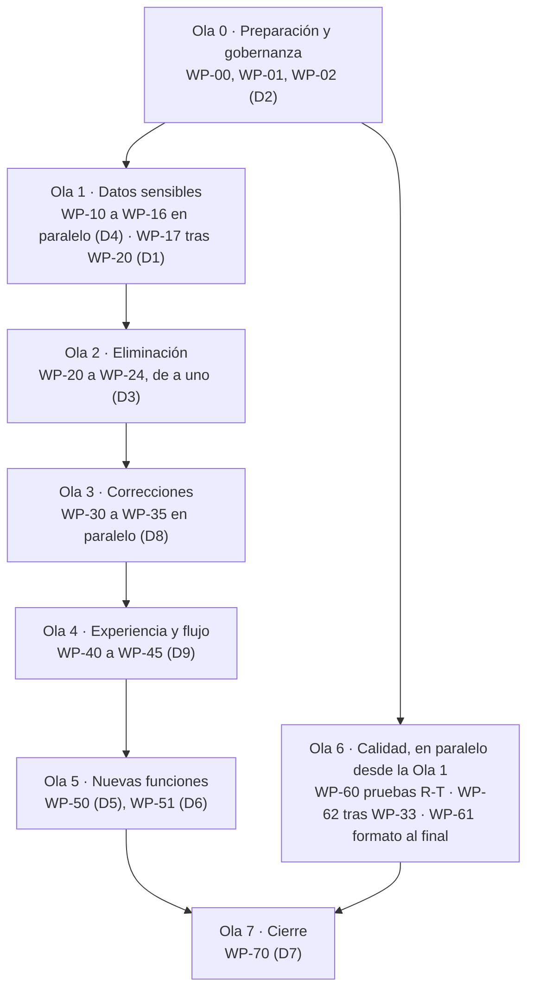

# Plan de implementación multiagente — flow

9 de octubre de 2026 · Matías Gaete

## Cómo usar este plan

Este plan convierte las cuatro auditorías del 9 de octubre de 2026 en 34 paquetes de trabajo (WP) agrupados en 8 olas, pensados para varios agentes de IA en ventanas separadas. Cada WP crea, elimina o modifica código con criterios binarios, y pasa por verificación, revisión y auditoría de alineación antes de integrarse. Ningún agente necesita esta conversación: todo lo que necesita está aquí, en el kit adjunto y en el repositorio.

**Punto de partida (N1):** repositorio `MatiGaete2023/flow`, rama `feat/ejecucion-plan-20261008`, commit `2765b47` (9 de octubre de 2026). `main` contiene solo `README.md`. Suites base: Asistente 605 aprobadas / 11 omitidas; Descargador 198 aprobadas / 59 subpruebas.

**Orden de lectura obligatorio para todo agente, y nada más salvo que su WP lo cite:**

1. Este plan: secciones «Reglas inviolables», su rol y su WP.
2. `docs/implementacion/ESTADO.json`: qué WP están tomados, hechos o bloqueados (lo crea WP-00).
3. `PLAN_VIGENTE.md` en la raíz, creado por WP-01.
4. Solo la sección de los documentos 01–05 que cite su WP. No releer los 233 KB del plan original.

**Kit adjunto (`kit_implementacion.zip`):** scripts y pruebas ya escritos y probados contra `2fe7a47` (sin diferencias de código con `2765b47`): `check_real_ids.py`, `extraer_estructura_har.py`, `anonimizar_excel.py`, `test_mayoria_edad.py`, `test_retencion_sesion.py`, los parches `retencion_sesion.diff`, `exportacion_sin_residuos.diff` y `pausa_checkpoint.diff`, y una copia en Markdown de este plan. WP-00 los copia al repo.

**Concurrencia (N1):** mientras se preparaban las auditorías, otro agente agregó 2 commits de documentación en la misma rama. Por eso este plan prohíbe escribir directamente en la rama base: cada WP trabaja en su propia rama `wp/<ID>-<slug>` y solo el Orquestador integra.

## Reglas inviolables

Un WP que viole cualquiera de estas reglas se rechaza completo, aunque sus pruebas pasen. El Auditor de alineación las revisa una por una.

### Restricciones del usuario (absolutas)

1. **Sin escritura automática en RUS ni SATURNO.** `registration.submit` debe seguir lanzando error mientras exista.
2. **Outlook solo borradores.** Prohibido `.Send(`; el único efecto permitido es `mail.Save()` en Borradores.
3. **CC fijo `ucc_concepcion@pjud.cl`** en todo borrador.
4. **Sin credenciales, cookies ni tokens** en código, logs, fixtures o conversaciones.
5. **Sin datos reales de NNA ni de terceros** en el repo, la CI, los artefactos ni en lo que se entrega a un agente. Ningún HAR, HTML, PDF, Excel o captura real; solo estructura anónima generada localmente.
6. **Reglas, umbrales y textos tradicionales intactos.** Ningún cambio en `src/nurus/personal/motor/` ni en `textos_base.json` sin decisión expresa del usuario y prueba de paridad con los 17 productos golden.
7. **El Asistente no navega SITFA ni inicia el Descargador.** Solo lee archivos locales.

### Reglas de Git

8. Un WP = una rama `wp/<ID>-<slug>` creada desde la punta de `feat/ejecucion-plan-20261008`; un PR borrador hacia esa rama.
9. Solo el Orquestador integra en la rama base. Nadie escribe en `main`. Nadie usa `--force` salvo WP-17 con autorización escrita del usuario.
10. Antes de cualquier eliminación: `git tag pre-<ID>` en la punta de la rama base (lo crea el Orquestador).
11. Mensaje de commit: `<ID>: <qué cambia>`; cuerpo con «Verificación: \<resultado del script>».
12. Prohibido «arreglar» una prueba que falla borrándola o marcándola `skip`. Solo se borran las pruebas que cubren exclusivamente código eliminado, y se listan en el PR.

### Reglas de alcance

13. Cada WP toca solo los archivos de su ficha. Si necesita otro, se detiene y lo anota en `ESTADO.json` como `BLOQUEADO`, con el motivo.
14. No crear documentos nuevos fuera de los que la ficha nombra. No crear actas, matrices ni evidencias ficticias.
15. No marcar nada como «aceptado» o «institucional»: eso solo lo hace el usuario en un acta.
16. Formato de fecha en documentos: «9 de octubre de 2026». Idioma: español de Chile.

### Enmiendas propuestas del 10 de octubre de 2026 (pendientes de aprobación)

Detalle y fundamento en [REPORTE_REVISION_20261010.md](REPORTE_REVISION_20261010.md), sección 5. Hasta que el
Orquestador y el usuario las aprueben, rigen las reglas 1–16 tal como están.

- **E1 · Estado por WP.** Cada Ejecutor escribe solo `docs/implementacion/estado/WP-XX.json`. `ESTADO.json` se
  regenera con `python tools/estado.py agregar` y la CI corre `python tools/estado.py validar`. Hasta que el
  Orquestador ejecute `python tools/estado.py dividir`, rige la regla actual.
- **E2 · Verificación sin holgura.** Las pruebas retiradas se declaran con `--lista-eliminadas` (nodeids). Un control
  que no se puede medir es FALLA. Ningún WP se integra sobre una línea base anterior a la última integración.
- **E3 · Revisión cruzada.** Revisor y Auditor pertenecen siempre a una raíz de agente distinta de la del Ejecutor.
  Los subagentes de una misma raíz cuentan como el mismo agente.
- **E4 · Presupuesto de CI.** Cada PR corre la CI mínima (Python 3.12). La matriz 3.12–3.14, Playwright, PyInstaller
  y el instalador corren al integrar en `feat` o a pedido (`workflow_dispatch`).
- **E5 · Privacidad del historial.** No se sube una etiqueta o rama cuyo árbol contenga datos reales; WP-17 cubre
  también etiquetas `pre-*`, ramas legado y `ccr-*`. Las pruebas con datos reales se hacen solo en el PC autorizado y
  devuelven al agente un resultado binario o agregado, nunca contenido.
- **E6 · Dependencias explícitas.** Sin `TODAS_LAS_DEMAS`: cada dependencia es una lista explícita de tipo
  `funcional` o `archivo`. Una dependencia de archivo no impide ejecutar el WP contra `feat`; solo obliga a resolver
  el conflicto textual al integrar. WP-61 excluye `src/nurus/personal/motor/` salvo decisión expresa.

## Roles y ciclo de vida de un WP

Cinco roles de agente y el usuario. Un mismo agente puede asumir varios roles en distintos WP, pero **nunca revisa ni audita un WP que él mismo ejecutó**.

| Rol | Qué hace | Qué no hace | Entrega |
| --- | --- | --- | --- |
| **Orquestador** (1 agente) | Mantiene `ESTADO.json`, asigna WP según dependencias, crea etiquetas `pre-<ID>`, integra PR aprobados, resuelve conflictos de merge | Escribir código de un WP; aprobar su propia integración sin el informe del Auditor | `ESTADO.json` actualizado; merge a la rama base |
| **Ejecutor** (n agentes) | Crea, elimina o modifica exactamente lo que dice la ficha del WP, en su rama | Tocar archivos fuera de la ficha; decidir reglas | Rama `wp/<ID>-<slug>`, PR borrador, `docs/implementacion/wp/<ID>.md` con lo hecho |
| **Verificador** | Ejecuta `tools/verificar_wp.py` sobre la rama del WP y compara con la línea base | Corregir código | Bloque «Verificación» en el PR: PASA/FALLA por umbral |
| **Revisor de código** | Lee el diff completo: corrección, simplicidad, archivos no tocados, pruebas pertinentes, sin código muerto nuevo | Reescribir el WP | Comentario en el PR: APROBADO o CAMBIOS con lista numerada |
| **Auditor de alineación** | Contrasta el WP con las reglas inviolables, `PLAN_VIGENTE.md`, la sección citada del plan original y la decisión del usuario que corresponda | Juzgar estilo | `docs/implementacion/auditoria/<ID>.md` con la lista de control y veredicto CONFORME / NO CONFORME |
| **Usuario** | Toma las decisiones D1–D9, firma actas de uso real, autoriza push forzado y fusión a `main` | — | Respuesta escrita en `ESTADO.json` → `decisiones` |

### Ciclo de vida de un WP (estados en `ESTADO.json`)

1. `PENDIENTE`: dependencias y decisiones aún sin cumplir.
2. `LISTO`: dependencias en `INTEGRADO` y decisiones tomadas. El Orquestador crea `pre-<ID>` si la ficha elimina algo.
3. `TOMADO`: un Ejecutor anota su nombre de agente y la hora. Si pasan 24 h sin PR, el Orquestador lo libera.
4. `EN_VERIFICACION`: el Ejecutor abre el PR. El Verificador corre el script; si FALLA, vuelve a `TOMADO` con el resultado.
5. `EN_REVISION`: el Revisor de código lee el diff. Con CAMBIOS, vuelve a `TOMADO`.
6. `EN_AUDITORIA`: el Auditor de alineación aplica la lista de control. Con NO CONFORME, vuelve a `TOMADO`; si el problema es de decisión, pasa a `BLOQUEADO_USUARIO`.
7. `INTEGRADO`: el Orquestador hace el merge, actualiza `ESTADO.json` y vuelve a correr la verificación sobre la rama base.
8. `REVERTIDO`: si la verificación posterior al merge falla, el Orquestador hace `git revert` del merge y devuelve el WP a `TOMADO`.

Estados laterales: `BLOQUEADO` (necesita un archivo fuera de su ficha) y `BLOQUEADO_USUARIO` (necesita una decisión D).

## Decisiones que solo el usuario puede tomar

Nueve decisiones bloquean WP concretos; el resto del plan avanza sin ellas. El Orquestador las registra en `ESTADO.json` → `decisiones` con la respuesta literal del usuario y la fecha. Ningún agente las presume.

| ID | Pregunta | Opciones | Valor sugerido por la auditoría | Bloquea |
| --- | --- | --- | --- | --- |
| D1 | ¿Cómo eliminar del historial las identidades reales y los contactos? | (a) reescribir historial de flow y NuRus con push forzado · (b) repo nuevo limpio y archivar los actuales · (c) no purgar | (a) o (b) | WP-17 |
| D2 | ¿Qué funciones ya probaste en uso real? | Lista de casos D-T / A-T marcados PASÓ | Descargas, filtros, consolidación, bitácoras, Excel, borradores, proyectos | WP-02 |
| D3 | ¿Se retira el inspector y el diario de registro RUS? | Sí · No | Sí | WP-22 |
| D4 | Plazo de retención local | Días de lotes y sesiones · máximo de sesiones anteriores | 30 días · 5 sesiones | WP-13, WP-14 |
| D5 | ¿Se activa la cronología de bitácoras (CT-01/CT-02) en modo «solo mostrar», y con qué horizonte? | Sí/No · 4 meses u otro | Sí · 4 meses, tras prueba con 10 ingresos conocidos | WP-50 |
| D6 | ¿El ZIP puede incluir el XLSX consolidado para que la copia del Asistente salga con fidelidad nativa? | Sí · No (se rotula fidelidad reducida) | Sí, solo el consolidado, sin HTML ni PDF | WP-51 |
| D7 | ¿Se fusiona a `main` al cierre? | Sí · No | Sí, después del acta final | WP-70 |
| D8 | ¿Alguna consulta 2.7.5 ha fallado con «La solicitud no corresponde a la consulta seleccionada» o filtros con `0`? | Sí (detallar sin datos) · No | — | Activa o descarta la variante «reaplicar tras `Envio()`» de WP-33 |
| D9 | Solicitud de antecedentes Asistente → Descargador | Precargar selección · Retirar botón | Retirar hasta que se necesite | WP-45 |

## Olas y dependencias

Las olas van en orden. Dentro de cada ola, los WP corren en paralelo salvo la Ola 2, que va de a uno porque borra archivos compartidos. La Ola 6 avanza junto al resto.



Una ola empieza cuando todos los WP de la anterior están `INTEGRADO`, o `BLOQUEADO_USUARIO` si no la condicionan. Entre paréntesis, la decisión del usuario que bloquea cada WP.

## Paquetes de trabajo

Cada ficha indica tipo (**C** crear · **E** eliminar · **M** modificar), dependencias, decisión del usuario, archivos permitidos, pasos, criterio de aceptación binario y la fuente en las auditorías. «Suite» significa `tools/verificar_wp.py`. Las líneas citadas corresponden al commit `2765b47`; si se movieron, el Ejecutor las ubica por contenido.

### Ola 0 · Preparación y gobernanza

**WP-00 · Kit, estado y línea base** — C · Orquestador · sin dependencias

- **Archivos:** `docs/implementacion/ESTADO.json`, `docs/implementacion/LINEA_BASE.md`, `tools/verificar_wp.py`, `tools/check_real_ids.py`, `tools/real_ids_allowlist.txt`, `tools/check_links.py`, `tools/modulos_no_alcanzables.py` (todos desde el kit), más docs/implementacion/PLAN\_IMPLEMENTACION.md (este plan) y docs/implementacion/PLAN\_VIGENTE\_propuesto.md (insumo de WP-01).
- **Hacer:** `git tag pre-implementacion-20261009 2765b47`; copiar los archivos del kit; crear `ESTADO.json` con los 34 WP en `PENDIENTE` (esquema en «Estado compartido»); correr `tools/verificar_wp.py --linea-base` y copiar el resultado en `LINEA_BASE.md`.
- **Aceptación:** la línea base registra 605/11 y 198/59, 18 hallazgos de `check_real_ids` (6 en `tests/` y 12 en `variantes/`) , paridad golden PASA, 0 avisos de Ruff E9/F63/F7/F82 en src/, 12 módulos no alcanzables y 26 enlaces rotos (medido sobre 2765b47 con el kit), según `modulos_no_alcanzables.py`.

**WP-01 · Gobernanza mínima** — C/M · depende de WP-00

- **Archivos:** `PLAN_VIGENTE.md` (crear), `AGENTS.md`, `CONTINUAR.md`, `docs/HISTORIAL.md` (crear), `docs/plan_20261008/06_FUNCIONAMIENTO_INTERNO_DESCARGADOR_2_6_0.md` (crear desde el kit), `docs/plan_20261008/README.md`.
- **Hacer:** `PLAN_VIGENTE.md` con el texto propuesto en el informe integral (sección Propuestas), dejando las decisiones D1–D9 como «pendiente» hasta que el usuario responda. Reescribir `AGENTS.md` para que remita solo a `PLAN_VIGENTE.md`, `ESTADO.json` y este plan, e incluya la regla «sin HAR, HTML ni capturas reales; solo estructura anónima». Mover el historial de `CONTINUAR.md` a `docs/HISTORIAL.md`. Agregar el documento 2.6.0 rotulado «histórico; donde difiera, prevalece `PLAN_VIGENTE.md`».
- **Aceptación:** `AGENTS.md` ≤ 40 líneas; `CONTINUAR.md` ≤ 2 KB; `PLAN_VIGENTE.md` ≤ 60 líneas; los SHA-256 de los 7 documentos originales de `docs/plan_20261008/` no cambian.
- **Fuente:** informe integral P1, P4, W4.

**WP-02 · Acta de uso real** — C · depende de WP-00 · **D2**

- **Archivos:** `docs/aceptacion/ACTA_USO_REAL_<fecha>.json`, una línea en `CONTINUAR.md`.
- **Hacer:** `python tools/flow_acceptance.py init docs/aceptacion/ACTA_USO_REAL_<fecha>.json --commit <SHA> --kind INSTITUCIONAL` con un `--case` por cada caso de D2. El usuario marca PASÓ; el agente no completa resultados.
- **Aceptación:** `python tools/flow_acceptance.py validate <acta>` sin errores; el acta no contiene nombres, RUT, RIT ni rutas personales.

### Ola 1 · Datos sensibles

**WP-10 · Identidades sintéticas en pruebas** — M · depende de WP-00

- **Archivos:** `tests/test_personal_batch_revision.py`.
- **Hacer:** en las líneas 293–294, 310–311 y 317–318, reemplazar nombres y RUT por «PERSONA FICTICIA UNO/DOS», `11111111-1` y `22222222-2`, manteniendo la aserción de agrupación «nombre, cédula N° … y nombre, cédula N° …».
- **Aceptación:** `python tools/check_real_ids.py tests/` = 0 hallazgos; suite 605/11.
- **Fuente:** auditoría general C1; Asistente AC1.

**WP-11 · Control de identidades en CI y pre-commit** — C/M · depende de WP-10

- **Archivos:** `tools/check_real_ids.py` (agregar `--excluir <ruta>`), `tools/hooks/pre-commit` (crear), `.github/workflows/tests.yml`, `.github/workflows/descargador-integral.yml`.
- **Hacer:** primer paso de ambos workflows: `python tools/check_real_ids.py --excluir variantes/`; el hook ejecuta lo mismo sobre los archivos en stage; documentar `git config core.hooksPath tools/hooks` en `CONTINUAR.md`. WP-20 quitará el `--excluir`.
- **Aceptación:** en una rama de ensayo, un RUT sintético con dígito verificador válido hace fallar la CI; se revierte. Sin hallazgos fuera de `variantes/`.

**WP-12 · Contactos fuera del paquete** — C/E/M · depende de WP-00

- **Archivos:** `src/nurus/personal/contactos_base.json` (eliminar), `contactos_ejemplo.json` (crear, 3 programas `@example.invalid`), `correos_base.json` (quitar los 14 correos personales `@pjud.cl`), `config.py` (carga desde `%LOCALAPPDATA%\CSMP_Personal\contactos.json` y, si no existe, el ejemplo con aviso), la página Configuración (botón «Importar contactos», reutiliza `import_contacts`, `outputs.py:123`), `work.py` (`save` sin `config`, guardando `config_sha256`; `load(directory, config)`) y sus llamadores, `pyproject.toml` (package-data), golden y pruebas que dependan de los contactos.
- **Hacer:** antes de borrar el archivo, documentar en `CONTINUAR.md` la **migración del usuario**: copiar su `contactos_base.json` instalado a `%LOCALAPPDATA%\CSMP_Personal\contactos.json`. El primer arranque sin ese archivo abre el diálogo de importación. Regenerar los golden con `tools/flow_baseline_golden.py`; la paridad debe mantenerse en todo, salvo direcciones de contacto.
- **Aceptación:** `rg -c '@pjud\.cl' --glob '!docs/historico/**'` solo encuentra `ucc_concepcion@pjud.cl`; ningún `trabajo.json` nuevo contiene la clave `config`; suite sin pérdidas no justificadas; una sesión antigua (con `config`) todavía carga.
- **Fuente:** general C2; Asistente AC2, AS1.

**WP-13 · Retención en el Asistente** — C/M · depende de WP-00 · **D4**

- **Archivos:** `src/nurus/personal/work.py`, `session.py`, `app_base.py`, `config.py` (constantes `RETENCION_DIAS`, `SESIONES_ANTERIORES` con los valores de D4), página Configuración, `tests/test_retencion_sesion.py` (kit).
- **Hacer:** aplicar `retencion_sesion.diff` del kit; botón «Datos guardados en este equipo»: cantidad y tamaño de sesiones, copias `.bin`, adjuntos y recibos; «Borrar lo anterior a N días» con confirmación y sin tocar el trabajo vigente.
- **Aceptación:** suite 607/11 o más; tras 3 cargas, la sesión conserva como máximo 2 `.bin`; `anteriores/` respeta D4; el botón no borra nada sin confirmación.
- **Fuente:** Asistente AA2, AS2, AS9.

**WP-14 · Retención en el Descargador** — C/M · depende de WP-00 · **D4**

- **Archivos:** `descargador/descargador.py:123`, `descargador/ventana_resultados.py`, `descargador/preferencias.py`, `descargador/test_retencion_lotes.py` (crear).
- **Hacer:** carpeta por defecto siempre `data_directory()/'descargas'`; botón «Archivar o borrar lotes antiguos» con lista, tamaño y confirmación, conservando opcionalmente `Bitacoras_RUS.xlsx` y `diagnostico_bitacoras.json`; advertencia si la ruta contiene `OneDrive`.
- **Aceptación:** prueba con lotes ficticios de 10 y 40 días: solo se borran los de 40, tras confirmar; suite del Descargador sin pérdidas.
- **Fuente:** Descargador DA3, DS4.

**WP-15 · Extractor HAR anónimo** — C · depende de WP-00

- **Archivos:** `descargador/extraer_estructura_har.py` (kit), `descargador/test_extraer_estructura_har.py` (crear).
- **Hacer:** la prueba construye un HAR ficticio con cookie, RIT, nombre y RUT sintéticos y comprueba que la salida no contiene ningún valor, pero sí `ShowObservaciones/6/tipo=11`.
- **Aceptación:** prueba aprobada; el script se niega a sobrescribir la salida.
- **Fuente:** Descargador DC1, DS1.

**WP-16 · Anonimizador de Excel** — C/M · depende de WP-00

- **Archivos:** `tools/anonimizar_excel.py` (kit), `tests/test_anonimizar_excel.py` (crear), página Configuración (botón «Exportar caso de prueba anónimo»).
- **Hacer:** la prueba reproduce la sonda de la auditoría: título en la fila 1, cuatro personas, dos hermanos con el mismo RIT, curador y observación con nombre, RIT y RUT. Exige 0 filtraciones, las mismas reglas antes y después, y que la copia pase `check_real_ids.py`.
- **Aceptación:** prueba aprobada; el botón nunca sobrescribe el original.
- **Fuente:** Asistente AS3.

**WP-17 · Purga de historial** — M · Orquestador · depende de WP-10, WP-12 y WP-20 · **D1**

- **Archivos:** historia Git de flow (y de NuRus si D1 lo incluye); `tools/check_real_ids.py` (agregar `--historia`, que recorre `git log -p --all`).
- **Hacer:** según D1: `git filter-repo --replace-text reemplazos.txt` o repo nuevo. Borrar artefactos de Actions anteriores (`gh api` sobre `/actions/artifacts`). Push forzado **solo con la autorización escrita del usuario** registrada en `ESTADO.json`. Avisar a todos los agentes que vuelvan a clonar.
- **Aceptación:** `python tools/check_real_ids.py --historia` = 0; artefactos anteriores a la purga = 0.

### Ola 2 · Eliminación (de a un WP, cada uno con su etiqueta `pre-<ID>`)

**WP-20 · Copias y restos** — E · depende de WP-10 y WP-11

- **Archivos:** `variantes/` (321 archivos), `descargador/.github/`, `ORGANIZACION.md`, los 7 stubs (`docs/ACEPTACION_CSMP_PERSONAL.md`, `IMPLEMENTACION.md`, `VERIFICACION_PERSONAL.md`, `ESTADO_CONSOLIDADO_20260920.md`, `IMPLEMENTACION_PERSONAL.md`, `PLAN_INTEGRAL_20261002.md`, `ESTADO_PLAN_INTEGRAL_20261005.md`), las 2 copias «(1)» de `docs/plan_20261008/`, rutas `C:/Users/...` de `descargador/docs/PLAN_INTEGRAL_20261002.md`, el `--excluir variantes/` de WP-11.
- **Hacer:** `git rm -r` de lo listado; reemplazar las rutas locales por el nombre del archivo; actualizar `docs/plan_20261008/README.md` y el registro de hashes para indicar que las copias eran idénticas.
- **Aceptación:** suites idénticas a la línea base; `check_real_ids.py` sin `--excluir` = 0 hallazgos; `check_links.py` no reporta enlaces nuevos rotos.
- **Fuente:** general «Qué sacar», B2, B3, B6.

**WP-21 · Capa legado y segundo motor** — E/M · depende de WP-20

- **Archivos:** eliminar `src/nurus/storage/`, `src/nurus/services/{workflow,products,communications,contacts,review_import,rendering,delivery,statistics,resolutions}.py`, `src/nurus/rus/service.py`, `src/nurus/domain/`, `src/nurus/app.py`, y las funciones `evaluate_*` de `src/nurus/rus/rules.py`. Crear `src/nurus/rus/util.py` con `as_date`, `as_int`, `tribunal` y `historical_match`, y actualizar sus importaciones. Quitar el `TYPE_CHECKING` de `services/exports.py`. Ajustar el paso «Verify installed package» de `tests.yml:52–60` (hoy importa `Database`), `pyproject.toml no cambia sus scripts: ambos ya apuntan a nurus.personal.app:main`
- **Pruebas:** clasificar una por una `test_contacts_import`, `test_cross_sheet_exception`, `test_operational_products`, `test_products_snapshot`, `test_rendering`, `test_review_import`, `test_snapshot_integrity`, `test_source_archive`, `test_workflow_storage`, `test_rus_reader_and_rules``, test_personal_cleanup_20260921 y test_personal_usability_20260921 (importa nurus.app en las líneas 101–104)`. Si solo cubren código eliminado, se borran; si son mixtas, se recortan. **Se conservan** `test_exports.py`, `test_file_output.py` y `test_preserved_workbook_export.py`. Lista exacta en el PR, con conteo antes/después.
- **Aceptación:** `python tools/modulos_no_alcanzables.py` no reporta módulos de `src/nurus` fuera de `capture/` (usado por herramientas y Descargador); paridad de 17 productos golden; suite = 605 − pruebas borradas listadas, sin fallos.
- **Fuente:** general A3; Asistente AA4; integral P6 (cierra CA-05).

**WP-22 · Inspector y diario de registro RUS** — E/M · depende de WP-21 · **D3**

- **Archivos:** eliminar `tools/rus_capture_extension/`, `tools/rus_inspector_entry.py`, `tools/smoke_rus_capture.py`, `src/nurus/personal/rus_capture.py`, `rus_capture_app.py`, `registration_excel.py` y sus pruebas (`test_rus_capture.py`, `test_registration_excel.py`); reducir `registration.py` a la lectura de recibos que usa `app.py:228–231`, o eliminarlo con `test_registration.py` y esas 4 líneas. Editar `tests.yml` (paso de `smoke_rus_capture.py`, línea 117, y compilación de `RUS_Inspector`, líneas 152–166). Mover `docs/REGISTRO_RUS_AVANCE_20261006.md` a `docs/historico/`.
- **Aceptación:** `rg -l 'rus_capture|RUS_Inspector|registration_excel' --glob '!docs/historico/**'` vacío; si `registration.py` sobrevive, `submit` sigue lanzando error y su prueba lo comprueba.
- **Fuente:** Asistente AA3; integral P6 (cierra 02 §12.3).

**WP-23 · Restos de lanzamiento del Descargador desde el Asistente** — E/M · depende de WP-22

- **Archivos:** eliminar `src/nurus/personal/bitacora_link.py`, `integral_contract.py` y `check_integral` de `package_check.py`; quitar `--verificar-integracion` de `sitfa.py:83`, `app.py:372–374`, `tools/csmp_launcher.py:11` y `tools/build_integral.ps1:53`; recortar `tests/test_bitacora_lote.py` y las pruebas que importen esos módulos. **No** tocar `download_link.py` ni `download_transfer.py`: siguen sirviendo para recuperar devoluciones antiguas.
- **Aceptación:** `rg -l 'bitacora_link|integral_contract|verificar-integracion'` vacío fuera de `docs/`; `--verificar-paquete` del EXE sigue emitiendo `capture_v1_verified` y `capture_pipeline_verified` (CI Windows verde).
- **Fuente:** integral, tabla de cumplimiento (04 §1, §6); Asistente «Sacar».

**WP-24 · Documentación vigente** — E/M · depende de WP-20

- **Archivos:** mover los 32 `docs/*202609*` a `docs/historico/`; `README.md` raíz (≤ 40 líneas: qué es, instalar, flujo, enlace a `PLAN_VIGENTE.md`); `descargador/README.md` (≤ 40 líneas) + `descargador/CHANGELOG.md` con el historial actual; `docs/INDICE_DOCUMENTACION.md` como tabla de documentos vigentes; primera línea de `docs/MATRIZ_FUNCIONAL_20261008.md`: «Histórico (P0). Estado vigente en TRAZABILIDAD\_EJECUCION\_20261008.md»; corregir los 2 enlaces rotos de `descargador/README.md` (líneas 31 y 36).
- **Aceptación:** `check_links.py` = 0 enlaces rotos en documentos no históricos; no se borra ningún documento con contenido, solo se mueve.
- **Fuente:** general B1, B4, B5; Descargador DB1–DB5.

### Ola 3 · Correcciones (en paralelo)

**WP-30 · CC fijo con una sola fuente** — M · depende de WP-21

- **Archivos:** `src/nurus/personal/config.py:13` (`from nurus.services.policy import MANDATORY_CC as CC`), `app_base.py:724` (etiqueta con la constante), `correos_base.json` (quitar `cc_obligatorio` y ajustar su lector), `tests/test_cc_fuente_unica.py` (crear: falla si la dirección aparece literal fuera de `policy.py`, pruebas y `docs/`).
- **Aceptación:** la prueba nueva pasa; `tests/test_outlook_safety.py` sigue verde.

**WP-31 · Versión con una sola fuente** — M/C · depende de WP-20

- **Archivos:** Asistente: `src/nurus/__init__.py` como fuente, `pyproject.toml` con `dynamic = ["version"]` y `[tool.setuptools.dynamic] version = {attr = "nurus.__version__"}`, `installer/CSMP.iss` recibe la versión por `/D` desde el workflow. Descargador: `descargador/contrato_integral.py` como fuente; `descargador.py:129` la importa; `tools/write_build_meta.py` genera `extension/manifest.json` (`version`, `version_name`) y la constante de `extension/pagina.js:16`; nombres de artefactos de ambos workflows leídos de esas fuentes (corrige «SITFA-274», `tests.yml:187`). Prueba `tests/test_versiones_coherentes.py` (crear). Subir a `0.5.0.dev5` y `2.7.6`.
- **Aceptación:** la prueba compara todas las ocurrencias; la CI publica artefactos con el nombre correcto.

**WP-32 · Exportación sin residuos y sin fórmulas** — M/C · depende de WP-21

- **Archivos:** `src/nurus/personal/work.py` (`exportacion_sin_residuos.diff` del kit), `src/nurus/services/exports.py:356–359` (`_safe_cell`), `tests/test_exportacion_segura.py` (crear: una fórmula en NOMBRE no deja archivo y restaura `output`; una `OBSERVACION` `=1+1` sale como texto).
- **Aceptación:** las pruebas nuevas pasan; paridad golden intacta.

**WP-33 · Ritmo de consultas y checkpoint** — M · depende de WP-14 · **D8**

- **Archivos:** `descargador/lectura_bitacoras.py` (`pausa_checkpoint.diff` del kit), `descargador/preferencias.py` (pausa editable, mínimo 0,5 s, 1 s por defecto), `descargador/motor.py` (`run_sequence`: la misma pausa entre páginas), `MAX_LECTURAS_POR_LOTE = 300` con aviso para dividir, pruebas existentes de `DiaryRunner` con `pause=0`. Si D8 = Sí, agregar la variante «reaplicar valores tras `Envio()`» de `pagina.js` descrita en el documento 2.6.0 §8, detrás de la misma verificación actual.
- **Aceptación:** suite del Descargador 198/59 o más, en menos de 60 s; prueba nueva: 30 lecturas ficticias generan ≤ 5 reescrituras del manifiesto.

**WP-34 · CI ordenada** — M · depende de WP-22 y WP-23

- **Archivos:** `.github/workflows/tests.yml` (`permissions: contents: read`; ramas `feat/**`, `wp/**` y `main`; matriz 3.12/3.13/3.14 solo en `pull_request`, 3.12 en `push`; `retention-days: 14` en artefactos de prueba y 90 en el paquete conjunto; unificar `actions/checkout`), `.github/workflows/descargador-integral.yml` (Playwright y PyInstaller solo en PR y `workflow_dispatch`), lint: `ruff check --select E9,F63,F7,F82,F401,F841 src descargador tools` tras `ruff check --fix --select F401` y corregir `F821` en `descargador/verificar_extension_real.py:58` y `verificar_flujos_extension.py:24` con un import normal de `master`.
- **Aceptación:** CI verde en un PR; un push a `wp/**` corre solo 3.12; artefactos nuevos con `retention-days`.

**WP-35 · Instaladores con dependencias fijadas** — M · depende de WP-20

- **Archivos:** `Instalar_CSMP.bat` (`py -3.12` primero; `pip install --require-hashes -r requirements\windows-py312.lock` y luego `pip install --no-deps --no-build-isolation .`; se mantiene `--no-index --find-links paquetes` si existe la carpeta), `descargador/Iniciar.cmd` y `preparar_entorno.py` (Python 3.12 y lock con hashes), `tests/test_windows_installer_contract.py` (actualizar expectativas).
- **Aceptación:** prueba de contrato del instalador verde en CI Windows.

### Ola 4 · Experiencia de usuario y flujo

**WP-40 · Trabajo legible** — M · depende de WP-31

- **Archivos:** `src/nurus/personal/work_view.py`, `table_update.py` si corresponde, `tests/test_trabajo_vista.py` (crear, Xvfb).
- **Hacer:** orden de columnas Estado · Observación · RIT · Nombre · Programa · Tribunal; texto completo de la observación al pasar el cursor; editor inferior plegado hasta seleccionar una fila; filas excluidas con texto gris sobre fondo claro.
- **Aceptación:** la prueba lee `columns` del Treeview y el estado del editor; ninguna acción ni atajo existente se pierde (lista de atajos del README antes/después).
- **Fuente:** Asistente AM4, AS6.

**WP-41 · Barra «Siguiente paso»** — C · depende de WP-40

- **Archivos:** `src/nurus/personal/app_base.py` o un módulo nuevo `next_step.py`, `tests/test_siguiente_paso.py`.
- **Hacer:** «1 Revisar (n) → 2 Exportar copia → 3 Correos (n) → 4 Resoluciones (n) → 5 Resultados (n)»; los números salen de `check_products()` (`product_checks.py:29`) y del estado del trabajo; cada paso abre su página. Sin datos nuevos ni reglas nuevas.
- **Aceptación:** con un trabajo ficticio, los conteos coinciden con los de cada página.

**WP-42 · Resoluciones y Correos más claros** — M · depende de WP-40

- **Archivos:** `src/nurus/personal/resolution_view.py`, `mail_view.py`, `mail_controls.py`.
- **Hacer:** Resoluciones en tres grupos (Preparar · Revisar · Generar; «Word manual» y «Quitar del lote» en «Más»). En Correos, cada botón deshabilitado muestra al lado su motivo, usando la misma condición que lo deshabilita.
- **Aceptación:** prueba Xvfb que comprueba los grupos y el texto de motivo con y sin Excel cargado; mismas acciones disponibles que antes.

**WP-43 · «Crear paquete de este lote» en el Descargador** — C/M · depende de WP-33

- **Archivos:** `descargador/descargador.py` (al recibir `diary_done`), `descargador/test_paquete_lote_actual.py` (crear).
- **Hacer:** botón que llama a `export_capture` con la carpeta del lote recién descargado y su `bitacoras.json`, con la misma validación de identidad (`match_diaries=True`) y destino nuevo; sin abrir «Resultados e historial».
- **Aceptación:** con un lote ficticio, el ZIP pasa `tools/flow_capture_cli.py validate` y coincide en tablas con el ZIP creado por la ruta actual.
- **Fuente:** integral W1.

**WP-44 · «Importar último paquete» y fecha de corte por defecto** — C/M · depende de WP-43

- **Archivos:** `src/nurus/personal/app_base.py` (`_import_capture` y el diálogo de `app_base.py:356`), `results_view.py`, `work_view.py`, `tests/test_importar_ultimo.py`.
- **Hacer:** buscar el `*.zip` más reciente con manifiesto `CSMP_CAPTURE` en `%LOCALAPPDATA%\SITFA_Descargador_Integral\descargas` y en la carpeta de destino guardada por el Descargador; solo lectura de archivos. Fecha de corte con hoy por defecto y botón «Usar hoy»; mantener la posibilidad de escribir otra.
- **Aceptación:** prueba con dos ZIP ficticios elige el más reciente válido e ignora un ZIP ajeno; ninguna llamada a `subprocess` ni a Chrome.

**WP-45 · Solicitud de antecedentes** — M/E · depende de WP-23 · **D9**

- **Archivos:** `src/nurus/personal/results_view.py` (botón «Solicitar antecedentes faltantes»), `descargador/ventana_resultados.py:288` y `solicitud_antecedentes.py`.
- **Hacer:** según D9: retirar ambos botones (conservando `nurus.capture.requests` y sus pruebas) o precargar la selección del Descargador con confirmación humana antes de consultar.
- **Aceptación:** según la opción, botón ausente o prueba de precarga sin consulta automática.

### Ola 5 · Nuevas funciones

**WP-50 · Cronología de bitácoras en modo «solo mostrar»** — M/C · depende de WP-40 y WP-02 · **D5**

- **Archivos:** `src/nurus/capture/temporal.py`, `src/nurus/personal/capture_selfcheck.py:44`, `capture_findings.py`, `work_view.py` (columna «Última obs. centro»), `record_view.py` (panel «Novedades posteriores» en la pestaña Detalle), `contracts/csmp_context_v1/catalog.json` (CT-01 y CT-02 en estado `ACTIVA_SOLO_MOSTRAR`), pruebas nuevas.
- **Hacer:** mostrar la última observación atribuible al centro y las entradas posteriores (con empates inciertos marcados) dentro del horizonte de D5. No cambia ningún texto de observación, regla, umbral, `TT`, `CC` ni `RES`. Sin origen acreditado → «ORIGEN\_DESCONOCIDO». Antes de integrar, el usuario contrasta 10 ingresos conocidos y lo registra en un acta.
- **Aceptación:** paridad golden intacta; pruebas de fixtures para empate sin hora, origen desconocido y fuera de horizonte; acta de 10 ingresos con PASÓ.
- **Fuente:** integral P5; documento 03 §8.1.

**WP-51 · Fidelidad nativa desde ZIP** — M · depende de WP-43 · **D6**

- **Archivos:** `descargador/export_csmp_capture.py` (opción de incluir solo el XLSX consolidado), `contracts/csmp_capture_v1/` (campo opcional aditivo, versión 1.1.0), `src/nurus/capture/contract.py`, `src/nurus/personal/work.py:202`.
- **Hacer:** si D6 = Sí, el Asistente usa ese consolidado como base nativa de la copia. Si D6 = No, Resultados explica por qué la copia es de fidelidad reducida.
- **Aceptación:** paquetes 1.0.0 siguen importando; prueba ida y vuelta del 1.1.0; el ZIP nunca incluye HTML ni PDF.
- **Fuente:** integral W2.

### Ola 6 · Calidad (en paralelo desde la Ola 1)

**WP-60 · Pruebas de aceptación de reglas R-T** — C · depende de WP-00

- **Archivos:** `tests/test_mayoria_edad.py` (kit; cubre R-T02 y R-T03), luego `tests/test_reglas_espera.py` (R-T04–R-T08), `tests/test_reglas_cumplimiento.py` (R-T09–R-T15), `tests/test_reglas_informes.py` (R-T16 en adelante), y la columna «prueba local» de `docs/TRAZABILIDAD_EJECUCION_20261008.md`.
- **Hacer:** un caso límite por fila de 03 §12, con fecha de corte fija y datos ficticios. **Prohibido** cambiar una regla para que la prueba pase: si una prueba contradice al documento 03, se marca `xfail` con el motivo y se registra `[CONFLICTO_ABIERTO]` para el usuario en `ESTADO.json`.
- **Aceptación:** 32 de 32 casos R-T con prueba ejecutada (pasada o con conflicto registrado); la trazabilidad local deja de decir «NO EJECUTADO» para ellos.

**WP-61 · Formato automático** — M · depende de que todas las demás olas estén integradas

- **Archivos:** todo `src/`, `descargador/`, `tools/` y `tests/`; `tests/test_ux_iteration_20260922.py:85–89` y otras pruebas que leen código fuente como texto.
- **Hacer:** un commit solo con `ruff format`; otro que reemplaza las pruebas de texto fuente por pruebas de comportamiento; `ruff format --check` en CI.
- **Aceptación:** suites idénticas antes/después del commit de formato; diff sin cambios de AST (`python -m ast` sobre cada archivo, comparación en el PR).

**WP-62 · Dividir `DiaryRunner.run`** — M · depende de WP-33

- **Archivos:** `descargador/lectura_bitacoras.py`.
- **Hacer:** separar en `enumerar_listado()`, `leer_bitacora()` y `persistir()` sin cambiar el comportamiento.
- **Aceptación:** complejidad de Radon < 30 en cada función; suite del Descargador idéntica.

### Ola 7 · Cierre

**WP-70 · Cierre de la implementación** — M · Orquestador · depende de todo lo anterior · **D7**

- **Archivos:** `docs/aceptacion/ACTA_USO_REAL_<fecha>.json` de la versión final (usuario), `CONTINUAR.md`, `ESTADO.json`, `docs/implementacion/CIERRE.md` (métricas finales).
- **Hacer:** compilar el paquete conjunto en CI, entregar al usuario, esperar el acta. Con D7 = Sí, sacar el PR #1 de borrador y fusionarlo a `main` (sin `--force`, sin release).
- **Aceptación:** métricas de término cumplidas (última sección).

## Verificación estándar

Un solo comando decide PASA o FALLA para cualquier WP: `python tools/verificar_wp.py`. Lo probé (N1) sobre una copia de `2765b47` con el kit: la línea base se generó y, con los tres parches y las dos pruebas nuevas aplicados, el veredicto fue PASA (Asistente 611/11, Descargador 198/59). Un `.Send(` agregado a propósito lo hizo fallar.

### Preparar el entorno (una vez por máquina)

```sh
# Linux de agente: Python 3.12 con Tk (si el sistema no lo trae, uv instala uno que sí)
pip install uv && uv python install 3.12
$(uv python find 3.12) -m venv .venv && . .venv/bin/activate
pip install --require-hashes -r requirements/linux-py312.lock
pip install --no-deps --no-build-isolation -e .
pip install ruff
# Pruebas de interfaz: xvfb-run disponible (el script lo usa solo si no hay DISPLAY)
```

En Windows: Python 3.12 y `requirements\windows-py312.lock`; las pruebas de interfaz corren sin Xvfb.

### Uso

```sh
# Orquestador, una vez en la rama base (WP-00) y después de cada integración
python tools/verificar_wp.py --linea-base

# Verificador, sobre la rama del WP
python tools/verificar_wp.py --salida docs/implementacion/verificacion/WP-21.json \
    --pruebas-eliminadas-asistente 37   # solo si la ficha borra pruebas, con la lista en el PR
```

### Controles y umbrales

| # | Control | Umbral para PASA |
| --- | --- | --- |
| 1 | Suite del Asistente | 0 fallos y aprobadas ≥ base − pruebas eliminadas declaradas |
| 2 | Suite del Descargador | 0 fallos y aprobadas ≥ base − pruebas eliminadas declaradas |
| 3 | `check_real_ids.py` | Hallazgos ≤ base; cuando la base llega a 0, siempre 0 |
| 4 | Paridad de 17 productos golden | «PARIDAD PASÓ»; solo WP-12 puede regenerar los golden, y únicamente por direcciones de contacto |
| 5 | Restricciones absolutas | Sin `.Send(` en `src/`; `MANDATORY_CC` igual a `ucc_concepcion@pjud.cl`; `registration.submit` lanza error si existe; extensión sin acceso a `document.cookie` |
| 6 | Ruff `E9,F63,F7,F82` en `src/` | Avisos ≤ base (hoy 0) |
| 7 | Módulos no alcanzables | ≤ base (hoy 12; tras WP-21 y WP-22 debe quedar en 0 o en los que expliquen las fichas) |
| 8 | Enlaces Markdown rotos | ≤ base (hoy 26; tras WP-24, 0 fuera de `docs/historico/`) |

### Controles adicionales por tipo de WP

- **Eliminación (E):** etiqueta `pre-<ID>` creada; lista de archivos y pruebas borradas en el PR; `rg` de los nombres eliminados sin resultados fuera de `docs/historico/`.
- **Interfaz:** prueba Xvfb del WP y una captura de cada página tocada, generada con datos ficticios y adjunta al PR. No capturas de SITFA ni de datos reales.
- **Descargador:** `node descargador/test_bitacoras_extension.cjs` si se toca la extensión; CI Windows verde en el PR.
- **Contrato ZIP:** `python tools/flow_capture_cli.py validate contracts/csmp_capture_v1/fixtures/completa.zip` y `parcial.zip`.
- **Reglas (solo WP-60):** ninguna línea de `src/nurus/personal/motor/` cambia; el diff de esa carpeta debe estar vacío.

## Revisión y auditoría de alineación

Dos controles humanos simulados, independientes del Ejecutor: el Revisor mira si el código es correcto y simple; el Auditor mira si el cambio es el que el plan pidió y respeta las restricciones.

### Lista del Revisor de código (comentario en el PR)

1. El diff toca solo archivos de la ficha. Cualquier otro archivo se explica o se retira.
2. Cada cambio de comportamiento tiene una prueba nueva o modificada que falla sin el cambio.
3. No hay código muerto nuevo, funciones duplicadas, `print` de depuración ni `TODO` sin WP asociado.
4. Las eliminaciones no dejan imports, rutas de CI, documentos o botones apuntando a lo borrado (`rg` de cada nombre eliminado).
5. Mensajes al usuario en español de Chile, sin promesas («guardado en RUS», «enviado») que el programa no cumple.
6. Sin datos reales en fixtures; RUT sintéticos con dígito inválido o de un solo dígito repetido.
7. Veredicto: **APROBADO** o **CAMBIOS** con una lista numerada; cada punto cita archivo y línea.

### Lista del Auditor de alineación (`docs/implementacion/auditoria/<ID>.md`)

```markdown
# Auditoría de alineación — <ID> · <título>
Rama: wp/<ID>-<slug> · Commit: <sha> · Auditor: <agente> · Fecha: <d de mes de aaaa>

## A. Reglas inviolables (marcar cada una)
- [ ] 1 Sin escritura RUS/SATURNO          - [ ] 2 Outlook solo borradores
- [ ] 3 CC fijo ucc_concepcion@pjud.cl     - [ ] 4 Sin credenciales/cookies/tokens
- [ ] 5 Sin datos reales (check_real_ids)   - [ ] 6 Reglas/umbrales/textos intactos (paridad golden)
- [ ] 7 Asistente sin navegar ni lanzar el Descargador
- [ ] 8–12 Reglas de Git (rama propia, sin force, etiqueta pre-<ID> si elimina, mensaje, sin skip)
- [ ] 13–16 Alcance (solo archivos de la ficha, sin documentos extra, sin "aceptado" inventado)

## B. Correspondencia con el plan
- Ficha cumplida punto por punto: Archivos / Hacer / Aceptación (citar evidencia de cada uno)
- Fuente de la ficha (auditoría y sección) y sección del plan original citada: ¿el cambio responde a ella sin ir más allá?
- PLAN_VIGENTE.md: ¿contradice alguna decisión tomada o prioridad?
- Decisión del usuario requerida (D1–D9): ¿existe en ESTADO.json y el cambio la respeta literalmente?
- Efecto en el flujo Trabajo → Correos → Resoluciones → Resultados y en el circuito Descargador → ZIP → Asistente: ¿alguna acción del usuario desaparece o cambia de lugar sin estar en la ficha?

## C. Verificación
- Resultado de tools/verificar_wp.py (adjuntar JSON) y CI del PR

## Veredicto: CONFORME | NO CONFORME (motivo) | BLOQUEADO_USUARIO (decisión que falta)
```

### Matriz de alineación (qué revisa el Auditor en cada WP)

| WP | Fuente en las auditorías | Plan original | Restricción más sensible |
| --- | --- | --- | --- |
| 01, 02 | Integral P1, P4, W4 | 05 §3–4; 04 §8 | 15 (no inventar aceptación) |
| 10–12, 17 | General C1–C2; Asistente AC1–AC2 | 02 §9; 05 §1.2 | 5 (datos reales) |
| 13–14 | Asistente AA2; Descargador DA3 | 04 §1 (sin repositorios de NNA); CA-10 | 5, 13 |
| 15–16 | Descargador DC1; Asistente AS3 | 04 §1 (sin IA con expedientes) | 5 |
| 20–24 | General A3; Asistente AA3–AA4 | 05 §4.2 (sin borrar sin inspección); 04 §6 «retirar» | 12 (no borrar pruebas para pasar) |
| 30–35 | General M1–M5; Asistente AM1–AM6; Descargador DM1–DM2, DM6 | 02 §9 | 3 (CC), 2 (borradores) |
| 40–45 | Asistente AM4, AS6–AS7; integral W1, W3 | 02 §6.1; 04 §2 | 7 (Asistente sin lanzar el Descargador) |
| 50–51 | Integral P5, W2 | 03 §8.1, §9; 05 P7 | 6 (reglas intactas) |
| 60–62 | Asistente AA5; integral (R-T); Descargador DM5 | 03 §12 | 6 |
| 70 | Integral «Propuestas» | 05 P13 | 9 (sin `main` ni force sin autorización) |

## Estado compartido y traspaso entre ventanas

La memoria del proyecto vive en el repositorio, no en las conversaciones. Tres archivos bastan para que cualquier agente retome en una ventana nueva sin perder nada.

| Archivo | Quién escribe | Contenido |
| --- | --- | --- |
| `docs/implementacion/ESTADO.json` | Solo el Orquestador (los demás proponen cambios en su PR) | Decisiones D1–D9, estado de los 34 WP, conflictos abiertos, traspasos |
| `docs/implementacion/wp/<ID>.md` | El Ejecutor del WP | Qué hizo, archivos tocados, pruebas agregadas o borradas, dudas |
| `docs/implementacion/auditoria/<ID>.md` | El Auditor | Lista de control y veredicto |

El kit trae `ESTADO.json` inicial con los 34 WP, sus dependencias y las 9 decisiones en blanco. Forma de cada paquete:

```json
"WP-21": {
  "titulo": "Capa legado y segundo motor",
  "ola": 2, "tipo": "E/M",
  "depende_de": ["WP-20"], "decisiones": [],
  "estado": "TOMADO",
  "ejecutor": "agente-ejecutor-2", "tomado": "2026-10-10T09:15:00-03:00",
  "rama": "wp/WP-21-capa-legado", "pr": 2,
  "verificacion": null, "revision": null, "auditoria": null,
  "integrado_en": null,
  "notas": ["test_rus_reader_and_rules es mixta: se conserva la parte del lector"]
}
```

### Reglas de traspaso

1. **Al abrir una ventana:** `git fetch` y leer `ESTADO.json` en la punta de la rama base; nunca confiar en una copia local antigua.
2. **Al tomar un WP:** el Ejecutor abre un PR borrador vacío con el título `<ID>: en curso`. Ese PR es la reserva; el Orquestador lo refleja en `ESTADO.json`.
3. **Al cerrar una ventana con trabajo a medias:** commit en la rama del WP con prefijo `WIP <ID>:` y una entrada en `docs/implementacion/wp/<ID>.md` → «Traspaso»: qué falta, último comando ejecutado y su resultado, archivos a medio editar.
4. **Al retomar:** leer el «Traspaso», correr `python tools/verificar_wp.py` antes de seguir, y continuar en la misma rama.
5. **Conflicto con otro agente:** si la rama base avanzó, `git rebase` sobre ella. Si el conflicto toca archivos de otro WP en curso, detenerse y anotar `BLOQUEADO` con el WP que choca; el Orquestador decide el orden.
6. **Lo que nunca va en estos archivos:** datos reales, rutas con nombres de usuario de Windows, contenido de HAR o capturas.

## Prompts listos para cada agente

Copia el bloque del rol en una ventana nueva y reemplaza lo que va entre `< >`. Todos suponen que WP-00 ya copió este plan como `docs/implementacion/PLAN_IMPLEMENTACION.md`. Para WP-00, adjunta el kit a la ventana del Orquestador.

### Orquestador

```text
Eres el Orquestador del plan de implementación del repositorio MatiGaete2023/flow, rama feat/ejecucion-plan-20261008.
Lee completo docs/implementacion/PLAN_IMPLEMENTACION.md (si no existe, el kit adjunto trae PLAN_IMPLEMENTACION.md: ejecuta primero WP-00).
Tu trabajo: mantener docs/implementacion/ESTADO.json, crear etiquetas pre-<ID> antes de cada WP que elimina, asignar WP en estado LISTO respetando dependencias y decisiones D1–D9, integrar solo PR con verificación PASA, revisión APROBADO y auditoría CONFORME, y volver a correr `python tools/verificar_wp.py --linea-base` tras cada integración.
No escribes código de los WP. Nunca usas --force ni tocas main sin autorización escrita del usuario registrada en ESTADO.json.
Cuando un WP necesite una decisión del usuario, formúlala en una sola pregunta con las opciones de la tabla de decisiones y detente.
Entrega al final de cada turno: tabla de WP por estado y la siguiente acción.
```

### Ejecutor

```text
Eres Ejecutor del WP <ID> en MatiGaete2023/flow. Lee de docs/implementacion/PLAN_IMPLEMENTACION.md solo: «Reglas inviolables», «Roles y ciclo de vida» y la ficha <ID>. Lee ESTADO.json y confirma que <ID> está LISTO y sus dependencias INTEGRADO.
Crea la rama wp/<ID>-<slug> desde la punta de feat/ejecucion-plan-20261008 y abre un PR borrador «<ID>: en curso».
Haz exactamente lo que dice la ficha: crear, eliminar o modificar solo los archivos listados. Si necesitas otro archivo, detente y escribe BLOQUEADO con el motivo en docs/implementacion/wp/<ID>.md.
Prueba cada cambio con una prueba que falle sin él. No borres ni marques skip pruebas para que pasen, salvo las que la ficha manda borrar (lístalas).
Al terminar: python tools/verificar_wp.py --salida docs/implementacion/verificacion/<ID>.json; escribe docs/implementacion/wp/<ID>.md (hecho, archivos, pruebas, dudas) y pasa el PR a «listo para revisión».
Nunca uses datos reales: ni HAR, ni HTML, ni Excel, ni capturas de SITFA; solo datos ficticios.
```

### Verificador

```text
Eres Verificador del WP <ID> en MatiGaete2023/flow. Haz checkout de la rama wp/<ID>-<slug>, prepara el entorno según «Verificación estándar» de docs/implementacion/PLAN_IMPLEMENTACION.md y ejecuta python tools/verificar_wp.py (con --pruebas-eliminadas-* solo si el PR lista pruebas borradas que la ficha autoriza).
Agrega los controles adicionales del tipo de WP (eliminación, interfaz, Descargador, contrato, reglas).
No corrijas código. Publica en el PR un bloque «Verificación» con cada control PASA/FALLA y el JSON de salida.
```

### Revisor de código

```text
Eres Revisor de código del WP <ID> en MatiGaete2023/flow. No ejecutaste este WP.
Lee la ficha <ID> en docs/implementacion/PLAN_IMPLEMENTACION.md y el diff completo del PR contra feat/ejecucion-plan-20261008.
Aplica la «Lista del Revisor de código» punto por punto. Busca con rg cada nombre eliminado.
Responde en el PR: APROBADO, o CAMBIOS con una lista numerada que cite archivo y línea. No reescribas el WP.
```

### Auditor de alineación

```text
Eres Auditor de alineación del WP <ID> en MatiGaete2023/flow. No ejecutaste ni revisaste este WP.
Lee: «Reglas inviolables», la ficha <ID>, la fila de <ID> en la matriz de alineación, PLAN_VIGENTE.md, la sección del plan original citada y las decisiones de ESTADO.json que la ficha requiera.
Completa docs/implementacion/auditoria/<ID>.md con la plantilla del plan, citando evidencia (archivo:línea, salida de comandos) para cada casilla.
Veredicto: CONFORME, NO CONFORME (motivo) o BLOQUEADO_USUARIO (decisión que falta). Ante cualquier duda sobre datos sensibles, NO CONFORME.
```

## Criterio de término y métricas

La implementación termina cuando los 34 WP están `INTEGRADO` (o descartados por una decisión del usuario registrada) y estas 12 métricas se cumplen en la punta de la rama, medidas con las herramientas del kit.

| Métrica | Hoy (N1, `2765b47`) | Meta |
| --- | --- | --- |
| Identidades reales (`check_real_ids.py`, y `--historia` si D1 ≠ c) | 18 | 0 |
| Correos `@pjud.cl` distintos del CC fijo en el repo | 14 | 0 |
| Copias de Excel en la sesión del Asistente tras 3 cargas | 3 | ≤ 2 |
| Lotes del Descargador con plazo de retención | No | Sí (D4) |
| Módulos no alcanzables (`modulos_no_alcanzables.py`) | 12 | 0, salvo los que justifique una ficha |
| Archivos versionados | 950 | \~600 |
| Enlaces Markdown rotos fuera de `docs/historico/` | 26 | 0 |
| Casos R-T con prueba ejecutada | 2 de 32 | 32 de 32 |
| Acciones para llevar un lote del Descargador al Asistente | \~10 | \~4 |
| Paridad de 17 productos golden | PASA | PASA |
| Restricciones absolutas (control 5) | Sin infracciones | Sin infracciones |
| Actas de uso real firmadas por el usuario | 0 | ≥ 2 (inicio, WP-02, y cierre, WP-70) |

**Lo que no mide este plan:** el valor jurídico de las observaciones, que sigue siendo decisión del usuario, ni la aceptación institucional formal, que no es requisito de esta implementación.
