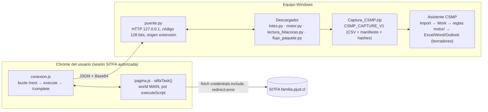
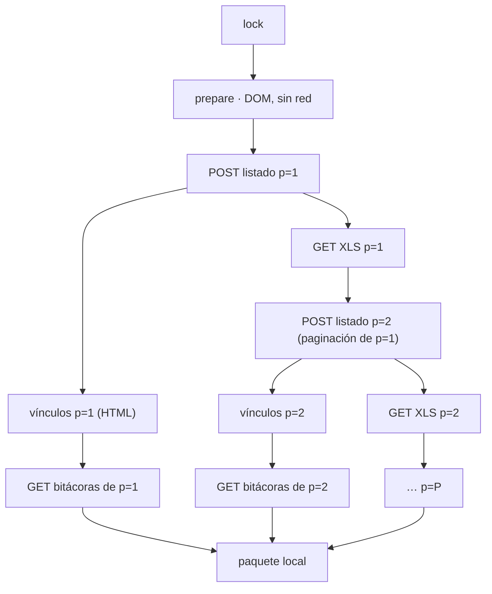
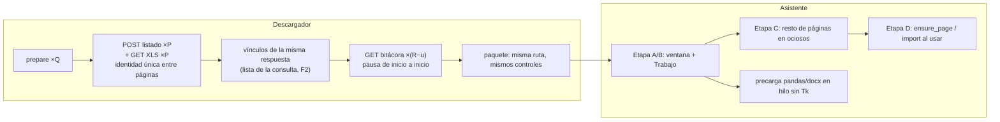

# Auditoría de arquitectura y rendimiento · Descargador SITFA, puente local y Asistente CSMP

15 de octubre de 2026 · Solo lectura: no se modificó código.
Base auditada: `feat/ejecucion-plan-20261008` en `9726448`. Ramas posteriores revisadas: `feat/historia-causa-sitfa`,
`e3/reglas-historia-20261014` (historia de causa: `history_open`, `LectorHistoria`) y `wp/anonimizador-portable-20261015`
(sin efecto sobre el flujo).

Niveles: **N1** = hecho verificado en el código o medido aquí · **N2** = inferencia con el supuesto explícito ·
**N3** = especulación o cifra ilustrativa que hay que reemplazar por una medición.

Entorno de medición: contenedor Linux, CPython 3.12.13, Tk 9.0, Xvfb, dependencias de `requirements/linux-py312.lock`,
solo datos ficticios (`nurus.capture.fixtures` y los dobles de prueba del Descargador). **No hay medición en Windows ni
en SITFA real.** Ninguna cifra de este informe certifica el puesto de referencia.

---

## 0. Respuestas cortas

**Descargador.** El protocolo ya usa HTTP directo para todo lo que trae datos (`fetch` POST de búsqueda, GET del XLS,
GET de la bitácora); lo que queda de «interfaz humana» (`prepare` sobre el formulario y `Envio()`) cuesta milisegundos
y no genera solicitudes. La redundancia real está en el flujo «Consultar y crear paquete»: **el listado se consulta dos
veces**. La secuencia mínima suficiente es, por consulta con `P` páginas y `R` filas con enlace:
`1 prepare (local) + P POST de listado + P GET de XLS + (R − u) GET de bitácora`, donde `u` son lecturas reutilizables
dentro de la ventana de vigencia aceptada. No se puede bajar de `2P` sin perder un producto (XLS) o la identidad de las
bitácoras (enlaces del HTML). Por la ley de Amdahl, el tiempo lo dominan las `R` bitácoras y su pausa, no el listado.

**Asistente.** En Linux, el tiempo hasta interfaz receptiva es mediana 1,70 s, p95 1,93 s (n = 15, sin sesión) y 1,82 s /
2,02 s con sesión recuperable de 344 filas. El 55 % es dibujar con customtkinter cinco páginas, de las que la primera
pantalla usa una; el 24 % es importar pandas, numpy y python-docx, que la primera pantalla no usa. El trabajo mínimo
antes de mostrar es: intérprete, Tk/customtkinter, configuración, ventana, barra lateral, página Trabajo y barras de
estado. **El objetivo de 3 s en Windows no se puede declarar cumplido ni descartado**: falta medir el ejecutable
distribuido en arranque frío.

---

## 1. Diagnóstico comprobado

### 1.1 Modelo del sistema



| Componente | Función (N1) | Entrada → salida | Indispensable | Repetido o eliminable | Validaciones que aseguran el resultado |
| --- | --- | --- | --- | --- | --- |
| `pagina.js` | Lee formulario, arma pares con `Envio()`/`Seleccion()`, hace `fetch` y devuelve bytes en Base64 | comando + payload → `{status,type,body,digest}` | `search`, `download`, `diary_open`, `lock/unlock`, `evidence_*` | `search` repetido en la 2.ª pasada (§2) | origen exacto, `redirect:"error"`, campos permitidos, `irAccion`, enlace `ShowObservaciones` único en el listado vigente, tope 80 MB, SHA-256 de la bitácora |
| `conexion.js` | Bucle de tareas, captura de pantalla para PDF de consulta vacía | tarea → resultado | Sí | — | código, `frameId` único, pestaña activa para la captura |
| `puente.py` | Cola de tareas con *long polling* (4 s), espera por tarea (75 s) | JSON ≤ 112 MB | Sí | — | HMAC del código, origen `chrome-extension://`, `TASK_EXPIRED` |
| `lotes.py` + `motor.run_sequence` | Pasada 1: POST(n) → XLS(n) → validar → fsync → releer → POST(n+1) | pares → XLS por página + `verificacion NNN.json` con `vinculos_ingreso` | Sí | relectura y segundo parseo del XLS ya comparado byte a byte | página = esperada, total invariable, registros XLS = HTML, sin páginas repetidas, escritura exclusiva con `fsync` |
| `lectura_bitacoras.DiaryRunner` | Pasada 2: vuelve a hacer `prepare` y POST de cada página para tener el documento vivo en la extensión, y abre cada bitácora | listado → HTML de bitácoras + `bitacoras.json` | La lectura de bitácoras sí; el re-listado no, dentro del flujo combinado | `prepare` y `search` de todas las páginas | identidad repetida en la consulta, `params` = respuesta, SHA-256, `startedAt`, advertencias visibles de identidad, `checkpoint` cada 25 |
| `flujo_paquete.run` | Orquesta pasada 1 → pasada 2 → paquete | lote → `Captura_CSMP.zip` | Sí | — | carpetas dentro de `respaldo/`, `proceso.json` por fase |
| `package_current_lot` | Relee XLS y bitácoras desde disco, cruza por tribunal/causa/ingreso, escribe y vuelve a leer el ZIP | carpetas → ZIP | Sí (también es la ruta de «Resultados › Paquete») | consolidado vía archivo temporal (costo trivial) | `match_diaries`, `read_capture` sobre el ZIP recién escrito |
| Asistente: importación | Valida ZIP (rutas, hashes, conteos, cobertura) y construye `Work` | ZIP → trabajo | Sí: es frontera de confianza entre dos programas | — | contrato v1, cobertura por identidad |
| Asistente: arranque | Construye ventana y **las cinco páginas**; si hay sesión, carga `Work` completo | — | Página Trabajo | 4 páginas y la importación de pandas/docx antes de usarlas | — |

**Decisiones funcionales (se respetan):** sesión del navegador del usuario; sin escritura RUS/SATURNO; Excel originales
por página; consolidado; bitácoras; PDF de consulta vacía; pausa hacia SITFA; separación Descargador/Asistente;
persistencia de Outlook por efecto; relectura de la exportación (EF-02b).
**Decisiones de implementación (reconsiderables):** segunda pasada de listado, pausa medida desde el fin de la respuesta,
construcción anticipada de páginas, importaciones de módulo a nivel superior.

### 1.2 Trabajo previo que no se presenta como novedad

- Búsqueda, XLS y bitácora ya son `fetch` HTTP directos desde la extensión (N1, `pagina.js`).
- WP-93 (EF-04) ya reutiliza bitácoras del mismo día y de menos de 12 h, por clave, `params` y SHA-256.
- WP-91 (EF-02) ya optimizó edición e importación; EF-02b conservó la relectura de la exportación con justificación.
- `EFICIENCIA_PRODUCTOS_20261012.md` (S1, propuesta 7) ya detectó la doble consulta del listado. **Corrección a esa
  propuesta:** sugería tomar los vínculos «de los XLS ya descargados». Los vínculos no están en el XLS: salen del
  atributo `onclick` del HTML (`vinculos.extract` sobre la tabla HTML), y la pasada 1 ya los guarda en
  `verificacion NNN.json → vinculos_ingreso` (N1, `motor.run_sequence`). El obstáculo real es otro (§2.3).

### 1.3 Cuellos de botella con evidencia

| # | Hallazgo | Evidencia | Nivel |
| --- | --- | --- | --- |
| B1 | «Consultar y crear paquete» emite `2P` POST de listado y `2Q` `prepare`. Con SITFA ficticio (8 consultas × 2 páginas, 16 filas): `search` 32, `download` 16, `diary_open` 16, `prepare` 16, `lock` 2 | `bench/conteo_paquete.py` (anexo A) sobre `flujo_paquete.run` real con el doble de prueba | N1 sintético |
| B2 | La pausa se agrega **después** de cada respuesta: intervalo efectivo por bitácora = RTT + pausa + sobrecarga del puente | `lectura_bitacoras.leer_bitacora` → `cancel.wait(self.pause)` tras `diary_open` | N1 |
| B3 | Costo local por bitácora: JSON 0,1 ms, Base64 0,16 ms, SHA-256 0,05 ms, `fsync` 0,5 ms (cuerpo de 60 KB, Linux) | micro-benchmark, anexo B | N1 Linux; Windows con antivirus: N2, mayor |
| B4 | Asistente: `App.__init__` 0,93–1,0 s. Por página: Trabajo 0,30; Configuración 0,22–0,24; Correos 0,14; Resoluciones 0,09–0,12; Resultados 0,04 | `bench/startup2.py`, cProfile: 59 524 llamadas Tcl, 555 rectángulos redondeados de customtkinter | N1 Linux |
| B5 | Importar `nurus.personal.app` carga 774 módulos y 57 extensiones nativas (42 MB): pandas 295, numpy 98, docx 94 módulos. Costo 0,37–0,41 s, de los que pandas 0,26 y docx más docxcompose 0,08 | `-X importtime`, inventario de `sys.modules` | N1 Linux |
| B6 | La recuperación de sesión carga el `Work` completo en el hilo de la interfaz: 0,05 s con 344 filas y 0,94 s con 3000 filas (sesión de 27 MB) | `bench/startup2.py` | N1 Linux |
| B7 | El acceso directo instalado (`Flow CSMP`) abre primero un selector Tk y espera un clic; luego crea una segunda raíz Tk | `tools/csmp_launcher.py`, `installer/CSMP.iss [Icons]` | N1 |

---

## 2. Descargador SITFA: secuencia mínima de intercambios

### 2.1 Protocolo efectivo reconstruido (N1, código)

| Operación | Destino | Método | Parámetros de identidad | Estado que exige | Uso de la respuesta |
| --- | --- | --- | --- | --- | --- |
| `catalog` | DOM | — | tribunales, modalidades, informes, medidas | formulario `InformesPpalForm`/`MaoPpalForm` cargado | opciones; cambia pestañas con `Lengueta()` y las restaura |
| `navigate` | `InformesViewAccion.do?TipMenuINF=89/94/91/90`, `MAOViewAccion.do?TipMenuMAO=29` | GET de navegación | pantalla | sesión | carga el formulario de la pantalla |
| `lock` | DOM | — | — | sin otro lote | captura de campos, capa de bloqueo, teclado bloqueado |
| `prepare` | DOM | — | `COD_Tribunal_sel`, `COD_Lengueta`, `TIP_Consulta`, `TIP_Informe`, fechas | funciones `Envio()`/`Seleccion()`/`cambiacheck()` de SITFA | pares del formulario; ninguna solicitud de red |
| `search` | `InformesDAction.do` / `MaoDAction.do` | POST | pares; paginación `NUM_Pagina*`/`NUM_Total*` | cookie de sesión | HTML: formulario devuelto (identidad), paginación, tabla, `ShowExcel()` con URL del XLS, `ShowObservaciones(...)` por fila |
| `download` | `/sitfa/reportes/<id>_<plantilla>.xls` | GET | plantilla en el nombre | el XLS temporal lo generó el POST anterior | XLS de **esa página** (se exige registros XLS = registros HTML) |
| `diary_open` | `IrPopUpInformesAccion.do?tipo_popUp&CRR_IdCausa&COD_Tribunal&TIP_Consulta&ID_Ingreso&COD_Etapa&FLG_MejorNinez` | GET | 7 parámetros numéricos | la extensión exige que la tupla aparezca exactamente 1 vez en el último listado | HTML de bitácora, SHA-256, `startedAt` |
| `evidence_open` + `evidence_capture` | POST nativo en `iframe` + captura | POST | pares | ventana visible | PDF de consulta vacía |
| `history_open` (rama posterior) | `Encrypt_AjaxAccion.do` → `ConsultaDetalleAtPublicoAccion.do` | 2 GET | causa | enlace `ShowHistoria` en el listado vigente | historia de causa |

Distinción exigida:

- **Exige el servidor (N1 por comportamiento observado en el código, N2 en su causa):** sesión autenticada; el XLS
  temporal pertenece al último POST («descargarlo antes de pedir otra página», `motor.py:732`); la paginación se pide
  reenviando los campos de paginación de la respuesta anterior.
- **Exige la implementación web de SITFA:** que los pares se armen con su `Envio()` (campos ocultos, `COD_Lengueta`,
  `FLG_Consulta`); que la consulta vacía se pruebe con la pantalla nativa.
- **Exige solo el Descargador:** que `diary_open` se valide contra el documento del **último** `search`
  (`run.diaryDocument`, borrado en cada `search`). Esa es la causa directa de la segunda pasada.

Sin evidencia de: API pública, parámetro de tamaño de página, endpoint de bitácoras por lote, `ETag`/`Last-Modified`,
contador total de registros en el HTML. No se proponen mecanismos que dependan de ellos.

### 2.2 Grafo de dependencias



Dependencias comprobadas (N1): `POST(n) → GET XLS(n)` antes de `POST(n+1)`; `POST(n) → vínculos(n)`;
`vínculos(n) → GET bitácora` (identidad). Dependencia **no comprobada** y decisiva: si el GET de bitácora depende del
estado de sesión del último POST de listado (hipótesis H-S1, §2.7). El flujo vigente ya ejecuta
`POST(n) → bitácoras(n) → POST(n+1)` en la pasada 2, así que esa secuencia es empíricamente válida (prueba D-04/D-05 del
13-oct, PASA).

### 2.3 Secuencia mínima suficiente

Notación: `Q` consultas, `P` páginas en total, `R` filas con enlace, `u` lecturas reutilizables, `E` consultas vacías.

| Concepto | Vigente (N1) | Mínimo suficiente | Por qué no se puede bajar más |
| --- | --- | --- | --- |
| `prepare` (local) | 2Q | Q | una por consulta para que SITFA arme los pares |
| POST de listado | 2P (+E en la 2.ª pasada) | P | solo el HTML trae paginación, identidad del formulario y vínculos |
| GET XLS | P | P | producto obligatorio y es por página |
| GET bitácora | R − u | R − u | no se conoce endpoint por lote; el contenido solo viene en el popup |
| POST de evidencia | E | E | requisito funcional del PDF de consulta vacía; además vuelve a comprobar que siga vacía |
| `lock/unlock` | 2 | 1 | — |

Dos formas de eliminar la segunda pasada:

- **F1 · fusión por página, sin tocar la extensión.** `POST(n) → XLS(n) → bitácoras(n) → POST(n+1)`. Funciona con la
  extensión 2.7.6 (el `download` no borra `diaryDocument`). Costo: el listado XLS queda repartido en minutos (lo que tarda
  leer las bitácoras) en vez de segundos, lo que amplía la ventana en que una alta o baja en SITFA desplaza filas entre
  páginas.
- **F2 · lista de vínculos de la sesión.** La pasada 1 queda igual (rápida, XLS en una ventana corta); `search` agrega
  los vínculos de cada página a una lista acotada a la consulta y al bloqueo, en vez de reemplazar el documento; luego se
  leen las bitácoras sin volver a listar. Mantiene la garantía «enlace presente exactamente una vez en un listado
  obtenido en esta sesión». Requiere modificar `pagina.js` (zona riesgosa, E3 obligatoria) y que H-S1 sea verdadera.

La lectura independiente «Leer bitácoras» (sin XLS) **sí** necesita su propio listado y no cambia.

### 2.4 Modelo de costos

`T ≈ Σ solicitudes·RTT_tipo + Σ pausas + local + recuperación`

| Fase | Vigente | F2 |
| --- | --- | --- |
| Listado y XLS | P·(RTT_POST + RTT_XLS) + (P − 1)·pausa | igual |
| Re-listado | P·RTT_POST + Q·ε | 0 |
| Bitácoras | (R − u)·(RTT_bit + pausa) | igual; o (R − u)·max(RTT_bit, pausa) con pausa medida de inicio a inicio |
| Local | < 5 ms por bitácora, < 0,4 s el paquete sintético completo | igual |

Ejemplo **N3** (cifras ilustrativas que deben reemplazarse por la medición de §2.7): R = 344, Q = 8, P = 12,
RTT_POST = 0,8 s, RTT_XLS = RTT_bit = 0,5 s, pausa = 1 s.
- Vigente ≈ 27 s (listado) + 10 s (re-listado) + 516 s (bitácoras) ≈ 9,2 min.
- F2 ahorra ≈ 10 s (≈ 2 %).
- Medir la pausa de inicio a inicio ahorra ≈ 172 s (≈ 31 %) con la misma tasa máxima de 1 solicitud por segundo.
- Una segunda corrida del mismo día con reutilización (WP-93) deja las bitácoras cerca de 0.

**Conclusión por Amdahl:** eliminar la segunda pasada vale más por integridad que por tiempo; el tiempo lo decide la
política de pausa y la reutilización.

### 2.5 Integridad y actualidad: qué es demostrable

| Garantía | Hoy (N1) | Demostrable sin ayuda del servidor | No demostrable |
| --- | --- | --- | --- |
| Cobertura | total de páginas invariable, página pedida = recibida, XLS = HTML, páginas no repetidas como conjunto | identidad tribunal/causa/ingreso única **entre páginas** en la pasada 1 (hoy solo la pasada 2 lo exige por consulta) | que no haya filas saltadas por una baja durante la paginación: no hay contador total de registros |
| Identidad | formulario devuelto = consulta, plantilla XLS = consulta, tupla `ShowObservaciones` única, `params` devueltos = pedidos | igual | — |
| Correspondencia XLS ↔ bitácora | cruce posterior por identidad (`match_diaries`); excluye bitácoras «ajenas» | con F2/F1 cada bitácora sale de un vínculo del mismo HTML que respalda el XLS | — |
| Actualidad | `startedAt` por bitácora; reutilización ≤ 12 h y mismo día | declarar en el paquete la edad máxima de lo reutilizado | que una lectura reutilizada siga vigente: SITFA no expone versión. Un hash igual solo prueba que la copia local no cambió |
| Consistencia multi-página | detecta cambio del total de páginas | relectura final de la página 1 y del total como verificación barata (+1 POST por consulta) | instantánea consistente: no existe en el protocolo |
| Recuperación | `proceso.json`, manifiestos `EN_CURSO/INCOMPLETA`, «Retomar» por clave y hash, escritura exclusiva | igual | — |

Nota sobre F1/F2: la pasada 2 vigente actúa, sin proponérselo, como segunda lectura del listado. El cruce
`match_diaries` informa las bitácoras excluidas, pero no presenta la deriva como tal. Al quitarla se pierde esa señal
implícita. Se reemplaza con la verificación de identidad única entre páginas y, si el usuario lo decide, con la relectura
final de la página 1.

### 2.6 Transporte y representación

- Página → extensión → puente: bytes → `String.fromCharCode` por bloques → `btoa` → JSON → `json.loads` →
  `b64decode`. Sobrecosto de Base64 33 %; costo medido de 0,3 ms por 60 KB (N1 Linux). **No se justifica un transporte
  binario:** ganancia < 0,1 % del ciclo por bitácora y abre superficie nueva en el puente.
- XLS: se escribe con `fsync`, se relee y se vuelve a parsear tras comprobar igualdad de bytes. El segundo parseo es
  lógicamente redundante (mismo parser y mismos bytes), pero su costo es de milisegundos. Se puede eliminar, pero no
  cambia el tiempo total.
- Paquete: el consolidado se escribe en un temporal y se vuelve a leer como bytes. Costo trivial; se conserva porque es
  la misma ruta que «Resultados».
- Puente: *long polling* de 4 s, tarea de 75 s, `fetch` de 60 s, tope de 80 MB por respuesta y 112 MB por mensaje.
  Coherente; no se proponen cambios.

### 2.7 Alternativas A/B/C

| Criterio | A · vigente optimizada | B · HTTP estructurado sin DOM | C · híbrida (navegador solo para lo que exige su contexto) |
| --- | --- | --- | --- |
| Qué cambia | F1 + pausa de inicio a inicio | además arma los pares en Python sin `Envio()` | F2 + pausa de inicio a inicio; DOM solo para `prepare` y evidencia |
| Solicitudes | P + P + (R − u) | igual | igual |
| Tiempo | −(re-listado) − (R − u)·min(RTT, pausa) | casi igual que C: `prepare` cuesta ms | igual que A |
| Integridad | XLS repartido en minutos | **riesgo**: duplica la lógica de formularios de SITFA; un cambio en su JS rompe la equivalencia en silencio | XLS en ventana corta + vínculos de la misma respuesta |
| Riesgo de zona | sin E3 de extensión | extensión y contrato | extensión → E3 |
| Veredicto | respaldo si H-S1 es falsa | **descartada**: no ahorra tiempo medible (Amdahl) y depende de reproducir la semántica no documentada de `Envio()` | **recomendada si H-S1 es verdadera** |

### 2.8 Experimento de validación (SITFA real, PC autorizado)

Instrumentación previa (cambio futuro, no hecho aquí): un contador en `puente.call` que registre por comando
`{comando, inicio, fin, bytes_respuesta, ok, código}` **sin parámetros, URL ni cuerpos**, en un JSON anónimo junto a
`diagnostico_bitacoras.json`.

| Hipótesis | Experimento mínimo | Refutación |
| --- | --- | --- |
| H-S1: el GET de bitácora no depende del último POST de listado | En un bloqueo: POST p1, POST p2, abrir bitácora de una fila de p1; comparar el SHA-256 y el parseo con la lectura hecha justo después de POST p1 | error, redirección o contenido distinto |
| H-S2: el XLS es por página y se regenera en cada POST | ya cubierto por la validación XLS = HTML; registrar los conteos | XLS con registros de otra página |
| H-S3: el HTML no trae un total de registros | `extraer_estructura_har.py` sobre un HAR local de una consulta de varias páginas; compartir solo la estructura | aparece un campo de conteo → validar cobertura por registros |
| H-S4: el listado no tiene un campo que cambie cuando una bitácora recibe una entrada | estructura del listado antes y después de registrar una entrada (solo nombres de columna y si cambiaron) | existe ese campo → reutilización condicionada entre días |
| H-S5: RTT y bytes por tipo de solicitud | contador del puente en 3 corridas del mismo alcance | — (dato base) |
| H-S6: pausa de inicio a inicio | mismo alcance, pausa 1 s, ambas variantes; mismo día y horario | tiempo de bitácoras no baja ≈ (R − u)·min(RTT, 1 s) |

Equivalencia exigida (no «similar»): mismo multiconjunto de filas XLS por consulta; mismo conjunto
tribunal/causa/ingreso; bitácora por identidad con igual SHA-256 o, si difiere, diferencia explicada por `startedAt`.
Para estimar la deriva de fondo, correr F0 → F2 → F0 seguidas. Importar los paquetes en el Asistente con la misma fecha
de corte y comparar observaciones (procedimiento de WP-93, paso 3). Registrar solicitudes, bytes, tiempo de red,
tiempo local, CPU y memoria máximas, escrituras, operaciones manuales, tiempo de recuperación tras cortar la conexión y
tiempo hasta el ZIP.

---

## 3. Asistente CSMP: arranque mínimo

### 3.1 Definición de «operativo»

Ventana principal mapeada; la barra lateral cambia de página; `Ctrl+O` abre el selector; la importación de un paquete
puede iniciarse; un `after(0)` se atiende sin espera (el hilo de Tk no está bloqueado). Medido desde fuera del proceso.

### 3.2 Línea temporal (Linux, N1, mediana de 5 corridas internas; externa n = 15)

| Etapa | Tiempo | % | Tipo |
| --- | --- | --- | --- |
| Proceso + intérprete | ≈ 0,05 s | 3 | CPU/disco |
| `customtkinter` | 0,05–0,07 s | 4 | CPU |
| pandas + numpy | 0,24–0,34 s | 18 | CPU + 53 extensiones nativas |
| resto de `nurus.personal.app` (docx, docxcompose, nurus) | 0,07–0,09 s | 5 | CPU |
| `Configuration` (existente / primera vez) | 0,003 / 0,12–0,19 s | 0–10 | disco |
| `App.__init__`: Trabajo 0,30 · Configuración 0,23 · Correos 0,14 · Resoluciones 0,10 · Resultados 0,04 · resto 0,12 | 0,93 s | 55 | CPU en Tcl (dibujo de canvas) |
| primer `update` | 0,05–0,09 s | 4 | CPU |
| Recuperar sesión (`Work.load`) | 0,05 s (344 filas) / 0,94 s (3000) | 3–35 | disco + JSON + hash |
| **Total externo** | **mediana 1,70 s · p95 1,93 s** (sin sesión); **1,82 / 2,02 s** (344 filas) | | |

En Windows faltan por medir: bootloader de PyInstaller *onedir* (`upx=False`, que es lo correcto), carga de
`python3xx.dll` y de cada `.pyd`/`.dll` con el antivirus en frío, y escalado DPI. **Hipótesis H-A1 (N2):** en frío, el
costo dominante pasa a ser la apertura de las extensiones nativas de pandas/numpy (decenas de archivos y OpenBLAS), que
el antivirus examina en la primera carga.

### 3.3 Clasificación

| Operación | Clase | Justificación |
| --- | --- | --- |
| Intérprete, `tkinter`, `customtkinter`, tema | Imprescindible | sin ellas no hay ventana |
| `Configuration` existente | Imprescindible | tema, contactos (aviso), rutas |
| Ventana, barra lateral, `PageStack`, página Trabajo, barras de contexto y estado, atajos | Imprescindible | primera pantalla y navegación |
| Páginas Correos, Resoluciones, Configuración y Resultados | Necesaria antes de esa función | no se ven al iniciar; 0,49–0,54 s medidos |
| pandas/numpy (`motor.composicion` vía `work`) | Necesaria antes de procesar o importar | ninguna operación de la primera pantalla la usa |
| python-docx/docxcompose (`resolutions` en nivel superior) | Necesaria antes de Resoluciones | ídem |
| openpyxl, win32com | Ya diferidas (N1) | imports dentro de funciones |
| `Work.load` completo al iniciar | Diferible | para ofrecer «Continuar» bastan la ruta de salida y la descripción; la carga completa puede hacerse al aceptar |
| Copia de plantillas Word | Imprescindible solo la primera vez | ya es condicional (`if not dst.exists()`) |
| Selector de aplicación (`csmp_launcher.choose_mode`) | Eliminable del camino del Asistente | ya existe `--asistente`; falta el acceso directo |

Camino crítico (Linux): intérprete → importaciones (0,40) → `App.__init__` (0,93) → primer `update` (0,07). Las
páginas no visibles y las importaciones pesadas están **en serie** en ese camino sin ser dependencias de la primera
pantalla.

### 3.4 Arquitectura de inicialización

- **Etapa A + B en el arranque:** importaciones livianas, configuración, ventana, Trabajo y barras.
- **Etapa C, una tarea por ciclo ocioso de Tk:** construir Correos, Resoluciones, Configuración y Resultados, cada una
  en un `after_idle`/`after(1)` distinto (bloques de 0,04 a 0,24 s; la interfaz atiende eventos entre bloques). Así se
  conserva el contrato actual: todas las páginas y widgets existen a ≈ 0,6 s de mostrarse la ventana.
- **Etapa D:** `PageStack.select` y todo método que use widgets de otra página llaman antes a `ensure_page(nombre)`,
  que construye la página de forma síncrona si la etapa C no llegó. Hoy hay referencias cruzadas
  (`mail_list`, `mail_courts`… en `app.py`/`app_base.py`); por eso no se propone una creación puramente perezosa.
- **Importaciones:** sacar `Work`, `resolutions` y `docx` del nivel superior de `app.py`, `app_base.py` y `ux_support.py`
  (no tocan `motor/`). Precargar pandas/docx en un hilo secundario sin widgets; el `import` normal en la función que lo
  necesita espera el *lock* de importación si la precarga no terminó, así que es correcto por construcción. Sin
  concurrencia sobre Tk.
- **Sesión:** leer solo los metadatos para la oferta de «Continuar»; `Work.load` al aceptar, con la barra de
  progreso existente (`_run`).

Descartadas: *splash* de PyInstaller (muestra una imagen, no una interfaz operativa); proceso residente (cambia la
arquitectura sin medición que lo justifique); Nuitka/compilación AOT (costo alto, beneficio no medido).

### 3.5 Presupuesto de 3 s

| Etapa | Linux medido | Linux proyectado (N2) | Windows frío |
| --- | --- | --- | --- |
| Proceso, bootloader, intérprete | 0,05 | 0,05 | **sin dato** |
| Importaciones de primera pantalla | 0,40 | ≈ 0,07 | **sin dato** (H-A1) |
| Ventana + Trabajo + barras | 0,93 | ≈ 0,42 | **sin dato** |
| Primer `update` | 0,07 | 0,07 | **sin dato** |
| Total | 1,70 (p95 1,93) | ≈ 0,6–0,7 | **meta: p95 < 3,0** |

Supuesto de la proyección: los componentes se restan sin interacción (medidos por separado). Amdahl: optimizar
`Configuration` o `_install_templates` (< 1 %) no mueve el total; páginas e importaciones (≈ 80 % del camino) sí.

### 3.6 Validación

- Medición externa en el equipo de referencia, ejecutable distribuido `CSMP_Integral.exe --asistente`: lanzar, esperar
  la ventana «CSMP Assistant» y comprobar que responde (`SendMessageTimeout WM_NULL` < 100 ms y `Ctrl+O` abre el
  diálogo). `pywinauto` ya está en dependencias de desarrollo; no requiere permisos de administrador.
- Escenarios: frío (primera ejecución tras reiniciar, n ≥ 10), caliente (n ≥ 30), primera ejecución tras instalar,
  configuración existente, sesión recuperable de 344 y de 3000 filas, configuración incompleta o contactos ausentes.
  Reportar mediana y p95 por escenario; antivirus y carga del equipo se registran, no se controlan.
- Marcas internas opcionales: `perf_counter` por etapa escritas en `%LOCALAPPDATA%` solo con una variable de entorno
  de diagnóstico.

---

## 4. Tres intervenciones prioritarias

### I1 · Pausa hacia SITFA medida de inicio a inicio (Descargador)

- **Problema:** la pausa se suma al RTT; el intervalo efectivo es RTT + pausa (B2).
- **Evidencia:** N1 en el código. Ahorro: (R − u)·min(RTT_bit, pausa), N2. El RTT es desconocido: H-S5.
- **Archivos:** `lectura_bitacoras.py` (`leer_bitacora`), `lotes.py` y `motor.run_sequence` (pausas entre páginas y
  consultas); en la rama de historia, `lectura_historia.py`.
- **Cambio:** esperar `max(0, pausa − (ahora − inicio_solicitud_anterior))`. La tasa máxima hacia SITFA queda acotada
  en 1/pausa solicitudes por segundo; concurrencia 1 sin cambios.
- **Beneficio:** el mayor ahorro de tiempo del Descargador (ejemplo N3: −31 %).
- **Complejidad:** baja. **Riesgo:** la tasa efectiva sube de 1/(RTT + pausa) a 1/max(RTT, pausa); por eso es una
  **decisión del usuario**: las pausas quedaron fuera de alcance en `EFICIENCIA_PRODUCTOS_20261012.md`. Si quiere
  conservar exactamente la carga actual, no hay ganancia.
- **Experimento:** H-S6. **Se descarta si** el tiempo de bitácoras baja menos del 10 % (RTT ≪ pausa) o si SITFA
  responde con errores o lentitud al pasar de 1/(RTT + pausa) a 1/pausa.

### I2 · Un solo listado por consulta en «Consultar y crear paquete» (Descargador)

- **Problema:** doble `prepare`, doble POST de listado y doble bloqueo (B1). Además, el XLS y las bitácoras salen de
  instantáneas distintas del listado.
- **Evidencia:** N1 en el código y conteo sintético (anexo A). La redundancia ya estaba documentada (S1); se corrige
  el mecanismo propuesto (§1.2).
- **Archivos:** `flujo_paquete.py`, `lectura_bitacoras.py` (nuevo modo «desde manifiesto de la pasada 1» que lee
  `vinculos_ingreso`), `lotes.py` (exponer los vínculos por página). Para F2, `extension/pagina.js` (`search` acumula
  vínculos, `diary_open` y `history_open` validan contra la lista de la consulta en curso). Agregar la identidad única
  entre páginas a la pasada 1.
- **Cambio:** F2 si H-S1 se cumple; F1 si no. La lectura independiente de bitácoras queda igual.
- **Beneficio:** −P POST, −Q `prepare`, −1 `lock`; correspondencia XLS ↔ bitácora por construcción; la historia
  hereda el beneficio. En tiempo es menor (N3: ≈ 2 %).
- **Complejidad:** media. **Riesgo:** F2 toca la extensión (E3, decisión j) y se pierde la segunda lectura implícita del
  listado (§2.5); se compensa con la identidad única entre páginas y la relectura final opcional.
- **Experimento:** H-S1 más la equivalencia de §2.8. **Se descarta si** H-S1 y F1 fallan, o si la equivalencia de
  paquetes no se cumple en 3 corridas.

### I3 · Arranque progresivo del Asistente y medición del ejecutable

- **Problema:** el camino crítico incluye 4 páginas no visibles y 0,33 s de importaciones no usadas (B4, B5); la sesión
  grande bloquea (B6); el acceso directo pasa por un selector (B7).
- **Archivos:** `src/nurus/personal/app_base.py`, `app.py`, `ux_support.py`, `resolutions.py` (solo la ubicación de
  los `import`), `ui.py` (`PageStack.select` → `ensure_page`), `installer/CSMP.iss` (acceso directo «CSMP Asistente»
  con `--asistente`). `motor/`, `textos_base.json`, Outlook y contratos quedan intactos.
- **Cambio:** §3.4.
- **Beneficio:** Linux 1,70 → ≈ 0,6–0,7 s (N2); en Windows frío debería pesar más si H-A1 es verdadera.
- **Complejidad:** media. **Riesgo:** referencias cruzadas entre páginas (se mitiga con `ensure_page` y la etapa C
  completa en < 1 s); pruebas de GUI que asumen las páginas al construir (correrlas con `update_idletasks` previo).
- **Experimento:** línea base en el equipo de referencia antes del cambio (§3.6); repetir con el candidato.
  **Se descarta si** el p95 en frío baja menos de 0,3 s o si alguna prueba de contrato de widgets o de paridad falla.
  **Si tras I3 el p95 en frío sigue sobre 3 s:** la causa queda acotada al bootloader o a la carga nativa (H-A1). El
  siguiente paso es medir un ejecutable sin pandas en la primera pantalla y evaluar el empaquetado. No se declara
  cumplimiento sin esa medición.

---

## 5. Arquitectura objetivo



**Cambia:** número de listados, momento de la pausa, orden de construcción de páginas, ubicación de importaciones,
carga diferida de la sesión, acceso directo.
**No cambia:** sesión del navegador, pausa mínima configurable, tope de 600 aperturas, `checkpoints`, validaciones de
identidad y cobertura, XLS por página, PDF de consulta vacía, reutilización WP-93, contrato CSMP_CAPTURE_V1,
validación del ZIP en el Asistente, relectura de la exportación (EF-02b), persistencia de Outlook por efecto, CC fijo,
`motor/`, textos y paridad golden.

---

## 6. Plan mínimo de validación y ejecución

| Orden | Paso | Depende de | Aceptación | Dónde |
| --- | --- | --- | --- | --- |
| 1 | Línea base de arranque del ejecutable distribuido (§3.6) | — | mediana y p95 por escenario | Windows de referencia |
| 2 | Contador anónimo del puente (cambio pequeño, sin parámetros) | — | JSON sin identificadores, revisado con `check_real_ids` | laboratorio + PC autorizado |
| 3 | H-S5, H-S3, H-S4 en una corrida real | 2 | RTT/bytes por tipo; estructura | PC autorizado |
| 4 | I3 (arranque progresivo) | 1 | p95 en frío < 3 s; suites PASA; paridad golden | laboratorio → Windows |
| 5 | Decisión del usuario sobre I1 | 3 | respuesta registrada en `PLAN_VIGENTE.md` | usuario |
| 6 | H-S1 | 2 | resultado registrado | PC autorizado |
| 7 | I2 (F2 o F1) con E3 | 6 | equivalencia de §2.8 en 3 corridas | laboratorio → SITFA |
| 8 | I1 si se autoriza | 5 | H-S6 | SITFA |
| 9 | Acta de uso real | 4, 7, 8 | firma del usuario | — |

En laboratorio se comprueban: conteos, equivalencia sintética, `verificar_wp.py` y paridad. Quedan pendientes del
equipo Windows y de SITFA real: tiempos, H-S1 a H-S6 y la aceptación.

---

## 7. Conclusión

- **Mantener:** HTTP directo desde la extensión, `prepare` con el JavaScript de SITFA, validaciones de identidad,
  cobertura y paginación, XLS por página, evidencia de consulta vacía, `checkpoints`, reutilización WP-93, validación
  del ZIP en ambos extremos, EF-02b, persistencia de Outlook, separación de los dos programas.
- **Modificar:** pausa de inicio a inicio (con decisión del usuario), un solo listado en el flujo combinado,
  identidad única entre páginas en la pasada 1, arranque progresivo del Asistente, sesión diferida, acceso directo con
  `--asistente`.
- **Eliminar:** segunda pasada de listado del flujo combinado; segundo parseo del XLS tras la igualdad de bytes
  (opcional, ganancia nula); construcción anticipada de páginas no visibles; importaciones de nivel superior de
  pandas/docx en la ruta de arranque.
- **Descartar:** transporte binario en el puente, armado de pares sin `Envio()`, *splash*, proceso residente y
  reescritura integral.
- **Pendiente de medición:** RTT y bytes reales por tipo (H-S5); H-S1 (independencia del popup); H-S3/H-S4
  (contador total y señal de cambio); H-S6; tiempos Windows en frío y H-A1. Sin esos datos, **no hay evidencia para
  afirmar ni negar que se alcancen los 3 s en el equipo de referencia**.

---

## Anexo A · Conteo de comandos con SITFA ficticio

`descargador/` del árbol auditado, Python 3.12, `PYTHONPATH=.:../src`, dobles de `test_lotes.FakeBridge` (pasada 1) y
`test_lectura_bitacoras.Bridge` (pasada 2), 8 consultas × 2 páginas, `pause=0`, `reuse=False`:

```json
{"lock": 2, "prepare": 16, "search": 32, "download": 16, "unlock": 2, "capabilities": 1, "diary_open": 16,
 "segundos_locales": 0.364}
```

```python
import sys, json, tempfile, threading, collections
from pathlib import Path
from csmp_shared import parser; parser()
import test_lectura_bitacoras as t, test_lotes, flujo_paquete
from lotes import Batch

class Mux:
    connected = True
    def __init__(s): s.a = test_lotes.FakeBridge(total=2); s.b = t.Bridge(); s.locks = 0; s.events = []
    def call(s, command, payload=None, timeout=75):
        s.locks += command == 'lock'
        s.events.append(command)
        return (s.a if s.locks < 2 else s.b).call(command, payload, timeout)

bridge = Mux()
batch = Batch(tuple(t.CATALOG['tribunales']), ('1', '2'), ('Espera', 'Cumplimiento'))
flujo_paquete.run(bridge, t.CATALOG, lambda *a: None, threading.Event(), batch, Path(tempfile.mkdtemp()),
                  consolidated=False, pause=0, reuse=False)
print(json.dumps(collections.Counter(bridge.events)))
```

## Anexo B · Mediciones del Asistente

- Importación: `PYTHONPATH=src python -X importtime -c "import nurus.personal.app"`.
- Por etapa y página: envolver `_work_page`, `_mail_page`, `_word_page`, `_config_page`, `results_view.build` y
  `Work.load` con `perf_counter`; sesión ficticia con `fixture(n)` → `import_capture` → `export` → `save`.
- Tiempo externo hasta receptiva: proceso hijo que construye `App`, ejecuta `after(0)` y escribe `READY`; el padre mide
  desde el lanzamiento (Xvfb). Resultados: sin sesión, mediana 1,697 s y p95 1,928 s; con 344 filas, 1,822 y 2,021 s
  (n = 15).
- Costo local por bitácora (60 KB): JSON 0,108 ms, Base64 0,156 ms, SHA-256 0,047 ms, escritura con `fsync` 0,526 ms.
