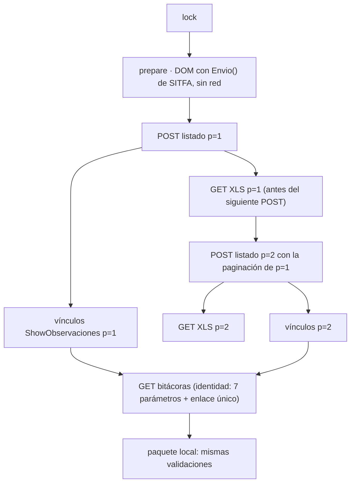

# Auditoría consolidada de arquitectura y rendimiento · FLOW / CSMP Assistant / Descargador SITFA

15 de octubre de 2026 · Base: `feat/ejecucion-plan-20261008` en `9726448af37b86cf73a87e25d087cea839fb641b`.

Este informe contrasta dos análisis:
- **Informe A:** [AUDITORIA_ARQUITECTURA_RENDIMIENTO_20261015.md](AUDITORIA_ARQUITECTURA_RENDIMIENTO_20261015.md),
  con inspección del código y mediciones en Linux con datos ficticios.
- **Informe B:** análisis de otra IA, entregado por el usuario. Es solo inspección estática: sin pruebas ni mediciones.

Para contrastarlos se agregaron evidencias nuevas en esta ronda (§2). Lo que no tiene evidencia queda marcado como
pendiente.

Niveles: **N1** = verificado en el código o medido aquí · **N2** = inferencia con el supuesto indicado ·
**N3** = especulación o cifra ilustrativa.

**Límites:** contenedor Linux con CPython 3.12.13, Tk 9.0 y Xvfb; solo datos ficticios. **No se midió nada en Windows
ni en SITFA real.** No se modificó código. Esta ronda agrega solo este documento.

---

## 1. Dictamen

1. **Primero hay que corregir la captura, después acelerarla.** El Informe B tiene razón en poner esto como condición
   previa (N1, WP-99): en la prueba del 13-oct, 36 de 40 bitácoras de Espera y 8 de Cumplimiento se leyeron sin
   entradas, aunque el HTML tenía observaciones. Desde `f363a4d` esas copias quedan como «no leídas» en vez de vacías,
   pero la causa raíz sigue abierta. Acelerar antes de resolverlo es acelerar una captura que puede perder datos.
2. **Descargador.** Ambos informes coinciden en el modelo vigente: `3P + B` solicitudes principales a SITFA, donde `P`
   son las páginas y `B` las bitácoras abiertas. La secuencia mínima suficiente dentro del protocolo verificado es
   `2P + B − u`, donde `u` son las lecturas reutilizables. Quitar el re-listado ahorra poco tiempo (N3: ≈ 2 %) y mejora
   la integridad: el XLS y las bitácoras salen del mismo listado. El tiempo lo dominan las `B` bitácoras y su pausa.
3. **Asistente.** En Linux tarda 1,70 s de mediana y 1,93 s en el p95 (N1). El 80 % del camino crítico son cuatro
   páginas que no se ven y la importación de pandas/numpy/docx. Las operaciones que el Informe B propuso medir
   (configuración y plantillas) cuestan 3 ms y 0,5 ms: no influyen. **Los 3 s en Windows siguen sin demostrarse.**
4. **Transporte Base64/JSON.** Medido: 0,3 ms por respuesta de 60 KB (N1). No es un cuello de botella. Se descarta como
   intervención prioritaria; el Informe B lo había puesto como tercera.

---

## 2. Evidencia nueva de esta ronda (N1)

| Comprobación sobre `9726448` | Resultado |
| --- | --- |
| `pytest tests` (Asistente, Xvfb) | **944 aprobadas**, 11 omitidas, 6 xfail |
| `pytest descargador` | **283 aprobadas**, 62 subpruebas |
| `node descargador/test_bitacoras_extension.cjs` | OK: GET de lectura, identidad, modalidad, pestaña, duplicados y ningún guardado RUS |
| `python tools/verificar_wp.py` | **PASA**: suites ≥ línea base, inventario sin bajas, identidades reales 0, **paridad golden válida**, restricciones absolutas, Ruff, módulos alcanzables y enlaces |

Esto responde la objeción del Informe B: la línea base de `bbf8cdd` ya no es la única evidencia, porque el commit
auditado se verificó de nuevo. La verificación es en Linux: no reemplaza Windows, Office, SITFA ni el acta.

---

## 3. Contraste punto por punto

| Tema | Informe B | Informe A | Verificación | Veredicto |
| --- | --- | --- | --- | --- |
| HTTP directo en el Descargador | Ya existe; no es una novedad | Igual | `pagina.js`: `fetch` con `credentials:"include"` y `redirect:"error"` | **Coinciden** (N1) |
| Modelo de solicitudes | `3P + B` | `2P` POST + `P` XLS + `(B − u)` | conteo sintético: 32 búsquedas, 16 XLS y 16 bitácoras con 8 consultas × 2 páginas | **Coinciden** (N1 sintético) |
| ¿`2P` es el mínimo? | «No demostrado» | Mínimo dentro del protocolo verificado: el XLS por página es un producto obligatorio; los vínculos solo están en el HTML | no se encontró parámetro de tamaño de página ni endpoint por lote; usarlos exigiría funciones de SITFA no comprobadas, que la restricción excluye | **A, con condición:** `2P` es el mínimo admisible, no el mínimo teórico absoluto |
| Causa del re-listado | Obtener vínculos y validar identidad | La extensión solo acepta `diary_open` contra el documento del **último** `search` (`run.diaryDocument`) | `pagina.js`: `search` borra y reemplaza `diaryDocument`; `download` no lo toca | **A precisa la causa** (N1) |
| Vínculos desde Excel | No sirve | No sirve; `vinculos_ingreso` ya se guarda en la pasada 1 | `motor.run_sequence` guarda `current.bindings` | **Coinciden**; ambos corrigen la propuesta 7 de EFICIENCIA_PRODUCTOS |
| ¿El re-listado aporta una garantía? | Podría ser un control de actualidad | Es una segunda lectura implícita del listado; `match_diaries` la expresa solo como «ajenas excluidas» | `export_csmp_capture.py:220-235` | **Coinciden.** Hay que reemplazarla (§5.3), no solo quitarla |
| Reutilización WP-93 | Acredita integridad, no vigencia | Igual | `lecturas_reutilizables`: ≤ 12 h, mismo día, hash | **Coinciden.** B agrega la distinción entre captura histórica y estado actual; se adopta |
| Paralelizar páginas | No | No (concurrencia 1) | el XLS temporal depende del último POST | **Coinciden** |
| Pausas hacia SITFA | «No corresponde cambiar el ritmo de consultas» | Medir la pausa de inicio a inicio, previa decisión del usuario | la pausa ya es configurable entre 0,5 y 10 s; medida desde el inicio, la tasa efectiva sube de 1/(RTT+pausa) a 1/max(RTT,pausa) | **[CONFLICTO_ABIERTO]**, decide el usuario (§5.4). Por defecto no se cambia |
| Configuración y `defaults()` en el arranque | Medir | — | `Configuration` existente: **3 ms**; primera vez: 0,12–0,19 s | **Descartado** por Amdahl |
| `_install_templates()` | Candidato a diferir | — | **0,5 ms** | **Descartado** |
| Importaciones anticipadas | Correo, resoluciones, trabajo | pandas (vía `work` → `motor.composicion`) y docx (vía `resolutions`) | `-X importtime`: pandas 0,26 s y docx + docxcompose 0,08 s; los módulos de correo pesan poco | **A precisa la causa** |
| Cinco páginas en el constructor | Candidato | Medido: Trabajo 0,30 · Configuración 0,23 · Correos 0,14 · Resoluciones 0,10 · Resultados 0,04 s | cProfile: el costo está en el dibujo de canvas de customtkinter | **Coinciden; A cuantifica** |
| `Work.load()` síncrono | Candidato | 0,05 s con 344 filas y 0,94 s con 3000 | medido | **Coinciden**: importa solo con sesiones grandes |
| Transporte Base64 | Tercera prioridad, medir primero | Descartado con medición | 0,3 ms por 60 KB, frente a ≈ 1 s de pausa por bitácora | **A**: medido y descartado |
| Lanzador | Medir `Abrir_CSMP.bat`, el ejecutable y el selector | Selector con un clic en el acceso directo instalado | `Abrir_CSMP.bat` usa la **venv de desarrollo** (`python -m nurus.personal.app`). La distribución usa `Abrir_CSMP.cmd` → `CSMP_Integral.exe --asistente`, y el acceso directo «Flow CSMP» → selector | **B mezcla el lanzador de desarrollo con el distribuido.** Se mide el distribuido |
| Muestras de arranque | 30 por escenario, frío incluido | ≥ 10 en frío y ≥ 30 en caliente | un arranque frío real exige reiniciar Windows antes de cada corrida; con n = 10, el p95 casi equivale al máximo | **Ajuste:** reportar n, mediana, p95 y máximo; el criterio de 3 s se aplica al máximo en frío si n < 20 |
| Bitácoras de Espera (WP-99) | Condición previa | Mencionada como C-01, sin ponerla como condición | `WP-99.md`: 344 registros (304 Cumplimiento y 40 Espera); 36/40 y 8 Cumplimiento sin entradas; 300 leídas, 1 fallida por el tope y 43 sin consulta | **B tiene razón**; A lo subestimó. Se adopta como condición (§4) |
| Pruebas | No ejecutadas | Solo mediciones | esta ronda: suites y `verificar_wp` PASA | **Resuelto** (§2) |

---

## 4. Condición previa: integridad de la lectura de bitácoras

**Hecho (N1).** `nurus.bitacora_html.read_snapshot` analiza con `lxml.html`, que usa el parser HTML4 de libxml2. Exige
una única `table#TablaInforme` dentro de `form[name=InformesPpalForm]` y asocia cada fila con sus ocultos `HOBS_*<id>`.
Desde `f363a4d`, si encuentra `HOBS_*` u observaciones fuera de la tabla, falla en vez de entregar una bitácora vacía.

**Hipótesis H-C1 (N2, refutable).** El HTML de las bitácoras de Espera tiene un anidamiento inválido (por ejemplo, un
`form` o un `input` entre `table` y `tr`). Chrome lo repara con el algoritmo HTML5 (*foster parenting*) y el usuario ve
las filas; libxml2 lo repara de otra forma y cierra la tabla antes. Eso calza con lo observado: el lector solo ve la
cabecera aunque la copia guardada tiene observaciones. **Supuesto:** las copias de Cumplimiento que funcionan no tienen
ese anidamiento.

**Experimento mínimo, sin datos reales:**
1. El usuario corre `descargador/extraer_estructura_bitacora.py` sobre una copia de Espera fallida y otra que funcione
   (ya pedido en WP-99).
2. Se comparan la secuencia de etiquetas y la profundidad alrededor de `TablaInforme`.
3. Se reproduce con un fixture sintético de la misma estructura. Se refuta H-C1 si lxml ve todas las filas del fixture.

**Control cruzado recomendado, por construcción y con costo casi nulo.** En `diary_open`, la extensión ya tiene la
respuesta. Puede analizarla con `DOMParser` (el parser HTML5 de Chrome, el mismo que muestra la página al usuario) y
devolver solo **conteos**: filas de `TablaInforme` y ocultos `HOBS_*`. Python compara esos conteos con los de
`read_snapshot`: si no coinciden, la lectura es **FALLIDA** con un código explícito. Ninguna bitácora con entradas puede
volver a quedar como vacía sin ser detectada. Toca la extensión, por lo que requiere E3 (decisión j). No reemplaza
corregir el lector: lo vigila.

**Criterio de salida de la condición previa:** C-01 (10 ingresos, WP-50) PASA y el diagnóstico anónimo de un lote real
registra 0 diferencias de conteo entre el navegador y el lector.

---

## 5. Descargador: secuencia mínima consolidada

### 5.1 Grafo de dependencias comprobadas (N1)



Dependencia sin comprobar y decisiva: **H-S1**. ¿El GET de bitácora depende del estado de sesión dejado por el último
POST de listado? El flujo vigente ya ejecuta `POST(n) → bitácoras(n) → POST(n+1)`, así que esa variante funciona
(pruebas D-01/D-02/D-04/D-05 del 13-oct: PASA).

### 5.2 Secuencia mínima suficiente

| Elemento | Vigente | Mínimo admisible | Qué lo impide bajar |
| --- | --- | --- | --- |
| `prepare` (local) | 2Q | Q | SITFA arma los pares con su JavaScript |
| POST de listado | 2P | P | solo el HTML trae paginación, identidad del formulario y vínculos |
| GET XLS | P | P | Excel original por página (producto obligatorio) |
| GET bitácora | B − u | B − u | sin endpoint por lote conocido |
| POST de evidencia | E | E | PDF de consulta vacía (requisito funcional) |
| Historia (ramas posteriores) | 2 por causa | 2 por causa | `Encrypt_AjaxAccion` → `ConsultaDetalleAtPublicoAccion` |

Dos variantes para quitar el re-listado. **F2 es la recomendada si H-S1 se cumple.**
- **F1 · por página** (sin tocar la extensión): `POST(n) → XLS(n) → bitácoras(n) → POST(n+1)`. Desventaja: los XLS
  quedan repartidos en minutos, con más exposición a altas y bajas en SITFA durante la paginación.
- **F2 · lista de vínculos de la consulta** (cambia la extensión, E3): la pasada 1 no cambia y `search` acumula los
  vínculos en vez de reemplazarlos. `diary_open` y `history_open` se validan contra esa lista. Mantiene el listado en
  una ventana corta y la garantía de «enlace único en un listado de esta sesión».

La lectura independiente «Leer bitácoras» sigue igual: ahí el listado es necesario.

### 5.3 Garantías: qué se conserva, qué se reemplaza y qué no es demostrable

| Garantía | Mecanismo propuesto | Demostrable |
| --- | --- | --- |
| Cobertura | total de páginas invariable + página pedida = recibida + XLS = HTML + **identidad tribunal/causa/ingreso única entre páginas en la pasada 1** (hoy solo la pasada 2 lo exige) | duplicados por corrimiento: sí. Filas saltadas por una baja: **no** sin un contador total de registros (H-S3) |
| Relectura del listado (reemplaza la señal implícita del re-listado) | opcional: volver a pedir la página 1 y el total al terminar la consulta (+1 POST) | detecta cambios visibles en la cabecera; no garantiza una instantánea |
| Identidad | 7 parámetros, enlace único, `params` devueltos, campos del formulario de la bitácora | sí |
| Entradas de bitácora | conteo HTML5 del navegador = conteo del lector (§4) | sí, por construcción |
| Actualidad | `startedAt` por bitácora; reutilización declarada; el paquete debe distinguir **captura histórica** de **lectura vigente** (aporte del Informe B) | vigencia de lo reutilizado: **no**, porque SITFA no expone versión. Un hash igual solo prueba que la copia no cambió |
| Recuperación | `proceso.json`, manifiestos de estado, «Retomar», escritura exclusiva con `fsync` | sí |

### 5.4 Modelo de costos y el conflicto sobre la pausa

`T ≈ (P_POST·RTT_POST + P·RTT_XLS + (B−u)·RTT_bit) + pausas + local`. Lo local mide < 5 ms por bitácora y 0,36 s el
paquete sintético completo (N1).

Ejemplo **N3**, con cifras ilustrativas que debe reemplazar H-S5: B = 344, Q = 8, P = 12, RTT 0,5–0,8 s, pausa 1 s.

| Variante | Tiempo | Ahorro |
| --- | --- | --- |
| Vigente | ≈ 9,2 min | — |
| Sin re-listado | ≈ 9,0 min | ≈ 2 % |
| Pausa de inicio a inicio | ≈ 6,3 min | ≈ 31 % |
| Segunda corrida del mismo día con reutilización | ≈ 1 min | ≈ 90 % |

**[CONFLICTO_ABIERTO] Pausa.** El Informe B pide no cambiar el ritmo. El Informe A propone medir la pausa desde el
inicio de la solicitud anterior, sin eliminarla. Hechos:
- La pausa ya es configurable entre 0,5 y 10 s.
- `EFICIENCIA_PRODUCTOS_20261012.md` la declaró fuera de alcance.
- El cambio sube la tasa efectiva hacia SITFA, con un tope de 1 solicitud por pausa y concurrencia 1.

Resolución: **por defecto no se cambia**. Es una decisión del usuario sobre la carga que acepta imponer a SITFA, no una
optimización técnica neutra. Si la autoriza, se mide con H-S6.

---

## 6. Asistente: arranque mínimo consolidado

### 6.1 Medición (N1, Linux, n = 15, tiempo externo hasta que un `after(0)` se atiende)

| Escenario | Mediana | p95 |
| --- | --- | --- |
| Configuración existente, sin sesión | 1,70 s | 1,93 s |
| Sesión recuperable de 344 filas | 1,82 s | 2,02 s |

Camino crítico: intérprete 0,05 → `customtkinter` 0,06 → pandas/numpy 0,26–0,34 → resto de importaciones 0,08 →
`App.__init__` 0,93 → primer `update` 0,07 s.
- 774 módulos y 57 extensiones nativas (42 MB) en el arranque.
- pandas, numpy y docx suman 487 de esos módulos, y ninguno se usa en la primera pantalla.

### 6.2 Clasificación con justificación medida

| Operación | Clase | Evidencia |
| --- | --- | --- |
| Intérprete, Tk, customtkinter, tema, `Configuration`, ventana, barra lateral, Trabajo, barras | Imprescindible | primera pantalla |
| Correos, Resoluciones, Configuración, Resultados | Necesaria antes de esa función: construir en ociosos tras mostrar la ventana y con `ensure_page` al usarla | 0,49–0,54 s; hay referencias cruzadas entre páginas, por eso no se propone una creación puramente perezosa |
| pandas/numpy, docx/docxcompose | Necesaria antes de procesar o de Resoluciones: importación diferida y precarga en un hilo sin Tk | 0,33 s en Linux; en Windows en frío probablemente más (H-A1) |
| `Work.load` completo | Diferible: la oferta de «Continuar» usa metadatos; la carga se hace al aceptar | 0,05–0,94 s |
| `Configuration`, `_install_templates`, `validate/defaults` | Mantener: costo despreciable | 3 ms / 0,5 ms |
| openpyxl, win32com | Ya diferidas | imports dentro de funciones |
| Selector en el acceso directo instalado | Agregar un acceso directo «CSMP Asistente» con `--asistente` | `installer/CSMP.iss [Icons]` |

Proyección **N2** en Linux: ≈ 0,6–0,7 s hasta interfaz receptiva. Supuesto: las partes medidas se restan sin interactuar
entre sí.

### 6.3 Factibilidad de los 3 s

**H-A1 (N2):** en Windows en frío, el ejecutable PyInstaller *onedir* (`upx=False`) pierde la mayor parte del tiempo
en abrir las extensiones nativas de pandas/numpy y OpenBLAS, que el antivirus revisa en la primera carga. Esa es la
misma parte que difiere la intervención I2.
- **Si con I2 el arranque en frío sigue sobre 3 s:** medir un ejecutable sin pandas en la ruta de arranque para separar
  el bootloader de la carga nativa. Recién ahí evaluar el empaquetado.
- **No se declara cumplimiento** sin medir en el equipo de referencia.

---

## 7. Tres intervenciones prioritarias

Orden por dependencia: la integridad condiciona la velocidad. La lectura correcta de bitácoras (WP-99) no se cuenta
como intervención: es un trabajo ya abierto en el plan y una condición previa (§4).

### I1 · Captura coordinada: un listado por consulta + control cruzado de entradas

- **Problema:** re-listado redundante (N1); XLS y bitácoras de instantáneas distintas; lectura vacía no detectada en
  Espera (N1, WP-99).
- **Archivos:** `descargador/flujo_paquete.py`, `lectura_bitacoras.py` (modo «desde la pasada 1» usando
  `vinculos_ingreso`), `lotes.py`/`motor.py` (exponer vínculos e identidad única entre páginas),
  `extension/pagina.js` (F2: lista de vínculos por consulta; conteo HTML5 de filas y `HOBS_*`).
- **Beneficio:** −P POST, −Q `prepare`, −1 `lock`; correspondencia XLS ↔ bitácora por construcción; ninguna bitácora con
  entradas queda vacía sin aviso.
- **Complejidad:** media. **Riesgo:** extensión → E3; se pierde la señal implícita del re-listado, compensada con la
  identidad única entre páginas y la relectura opcional de la página 1.
- **Experimento:** H-S1 en el PC autorizado. Luego, equivalencia en 3 corridas F0 → F2 → F0: mismo multiconjunto XLS
  por consulta, mismo conjunto de identidades, bitácoras con igual SHA-256 o diferencia explicada por `startedAt`, y las
  mismas observaciones en el Asistente con la misma fecha de corte.
- **Se descarta si** H-S1 y F1 fallan, o si la equivalencia no se cumple.

### I2 · Arranque progresivo del Asistente

- **Problema:** 4 páginas no visibles y 0,33 s de importaciones en el camino crítico; sesión grande síncrona; selector
  en el acceso directo.
- **Archivos:** `src/nurus/personal/app_base.py`, `app.py`, `ux_support.py`, `resolutions.py` (solo la ubicación de los
  `import`), `ui.py` (`ensure_page`), `installer/CSMP.iss`. `motor/`, textos, Outlook y contratos quedan intactos.
- **Beneficio:** Linux 1,70 → ≈ 0,6–0,7 s (N2). En Windows en frío, mayor si H-A1 se cumple.
- **Complejidad:** media. **Riesgo:** referencias cruzadas entre páginas y pruebas de GUI que asumen las páginas
  construidas; se mitiga con `ensure_page` y con la etapa diferida completa en < 1 s.
- **Experimento:**
  1. Línea base del ejecutable distribuido en Windows: frío n ≥ 10 tras reinicio y caliente n ≥ 30; escenarios con y
     sin sesión y con configuración incompleta.
  2. Interfaz receptiva = `SendMessageTimeout WM_NULL` < 100 ms y `Ctrl+O` operativo, con `pywinauto` y sin permisos
     de administrador.
  3. Repetir con el candidato y `verificar_wp.py` PASA.
- **Se descarta si** el arranque en frío mejora menos de 0,3 s o si falla alguna prueba de contrato o la paridad.

### I3 · Instrumentación anónima del puente (requisito de las demás decisiones)

- **Problema:** sin RTT, bytes ni tiempos por tipo de solicitud, ninguna cifra del Descargador pasa de N3. El Informe B
  pedía medir el transporte; esto lo resuelve sin rediseñarlo.
- **Archivos:** `descargador/puente.py`, que agrega un registro por `call` con `{comando, inicio, fin, bytes, ok,
  código}`, sin parámetros, URL ni cuerpos; `lectura_bitacoras.anonymous_diagnostic` lo agrega como resumen.
- **Beneficio:** convierte H-S5 y H-S6 en datos, decide el conflicto de la pausa con números y mide el arranque del
  Descargador.
- **Complejidad:** baja. **Riesgo:** filtrar datos; se mitiga con una lista blanca de campos y una prueba con
  `check_real_ids`.
- **Se descarta si** el registro no pasa la revisión de datos sensibles.

Descartadas con evidencia: transporte binario en el puente (0,3 ms por 60 KB); armar los pares sin `Envio()`;
optimizar `Configuration` o plantillas (≤ 3 ms); paralelizar páginas; *splash*; proceso residente; reescritura.

---

## 8. Plan mínimo por dependencias

| # | Paso | Requiere | Aceptación | Dónde |
| --- | --- | --- | --- | --- |
| 1 | `estructura.json` de Espera y Cumplimiento (WP-99) | usuario | archivos anónimos recibidos | PC autorizado |
| 2 | H-C1 y corrección del lector con un fixture sintético | 1 | fixture reproduce y corrige; paridad golden | laboratorio |
| 3 | I3, instrumentación anónima | — | sin identificadores; suites PASA | laboratorio |
| 4 | Línea base de arranque Windows (I2, experimento 1) | — | n, mediana, p95, máximo por escenario | Windows de referencia |
| 5 | Corrida real instrumentada: H-S1, H-S3, H-S4, H-S5 y C-01 | 2, 3 | C-01 PASA; datos de RTT y bytes | PC autorizado |
| 6 | I1 (F2 o F1) con E3 | 5 | equivalencia en 3 corridas | laboratorio → SITFA |
| 7 | I2 | 4 | frío < 3 s (criterio de §3) y `verificar_wp` PASA | laboratorio → Windows |
| 8 | Decisión sobre la pausa (conflicto §5.4) | 5 | respuesta del usuario en `PLAN_VIGENTE.md` | usuario |
| 9 | Acta de uso real | 6, 7 | firma del usuario | — |

---

## 9. Conclusión

- **Mantener:**
  - Descargador: HTTP directo con la sesión de Chrome; `prepare` con el JavaScript de SITFA; validaciones de identidad,
    paginación y XLS = HTML; XLS por página; PDF de consulta vacía; pausa vigente; concurrencia 1; tope de 600
    aperturas; reutilización WP-93 declarada como captura histórica.
  - Paquete y Asistente: contrato v1 validado en ambos extremos; EF-02b; persistencia de Outlook por efecto; separación
    entre los dos programas.
- **Modificar:**
  - Descargador: lector de bitácoras (después de H-C1); control cruzado de conteo navegador/lector; un listado por
    consulta en el flujo combinado; identidad única entre páginas; registro anónimo del puente.
  - Asistente: arranque progresivo; sesión diferida; acceso directo `--asistente`.
- **Eliminar:** re-listado del flujo combinado; construcción anticipada de páginas no visibles; importaciones de
  pandas/docx en la ruta de arranque; segundo parseo del XLS tras la igualdad de bytes (opcional, sin ganancia
  medible).
- **Descartar:** transporte binario, armado de pares sin `Envio()`, optimización de configuración y plantillas,
  paralelismo, *splash*, proceso residente y reescritura.
- **Pendiente de medición:**
  - H-C1 (causa de Espera), H-S1 (independencia del popup), H-S3 (contador total), H-S4 (señal de cambio), H-S5
    (RTT y bytes) y H-S6 (pausa).
  - H-A1 y arranque Windows en frío.
  - Decisión del usuario sobre la pausa.

---

## Anexo · Comandos de esta ronda

```sh
# Árbol auditado en un worktree aparte; venv Python 3.12 desde requirements/linux-py312.lock (+ pytest, Pillow, jsonschema, reportlab, icalendar)
xvfb-run -a python -m pytest -q tests                                          # 944 / 11 / 6 xfail
(cd descargador && PYTHONPATH=.:../src xvfb-run -a python -m pytest -q .)       # 283 + 62 subpruebas
node descargador/test_bitacoras_extension.cjs                                   # OK
xvfb-run -a python tools/verificar_wp.py --salida <scratch>/verif.json          # PASA, commit 9726448
```

Las mediciones de arranque, el conteo de comandos y el micro-benchmark del transporte están descritos en el anexo del
Informe A.
