# Manual ilustrado del Descargador SITFA

Desde una primera descarga hasta el paquete para el Asistente.

**Versión 2.7.4 · 9 de octubre de 2026**

[Descargar PDF](Manual_ilustrado_Descargador_SITFA_2.7.4.pdf) · [Abrir HTML sin conexión](Manual_ilustrado_Descargador_SITFA_2.7.4.html) · [Práctica ficticia](Practica_ficticia_Descargador_2.7.4.zip)

En HTML puedes ampliar las imágenes. El PDF tiene una página por sección.

## Índice

- 1. La ruta que vas a seguir (página 1 del PDF)
- 2. Abrir e instalar la versión correcta (página 2 del PDF)
- 3. Conectar tu Chrome con el Descargador (página 3 del PDF)
- 4. Elegir los tribunales (página 4 del PDF)
- 5. Preparar una consulta de Seguimiento (página 5 del PDF)
- 6. Consultar Informes por vencer, vencidos o recibidos (página 6 del PDF)
- 7. Descargar las hojas y comprobar el resultado (página 7 del PDF)
- 8. Leer las bitácoras: un paso adicional (página 8 del PDF)
- 9. Recuperar tus bitácoras anteriores (página 9 del PDF)
- 10. Obtener el Excel de bitácoras consolidadas (página 10 del PDF)
- 11. Juntar Cumplimiento e Informes descargados por separado (página 11 del PDF)
- 12. Crear el paquete completo para el Asistente (página 12 del PDF)
- 13. Elegir el archivo correcto e importarlo (página 13 del PDF)
- 14. Práctica sin SITFA: recuperar, consolidar y reunir (página 14 del PDF)
- 15. Primera prueba pequeña en SITFA (página 15 del PDF)
- 16. Resolver los problemas más frecuentes (página 16 del PDF)
- 17. Otras funciones y dónde encontrarlas (página 17 del PDF)

## 1. La ruta que vas a seguir

Para reunir hojas y bitácoras: conecta Chrome → descarga hojas → lee o recupera bitácoras → crea el paquete ZIP. Son acciones separadas; descargar una hoja no descarga automáticamente sus bitácoras.

| Quiero… | Debo pulsar… | Obtendré… |
| --- | --- | --- |
| Las hojas RUS | Descargar el lote completo | Excel originales y control de descarga |
| Las observaciones de los ingresos | Leer bitácoras del lote | HTML, bitacoras.json y Bitacoras_RUS.xlsx |
| Volver a usar lo que ya descargué | Resultados… | Historial y recuperación local, sin Chrome |
| Llevar todo al Asistente | Crear paquete para Asistente (ZIP)… | Captura_CSMP.zip para importar en Trabajo |

**Ten presente:** Empieza con una consulta pequeña. Si todavía no entrarás a SITFA, ve directamente a la práctica sin conexión de la página 14. Las capturas son reales de la interfaz, con datos ficticios. El marco y las fuentes pueden variar en Windows.

## 2. Abrir e instalar la versión correcta

1. Si descargaste el repositorio en ZIP: extrae todo en una carpeta nueva. Para el Asistente ejecuta Instalar_CSMP.bat; para el Descargador abre descargador/Iniciar.cmd. No ejecutes dentro del ZIP.
2. En el paquete compilado conjunto, abre Abrir_Descargador.cmd. Pulsa Instalar extensión… en el Descargador: abre Chrome y copia la ruta que debes seleccionar.
3. En chrome://extensions activa Modo de desarrollador, pulsa Cargar descomprimida y selecciona la carpeta extension de esa misma copia. Si ya estaba instalada, recarga la extensión actualizada. Comprueba versión 2.7.4.

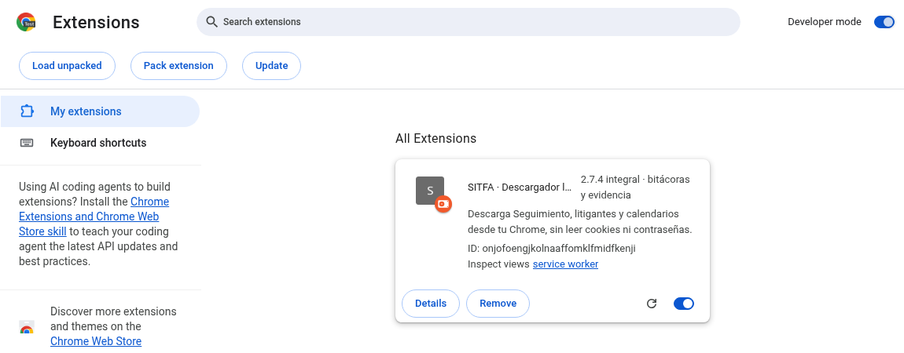

*Chrome con la extensión del paquete cargada. En inglés: Developer mode = Modo de desarrollador; Load unpacked = Cargar descomprimida. Selecciona una carpeta, no el ZIP.*

**Ten presente:** Fija SITFA · Descargador local en el menú de extensiones (icono de rompecabezas). Usa el Chrome y el perfil donde tienes tu sesión institucional.

## 3. Conectar tu Chrome con el Descargador

1. En el Descargador pulsa Abrir mi Chrome en SITFA. Inicia sesión personalmente y entra a la pantalla Seguimiento.
2. Desde esa pestaña de SITFA pulsa el icono de la extensión. En el Descargador pulsa Copiar código; pega el código en la pestaña de conexión y pulsa Conectar.
3. Vuelve al Descargador y pulsa Cargar opciones. Cuando aparezcan los tribunales y modalidades, ya puedes elegir la consulta. Mantén abiertas las dos pestañas de Chrome.

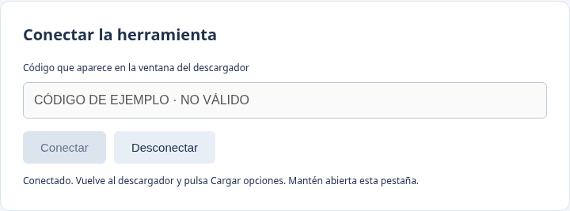

*Pestaña de conexión de la extensión. El código mostrado es ficticio y no sirve para conectarse.*

**Ten presente:** Al cerrar o desconectar el programa vence el código anterior. Cada nueva sesión usa el código que muestra el Descargador en ese momento.

## 4. Elegir los tribunales

1. Pulsa Elegir tribunales… después de Cargar opciones. Para tu primera prueba, pulsa Desmarcar todos y marca un solo tribunal que quieras consultar.
2. Pulsa Aplicar. Comprueba que su nombre aparezca en Tribunal. Después elige una sola Modalidad, por ejemplo Ambulatorio; más adelante podrás marcar varios tribunales y todas las modalidades.

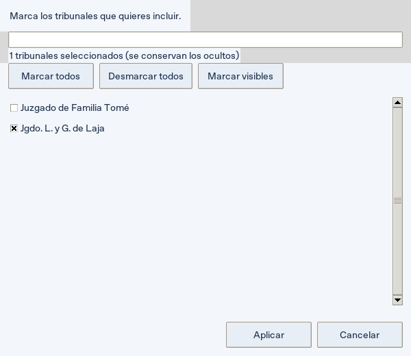

*Ejemplo con un solo tribunal marcado. Los tribunales disponibles los aporta tu sesión.*

**Ten presente:** El buscador ayuda a encontrar un tribunal. Marcar visibles afecta los resultados de esa búsqueda. Cerrar o cancelar la ventana conserva la selección anterior.

## 5. Preparar una consulta de Seguimiento

1. En Consulta deja Seguimiento. En Registros elige Espera o Cumplimiento. Espera y Cumplimiento ejecuta las dos pestañas por separado.
2. Para una primera prueba, deja Filtrar por fecha desmarcado y Conservar los otros filtros… desmarcado. Las fechas grises que ves no aplican un filtro.
3. Revisa el número de consultas al pie. Un tribunal, una modalidad y una pestaña deben mostrar 1 consultas. En Cumplimiento puedes usar Todas las medidas o el filtro específico que ofrezca SITFA.

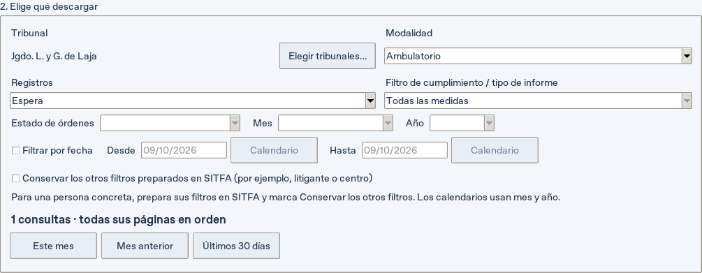

*Espera, una modalidad y un tribunal; fechas desactivadas. Cumplimiento se elige en el mismo campo Registros.*

**Ten presente:** Si necesitas un período, marca Filtrar por fecha y completa Desde/Hasta (dd/mm/aaaa). Los botones Este mes, Mes anterior y Últimos 30 días activan ese filtro. Para una persona o centro concreto, prepara sus filtros en SITFA y marca Conservar los otros filtros…

## 6. Consultar Informes por vencer, vencidos o recibidos

1. Mantén Consulta = Seguimiento y cambia Registros a Informes.
2. En Filtro de cumplimiento / tipo de informe selecciona Por vencer, Vencidos o Recibidos. El rótulo y alcance que ofrece tu sesión de SITFA son la referencia, incluido el plazo que muestre para Por vencer.
3. Descarga o lee las bitácoras de ese tipo de informe. Para otro tipo, cambia la selección y ejecuta un lote nuevo. Antes de cada acción revisa tribunal, modalidad, tipo y filtro de fechas.

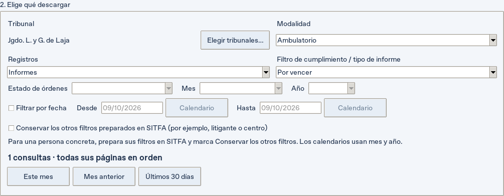

*Ejemplo de Informes → Por vencer. Vencidos y Recibidos se eligen en el mismo desplegable.*

**Ten presente:** Informes por vencer (calendario), en el campo Consulta, es otra pantalla: trabaja por Mes y Año. No confundas ese calendario con la pestaña Informes de Seguimiento. Para las bitácoras aquí descritas utiliza Seguimiento.

## 7. Descargar las hojas y comprobar el resultado

1. En Carpeta de descarga pulsa Cambiar… si quieres otro destino. Cada ejecución crea su propia subcarpeta con fecha y hora.
2. Pulsa Descargar el lote completo. Espera a que termine: recorre todas las páginas de las consultas seleccionadas. Usa Cancelar para detenerlo; Pausar / continuar pausa entre páginas.
3. Lee el mensaje final. Pulsa Abrir carpeta para ver los archivos o Resultados… para revisar el control. Conserva la carpeta completa, incluidos resumen.json y los archivos de verificación.

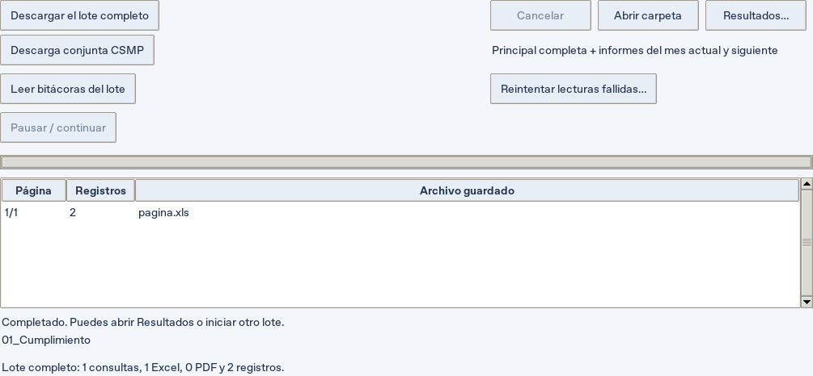

*Ejemplo ficticio: una página, dos registros. El mensaje final está debajo de la tabla; desplázate hacia abajo si no lo ves.*

**Ten presente:** VALIDADA indica descarga comprobada. SIN_RESULTADOS corresponde a una consulta vacía comprobada, con PDF de evidencia que debe mostrar tribunal, modalidad, pestaña y fechas o Sin filtro de fechas. INCOMPLETA requiere revisar el error y recuperar pendientes.

## 8. Leer las bitácoras: un paso adicional

1. Deja seleccionados el tribunal, modalidad y Registros que deseas leer. Si descargaste Cumplimiento y después cambiaste a Informes, este botón leerá Informes.
2. Pulsa Leer bitácoras del lote. Mantén Chrome conectado. El programa vuelve a consultar el listado de SITFA con la selección actual y abre las observaciones de los ingresos identificados; no lee la hoja Excel ya descargada.
3. Espera al mensaje final. Revisa lecturas verificadas, filas fallidas y consultas fallidas. Pulsa Abrir carpeta: la lectura guarda sus propios HTML, bitacoras.json, diagnóstico y Bitacoras_RUS.xlsx.

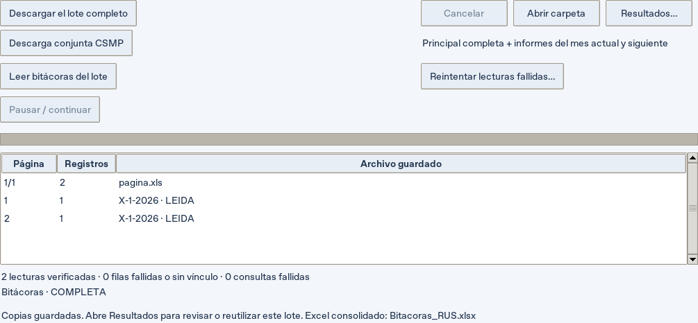

*Dos lecturas LEIDA en una consulta ficticia. Descargar las hojas y leer bitácoras pueden generar carpetas distintas.*

**Ten presente:** Disponible en Seguimiento para Espera, Cumplimiento e Informes (Por vencer, Vencidos, Recibidos). Si aparece SIN_VINCULO o FALLIDA, usa Reintentar lecturas fallidas… y selecciona la carpeta de esa lectura. Estos errores no significan que no haya observaciones.

## 9. Recuperar tus bitácoras anteriores

1. Abre Resultados… o Más opciones → Resultados e historial. Puedes hacerlo sin Chrome y sin iniciar sesión en SITFA.
2. Si el lote aparece con Tipo = Bitácoras, selecciónalo y espera a que termine la comprobación. Si no aparece, pulsa Añadir bitácoras anteriores… y abre su bitacoras.json. Puedes añadir varios controles.
3. Conserva junto al JSON todos sus HTML originales. Si moviste los archivos, añade el control desde su ubicación nueva. Un JSON aislado o una colección de HTML sin control no permite esta recuperación.

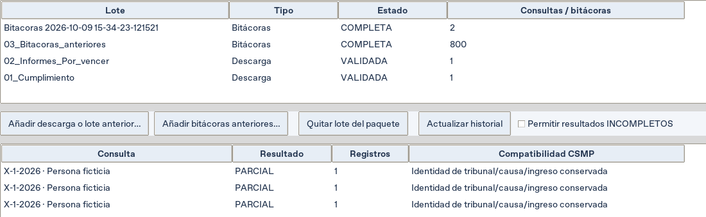

*Historial y detalle de un lote de 800 bitácoras ficticias. PARCIAL describe el alcance conservado; no equivale a fallo de lectura.*

**Ten presente:** El historial recuerda las rutas entre ejecuciones y cambios de destino. Una descarga nueva conserva los lotes anteriores. El texto Paquete indica cuántos lotes de bitácoras están disponibles para el paquete actual.

## 10. Obtener el Excel de bitácoras consolidadas

1. Tras una lectura nueva, abre su carpeta y busca Bitacoras_RUS.xlsx. Si no se generó, conserva el lote y créalo desde Resultados.
2. Para un lote anterior, selecciónalo con Tipo = Bitácoras y pulsa Excel bitácoras autónomo… Elige una ubicación y un nombre nuevo, espera a Creado: … y abre ese archivo en Excel.
3. Si quieres consolidar los lotes de bitácoras disponibles juntos, deja seleccionada una descarga de hojas y usa el mismo botón. Revisa primero qué lotes están disponibles en el resumen Paquete.

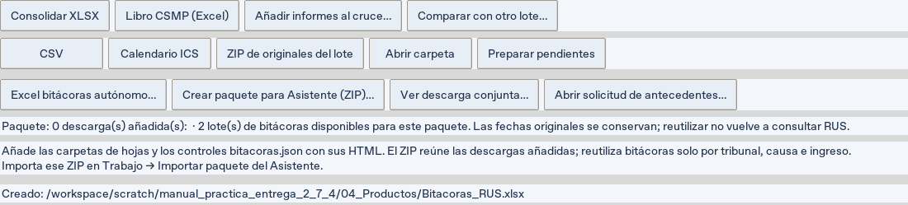

*El mensaje Creado: muestra la ruta exacta del XLSX generado; este paso no necesita Chrome.*

**Ten presente:** En Excel, Copia íntegra contiene los textos completos; Ingresos identifica los ingresos y Fuentes permite ver su procedencia. También se conservan lecturas, consultas, lote y textos extensos. Guarda otra copia antes de editar los archivos originales. Los HTML son las copias individuales; el XLSX es el consolidado.

## 11. Juntar Cumplimiento e Informes descargados por separado

1. En Resultados pulsa Añadir descarga o lote anterior… y selecciona la carpeta de Cumplimiento que contiene resumen.json y sus Excel originales. No elijas un Excel suelto.
2. Pulsa de nuevo el mismo botón y añade la carpeta de Informes. Repite para otras hojas que quieras incluir. Añade también las bitácoras anteriores si aún no están disponibles.
3. Lee la línea Paquete debajo de los botones: debe mostrar las descargas añadidas y los lotes de bitácoras disponibles. Para retirar una fuente, selecciónala y pulsa Quitar lote del paquete. Sus archivos se conservan.

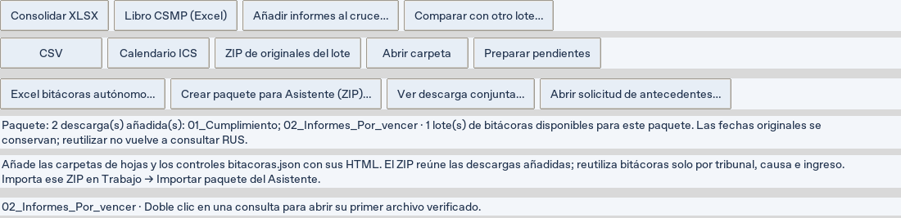

*Ejemplo: 2 descargas añadidas (Cumplimiento e Informes) y 1 lote de 800 bitácoras disponible.*

**Ten presente:** La selección del paquete se prepara en esta ventana. Antes de exportar compruébala siempre, aunque las carpetas aparezcan en el historial. No hace falta copiar y pegar hojas ni unir los Excel manualmente.

## 12. Crear el paquete completo para el Asistente

1. Con las hojas añadidas y las bitácoras disponibles, pulsa Crear paquete para Asistente (ZIP)…
2. Guarda un archivo nuevo, por ejemplo Captura_CSMP.zip. Espera a Paquete creado: y revisa las coincidencias y exclusiones que indica el mensaje.
3. El programa incorpora las bitácoras que corresponden a esas hojas por tribunal, causa e ingreso comprobados. En este ejemplo hay 800 bitácoras disponibles: 2 corresponden y 798 quedan fuera. No tienes que filtrarlas a mano.

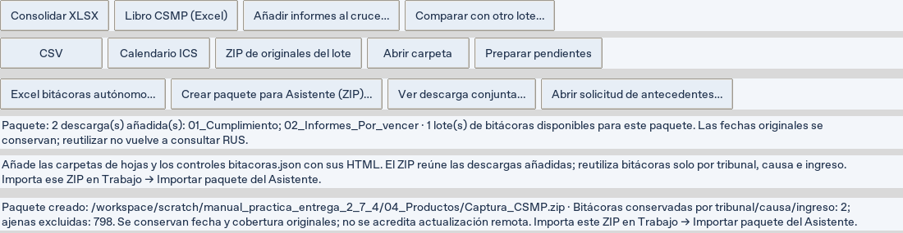

*Paquete generado por la interfaz real a partir de los lotes ficticios del ejercicio.*

**Ten presente:** Reutilizar conserva las fechas originales: no actualiza la bitácora en SITFA. Si necesitas datos recientes, haz una lectura nueva. Coincidir solo por nombre o RIT no basta; si no hay identidad comprobada, el sistema informa la incertidumbre. El ZIP contiene tablas y metadatos, no los HTML/XLS originales.

## 13. Elegir el archivo correcto e importarlo

| Botón / archivo | Para qué sirve | ¿Es el paquete de intercambio? |
| --- | --- | --- |
| Crear paquete para Asistente (ZIP)… | Reúne las hojas añadidas y sus bitácoras correspondientes | Sí: importa este ZIP en Trabajo |
| ZIP de originales del lote | Copia los originales de un lote para conservarlos | No: es otro tipo de ZIP |
| Libro CSMP (Excel) | Prepara un libro Excel del lote abierto | No: no sustituye al ZIP con bitácoras |
| Consolidar XLSX | Agrupa las hojas del lote abierto | No: es una salida Excel |
| Excel bitácoras autónomo… | Crea el consolidado de observaciones | No: es el XLSX de bitácoras |

1. Abre el Asistente CSMP de la misma entrega. En Trabajo pulsa Importar paquete y selecciona el ZIP creado con Crear paquete para Asistente (ZIP)…
2. Revisa el resumen de importación, la cobertura y las incidencias antes de preparar los productos. Que el ZIP se importe no garantiza que todas las bitácoras estén actualizadas o completas.

**Ten presente:** Si después preparas correos, el adjunto se genera automáticamente. Editar adjunto (opcional) modifica solo el correo seleccionado: no tienes que revisar y editar los 25 adjuntos para cambiar uno. Esta entrega no descarga historia judicial ni PDF por trámite.

## 14. Práctica sin SITFA: recuperar, consolidar y reunir

Abre Practica_ficticia_Descargador_2.7.4.zip, extrae todo en una carpeta nueva y usa exclusivamente esos datos para este ejercicio. No necesitas Chrome ni sesión institucional.

| Paso | Haz esto | Comprueba esto |
| --- | --- | --- |
| 1 | Abre Resultados…; añade 03_Bitacoras_anteriores/bitacoras.json | 800 ingresos recuperados |
| 2 | Con ese lote seleccionado, pulsa Excel bitácoras autónomo… | El XLSX tiene 800 ingresos; su ruta aparece en Creado: |
| 3 | Añade la carpeta 01_Cumplimiento | Una consulta VALIDADA con 2 registros |
| 4 | Añade la carpeta 02_Informes_Por_vencer | Paquete: 2 descargas añadidas |
| 5 | Pulsa Crear paquete para Asistente (ZIP)…; elige un nombre nuevo | 2 bitácoras correspondientes; 798 no correspondientes |
| 6 | En el Asistente: Trabajo → Importar paquete | 4 registros de hojas; 2 bitácoras de ingresos distintos |

**Ten presente:** El ZIP de práctica contiene únicamente dos lotes de hojas y 800 bitácoras artificiales. No uses ZIP de originales del lote para el paso 5. Si ya tienes otros lotes añadidos o bitácoras disponibles, retíralos de este paquete para reproducir los conteos del ejemplo; no se borran.

## 15. Primera prueba pequeña en SITFA

Con tu sesión autorizada, utiliza un solo tribunal y una sola modalidad. Primero completa esta prueba; después amplía el lote.

| Paso | Acción | Resultado que debes observar |
| --- | --- | --- |
| 1 | Conecta y pulsa Cargar opciones | Tribunales y modalidades disponibles |
| 2 | Seguimiento → Cumplimiento; sin fechas ni otros filtros | Vista previa de 1 consulta |
| 3 | Descargar el lote completo | Excel y control VALIDADA, o vacío comprobado con PDF contextual |
| 4 | Sin cambiar selección: Leer bitácoras del lote | Contadores y archivos de lectura; revisar fallos si los hay |
| 5 | Repite con Espera y luego Informes → Por vencer | Cada lote conserva su pestaña y tipo; revisar errores de vínculos |
| 6 | Añade carpetas y bitácoras en Resultados; crea el paquete | Resumen de fuentes, coincidencias y exclusiones |
| 7 | Importa el ZIP en el Asistente | Fuentes y cobertura coherentes con lo que consultaste |

**Ten presente:** Si una consulta está vacía, no esperes bitácoras de esa consulta. Si hay registros pero no lecturas, revisa el diagnóstico: es una incidencia, no un resultado vacío. Anota versión, pantalla, pestaña, tipo, etapa y mensaje para comunicar el problema.

## 16. Resolver los problemas más frecuentes

| Veo esto | Qué significa / qué hacer |
| --- | --- |
| Botones de descarga desactivados | Conecta la extensión, entra a la pantalla elegida y pulsa Cargar opciones. Si cambias Consulta, carga sus opciones de nuevo. |
| Solo tengo HTML de las bitácoras | Busca Bitacoras_RUS.xlsx en la carpeta de lectura. Si falta, añade bitacoras.json con sus HTML y usa Excel bitácoras autónomo… |
| Ya no veo mi descarga anterior | Abre Resultados e historial. Añade su carpeta si cambió de ubicación. No selecciones un Excel suelto ni una carpeta general que contenga varios lotes. |
| SIN_VINCULO / FALLIDA / consultas fallidas | Conserva la carpeta y el diagnóstico. Comprueba Descargador y extensión 2.7.4, pestaña y sesión. Reintenta el lote. No equivale a ausencia de observaciones. |
| INCOMPLETA o descarga cancelada | Conecta Chrome y carga las opciones de la misma pantalla. En Resultados selecciona el lote y pulsa Preparar pendientes; ejecútalos en la ventana principal. Para bitácoras usa Reintentar lecturas fallidas… Permitir resultados INCOMPLETOS exporta datos parciales con su advertencia. |
| El PDF vacío no muestra la consulta | Es una incidencia: no lo consideres evidencia suficiente. Comprueba la extensión y comunica versión, pantalla, filtros y mensaje. |
| No todas las bitácoras entran al ZIP | Revisa las exclusiones y los lotes añadidos. Solo se incluyen ingresos con tribunal/causa/ingreso comprobados; las demás bitácoras siguen en sus originales. |
| Falta un original, cambió el archivo o dos versiones entran en conflicto | Recupera la carpeta íntegra. Si hay versiones incompatibles sin fecha inequívoca, quita una del paquete. Conserva los originales y no alteres IDs o controles a mano. |

**Ten presente:** Si informas un fallo, basta empezar con versión, paso, mensaje y contadores. Conserva los datos institucionales localmente; este manual y su práctica usan solamente datos ficticios.

## 17. Otras funciones y dónde encontrarlas

| Función | Cómo usarla y qué esperar |
| --- | --- |
| Descarga conjunta CSMP | Selecciona Seguimiento y una sola principal (Espera o Cumplimiento). Pulsa el botón: reúne principal completa e informes del mes actual y siguiente en un libro. No lee automáticamente las bitácoras ni crea su ZIP de intercambio. |
| Recuperar un conjunto | En Resultados añade la carpeta con flujo.json, usa Ver descarga conjunta… o Más opciones → Retomar descarga conjunta… Para su ZIP, añade el conjunto y las bitácoras y pulsa Crear paquete para Asistente (ZIP)… |
| Medidas / Informes por vencer (calendario) | Elige la pantalla en Consulta, carga sus opciones y selecciona tribunal, Mes y Año. Son consultas mensuales; no equivalen a las pestañas de Seguimiento. |
| Seguimiento de litigantes / órdenes | Elige su pantalla, carga las opciones y selecciona Estado de órdenes. La lectura de bitácoras de este manual no acredita soporte de observaciones de órdenes. |
| Carga · resoluciones firmadas | Es una consulta independiente con período de fechas. No forma parte de la descarga conjunta actual ni acredita historia judicial completa. |
| CSV, Calendario ICS y comparar lotes | Están en Resultados. ICS necesita fechas reconocidas; comparar exige lotes con alcance compatible. No sustituyen al paquete para el Asistente. |
| Favoritos, apariencia y solicitud de antecedentes | Favoritos y apariencia están en los menús superiores. Abrir solicitud de antecedentes… muestra qué pidió el Asistente; no ejecuta consultas automáticamente. |

**Ten presente:** El camino principal que necesitas es: hojas → bitácoras nuevas o anteriores → Resultados → Crear paquete para Asistente (ZIP) → Trabajo → Importar paquete. Puedes regresar a las páginas 9–12 para repetir la parte local sin volver a descargar todo.

## Alcance y reproducción

Capturas de la interfaz 2.7.4 en escritorio de prueba y Chromium. La conexión de demostración usa respuestas locales ficticias: cero consultas institucionales. Las instrucciones se contrastaron con los botones y exportaciones de esta versión. La práctica confirma 800 ingresos en Excel y un paquete con 4 registros de hojas y 2 bitácoras correspondientes; no sustituye la aceptación en SITFA real.

Vista completa de la ventana principal (datos ficticios):

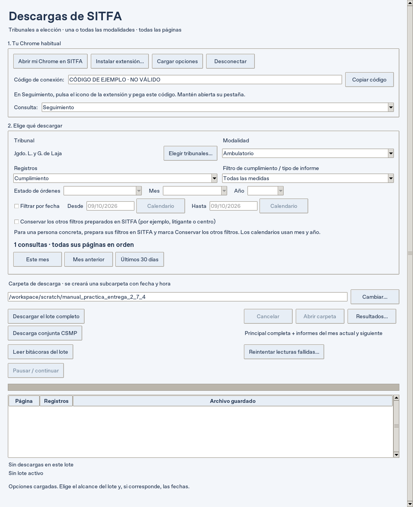

El bloque de conexión del Descargador:

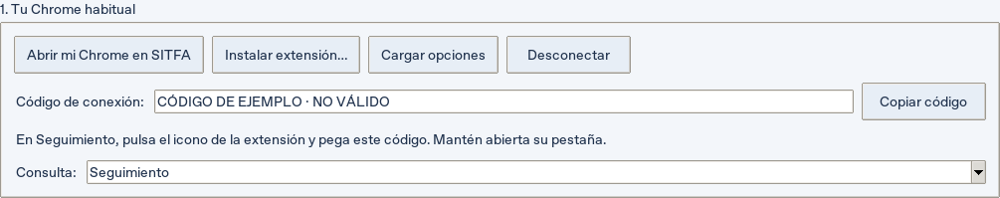

Fuentes: [manual breve](../MANUAL_DESCARGADOR_MVP_20261008.md), [README del Descargador](../../descargador/README.md) y [correcciones de esta entrega](../REGRESIONES_PRUEBAS_USUARIO_20261009.md).

Para actualizar capturas: `tools/manual_descargador_capturas.py`. Para regenerar este documento, HTML y PDF: `tools/manual_descargador_publicar.py`. El contenido editable está en `contenido.json`; los generadores requieren el entorno de desarrollo.
