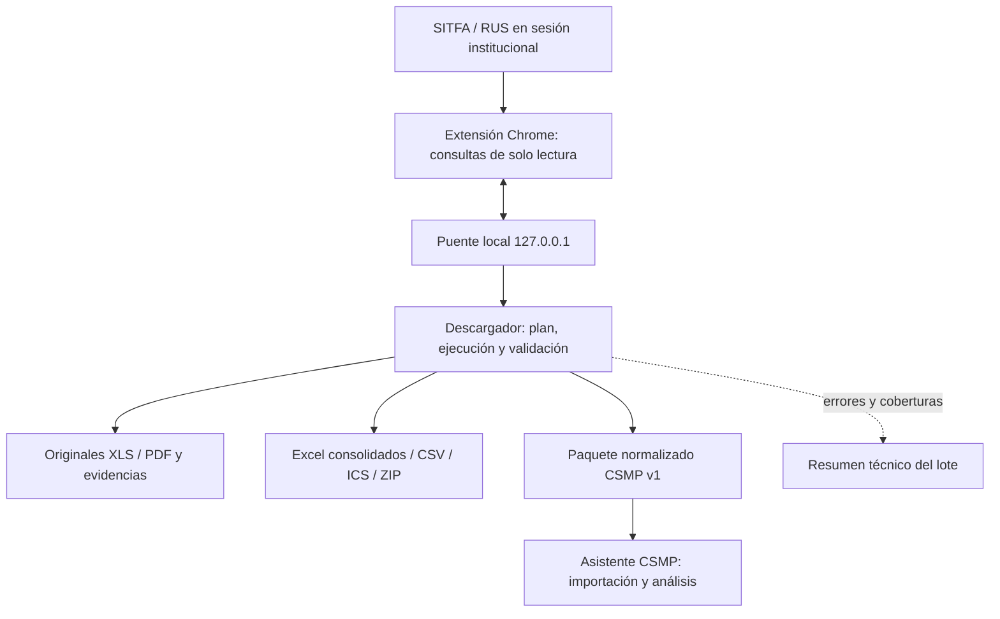

# ESPECIFICACIÓN TÉCNICA Y FUNCIONAL — DESCARGADOR RUS/SITFA

**Documento:** D-CSMP-01 · **Estado:** especificación para desarrollo, no implementación aprobada ni verificación en producción  
**Fecha:** 8 de octubre de 2026 · **Repositorio:** `MatiGaete2023/NuRus`  
**Rama auditada:** `experimento/plan-integral-csmp-20261002` · **Commit de referencia:** `fba9ffea79ef1040a7e161270398ebeaafeaf72f`  
**Aplicación examinada:** Descargador SITFA/RUS + extensión Chrome, línea integral 2.7.1.  
**Documentos complementarios:** `02_ESPECIFICACION_TECNICA_ASISTENTE_CSMP.md` y `03_REGLAS_ANALISIS_OBSERVACIONES_CSMP.md`.

> **Convenciones:** **[CÓDIGO]** verificado mediante lectura estática del repositorio; **[DOCUMENTADO]** descrito en documentación de la rama pero no certificado en sesión institucional actual; **[REQUISITO]** decisión del usuario para el rediseño; **[PENDIENTE]** funcionalidad/contrato por implementar o comprobar; **[CONFLICTO_ABIERTO]** divergencia que requiere evidencia o decisión. Ninguna prueba en GitHub acredita por sí sola aceptación en RUS real.

## 1. Objetivo y frontera de responsabilidad

El Descargador es la **única aplicación autorizada en esta arquitectura para interactuar directamente con las interfaces de consulta de SITFA/RUS**, mediante la sesión que el usuario inicia en Chrome y una extensión local con permisos limitados. Debe obtener, verificar, conservar y organizar datos y documentos recuperados; **no debe aplicar las reglas de observaciones del CSMP ni decidir acciones judiciales**.

Debe funcionar **autónomamente**, aunque el Asistente no esté instalado o abierto. Toda captura útil dará lugar a **dos familias independientes de salida**: (A) Excel originales y derivados, utilizables en otras tareas; (B) paquete de intercambio estructurado para el Asistente. El usuario podrá seleccionar las salidas necesarias; el paquete no sustituirá ni degradará los Excel. Una sola consulta validada puede alimentar ambos productos sin repetir tráfico con SITFA.

**Fuera del alcance:** enviar correos, producir observaciones, definir carga/TT/CC, generar proyectos de resolución, analizar pertinencia jurídica, escribir o registrar observaciones automáticamente en RUS, crear un historial interno de revisiones de causas y automatizar credenciales. Los datos históricos que devuelve una bitácora no son un «historial local de revisión».

### 1.1. Arquitectura objetivo



La extensión y el puente **son partes internas del Descargador**, no componentes del Asistente. La carpeta de intercambio permite ejecución desacoplada sin lanzar automáticamente otro programa.

## 2. Estado de partida confirmado en la rama

1. **[CÓDIGO]** `descargador/perfiles.py` declara pestañas `Espera`, `Cumplimiento`, `Informes`, `Egresados`; y pantallas `Seguimiento`, `Medidas por vencer (calendario)`, `Informes por vencer (calendario)`, `Seguimiento de litigantes / órdenes` y `Carga · resoluciones firmadas`. La existencia de un perfil **no garantiza aceptación real** de todas sus variantes.
2. **[CÓDIGO]** `descargador/descargador.py`, `lotes.py`, `motor.py` y `perfiles.py` permiten seleccionar tribunales, modalidad, pestaña, estado, fechas o meses, planificar un lote y ejecutar páginas secuenciales con validaciones.
3. **[CÓDIGO]** `resultados.py`/`ventana_resultados.py` implementan originales, consolidado XLSX, exportación para CSMP, CSV, ZIP, ICS, comparación de lotes y reporte de vencimientos, con comprobación de manifiestos y hashes.
4. **[CÓDIGO]** `lectura_bitacoras.py` y el comando `diary_open` de `extension/pagina.js` implementan copia por lotes de observaciones, identidad remota y HTML con SHA-256. **[DOCUMENTADO]** su aceptación en sesión real sigue pendiente; existen fallos observados en muestras anteriores.
5. **[CÓDIGO]** `vinculos.py` identifica `ShowObservaciones` y `ShowHistoria`, pero **[PENDIENTE]** no se ha confirmado un extractor completo de trámites de historia SITFA ni sus PDFs por ingreso.
6. **[CÓDIGO]** actualmente una parte de la exportación Excel de bitácoras depende del Asistente (`src/nurus/personal/bitacora_lote.py` + `bitacoras.py`). Debe pasar a estar disponible de manera autónoma en Descargador.
7. **[CÓDIGO]** `flujo_csmp.py` prepara una combinación especial de principal y calendarios; el contrato existente está diseñado para casos específicos y no es todavía el contrato universal propuesto.
8. **[DOCUMENTADO]** la rama y `main` no están consolidadas. La eventual migración debe comparar funcionalidades de ambas antes de modificar servicios compartidos.

**Fuentes primarias:** [README Descargador](https://github.com/MatiGaete2023/NuRus/blob/fba9ffea79ef1040a7e161270398ebeaafeaf72f/descargador/README.md), [perfiles.py](https://github.com/MatiGaete2023/NuRus/blob/fba9ffea79ef1040a7e161270398ebeaafeaf72f/descargador/perfiles.py), [resultados.py](https://github.com/MatiGaete2023/NuRus/blob/fba9ffea79ef1040a7e161270398ebeaafeaf72f/descargador/resultados.py), [integración del 08-10](https://github.com/MatiGaete2023/NuRus/blob/fba9ffea79ef1040a7e161270398ebeaafeaf72f/docs/INTEGRACION_COMPLETA_20261008.md).

## 3. Catálogo obligatorio de capturas

| ID | Fuente y consulta | Selección/resultado | Tratamiento y estado |
|---|---|---|---|
| D-SEG-01 | Seguimiento → Espera | Tribunal(es), modalidad(es), fechas/filtros disponibles, todas las páginas | Mantener originales y consolidaciones **[CÓDIGO]** |
| D-SEG-02 | Seguimiento → Cumplimiento | Ídem, con filtros de medidas por vencer/vencidas/todas cuando existan | Mantener **[CÓDIGO]** |
| D-SEG-03 | Seguimiento → Informes | Ídem; por vencer, vencidos, recibidos u opciones reales del catálogo | Mantener **[CÓDIGO]** |
| D-SEG-04 | Seguimiento → Egresados | Según opciones actuales del formulario | Perfil implementado; contraste real **[PENDIENTE]** |
| D-CAL-01 | Calendario de informes por vencer | Tribunal(es), mes/año; selección independiente | Mantener; distinguir vencimiento programado de envío efectivo |
| D-CAL-02 | Calendario de medidas por vencer | Tribunal(es), mes/año | Mantener; distinguir proyección y egreso real |
| D-LIT-01 | Consulta de litigantes/órdenes de búsqueda | Tribunal(es), estado, fechas y filtros nativos | Mantener; no confundir nombre de persona con nombre de centro |
| D-CAR-01 | Carga / resoluciones firmadas | Tribunal y rangos soportados por la interfaz | Preservar como consulta separada; cobertura temporal no acreditada **[PARCIAL]** |
| D-BIT-01 | Bitácora RUS | Por causa e **ingreso** enlazado, tribunal, modalidad, pestaña | Mantener y completar controles; Excel autónomo **[PENDIENTE]** |
| D-HIS-01 | Historia de causa SITFA | Trámites, descripción, fecha, tipo, referencia/folio, relación con ingreso | Reconocer vínculo actual; extractor **[PENDIENTE]** |
| D-DOC-01 | Documentos vinculados en SITFA | Metadatos, disponibilidad y, con alcance autorizado, PDF seleccionado | Descarga documental **[PENDIENTE]**, NO requisito bloqueante inicial |
| D-GEN-01 | «Informe general» mencionado por usuario | Confirmar pantalla, filtro o reporte real | **[CONFLICTO_ABIERTO]**: no aparece como pantalla independiente en `SCREENS`; levantar captura/catálogo real |

**Modalidades:** las claves del software vigente representan **Residencia, Ambulatorio, FAE y DCE**; FAS, RTA/RTT/RVA y otras etiquetas son denominaciones o subtipos que deben conservarse exactamente como devuelve cada fuente, sin inventar claves ni forzar equivalencias. «Todos los tribunales» significa **todos los visibles para la cuenta en el formulario elegido**, no acceso universal.

### 3.1. Filtros y preferencias conservados

Seleccionar uno/varios/todos los tribunales disponibles; una/varias modalidades; pestaña/consulta; tipo de informe o medida; estado de búsqueda; rango de fechas, mes y año según pantalla; búsqueda por causa/persona/centro cuando SITFA ofrezca esos campos. Mantener favoritos relativos, fechas rápidas, destino, pausa, cancelación, progreso y avisos. Validar cada selección contra el catálogo obtenido en la sesión, no contra códigos presumidos.

Por defecto, limpiar filtros extraños previos al lote. La opción **«conservar filtros preparados en SITFA»** solo funciona si la fuente permite leer y verificar dichos filtros; si no se pueden acreditar, bloquear comparación/consolidación de alcances distintos y advertirlo. No guardar RUT, nombres ni filtros privados en favoritos generales. La restauración del formulario al concluir debe informar fallas sin alterar la integridad de lo ya descargado.

## 4. Procedimiento obligatorio de ejecución

1. **Preparación:** usuario abre Chrome y se autentica personalmente; instala/carga extensión de la misma entrega y conecta mediante código temporal al puente local. No automatizar login ni acceder a cookies.
2. **Catálogo:** elegir pantalla; leer opciones realmente disponibles; registrar versión del Descargador, extensión y capacidades; comprobar formulario/URL y sesión.
3. **Plan:** transformar filtros en conjunto **explícito de consultas** por tribunal, pestaña, modalidad y período. Distinguir completa/focalizada; contar consultas esperadas; preservar la intención original.
4. **Consulta:** ejecutar secuencialmente por página, validar identidad de formulario, URL permitida, estado HTTP, página y total, parámetros de filtros y correspondencia entre pantalla y respuesta. No ejecutar JavaScript arbitrario devuelto por el servidor.
5. **Exportación original:** descargar inmediatamente el XLS temporal de la página, antes de otra consulta que pueda reemplazarlo; comprobar tipo real de archivo y concordancia con listado (filas/identidad cuando aplique); guardar sin sobrescribir.
6. **Capturas complementarias:** si el usuario lo solicita, recorrer bitácoras/historia por vínculos remotos presentes en la fila actual. Ante vínculo ambiguo, dejar incidencia; **prohibido fabricar la consulta a partir de RIT/nombre**.
7. **Control:** checkpoint por consulta y por ingreso cuando corresponda; guardar SHA-256 y estado real. Distinguir resultado vacío comprobado, parcial, fallido, no solicitado e identidad incorrecta.
8. **Productos:** producir originales + resumen, consolidaciones Excel disponibles y paquete estructurado (si se seleccionó). La producción derivada **no dispara otra consulta remota**.
9. **Cierre:** ofrecer abrir carpeta, reporte de incidencias y reintentar únicamente faltantes/fallidos. En reintento, reenumerar el listado y validar hashes e identidad antes de reutilizar copias.

**No paralelizar solicitudes a SITFA** dentro de la misma sesión: la exportación XLS remota es temporal y reutilizada. La secuencia y la comprobación de cada página son invariantes de seguridad, no una oportunidad de optimización.

## 5. Identidad, procedencia y cobertura

### 5.1. Identidades

- **Consulta:** ID de captura + pantalla + tribunal + modalidad + pestaña + filtros/fechas + página.
- **Causa:** código de tribunal + identificador real de causa (`CRR_IdCausa` cuando esté acreditado); RIT original como atributo, **no clave suficiente**.
- **Ingreso:** tribunal + causa remota + `ID_Ingreso` + etapa/modalidad cuando el contrato requiera distinguirlos.
- **Persona/programa:** identificadores remotos si existen; RUT, nombre y programa como atributos para verificación, **no identidad única por semejanza**.
- **Evento:** ID remoto de bitácora/trámite cuando exista; si no existe, fingerprint con fuente+ingreso+campos+posición verificable, marcado como identidad derivada. Nunca deduplicar eventos solo por RIT/fecha/texto similar.

**Regla de aceptación:** si los IDs remotos coinciden y solo difiere la grafía visible de RIT/nombre, aceptar con **advertencia trazable**; si la respuesta corresponde a otro ingreso, **rechazar**. No transformar una incidencia de identidad en una bitácora vacía.

### 5.2. Estados canónicos propuestos

`NO_SOLICITADA`, `EN_CURSO`, `COMPLETA`, `VACIA_COMPROBADA`, `PARCIAL`, `FALLIDA`, `CANCELADA`, `IDENTIDAD_INCIERTA`, `NO_DISPONIBLE`. Los términos reales de versiones anteriores (`VALIDADA`, `SIN_RESULTADOS`, `LEIDA`, `SIN_VINCULO`, etc.) se convertirán mediante adaptadores documentados, sin confundir lectura completa de una pantalla con cobertura histórica total.

**Cobertura espacial:** tribunales, modalidad, pestañas, filtros y páginas efectivamente leídos. **Cobertura temporal:** intervalo solicitado, intervalo efectivamente cubierto y si el endpoint garantiza historia íntegra o solo vista parcial. Una consulta sin resultados **solo acredita vacío del alcance consultado**; una causa ausente de un lote parcial no está egresada ni subsanada.

## 6. Productos entregables obligatorios

### 6.1. Producto A: salidas autónomas para el usuario

- **XLS/XLSX originales** de cada consulta y página, con formato/columnas/filas entregados por SITFA, **sin alteración**. Mantener nomenclatura legible tipo `ESP ... .xls`, `CUMP ... .xls`, `Informes ... .xls`, calendarios y litigantes.
- **PDF de consulta vacía** cuando la captura visual verificada esté disponible; evidencia de «sin resultados», nunca sustituto de un registro.
- **`Consolidado.xlsx`** derivado: hojas por familia/esquema compatible, `Resumen`, mapa de archivos, `Vencimientos`, filtros y procedencia por fila. No fusionar esquemas incompatibles ni perder filas repetidas.
- **Excel de bitácoras autónomo:** una hoja de copia íntegra de entradas, resumen por ingreso, últimas observaciones de centro (cuando se clasifiquen con certeza), `Lecturas`, `Consultas`, incidencias y fuentes. No exigir abrir CSMP para generarlo.
- **Excel de historia/trámites**, una fila por trámite de la causa con fechas, descripción, referencia, tipo, estado, origen e identificación, cuando el extractor esté validado.
- **CSV UTF-8/BOM**, delimitador `;`, por tabla/esquema para consumidores externos; cuidado con cadenas interpretables como fórmulas.
- **ICS de vencimientos** para importación local voluntaria, sin datos personales innecesarios; fechas como día completo cuando corresponda.
- **ZIP de entrega/archivo** de fuentes y productos, con hashes; nunca ocultar errores o datos faltantes.
- **Comparación de lotes** como utilidad opcional del Descargador, distinta del historial de revisión del centro: solo para alcances equiparables y con advertencia expresa de que ausencia ≠ egreso.

El usuario podrá generar los Excel sin producir un paquete para el Asistente y viceversa. No imponer una «descarga conjunta» rígida con fechas o pantallas adicionales no seleccionadas.

### 6.2. Producto B: paquete interoperable `CSMP_CAPTURE_V1`

**[PROPUESTA DE CONTRATO, NO EXISTE AÚN EN LA RAMA]**: un ZIP con `manifest.json`, tablas UTF-8 de esquema definido, fuentes originales intactas y evidencias seleccionadas. Es recomendable generar los datos normalizados desde las capturas verificadas, no parsear el XLSX consolidado como única fuente.

```text
Captura_CSMP_<id>.zip
├── manifest.json
├── data/
│   ├── consultas.csv
│   ├── registros.csv
│   ├── bitacoras.csv
│   ├── historia_tramites.csv
│   ├── documentos.csv
│   └── incidencias.csv
├── originales/          # XLS/PDF/HTML autorizados, por referencia del manifiesto
└── evidencias/          # comprobantes locales disponibles, sin secretos
```

**Manifiesto mínimo propuesto (ejemplo ficticio):**

```json
{
  "schema_id": "CSMP_CAPTURE",
  "schema_version": "1.0.0",
  "capture_id": "captura-20261008-001",
  "captured_at": "2026-10-08T15:00:00-03:00",
  "downloader": {"version": "pendiente", "commit": "pendiente"},
  "queries": [{"query_id": "q1", "source": "SITFA", "screen": "seguimiento",
    "tab": "Espera", "court_code": "CODIGO_FICTICIO", "coverage": "COMPLETA",
    "filters": {"dates_enabled": false}, "expected_pages": 2, "saved_pages": 2}],
  "files": [{"path": "data/registros.csv", "sha256": "HASH_SHA256_REAL_DEL_ARCHIVO",
    "rows": 10, "type": "normalized_table"}],
  "contains_sensitive_data": true
}
```

El ejemplo **no** constituye validación de esquema ni una muestra de datos reales. Cada archivo declarado debe tener hash hexadecimal SHA-256 auténtico, tipo, número de filas, bytes y relación con consultas/identidades. El exportador debe rechazar rutas absolutas o que escapen del ZIP, colisiones, archivos faltantes y diferencias de huella.

**Columnas comunes mínimas** en todas las tablas donde procedan: `capture_id`, `query_id`, `source_system`, `court_code`, `court_name`, `rit_original`, `cause_id`, `ingreso_id`, `person_id`, `program_id`, `modality_raw`, `modality_code`, `tab`, `event_id`, `event_at`, `captured_at`, `original_file`, `original_sheet`, `original_row`, `source_sha256`, `coverage`. Campos inaplicables serán vacíos y documentados, **nunca cero ficticio**. RIT, RUT e IDs remotos son cadenas, no números Excel.

**Tablas específicas:**

| Tabla | Unidad de fila | Columnas adicionales indispensables |
|---|---|---|
| `consultas.csv` | Consulta/pantalla y alcance | filtros verificados, páginas esperadas/guardadas, período, estado, errores, fecha |
| `registros.csv` | Registro original/ingreso | tipo Espera/Cumplimiento/Informes/Egresados, campos originales, mapeos y valores normalizados, hoja/fila |
| `bitacoras.csv` | Entrada de bitácora | tipo, autor, origen centro/otro/desconocido, texto íntegro, respuesta, fecha respuesta, identidad remota, alerta identidad |
| `historia_tramites.csv` | Trámite de SITFA | fecha, tipo, descripción, referencia/folio, identificador, estado, documento disponible, identidad causa/ingreso |
| `documentos.csv` | Referencia documental | trámite padre, referencia, PDF/URL relativa autorizada, archivo local, hash, estado descarga; no afirmar contenido leído |
| `incidencias.csv` | Incidente de captura | fase, código, consulta/ingreso afectado, severidad técnica, explicación, recuperabilidad |

**Decisiones de formato pendientes de cierre programático:** longitud máxima de campos; esquema de tipos y nulos; ordenamiento temporal; codificación de textos Excel >32.767 unidades UTF-16 (sidecars o partición explícita); versión y compatibilidad; si originales contienen información personal sensible, su inclusión en ZIP puede ser opcional bajo política institucional, manteniendo referencias verificables. **No truncar textos silenciosamente.**

## 7. Bitácoras: implementación específica

1. Reutilizar `DiaryRunner` de `lectura_bitacoras.py`, `vinculos.py`, `nurus/bitacora_html.py` y el comando de extensión `diary_open`, con validaciones vigentes de tribunal+causa+ingreso y hashes.
2. Reutilizar o extraer a un **módulo de exportación sin dependencias de UI del Asistente** la lógica `import_lote`, `read_popup` y exportación de copia íntegra; decidir si el código común queda en una biblioteca compartida instalada con ambos ejecutables o en paquete versionado. Evitar importar `personal.app` o iniciar CSMP desde Descargador.
3. Separar **captura completa de pantalla** de **ventana de análisis (hoy hasta cuatro meses)**: el archivo crudo conserva todas las entradas obtenidas; un informe filtrado no debe suprimir anteriores ni reclamar historia total.
4. Mantener estados `LEIDA`, `FALLIDA`, `SIN_VINCULO`, consulta fallida y manifiesto con entradas no reenumeradas tras recuperación. Ningún error se transforma en «0 observaciones».
5. El Excel debe registrar fecha, autor, tipo, texto completo, respuesta, identidad, origen, advertencias, cobertura, hash y ubicación de fuente; reglas de carga/CC y propuesta de observaciones quedan en el Asistente.
6. **Aceptación real bloqueante:** releer los dos ingresos previamente fallidos; contrastar tabla visible versus copia; ampliar a cuatro modalidades y pestañas; revisar casos de grafía distinta con igual ID y caso de ID distinto rechazado.

## 8. Historia SITFA y documentos: desarrollo nuevo condicionado

**[PENDIENTE]** El vínculo `ShowHistoria` identificado actualmente **no equivale a extracción histórica implementada**. Antes de programar: capturar, en sesión autorizada y sin secretos, HTML/HAR representativos del popup de información de causa e historia, encabezados de tabla, orden, paginación, links PDF y variantes por tribunal/etapa. Determinar qué existe realmente en cada pantalla.

Desarrollar `HistoriaRunner` análogo a `DiaryRunner` solo si se comprueba acceso de lectura estable: abrir mediante vínculo real de la fila, cotejar IDs, iterar trámites/páginas, conservar fecha, descripción y referencia íntegra, registrar cobertura, detectar documentos asociados sin abrirlos necesariamente. Descargar PDF **únicamente por selección explícita** y tras confirmar URL permitida, identidad, permisos, límite de tamaño/tipo e integridad. Si el PDF no se puede extraer o verificar: dejar `NO_DISPONIBLE`/`FALLIDA` sin impedir la exportación tabular válida.

**No ejecutar descargas automáticas de todos los PDFs por defecto**; tampoco afirmar que trámites, resoluciones firmadas y bitácoras sean equivalentes. La lectura externa de documentos/IA no forma parte del Descargador.

## 9. Matriz de módulos: conservación, cambio, mejora, retiro

| Ruta (relativa al repositorio) | Diagnóstico | Acción exigida |
|---|---|---|
| `descargador/descargador.py` | GUI actual y controles de consulta **[CÓDIGO]** | **CONSERVAR/MEJORAR:** UX sin perder filtros, pausa, progreso, productos independientes; retirar dependencia de configuración de ruta a CSMP |
| `descargador/perfiles.py` | Catálogo de pantallas/pestañas **[CÓDIGO]** | **CONSERVAR/AMPLIAR:** `historia` y eventual informe general, solo con contratos reales |
| `descargador/lotes.py` | Plan, filtros, transporte, secuencia **[CÓDIGO]** | **CONSERVAR:** no paralelizar; completar cobertura y recuperación |
| `descargador/motor.py` | Validación HTTP/formulario/Excel **[CÓDIGO]** | **CONSERVAR/ENDURECER:** límites, mensajes, identidad, mapeos, pruebas de cambios UI |
| `descargador/puente.py` | Código efímero y comunicación local **[CÓDIGO]** | **CONSERVAR:** comunicación autenticada local, sin credenciales persistentes |
| `descargador/extension/*` | Navegación, PDF, `diary_open` **[CÓDIGO]** | **CONSERVAR/AMPLIAR SOLO LECTURA:** `history_open` con autorización y validaciones; mantener permisos mínimos |
| `descargador/vinculos.py` | `ShowObservaciones` y `ShowHistoria` **[CÓDIGO]** | **CONSERVAR/AMPLIAR:** identidad por ingreso y vínculo de historia |
| `descargador/lectura_bitacoras.py` | Captura de entradas **[CÓDIGO]** | **CONSERVAR/CORREGIR:** aceptación real y salida autónoma |
| `descargador/resultados.py` | XLSX/CSV/ICS/ZIP/comparación **[CÓDIGO]** | **CONSERVAR/AMPLIAR:** paquete estandarizado y Excel de historia/bitácoras |
| `descargador/excel_presentacion.py` | Formato de derivados **[CÓDIGO]** | **CONSERVAR:** nunca alterar originales |
| `descargador/flujo_csmp.py` | Combinación rígida de fuentes para CSMP **[CÓDIGO]** | **REFACTORIZAR:** plan configurable y adaptador legado; no obligar fases ajenas |
| `descargador/contrato_integral.py` | Gate específico de capacidades 2.7.1 **[CÓDIGO]** | **MODIFICAR:** versionado/capacidades independientes + compatibilidad con paquetes antiguos |
| `descargador/carga.py` | Consulta de resoluciones firmadas **[CÓDIGO]** | **CONSERVAR:** declarar cobertura parcial hasta prueba de criterio temporal |
| `descargador/ventana_resultados.py` | Interfaz de resultados **[CÓDIGO]** | **CONSERVAR/MEJORAR:** opciones claramente separadas, bitácoras Excel, paquete CSMP |
| `descargador/preferencias.py`, `pausa.py`, `evidencias.py` | Preferencias, pausa, PDF **[CÓDIGO]** | **CONSERVAR**, revisar almacenamiento local y límites |
| `src/nurus/personal/bitacora_lote.py` y `bitacora_har.py` | Exportación/parseo desde CSMP **[CÓDIGO]** | **EXTRAER** funciones de parseo/exportación a componente compartido; retirar dependencia del Asistente en la exportación autónoma |
| `src/nurus/personal/bitacoras.py` | Mezcla de análisis y exportación **[CÓDIGO]** | **SEPARAR:** datos crudos y exportación al Descargador; análisis semántico en Asistente |
| `src/nurus/personal/download_link.py`, `bitacora_link.py` | CSMP lanza Descargador **[CÓDIGO]** | **DESACOPLAR** flujo principal; reemplazar por importación de paquete; mantener adaptador temporal de recuperación |
| `descargador/test_*.py`, `pruebas/*`, CI | Cobertura de regresión **[CÓDIGO]** | **CONSERVAR/AMPLIAR** pruebas por cada nuevo contrato; nunca suprimir pruebas para ocultar regresiones |

**No borrar módulos compartidos solo por su nombre.** Eliminar código únicamente después de trazar imports directos/transitivos, preservar servicios usados y pasar regresiones.

## 10. Limitaciones y prohibiciones no negociables

1. **Solo lectura** hacia SITFA/RUS. No implementar endpoint de escritura, registro masivo de observaciones, cambio de estado ni envío de formularios judiciales; `escritura_rus=false` debe mantenerse en contrato/extensión.
2. No automatizar ni almacenar usuario/contraseña, cookies, tokens o contraseñas de 2FA; sesión controlada por Chrome del usuario.
3. No realizar peticiones a hosts no verificados: ámbito institucional y `127.0.0.1`; prohibida extracción a telemetría, nubes, repositorios o IA externos sin autorización expresa institucional.
4. No inventar IDs de ingreso/cause ni completar RIT/RUT con ceros o coincidencias débiles. No mezclar NNA/ingresos de igual RIT.
5. No inferir ausencia de movimientos por fallas de consulta o ventanas de cobertura parciales; no identificar un informe como entregado solo por aparecer un trámite sin verificación.
6. No modificar los Excel originales; no sobrescribir trabajo previo; los derivados deben ser reconocibles y reproducibles.
7. No «arreglar» respuestas desconocidas omitiendo filas, fusionando fuentes incompatibles o atribuyendo consulta completa sin paginación cerrada.
8. No introducir Selenium/Playwright como dependencia obligatoria de ejecución diaria sin evaluación y autorización; Playwright aparece en pruebas de Chrome ficticio, no es requisito productivo vigente.
9. No exigir administrador en Windows 10 ni servicios/servidores externos; advertir antes si un cambio futuro los requiere. Chrome/extension, Python y bibliotecas sí son dependencias técnicas locales.
10. Custodia de datos de NNA y expedientes: carpetas autorizadas, acceso mínimo, retención institucional, no publicar muestras reales, HAR, HTML, PDFs o logs con datos identificables en GitHub.

### 10.1. Límites técnicos conocidos a preservar o revisar

- `descargador/lotes.py`: respuesta decodificada hasta ~**80 MiB**; mensajes inequívocos ante tamaño o tipo indebido.
- `descargador/resultados.py`: consolidación actual limitada a **200.000 filas** y tamaño de JSON acotado (constante `MAX_JSON=4*1024*1024`); evitar relajar sin pruebas de memoria/tiempo.
- Bitácoras: cada HTML reutilizado tiene validación de hash y límite de **8 MiB** en el código examinado; el período de análisis del Asistente llega hasta **cuatro meses**, pero las copias deben conservar íntegra la tabla descargada.
- Los XLS legados pueden ser BIFF/OOXML o, excepcionalmente, contenido HTML con extensión `.xls`; verificar la firma, no confiar en extensión.
- `descargador/requirements.txt`: `xlrd==2.0.2`, `openpyxl==3.1.5`, `lxml==6.1.3`, `tzdata>=2025.2`, `reportlab==4.4.3`, `Pillow==11.3.0`, `icalendar>=6,<7`. **No exigir Office para capturar/exportar**, Excel 2010 debe poder abrir los XLSX derivados.
- Pruebas automatizadas declaradas para Windows con Python **3.10 y 3.12**; preparar nuevas dependencias bajo matrices antes de cambiar versiones. El paquete ejecutable debe traer lo necesario para uso sin privilegios admin.

## 11. Requisitos de aceptación (criterios binarios)

| Test | Escenario | Criterio de aceptación |
|---|---|---|
| D-T01 | Solo Espera con N páginas | N originales correctos, sin duplicar GET/POST, suma de filas coherente y lote completo |
| D-T02 | Múltiples tribunales/modalidades | Todas las combinaciones seleccionadas; cero mezclas de fuentes; CSV/XLSX atribuibles por consulta |
| D-T03 | XLS vacío / página cero | PDF de evidencia si procede; estado `VACIA_COMPROBADA` y no `FALLIDA` |
| D-T04 | Formulario con filtros privados | Solo se conservan bajo opción explícita; filtros verificables y reversión con aviso |
| D-T05 | Calendario diciembre/enero | Mes/año correctos; conserva filtros de período y no confunde egreso proyectado |
| D-T06 | Egresados, informes, litigantes, carga | Contratos específicos comprobados con fixtures y captura real de muestra |
| D-T07 | Cancelación tras varias páginas | Originales previos intactos; consulta parcial visible; reintento no repite consultas completas innecesariamente |
| D-T08 | Cambio de total o página repetida | Rechazo visible sin declaración de lote validado |
| D-T09 | Identidad de bitácora | Diferencia visual inocua advertida; ingreso remoto distinto rechazado; ningún error se vuelve «vacía» |
| D-T10 | Bitácora real | Copia íntegra coincide con pantalla; resultados por ingreso; cuatro modalidades/pestañas representativas |
| D-T11 | Excel autónomo de bitácoras | Generación con **solo Descargador abierto**; hojas Lecturas/Consultas y textos íntegros |
| D-T12 | Historia SITFA | Fechas, trámites y referencias reales comparados con pantalla; paginación y cobertura documentadas |
| D-T13 | Documentos PDF seleccionados | Sin descarga no autorizada; integridad, asociación a trámite, error aislado de descarga |
| D-T14 | Excel independiente | Productos legados se generan aunque paquete CSMP no se solicite; originales y formatos preservados |
| D-T15 | Paquete normalizado | Todas las tablas/manifest `v1.0.0` pasan validador del Asistente sin editar archivos; hash íntegro |
| D-T16 | Paquete parcial / fuentes ausentes | El Asistente recibe estado explícito; no interpreta ausencia como cumplimiento ni egreso |
| D-T17 | Excel 2010 | Abre XLSX sin pérdida relevante de textos, filtros, fechas o identificadores en prueba Windows/Office cuando exista |
| D-T18 | Seguridad | Sin credenciales/logs privados; comunicación limitada; sin escritura RUS; datos ficticios en CI |
| D-T19 | Compatibilidad | Se conservan recuperaciones y exportaciones legadas previamente válidas |
| D-T20 | Empaquetado Windows | EXE, extensión y recursos comparten commit/capacidades, arranque comprobado sin admin |

**Pruebas externas:** usar Python `unittest`/fixtures existentes, Chrome for Testing con Playwright **solo en CI**, comparación real supervisada con la pantalla institucional en operación autorizada. Ningún resultado sintético reemplaza D-T09/D-T10/D-T12. Registrar evidencia de número de casos/páginas, no publicar datos personales.

## 12. Plan de cambios mínimo, secuencial y reversible

**Etapa 0 — Baseline:** congelar referencia del commit; comparar diferencias con `main`; ejecutar suites del Descargador y paquete integral; levantar inventario de nombres de archivos, hojas/columnas, opciones de UI y rutas de configuración. No refactorizar antes de esto.

**Etapa 1 — Aceptación bitácoras:** corregir si aún falla lectura de los ingresos reales anteriores; confirmar correspondencia por identidad y todos los tipos de consulta. No desarrollar historia sobre captura inestable.

**Etapa 2 — Excel autónomo de bitácoras:** extraer exportador/parseador y desacoplarlo del CSMP, manteniendo la exportación anterior como adaptador temporal. Pruebas de equivalencia byte/filas/columnas/texto.

**Etapa 3 — Contrato v1:** publicar schema, validación, exportador de paquete y pruebas de intercambio sin necesidad de automatizar historia. Mantener salidas Excel independientes.

**Etapa 4 — Historia SITFA:** obtener muestras, implementar parser por contrato verificado, captura y tabla de trámites; opcional PDF seleccionado. Una función no comprobada no debe aparecer como «disponible» en UI.

**Etapa 5 — Simplificación:** reemplazar retorno rígido CSMP/descarga conjunta por selección configurable y carpeta de intercambio; preservar perfiles, favoritos, rutas y recuperación.

**Etapa 6 — Cierre:** pruebas de regresión, empaquetado conjunto, manual de instalación, pruebas reales autorizadas y documentación de diferencias; publicar artefactos solo después de aceptación. Sin tocar código de reglas del Asistente en esta entrega.

**Orden de dependencia:** 0 → 1 → 2 → 3; la extracción de historia (4) puede comenzar tras documentar su contrato, pero no debe bloquear la entrega inicial estable 3. La limpieza final exige pruebas de compatibilidad.

## 13. Conflictos abiertos que NO puede decidir unilateralmente el programador

- **[CONFLICTO_ABIERTO] Informe general:** falta identificar el tipo de consulta, opción y archivo real. **Efecto:** catálogo incompleto. **Resolución:** captura de pantalla/opciones/ejemplo de exportación.
- **[CONFLICTO_ABIERTO] Historia SITFA y referencias a PDF:** el vínculo existe, el esquema de trámites no está acreditado. **Efecto:** no se puede programar parser fiable. **Resolución:** muestras representativas de la ventana y sus respuestas.
- **[CONFLICTO_ABIERTO] Alcance temporal de carga/resoluciones:** el código advierte que no se ha confirmado cobertura por fecha de firma. **Efecto:** falsos negativos de actuaciones. **Resolución:** comparación de consultas de períodos y firmas reales conocidas.
- **[CONFLICTO_ABIERTO] Consolidación con `main`:** ramas pueden tener mejoras exclusivas. **Efecto:** pérdidas funcionales por sustitución. **Resolución:** diff y pruebas de paridad antes de integración.
- **[CONFLICTO_ABIERTO] Política de inclusión de PDF/HTML sensible en paquetes:** **Efecto:** custodia/volumen. **Resolución:** instrucción institucional de almacenamiento y alcance.

## 14. Condición de entrega al programador y definición de terminado

No basta con «hacer que genere archivos». La entrega debe incluir: código y tests; manifiesto de cambios archivo por archivo; contratos versionados; diccionario de tablas; ejemplos **ficticios** completos y parciales; manual de instalación Windows/Chrome; ruta y estructura de salida; evidencia de comparación de Excel de antes/después; reporte de las pruebas ejecutadas y no ejecutadas; lista expresa de pendientes. **No fusionar a `main` ni habilitar escritura RUS** sin nueva orden.

La funcionalidad se considerará terminada solo cuando los Excel se generen autónomamente, el paquete sea importable por el Asistente sin conversión manual, se preserven las funciones anteriores y las fuentes nuevas acrediten su identidad/cobertura.

---

### Referencias directas del repositorio

- [`descargador/README.md`](https://github.com/MatiGaete2023/NuRus/blob/fba9ffea79ef1040a7e161270398ebeaafeaf72f/descargador/README.md)
- [`descargador/GUIA_EXPERIMENTAL.md`](https://github.com/MatiGaete2023/NuRus/blob/fba9ffea79ef1040a7e161270398ebeaafeaf72f/descargador/GUIA_EXPERIMENTAL.md)
- [`descargador/docs/PLAN_INTEGRAL_20261002.md`](https://github.com/MatiGaete2023/NuRus/blob/fba9ffea79ef1040a7e161270398ebeaafeaf72f/descargador/docs/PLAN_INTEGRAL_20261002.md)
- [`descargador/perfiles.py`](https://github.com/MatiGaete2023/NuRus/blob/fba9ffea79ef1040a7e161270398ebeaafeaf72f/descargador/perfiles.py), [`lotes.py`](https://github.com/MatiGaete2023/NuRus/blob/fba9ffea79ef1040a7e161270398ebeaafeaf72f/descargador/lotes.py), [`motor.py`](https://github.com/MatiGaete2023/NuRus/blob/fba9ffea79ef1040a7e161270398ebeaafeaf72f/descargador/motor.py)
- [`descargador/resultados.py`](https://github.com/MatiGaete2023/NuRus/blob/fba9ffea79ef1040a7e161270398ebeaafeaf72f/descargador/resultados.py), [`lectura_bitacoras.py`](https://github.com/MatiGaete2023/NuRus/blob/fba9ffea79ef1040a7e161270398ebeaafeaf72f/descargador/lectura_bitacoras.py)
- [`descargador/extension/pagina.js`](https://github.com/MatiGaete2023/NuRus/blob/fba9ffea79ef1040a7e161270398ebeaafeaf72f/descargador/extension/pagina.js), [`vinculos.py`](https://github.com/MatiGaete2023/NuRus/blob/fba9ffea79ef1040a7e161270398ebeaafeaf72f/descargador/vinculos.py)
- [`docs/INTEGRACION_COMPLETA_20261008.md`](https://github.com/MatiGaete2023/NuRus/blob/fba9ffea79ef1040a7e161270398ebeaafeaf72f/docs/INTEGRACION_COMPLETA_20261008.md)
