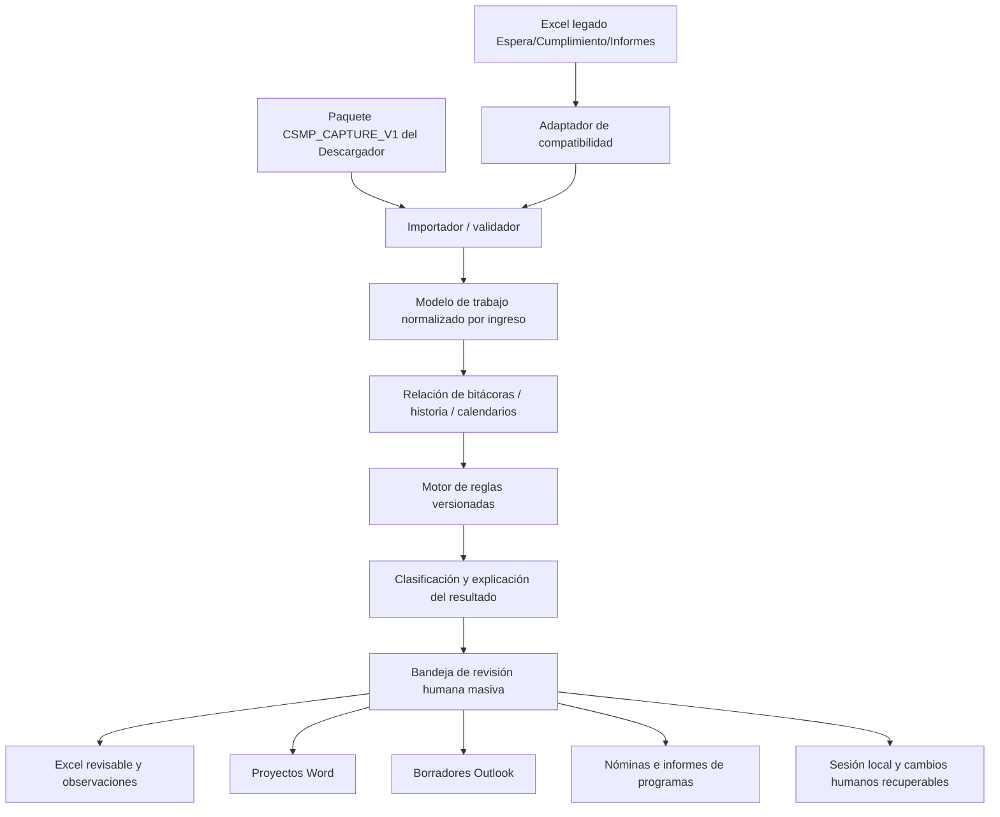

# ESPECIFICACIÓN TÉCNICA DE SOFTWARE — ASISTENTE CSMP

**Documento:** A-CSMP-01 · **Estado:** especificación ejecutable para programador; diseño, no implementación  
**Fecha:** 8 de octubre de 2026 · **Repositorio:** `MatiGaete2023/NuRus`  
**Rama auditada:** `experimento/plan-integral-csmp-20261002` · **Commit:** `fba9ffea79ef1040a7e161270398ebeaafeaf72f`  
**Aplicación de referencia:** CSMP Assistant personal 0.4.0.dev23 (Windows).  
**Documentos vinculados:** `01_ESPECIFICACION_DESCARGADOR_RUS_SITFA.md` (captura y contrato), `03_REGLAS_ANALISIS_OBSERVACIONES_CSMP.md` (motor y criterios funcionales).

> Este documento trata **arquitectura, programación, módulos, interfaces, datos, persistencia operativa, seguridad y productos**. El contenido concreto, vigencia y rediseño de reglas para formular observaciones **no se especifica aquí**: se encuentra exclusivamente en el documento A-CSMP-02. **[CÓDIGO]** = inspección estática; **[REQUISITO]** = alcance acordado; **[PENDIENTE]** = implementación/aceptación; **[CONFLICTO_ABIERTO]** = contradicción por resolver. No se ejecutaron en esta redacción los programas en un entorno RUS real.

## 1. Propósito y límite funcional

El Asistente es una **herramienta local de análisis y producción de trabajo CSMP**, no un navegador, descargador ni gestor de credenciales. Debe recibir directamente los productos normalizados del Descargador, reunir antecedentes de un mismo ingreso, presentar una revisión masiva de causas, permitir control humano y elaborar productos: Excel de observaciones, nóminas/informes a programas, proyectos de resolución Word y **borradores** de correos Outlook.

**Términos operativos acordados:** en este flujo «revisar una causa» y «formular una observación» se utilizarán como una sola actividad de trabajo, a fin de no crear dos procesos. Sin embargo, **una propuesta calculada, una observación validada y una observación efectivamente registrada en RUS no son estados intercambiables**. El Asistente prepara y revisa; el registro oficial en RUS sigue siendo manual.

**Eliminación aprobada:** no crear ni utilizar una base longitudinal de «últimas revisiones del centro» como fuente para decidir qué ocurrió en una causa. La fecha de la última observación del centro se obtendrá **desde la bitácora RUS de cobertura suficiente**, no del momento en que alguien abrió una planilla. Sí deben preservarse *sesiones y ediciones del trabajo actual*, recuperaciones, preferencias, borradores, y evidencias de creación de productos para no perder trabajo: esas funciones no equivalen al historial de revisiones descartado.

### 1.1. Componentes de arquitectura



El proceso principal debe arrancar desde **«Importar paquete»** o **«Abrir Excel legado»**, nunca exigir lanzar el Descargador. El Asistente no hace peticiones HTTP al servidor institucional, no inyecta scripts ni gestiona Chrome.

## 2. Estado real de la rama y funciones a preservar

**[CÓDIGO]** `src/nurus/personal/app.py` / `app_base.py` ejecutan el Asistente gráfico. `work.py` procesa Excel y aplica reglas; `personal/motor/reglas_{espera,cumplimiento,informes}.py` implementa reglas del CSMP; `record_view.py`, `work_view.py`, `results_view.py`, `resolution_view.py`, `mail_view.py` administran trabajo y productos; `outputs.py`, `resolutions.py`, `manual_products.py` producen Excel de nóminas, documentos y correos; `adapters/outlook.py` prepara integración Outlook. `session.py`, `sync.py`, `product_state.py` conservan/validan trabajo. Existen lectores del árbol `nurus/rus` y servicios legados `nurus/services`; **no declarar obsoletos sin mapa de imports**.

**[CÓDIGO]** el Asistente actual todavía llama al Descargador con `subprocess.Popen` desde `download_link.py` / `bitacora_link.py`, recibe respuestas especializadas y genera Excel de bitácoras desde `results_view.py`, `bitacora_lote.py`, `bitacora_har.py` y `bitacoras.py`. Eso se **desacoplará**.

**[CÓDIGO]** `personal/review_store.py` almacena marcas locales de firmas revisadas, vinculadas a `rus_activity.py` y `app.py`. La nueva instrucción es **no persistir historial de revisión**: retirar **la función longitudinal** sin romper análisis factual de firmas ni recuperación de las sesiones en curso. **[CÓDIGO]** `personal/registration.py` contiene infraestructura SQLite de registro remoto recuperable; **no equivale a un adaptador institucional de escritura validado** y se mantendrá inactiva/fuera del flujo.

**[DOCUMENTADO]** las reglas y comunicaciones tradicionales son para **Laja, Mulchén y Tomé**. La captura de bitácoras admite más tribunales según permisos. El Asistente **no debe aplicar reglas de un tribunal a otro ni inventar textos**; para otros tribunales puede mostrar antecedentes y señalar que no existe regla específica aprobada.

Referencias: [README](https://github.com/MatiGaete2023/NuRus/blob/fba9ffea79ef1040a7e161270398ebeaafeaf72f/README.md), [app.py](https://github.com/MatiGaete2023/NuRus/blob/fba9ffea79ef1040a7e161270398ebeaafeaf72f/src/nurus/personal/app.py), [work.py](https://github.com/MatiGaete2023/NuRus/blob/fba9ffea79ef1040a7e161270398ebeaafeaf72f/src/nurus/personal/work.py), [limpieza anterior](https://github.com/MatiGaete2023/NuRus/blob/fba9ffea79ef1040a7e161270398ebeaafeaf72f/docs/LIMPIEZA_ASISTENTE_20260921.md).

## 3. Responsabilidades exactas

| Debe hacer | No debe hacer |
|---|---|
| Importar paquete validado, y Excel antiguos mediante lector legado | Entrar a SITFA/RUS, abrir Chrome, manejar extensión o ejecutar descargas |
| Conservar identidad remota, original y procedencia; informar faltantes | Completar identificadores inventados, asociar por RIT+nombre ambiguo |
| Aplicar reglas, evaluar datos contextuales y ordenar incidencias | Inferir con certeza datos que no tienen cobertura acreditada |
| Mostrar revisión masiva e individual en una misma sesión | Obligar a abrir manualmente un formulario por cada fila |
| Permitir edición y decisiones humanas sin sobrescrituras inesperadas | Generar observaciones finales automáticamente sin posibilidad de revisión |
| Generar Excel, informes/nóminas, Word y borradores Outlook | Enviar correos, registrar observaciones en RUS o dictar resoluciones |
| Mantener configuración local, ediciones y sesión recuperable | Crear historial de revisiones de causas como fuente de verdad |
| Mantener importadores compatibles y lectores de contratos versionados | Exigir cambios manuales en columnas/hojas para usar un nuevo archivo |
| Identificar resultados pendientes/incompletos y pedir nuevos antecedentes | Pedir datos remotos por su cuenta o tratar faltantes como negativos |

## 4. Contratos de entrada

### 4.1. Entrada primaria: `CSMP_CAPTURE_V1`

El usuario selecciona un ZIP generado por Descargador conforme a `CSMP_CAPTURE` versión **1.0.0**. El importador debe validar **antes** de analizar: tipo, versión mayor, esquema de manifest, hashes SHA-256, ubicaciones internas seguras, límites de expansión, codificación, estructura de tablas, referencias de consulta, identidad remota, tipos de fecha y estados de cobertura. Rechazar ZIP path traversal, zip bombs, tablas duplicadas contradictorias, fórmulas maliciosas e identificadores numéricos convertidos automáticamente.

Tablas de entrada: `consultas.csv`, `registros.csv`, `bitacoras.csv`, `historia_tramites.csv`, `documentos.csv`, `incidencias.csv`. Todas pueden tener **cero filas** con cobertura explícita; las opcionales no solicitadas pueden faltar, pero el manifiesto debe distinguir `NO_SOLICITADA` de `VACIA_COMPROBADA` y `FALLIDA`. No asumir que una captura tiene todas las fuentes.

Requisitos concretos:

- **Datos originales inmutables.** Construir `SourceReference` hacia archivo/hoja/fila/hash; conservar contenido textual íntegro y valores normalizados aparte.
- **Identidad jerárquica:** tribunal+ID causa+ID ingreso cuando estén verificados; persona y programa como atributos adicionales. Si el vínculo es ambiguo, señalar **sin asociación** y no cruzar bitácora o trámite con otro ingreso.
- **Fechas:** texto ISO con zona cuando exista, `date` sin hora cuando corresponda; nunca asignar zona inventada ni inferir fecha desde la ejecución si falta.
- **Versiones:** admitir 1.x compatibles con validación; desconocida mayor o campos indispensables faltantes → rechazo explicativo sin destruir sesión previa.
- **Cobertura:** evaluar por consulta, pantalla, fuente, fecha y paginación; incluir `NO_SOLICITADA`, `FALLIDA`, `PARCIAL` y ausencia comprobada como estados diferenciados.
- **Proveniencia completa:** captura, consulta, original, hoja, fila, SHA-256, hora y advertencias. Cualquier inconsistencia debe quedar vinculada a la fila/ingreso afectado.
- **Importación atómica:** la sesión activa cambia únicamente tras validación y construcción exitosa del nuevo `Work`.

### 4.2. Entrada heredada: libros Excel

Mantener las rutas de importación actuales `read_workbook`, `personal/importing.py`, `sitfa.py` y `sync.py`: XLS, XLSX, XLSM cuando los lectores admitan su contenido, hojas `Espera`, `Cumplimiento`, `Informes`, encabezados desplazados, alias RUS y exportación que preserve fidelidad y ediciones. No confundir extensión `.xls` con tipo verdadero de contenido.

El Excel legado **no incluye automáticamente** bitácoras ni historia SITFA. Clasificar sus reglas como `SOLO_PLANILLA` o fuentes ausentes, no enriquecer desde registros de otra sesión ni crear falsos «sin actuaciones».

El importador debe poder reconocer un Excel exportado por el propio Descargador y un Excel manualmente entregado; si no se puede determinar el origen, declarar la limitación y mantener importación explícita con avisos.

### 4.3. Objeto de trabajo interno propuesto

```text
WorkBatch
  batch_id, source_package_id, schema_version, analyzed_at, policy_version
  sources[], coverage[], warnings[], issues[]
  records[]
    record_id, source_ref, remote_identity, raw_values, normalized_values
    diary_events[], history_events[], calendar_rows[], documents[]
    findings[], proposal, reason_codes[], review_class, missing_evidence[]
    human_decision, edited_text, action_selections[], product_refs[]
```

Este es un **modelo propuesto**, no la estructura Python ya implementada. Pueden conservarse `Work`, `Row` y servicios vigentes extendiéndolos con adaptadores para no duplicar estado. La clave `record_id` local no reemplaza `remote_identity`. Varios hallazgos por ingreso deben conservarse como objetos separados y componerse en una observación textual revisable.

## 5. Pipeline de programación obligatorio

1. **Leer y validar.** Abrir paquete; validar inventario de fuentes; no cargar toda la UI si hay error estructural.
2. **Normalizar.** Convertir alias/fechas/identificadores con mapeo versionado, conservando valor original. Resolver filas repetidas legítimas sin suprimir multiplicidad.
3. **Relacionar.** Asociar por tribunal+causa+ingreso; registrar relaciones parciales explícitas. Calendario masivo puede no tener ID ingreso: usar correspondencia completa validada o marcar `NO_ASOCIADO`.
4. **Ordenar eventos.** Normalizar bitácora e historia por fecha/hora conocida, con fuente y tipo; entradas empatadas se conservan, no se inventa orden. Diferenciar «última observación del centro» de «último trámite SITFA».
5. **Evaluar.** Invocar motor de reglas (definido en A-CSMP-02), con `as_of`, datos y cobertura; obtener hallazgos estructurados y propuestas no definitivas.
6. **Clasificar.** Marcar exhaustiva, focalizada, ordinaria, sin incidencia detectada o no evaluable según reglas funcionales y completitud. Mostrar explicación y faltantes.
7. **Presentar.** Bandeja masiva con filtros y detalle por fila; el usuario valida, corrige, difiere o descarta dentro de una misma sesión.
8. **Materializar.** Generar productos desde el **snapshot de decisiones** vigente; comprobar huellas para evitar adjuntos/proyectos obsoletos.
9. **Guardar sesión.** Conservar origen, decisiones, cambios, plantillas y productos de ese trabajo; no escribir historial longitudinal automático de las causas.

**Interfaz programática sugerida (ilustrativa):**

```python
from dataclasses import dataclass
from pathlib import Path

@dataclass(frozen=True)
class AnalysisRequest:
    package_path: Path
    as_of: str             # fecha de corte explícita
    ruleset_version: str

# La API real debe validar y devolver un resultado inmutable de análisis.
def analyze_package(request: AnalysisRequest):
    package = validate_capture_package(request.package_path)
    records = associate_sources(package)
    return evaluate_records(records, as_of=request.as_of,
                            ruleset_version=request.ruleset_version)
```

No se pretende que el fragmento sea ejecutable por sí solo: describe separación de responsabilidades y se acompaña con pruebas de contrato.

## 6. Interfaz: revisión masiva por defecto

### 6.1. Pantallas que deben permanecer

- **Trabajo/Bandeja:** tabla principal por ingreso con RIT, persona, tribunal, programa, modalidad, etapa, observación propuesta, clase de revisión, incidencias, cobertura, selección y estado humano. Columnas ordenables y filtros por tribunal/programa/modalidad/regla/alerta; filtros **no deben borrar** registros ocultos.
- **Detalle de causa:** relación de bitácoras e historia y referencias; último evento del centro y trámites posteriores; vista sin perder selección del lote.
- **Edición:** texto de observación, fecha y campos `TT`, `CC`, `RES`; cambios individuales o en lote con vista previa y confirmación de alcance. `RES` categórico (`PC_IE`, `PC_INFO`, `NOMENCL` o vacío) según versión actual; valores heredados deben interpretarse con avisos, no inventar tipo.
- **Correos:** filtros de destinatarios (programas, tribunales, ambos), programas/modalidades, tarjetas, adjuntos y editor; controles actuales de correos manuales y eliminación/restauración de sugeridos.
- **Resoluciones:** proyectos por causa, selección de tipo, edición de variables/plantillas, evitar duplicados no deseados y conservar cambios del usuario.
- **Resultados:** exportación de análisis, productos de trabajo, estadísticas y avisos; **retirar acciones de abrir Descargador, consultar en vivo e importar HAR para descargar** del flujo normal (mantener compatibilidad o herramienta auxiliar donde proceda).
- **Configuración:** parámetros y textos versionados, contactos, aliases, tribunales, plantillas Word, preferencias visuales y rutas; no interferir con datos ya editados.

### 6.2. Estados UI propuestos

`SIN_FUENTE`, `IMPORTANDO`, `VALIDACION_FALLIDA`, `ANALIZADO`, `REVISION_PENDIENTE`, `EDITADO`, `VALIDADO_PARA_PRODUCTOS`, `PRODUCTOS_PREPARADOS`, `PRODUCTOS_DESACTUALIZADOS`. Estos son estados de **trabajo local**, **no** de registro efectivo en RUS. Una propuesta local jamás debe mostrarse como «Observación registrada».

Acciones masivas sobre N seleccionados deben indicar N, excluir filas ocultas o rechazadas según elección expresa, permitir vista previa y generar recibo local del producto. No dar por «cerrada» una causa por no cumplir una regla.

## 7. Productos del Asistente — contrato de salida

| Producto | Fuente y condiciones | Forma y requisitos |
|---|---|---|
| **Excel de trabajo revisable** | Resultado estructurado y decisiones humanas | Mantener las hojas originales/operativas `Espera`, `Cumplimiento`, `Informes` cuando existan; preservar fuente, fila, formatos y columnas del trabajo; añadir `Bandeja`, `Hallazgos`, `Fuentes`, `Incidencias` si procede |
| **Excel de observaciones para RUS** | Texto validado, registro/ingreso inequívoco | Una fila por registro objetivo y observación compuesta; `OBSERVACION`, `FECHA_OBS`, `TT`, `CC`, `RES`, identidad remota y evidencia. No presume guardado oficial |
| **Nómina por programa: informes por vencer** | Calendario real y reglas de selección funcional | `.xlsx` por programa/tribunal/período, datos mínimos, fecha vencimiento, estado y fuentes; genera aun sin observación nueva cuando corresponde |
| **Nómina por programa: informes pendientes/vencidos** | Datos fuente y antecedentes del análisis | Excel por programa/tribunal; estado prudente, referencia temporal y trazabilidad |
| **Nómina de Espera u otras comunicaciones** | Selección de reglas y decisiones | Excel filtrado por destinatario, sin mezclar modalidades/tribunales sin aprobación |
| **Proyectos de resolución Word** | Decisión o regla habilitante + revisión humana | `.docx` desde plantillas vigentes por tribunal y tipo; variables verificadas, edición final humana, sin dictación/registro |
| **Correos Outlook** | Resultados validados y contactos configurados | **Borradores editables**, destinatarios/CC comprobados; adjuntos de nóminas; no envío automático |
| **Informe de resultados** | Trabajo actual | Excel/CSV descriptivo: totales revisados, incidencias, pendientes, productos preparados; distinguir resultados locales de registros efectivos |
| **Solicitud de antecedentes al Descargador** | Causas con fuentes faltantes o incompletas | JSON/CSV opcional con identidades remotas verificadas y tipo de consulta necesaria; **no dispara navegación** |
| **Archivo de sesión recuperable** | Ediciones y decisiones del trabajo activo | Carpeta local versionada; fuente hash, parámetros, productos, elecciones y compatibilidad; no historial global de revisiones |

**Productos independientes de las observaciones:** los listados de informes por vencer o pendientes se construyen desde fuentes verificadas y selección de programa/período, aunque no se genere una nueva observación en RUS. **Correos y proyectos no se originan por el mero hecho de que una alerta exista**: requieren reglas habilitantes y los pasos de validación definidos.

**Invariantes de Excel:** RIT/RUT e ID como cadenas, celdas que parezcan fórmula neutralizadas, texto largo sin truncamiento oculto, Excel 2010 compatible, validaciones de categorías donde se utilicen, nombres de hojas de máximo 31 caracteres, diferenciación de libro original/derivado, fuentes trazables y cambios humanos preservados. Mantener exportación con `openpyxl` portable y, cuando exista, opción Excel nativa Windows; probar fidelidad.

**Invariantes de Outlook:** nunca afirmar «enviado» al crear un borrador; confirmar dirección y alias de programa sin destinatario inventado; conservar adjuntos manualmente quitados; no generar mensajes vacíos por filtros; separación de «Enviados» verificados y actividad local.

## 8. Matriz por módulo: conservar, modificar, mejorar, retirar

| Ruta relativa al repositorio | Acción | Justificación / trabajo |
|---|---|---|
| `src/nurus/personal/app.py` | **CONSERVAR/MODIFICAR** | Entrada personal vigente; iniciar desde importar paquete, conservar UX y productos |
| `src/nurus/personal/app_base.py` | **CONSERVAR/LIMPIAR** | Quitar `_download_joint` y dependencias de arranque remoto del flujo; preservar navegación, edición, autosave |
| `src/nurus/personal/work.py` | **AMPLIAR** | Mantener evaluación por hoja y `Row`; permitir fuentes relacionadas, hallazgos estructurados y cobertura |
| `src/nurus/personal/sitfa.py` | **CONSERVAR/MODIFICAR** | Adaptador Excel/procedencia → importador de paquete; conservar apertura local de original verificado |
| `src/nurus/personal/importing.py`, `sync.py` | **CONSERVAR** | Excel legado, identidad, sincronización por campo, conflicto de edición y compatibilidad |
| `src/nurus/rus/reader.py`, `columns.py` | **CONSERVAR/REUTILIZAR** | Mapeos y lectores; sin reescritura innecesaria |
| `src/nurus/personal/motor/*` | **CONSERVAR/EVOLUCIONAR** | Motor sustantivo según informe A-CSMP-02, sin alterarlo en fase de importación |
| `src/nurus/rus/rules.py` y servicios antiguos | **AUDITAR** | Superposición aparente con motor personal; mapa de dependencias antes de unificar/retirar |
| `src/nurus/personal/results_view.py` | **MODIFICAR** | Retirar consulta directa/botones HAR de flujo central; agregar importación, resumen por fuente y exportación de resultados |
| `src/nurus/personal/download_link.py` | **RETIRAR DEL FLUJO** | Asistente no ejecuta descargador; compatibilidad temporal de recuperación mientras se migra |
| `src/nurus/personal/bitacora_link.py` | **RETIRAR DEL FLUJO** | No abrir Chrome/Descargador desde Asistente |
| `src/nurus/personal/download_transfer.py`, `integral_contract.py` | **ADAPTAR** | Sustituir gate de binarios/retornos específicos por verificación del paquete; conservar recuperación de trabajos existentes |
| `src/nurus/personal/bitacora_har.py`, `bitacora_lote.py` | **SEPARAR** | Exportación/lectura cruda reutilizable en Descargador; Asistente consume bitácora normalizada y analítica |
| `src/nurus/personal/bitacoras.py` | **DIVIDIR** | Análisis factual de entradas y origen se queda; exportador Excel autónomo se reutiliza en Descargador |
| `src/nurus/personal/rus_activity.py` | **CONSERVAR PARCIAL** | Lectura factual de firmas y cobertura sí; marcas «firma revisada localmente» no son necesarias como historial longitudinal |
| `src/nurus/personal/review_store.py` | **RETIRAR GRADUALMENTE** | Dejar de almacenar historial local de firmas revisadas; actualizar `app.py`, `rus_activity.py`, `reports.py` y pruebas antes de borrar |
| `src/nurus/personal/registration.py`, `registration_excel.py` | **DESACTIVAR EN UI** | Infraestructura para escritura no habilitada; no eliminar sin análisis de dependencias o pérdida de migración histórica |
| `src/nurus/personal/record_view.py`, `work_view.py`, `results_view.py` | **CONSERVAR/MEJORAR** | Operación masiva y contextual, filtros y revisión editable |
| `src/nurus/personal/resolutions.py`, `resolution_view.py` | **CONSERVAR** | Proyectos Word, tipos RES categóricos, variables y selección |
| `src/nurus/personal/outputs.py`, `mail_view.py`, `manual_products.py`, `manual_actions.py` | **CONSERVAR** | Borradores Outlook, nóminas, correo manual, adjuntos y edición |
| `src/nurus/personal/product_state.py`, `session.py` | **CONSERVAR** | Huellas de productos, recuperación y preservación de ediciones; no confundir con historial de revisiones |
| `src/nurus/personal/config.py`, `personalization.py` | **CONSERVAR** | Parámetros por usuario, contactos y textos; migraciones seguras |
| `src/nurus/storage/database.py` | **NO BORRAR AUTOMÁTICAMENTE** | Persistencia/servicios antiguos con imports posibles; retirar solo si auditoría confirma que no afectan Asistente activo |
| `tests/*`, `tools/build_integral.ps1` | **MANTENER/AMPLIAR** | Regresión histórica y nueva aceptación del intercambio, Word y Outlook |

**No se ordena borrar archivos ahora**. «Retirar» significa retirar responsabilidades de la interfaz/flujo nuevo y eliminar código únicamente tras pruebas y comprobación de dependencias. Evitar repetir la duplicación de clases/interfaz que ya se depuró en septiembre.

## 9. Requisitos no funcionales y seguridad

- **Windows 10**, instalación habitual sin administrador; Python **3.12–3.14** según `pyproject.toml` (`>=3.12,<3.15`); empaquetado Windows standalone debe contener plantillas Word y recursos JSON. No introducir servidor externo ni suscripción.
- **Excel 2010** como compatibilidad primaria del libro final; XLS/XLSX/XLSM respetando lectura validada, estilos y preservación cuando corresponda. `pywin32` y Office instalado solo para funciones nativas COM/Outlook, con manejo explícito de indisponibilidad.
- **Outlook 365**: borradores, no envío. Control de correos con CC y destinatarios, nombres alias, adjuntos y producto vigente. Prohibido notificar envíos inexistentes.
- **Datos personales sensibles de NNA:** solo rutas y cuentas institucionales autorizadas; no enviar a API/IA externa, nube personal, telemetría o GitHub. No capturar contraseñas ni incluir datos personales en logs/fixtures.
- **Seguridad de archivos:** prevenir zip traversal, zip bombs, CSV/Excel injection, XXE en parsers XML, escritura fuera de destino; aplicar límites a tamaño y descompresión, y hashes antes de usar fuentes.
- **Idempotencia:** reimportar el mismo paquete sin modificaciones debe generar el mismo conjunto de hallazgos para igual fecha/versión de reglas; no borrar decisiones humanas inadvertidamente.
- **Fechas reproducibles:** registrar `as_of` de análisis y zona/alcance de fuente; no usar `datetime.now()` disperso en reglas que afecten resultados reproducibles.
- **Ejecución masiva:** analizar cientos o miles de filas sin congelar la UI (trabajo en hilo/cola y progreso). Medir con fixtures de 100, 500, 2.000 registros; no inventar tiempos objetivo sin benchmarking.
- **Límites de competencia:** no ejecutar registro automático en RUS, no crear comprobantes ficticios, no inferir estado judicial definitivo, no sustituir decisión jurídica humana.

## 10. Pruebas y aceptación para el programador

| Código | Escenario verificable | Resultado requerido |
|---|---|---|
| A-T01 | Importar paquete completo de cuatro modalidades | Todos los registros, fechas y fuentes relacionadas; sin cambios manuales |
| A-T02 | Paquete sin bitácora o historia | Análisis restringido e incidencia explícita; no falsear «sin actuación» |
| A-T03 | Paquete con hash incorrecto/ZIP inseguro | Rechazo sin alterar trabajo actualmente abierto |
| A-T04 | Ingresos distintos de misma causa | Ningún cruce indebido de bitácoras/personas |
| A-T05 | Doble importación misma captura | Resultados deterministas; no duplicar hallazgos ni sobrescribir decisiones |
| A-T06 | Excel legado Espera/Cumplimiento/Informes | Misma evaluación/archivo de salida que baseline para reglas sin contexto nuevo |
| A-T07 | Miles de filas y múltiples hallazgos | UI utilizable, selección estable y navegación por filtro sin perder filas |
| A-T08 | Edición y reexportación | Texto humano, TT/CC/RES, contactos, adjuntos y tipo Word se conservan |
| A-T09 | Cambiar fuente o regla después de preparar productos | Producto anterior marcado obsoleto, no se remite silenciosamente |
| A-T10 | Generar informes por vencer y pendientes | Nóminas correctas por programa/tribunal aun sin nueva observación |
| A-T11 | Generar proyectos Word | Plantilla/variables/tipo y tribunal correctos; revisión humana disponible |
| A-T12 | Outlook 365 | Solo borrador, sin envío, sin direcciones inventadas; adjuntos correctos |
| A-T13 | Sin Outlook / sin Office | Excel y análisis operativos; error claro y limitado al producto afectado |
| A-T14 | Datos de otra causa / sin identidad | Incidencia, sin unión automática; revisión manual solicitada |
| A-T15 | Registro RUS no habilitado | No existen botones activos ni rutas ejecutables de escritura oficial |
| A-T16 | No historial longitudinal | No se guardan firmas marcadas como revisadas entre importaciones ni se infiere «última observación» de sesiones locales |
| A-T17 | Configuración personalizada previa | Migración reversible, no reemplaza ediciones de contactos/textos/reglas |
| A-T18 | Distribución Windows | EXE abre sin admin, carga plantillas, prueba Excel 2010 y Outlook institucional cuando disponibles |
| A-T19 | Extensión/Descargador no instalados | Asistente importa paquete y procesa por sí solo |
| A-T20 | Cambios main vs rama integral | Funcionalidades de ambos conjuntos preservadas o diferencias autorizadas por escrito |

**Prueba de paridad:** congelar un conjunto de libros ficticios representativos y comparar textos, columnas y productos antes/después para reglas tradicionales. Se aceptan diferencias solo documentadas en catálogo de cambios. CI y prueba Windows con Excel/Outlook no reemplazan revisión real de exactitud de observaciones.

## 11. Secuencia de ejecución recomendada

**Fase A0 — Baseline y no regresión:** comprobar commit, configuración real y diferencias con `main`. Inventariar todas las hojas, columnas, tablas de salida, plantillas y métodos; ejecutar suites antes de cambios. Identificar dependencias del viejo `nurus/services` sin suprimirlas.

**Fase A1 — Contrato/lector:** construir importador `CSMP_CAPTURE_V1` como módulo autocontenido, con validador de esquemas y tests de seguridad. No cambiar reglas tradicionales todavía.

**Fase A2 — Modelo compuesto:** adjuntar bitácoras/trámites/calendarios al `Work` existente con procedencia y cobertura; preservar Excel legado y sincronización, mantener original.

**Fase A3 — UI y desacoplamiento:** «Importar paquete» como vía principal, quitar botones que abren SITFA/Descargador e importar HAR para captura; mantener recuperación de sesiones legadas. Borrar dependencias directas solamente tras CI.

**Fase A4 — Motor y clasificación:** introducir interfaz de hallazgos versionados conforme a A-CSMP-02; primero paridad de reglas existentes, después reglas contextuales tras aprobación.

**Fase A5 — Productos:** integrar bandeja única y Excel, nóminas, Word, Outlook y solicitudes de datos faltantes con guardas de producto; mantener generación desde el trabajo actual validado.

**Fase A6 — Limpieza controlada:** retirar persistencia de marcas de «firma revisada» longitudinales, dejar infraestructura de escritura RUS inactiva, comprobar que ninguna sesión o personalización se pierda.

**Fase A7 — Cierre:** suites, prueba de interfaz, Office/Outlook autorizados, comparación con productos anteriores, artefactos Windows, bitácora de cambios y acta de límites. No publicar ni fusionar sin aceptación.

## 12. Conflictos abiertos y decisiones que requieren evidencia

1. **[CONFLICTO_ABIERTO] Equivalencia de motores de reglas:** `personal/motor` y `nurus/rus/rules.py` contienen implementaciones distintas. **Efecto:** una unificación precipitada podría alterar textos, umbrales o selección. **Resolución:** pruebas de paridad regla por regla antes de retirar un motor.
2. **[CONFLICTO_ABIERTO] Versiones de rama y personalizaciones:** `main` y rama integral no están unificadas. **Efecto:** posible regresión UX/Word/Outlook. **Resolución:** diff y pruebas de configuraciones/versiones.
3. **[CONFLICTO_ABIERTO] Estado de inscripción en RUS:** existe infraestructura de registro y recibos no probada como acción institucional. **Efecto:** riesgo de comunicar que una observación fue ingresada cuando no lo fue. **Resolución actual:** deshabilitar y mantener registro manual.
4. **[CONFLICTO_ABIERTO] Parámetros/criterios de observación:** diferencias entre catálogo histórico, configuraciones personales y nuevas fuentes. **Efecto:** decisiones distintas sobre idéntico caso. **Resolución:** aplicar proceso de aprobación del documento A-CSMP-02 y mantener baseline hasta entonces.
5. **[CONFLICTO_ABIERTO] Campos de historia SITFA:** estructura real pendiente de validar en Descargador. **Efecto:** reglas basadas en trámites no pueden activarse aún. **Resolución:** contrato y muestra verificados, luego importación.

## 13. Definición de terminado

La nueva versión del Asistente estará terminada cuando: **(a)** funcione sin acceso a Chrome/RUS/Descargador, **(b)** importe paquete íntegro o parcial en formato estable, **(c)** preserve Excel legado y edición por lotes, **(d)** aplique reglas reproducibles y explique límites de cobertura, **(e)** genere Excel, nóminas, Word y borradores Outlook correctos, **(f)** no cree historial de revisiones ni envíe/escriba en sistemas institucionales y **(g)** tenga pruebas de paridad y aceptación con los casos establecidos.

El programador entregará código, contratos, diccionario de datos, lista de módulos conservados/trasladados/retirados, tests y resultados, instrucciones de instalación, ejemplos ficticios, matriz de regresiones y un inventario de pendientes. No afirmará «validado en RUS» sin ejecución real acreditada.

---

### Fuentes técnicas específicas

- [`src/nurus/personal/app.py`](https://github.com/MatiGaete2023/NuRus/blob/fba9ffea79ef1040a7e161270398ebeaafeaf72f/src/nurus/personal/app.py), [`app_base.py`](https://github.com/MatiGaete2023/NuRus/blob/fba9ffea79ef1040a7e161270398ebeaafeaf72f/src/nurus/personal/app_base.py), [`work.py`](https://github.com/MatiGaete2023/NuRus/blob/fba9ffea79ef1040a7e161270398ebeaafeaf72f/src/nurus/personal/work.py)
- [`download_link.py`](https://github.com/MatiGaete2023/NuRus/blob/fba9ffea79ef1040a7e161270398ebeaafeaf72f/src/nurus/personal/download_link.py), [`bitacora_link.py`](https://github.com/MatiGaete2023/NuRus/blob/fba9ffea79ef1040a7e161270398ebeaafeaf72f/src/nurus/personal/bitacora_link.py), [`results_view.py`](https://github.com/MatiGaete2023/NuRus/blob/fba9ffea79ef1040a7e161270398ebeaafeaf72f/src/nurus/personal/results_view.py)
- [`review_store.py`](https://github.com/MatiGaete2023/NuRus/blob/fba9ffea79ef1040a7e161270398ebeaafeaf72f/src/nurus/personal/review_store.py), [`rus_activity.py`](https://github.com/MatiGaete2023/NuRus/blob/fba9ffea79ef1040a7e161270398ebeaafeaf72f/src/nurus/personal/rus_activity.py), [`registration.py`](https://github.com/MatiGaete2023/NuRus/blob/fba9ffea79ef1040a7e161270398ebeaafeaf72f/src/nurus/personal/registration.py)
- [`outputs.py`](https://github.com/MatiGaete2023/NuRus/blob/fba9ffea79ef1040a7e161270398ebeaafeaf72f/src/nurus/personal/outputs.py), [`resolutions.py`](https://github.com/MatiGaete2023/NuRus/blob/fba9ffea79ef1040a7e161270398ebeaafeaf72f/src/nurus/personal/resolutions.py), [`config.py`](https://github.com/MatiGaete2023/NuRus/blob/fba9ffea79ef1040a7e161270398ebeaafeaf72f/src/nurus/personal/config.py)
- [`pyproject.toml`](https://github.com/MatiGaete2023/NuRus/blob/fba9ffea79ef1040a7e161270398ebeaafeaf72f/pyproject.toml), [`docs/LIMPIEZA_ASISTENTE_20260921.md`](https://github.com/MatiGaete2023/NuRus/blob/fba9ffea79ef1040a7e161270398ebeaafeaf72f/docs/LIMPIEZA_ASISTENTE_20260921.md)
