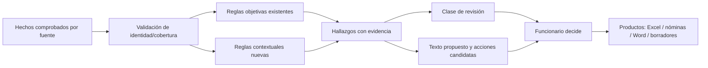

# CATÁLOGO FUNCIONAL — ANÁLISIS, PRIORIZACIÓN Y GENERACIÓN DE OBSERVACIONES CSMP

**Documento:** A-CSMP-02 · **Estado:** baseline de reglas existentes + propuesta de rediseño contextual **PENDIENTE DE VALIDACIÓN FUNCIONAL**  
**Fecha:** 8 de octubre de 2026 · **Repositorio:** `MatiGaete2023/NuRus`  
**Rama/commit auditados:** `experimento/plan-integral-csmp-20261002` / `fba9ffea79ef1040a7e161270398ebeaafeaf72f`.  
**Complemento técnico:** `02_ESPECIFICACION_TECNICA_ASISTENTE_CSMP.md`; **fuentes/captura:** `01_ESPECIFICACION_DESCARGADOR_RUS_SITFA.md`.

> **Alcance exclusivo de este documento:** qué hechos revisar, cómo aplicar las reglas de Espera, Cumplimiento e Informes, cómo aprovechar bitácoras e historia SITFA, cómo priorizar revisión manual, cómo componer las observaciones y cómo vincular propuestas con productos. No describe implementación gráfica ni empaquetado. **[ACTUAL]** = conducta localizada en código; **[CATÁLOGO]** = regla documentada por el repositorio; **[PROPUESTA]** = nueva lógica por validar; **[CONFLICTO_ABIERTO]** = no resolver sin decisión expresa. Los textos concretos aprobados deben recuperarse de `textos_base.json`/configuración vigente y compararse con el catálogo, no reescribirse desde esta síntesis.

## 1. Objetivo y principios de decisión

El Asistente debe recibir registros, calendarios, bitácoras e historia SITFA ya capturados, identificar la **última observación efectivamente atribuible al centro** en la fuente disponible, examinar actuaciones posteriores y generar una **propuesta editable de observación y de actuaciones relacionadas**, con una categoría transparente de revisión manual. Debe funcionar con muchas causas/ingresos simultáneamente; una causa con NNA/programas/ingresos múltiples **no constituye una sola unidad de regla**.

**Convención operativa de la conversación:** «revisar una causa» y «poner una observación» se tratarán como una actividad unificada; **no crear historial local de revisiones**. Aun así, los estados *observación sugerida*, *observación validada* y *observación registrada en RUS* siguen siendo diferentes, pues el registro oficial será manual. El Asistente no puede confundir un texto propuesto con una actuación efectiva del centro.

**Principios obligatorios:**

1. Fuente institucional sobre inferencia: cada conclusión debe apuntar a uno o más campos/eventos reales y a su cobertura.
2. Identidad: tribunal+causa+ingreso verificados; no trasladar observaciones entre ingresos de una misma causa por mera similitud.
3. Datos y valoración separados: el motor detecta hechos, aplica reglas configuradas y propone; el funcionario valida el texto y las medidas procedentes.
4. No existencia de un dato **no equivale** a prueba de ausencia; distinguir «no registra», «no consultado», «no se pudo acreditar» y «dato contradictorio».
5. Igual entrada + fecha de corte + versión de reglas + parámetros = igual propuesta estructurada. La lectura actual no altera retroactivamente decisiones humanas.
6. Pérdida de cobertura o identidad incierta no se resuelve con ceros, nombres similares ni observaciones de otro ingreso.
7. Una bitácora vacía comprobada dentro de un intervalo no acredita que nunca hubo observaciones fuera de ese intervalo.
8. Las reglas históricas aprobadas de **Laja, Mulchén y Tomé** se conservan como baseline. Para otros tribunales, no crear reglas jurídicas por extrapolación.

## 2. Fuentes, jerarquía y alcance

| Fuente | Información que acredita según contrato | Qué NO acredita por sí sola |
|---|---|---|
| Excel Espera/Cumplimiento/Informes | Valores visibles de estado, programa, fechas, plazos, referencias | Que se haya registrado una observación nueva, que no exista actuación posterior |
| Calendarios de informes/medidas | Vencimientos programados en período consultado | Entrega/recepción efectiva del informe; vigencia jurídica sin cotejo |
| Bitácora RUS | Entradas consultadas, autor/origen, texto, tipo, fecha y respuesta si existen | Toda la historia fuera de la cobertura; resolución en SITFA no representada en la bitácora |
| Historia/trámites SITFA | Trámites y referencias efectivamente extraídos/identificados | Contenido íntegro del PDF no descargado; resolución dictada si solo hay título genérico |
| Carga/resoluciones firmadas | Firmas halladas en el intervalo **efectivamente cubierto** | Ausencia de firmas fuera del filtro o interpretación de mérito del trámite |
| Texto/decisiones humanos del trabajo actual | La elección local del funcionario para generar productos | Inscripción real en RUS ni envío efectivo de correo |

**Prioridad de evidencia:** no es «SITFA prevalece siempre sobre RUS» ni lo inverso. Una tabla de calendario puede indicar un vencimiento mientras una historia muestra un trámite de recepción. **Se conservan ambos hechos y se marca contradicción pendiente de cotejo**; no se altera automáticamente el plazo ni se da por subsanado. Toda evidencia debe tener `source_system`, `source_ref`, `captured_at`, `coverage`, identidad y, cuando corresponda, fecha de actuación.

### 2.1. Modelo lógico de hechos / hallazgos / propuestas

Cada hallazgo estructurado debe incluir: `rule_id`, `rule_version`, `source_ids`, `record_identity`, `detected_at` (fecha de corte), `fact`, `threshold/condition`, `coverage`, `status` (`APLICA`, `NO_APLICA`, `NO_EVALUABLE`, `CONTRADICTORIA`), `reason`, `proposed_actions`, `confidence_class` (evidencia completa, parcial o incierta). **No generar porcentajes ficticios de confianza.**

## 3. Baseline de parámetros y fuentes vigentes

En [`src/nurus/personal/config.py`](https://github.com/MatiGaete2023/NuRus/blob/fba9ffea79ef1040a7e161270398ebeaafeaf72f/src/nurus/personal/config.py) la constante `UMBRALES` muestra actualmente:

| Parámetro código | Días | Interpretación inicial |
|---|---:|---|
| `espera_dce` | 30 | Demora DCE |
| `espera_laja` | 30 | Espera no DCE Laja |
| `espera_mulchen` | 30 | Espera no DCE Mulchén |
| `espera_tome` | 30 | Correo Espera Tomé |
| `proyecto_tome` | 60 | Proyecto por Espera Tomé |
| `mayoria` | 60 | Próxima mayoría de edad |
| `oido` | 45 | Oído reciente |
| `resolucion_reciente` | 30 | Resolución con antigüedad inferior a 30 días |
| `ingreso_reciente` | 30 | Días de cumplimiento recientes |
| `medida` | 45 | Medida por vencer |
| `informe` | 30 | Informe por vencer |
| `ficha_antigua` | 180 | Ficha individual desactualizada (más de 180) |
| `ficha_reciente` | 30 | Ficha individual reciente |
| `ficha_fae` | 120 | Falta ficha FAE después de 120 días |

Estos son **valores predeterminados del código auditado**, configurables por usuario: no sustituyen el manual institucional ni implican aprobación futura del rediseño. El documento [`docs/REFERENCIA_CATALOGO_ASISTENTE.md`](https://github.com/MatiGaete2023/NuRus/blob/fba9ffea79ef1040a7e161270398ebeaafeaf72f/docs/REFERENCIA_CATALOGO_ASISTENTE.md) contiene decisiones y textos históricos, algunos posteriormente ajustados. **Mantener baseline y registrar diferencias** entre código, configuración, catálogo y parámetros actuales antes de cambiar reglas.

### 3.1. Clasificación técnica de regla

- **Corte:** excluye seguimiento o impide ciertas reglas subsecuentes.
- **Principal:** define el supuesto rector de la observación.
- **Complementaria:** agrega información sin borrar la principal.
- **Contextual:** aporta contradicción, confirmación o necesidad de verificar eventos recientes; **nunca convierte por sí sola un título de trámite en subsanación acreditada**.
- **Acción:** vincula un hallazgo validado con correo/programa/proyecto/registro propuesto, bajo las restricciones del tribunal y modalidad.

## 4. Reglas transversales actuales (baseline, no rediseñadas)

| ID conceptual | Activación/función | Tratamiento obligado |
|---|---|---|
| G-01 | Prefijo `{PRIMER_NOMBRE} {SIGLA}:` | Conservar reglas vigentes de nombre y sigla, sin errores de formato |
| G-02 | Fecha en texto | Fecha larga en español; fechas técnicas en ISO donde proceda |
| G-03 | Normalización de programa | Conservar la presentación aprobada, sin reinterpretar abreviaturas arbitrariamente |
| G-04 | Composición y puntuación | Puntos únicos, orden aprobado, sin frases duplicadas |
| G-05 | Datos indispensables inválidos/ausentes | Omitir solo regla no evaluable y reportar incidencia; no borrar las restantes |
| G-06 | Tribunal | Detectar exclusivamente desde dato fuente, sin tribunal por defecto |
| G-07 | Orden | Preservar precedencia entre reglas principales/complementarias |
| G-08 | Hoja de informes para C-10 | Cruce por identidad completa, próximo vencimiento de fuente, no por cálculo sustitutivo |
| COMÚN.NO_SEGUIMIENTO | Derivación ajena al seguimiento del centro | Regla de corte; evitar falsos positivos por subcadenas |
| COMÚN.MAYORIA_EDAD | Fecha nacimiento implica ≥18 | Proponer egreso según texto vigente; sin egreso automático |
| COMÚN.PROXIMA_MAYORIA | Faltan 1 a 60 días (valor actual) | Aviso complementario |
| COMÚN.CURADOR | Campo existe y no registra curador según criterio vigente | Complementaria; ausencia de columna ≠ «no tiene curador» |
| COMÚN.OIDO | Fecha dentro de 45 días anteriores, no futura | Complementaria |
| COMÚN.PROX_AUDIENCIA | Fecha futura o actual | Complementaria; no deducir sin fecha |

**Observación normativa:** la falta de curador, opinión del NNA o ficha requiere examen de datos disponibles y de su calidad; el código no debe declarar inexistencia real fuera de lo que informa el RUS consultado.

## 5. Reglas de ESPERA — conservar baseline

| ID | Condición del código/catálogo | Resultado y restricciones |
|---|---|---|
| E-01 | Derivación no sujeta a seguimiento (`COMUN.NO_SEGUIMIENTO`) | Corte; texto específico y sin actuación de seguimiento |
| E-02 | Edad exacta ≥18 | Observación principal de mayoría y sugerencia de egreso; no ejecuta egreso |
| E-03 | Próxima mayoría en 1–60 días | Complementaria |
| E-04 | Fecha de resolución válida con antigüedad `[0,30)` días | Texto de resolución reciente / espera de ingreso, sin suponer ingreso efectivo |
| E-05 DCE | Espera ≥30 días | **Solo correo a programa**, no proyecto de resolución por demora de ingreso en Espera DCE |
| E-05 Laja/Mulchén no DCE | Espera ≥30 días | Proyecto de resolución pidiendo cuenta **más** correo a programa, según tipo/validación |
| E-05 Tomé no DCE | 30–59 días | Solo correo a programa |
| E-05 Tomé no DCE | Espera ≥60 días | Correo y proyecto de resolución |
| E-06 | Sin regla principal habilitada en Espera, según fallback actual | Texto base «medida revisada, a la espera de ingreso efectivo»; registrar incidencia por dato faltante |
| Complementarias | Curador, oído, audiencia y otras aplicables | Mantener precedencia y textos según configuración |

**[CÓDIGO]** `motor/reglas_espera.py` aplica `parametro()` para umbrales y produce fragmentos compuestos. El fallback E-06 en el código **también se usa si datos como T ESPERA están ausentes/no válidos**, a diferencia de un título antiguo del catálogo que lo describe como «sin fecha de resolución». No cambiarlo ni afirmar equivalencia sin verificar especificación vigente. Una fila con datos críticos faltantes debe además marcarse **NO_EVALUABLE/PARCIAL** en la clasificación contextual, aunque conserve una frase base histórica.

**No confundir antigüedad de la medida con antigüedad de una resolución en SITFA.** La incorporación de historia solo podrá **validar o contradecir** fechas y estados con fuente y revisión humana: no reescribir E-04 automáticamente.

## 6. Reglas de CUMPLIMIENTO — conservar baseline

| ID | Condición actual | Resultado / precedencia |
|---|---|---|
| C-01 | Mayoría de edad ≥18 | Principal, proponer egreso; sin registro automático |
| C-02 | Próxima mayoría 1–60 días | Complementaria |
| C-03 | `DÍAS CUMPL` entre 0 y 30 y fecha de ingreso efectivo válida | Texto de ingreso reciente; si fecha falta, incidencia y omitir esa frase |
| C-04 | `DÍAS EGRESAR<0` **o** `DÍAS CUMPL<0`, con fecha proyectada válida | Texto «medida vencida en RUS»; contradicción por fechas faltantes se reporta |
| C-05 | Días para egresar 0–45 y egreso proyectado válido; no C-04 | Texto «vence hoy» o «por vencer», según día |
| C-06 | **Eliminada** (cálculo interno de próximo informe) | No reintroducir ni recalcular usando periodicidad por defecto |
| C-07 | Programa residencial aplicable y ficha individual ausente/antigua/reciente | Ausente → sugerir; >180 días → desactualizada; 0–30 días → reciente; resto sin frase |
| C-08 | FAE/FAS, ingreso hace >120 días y ficha FAE ausente | Frase de falta de ficha FAE; comprobar disponibilidad de columna |
| C-09 | No hay reglas principales/complementarias | Base «Medida revisada, sin observaciones» del catálogo vigente |
| C-10 | Cruce por identidad completa con hoja de informes de vencimiento futuro | Próximo informe de avance; **se suprime si opera C-04/C-05** |
| Complementarias | Oído, próxima audiencia, curador | Acumulables según precedencia; sin inventar inexistencias |

**[CONFLICTO_ABIERTO]** C-07 y C-08, particularmente ausencia de columna: el código `reglas_cumplimiento.py` verifica expresamente presencia de columna antes de C-07, pero en C-08 determina fecha FAE nula sin un control igualmente explícito de existencia de columna, a diferencia del catálogo documental que señala exigencia de la fuente. **Efecto:** una ausencia de campo podría producir observación errónea. **Corrección a evaluar/testear:** C-08 solo declara «no registra ficha» si el esquema acredita el campo y ausencia en registro; si no, `NO_EVALUABLE`. No modificar texto normativo sin autorización.

**Cruce C-10:** combinar calendarios/Hoja2 con prioridad de fechas y conservar todas las fuentes para evidencia. No elegir arbitrariamente primer/último registro duplicado de distinto programa; cruces inciertos → revisión manual. Una medida por vencer no prueba por sí sola que deba omitirse verificar el estado real del informe, pero la frase C-10 histórica sí conserva su precedencia actual.

## 7. Reglas de INFORMES — conservar baseline

| ID | Condición actual | Resultado |
|---|---|---|
| I-01 | Fecha de vencimiento válida, anterior al corte | Informe vencido; distingue DCE diagnóstico de otros informes; propone actuaciones según texto/plantilla vigente y validación |
| I-02 | Fecha válida con 0–30 días restantes | Informe por vencer; distingue DCE y otros; correo a programa según configuración |
| I-03 / otros | Sin regla actual confirmada | No inventar reglas |
| Corte común | Derivación no sujeta a seguimiento | No producir observación ordinaria |
| Complementaria | Próxima audiencia disponible | Añadir si fecha válida y procede |

**[CÓDIGO]** `motor/reglas_informes.py` no emite frase si fecha de vencimiento es inválida ni si falta; genera incidencia, lo cual debe preservarse. **La sola fecha del calendario no acredita que el informe esté efectivamente pendiente**, de modo que la nueva capa contextual debe señalar trámites o recepción que requieran cotejo antes de reiterar una solicitud.

## 8. Rediseño contextual — NUEVAS reglas propuestas y decisiones pendientes

**Ninguna regla contextual nueva se activará automáticamente en producción hasta tener fuente, condición y prueba de aceptación aprobadas.** El primer entregable es la **detección explicada y sin acciones automáticas**.

| ID propuesto | Fuente y prueba | Hallazgo propuesto | Acción / límite |
|---|---|---|---|
| CT-01 | Bitácora con identidad y cobertura confirmada | Última observación del centro, fecha y autor; entradas empatadas todas | Mostrar referencia de corte; no crear historial local |
| CT-02 | Bitácora desde fecha de CT-01 | Entradas posteriores de cualquier autor/tipo con referencias | Mostrar novedades, texto íntegro, origen; no confundir observación propia con respuesta |
| CT-03 | Historia SITFA desde fecha de CT-01 | Trámites posteriores, tipo, fecha, folio/referencia y vínculo PDF | Mostrar cronología y necesidad de examinar PDF si título es insuficiente |
| CT-04 | Bitácora/historia vs dato Excel | Dato de vencimiento aparentemente discordante con actuación reciente | Clasificar revisión focalizada o exhaustiva; **no alterar plazo** automáticamente |
| CT-05 | Observación centro anterior y respuesta comprobada | Posible respuesta vinculada a observación | Mostrar «respuesta registrada / pendiente de cotejar»; no «subsanada» sin evidencia |
| CT-06 | Nueva consulta sin bitácora, lectura incompleta o ingreso ambiguo | Información necesaria no evaluable | Solicitar captura focalizada desde Descargador; no asumir ausencia |
| CT-07 | Reiteración literal/semántica de observaciones con IDs conocidos | Posible repetición | Advertir y presentar fechas, autores y textos; no suprimir propuesta automáticamente |
| CT-08 | Consulta de carga con cobertura temporal inequívoca | Resolución firmada posterior relevante | Mostrar evento y referencia; no inferir contenido ni trámite de otra persona |
| CT-09 | Calendario individual y estado acreditado | Informe enviado/pendiente según estado de fuente | Propuesta de actualizar clasificación, revisión humana para contradicciones |
| CT-10 | Varias incidencias relevantes y fuentes contradictorias | Necesidad de examen de causa | Categoría exhaustiva, con motivo y evidencias enumeradas |

### 8.1. Algoritmo temporal sin historial local de revisiones

1. Analizar cada **ingreso** y su universo de bitácoras **verificadas**, nunca toda la causa indistintamente.
2. Filtrar entradas atribuibles al **centro** por `origen`/tipo/campo acreditado. Si el origen es desconocido, no inferir automáticamente que la observación es del centro solo por parecido de texto.
3. Encontrar fecha/hora máxima de esa clase **dentro de la cobertura consultada**, conservando todas las observaciones empatadas. Mostrar texto íntegro, tipo, autor, fecha, ingreso y hash/ID.
4. Si no hay observación atribuible al centro: `ULTIMA_OBSERVACION_NO_ACREDITADA`, con causa (`sin entradas`, `sin cobertura histórica`, `origen ambiguo`, etc.). **No establecer hoy ni última revisión local como fecha sustituta**.
5. Para cada bitácora y trámite con tiempo conocido **posterior** a la última observación, producir una entrada de novedades con tipo, fecha, fuente, alcance, referencia y resumen fiel.
6. Si la última observación está fuera de ventana consultada o no se conoce: presentar **actuaciones recientes en el período capturado**, con advertencia explícita «no es posible afirmar que son posteriores a la última observación del centro».
7. Si un evento tiene fecha sin hora el mismo día que la observación: orden relativo **INCIERTO**; incluirlo como posible novedad para cotejar y no como evento ciertamente posterior.
8. Ningún resultado se almacena como «última revisión» independiente; cada nueva importación se vuelve a calcular desde **fuentes institucionales**.

**Restricción de cobertura actual:** `personal/bitacoras.py` limita el período de **análisis** a cuatro meses. La copia íntegra puede contener entradas anteriores; la herramienta no debe saltar a una última observación más antigua sin definir y comprobar un alcance autorizado o validar si la copia contiene realmente el historial histórico. Si no es posible, reportar «última observación no acreditada en período».

### 8.2. Ejemplo explicativo ficticio

- 10-09-2026: observación al programa registrada en bitácora, atribuible al centro.
- 25-09-2026: bitácora dice «programa informa remisión».
- 28-09-2026: SITFA muestra un trámite con referencia a «informe».
- 08-10-2026: calendario continúa mostrando vencimiento.

**Conclusión permitida:** «Hay antecedentes posteriores que podrían relacionarse con el informe señalado como vencido; corresponde verificar el trámite y, si procede, su documento». **Conclusiones prohibidas:** «informe recibido y subsanado», «programa incumplió», «tribunal resolvió» o «ya no corresponde ninguna actuación» sin contenido y evidencia adecuada.

## 9. Clasificación de necesidad de revisión manual

Esta clasificación es **una propuesta de flujo, no una decisión jurídica**. Debe ser explícita, determinista y explicable, sin porcentajes o puntajes arbitrarios.

| Clase | Disparadores propuestos | Qué hace el funcionario |
|---|---|---|
| `EXHAUSTIVA` | Contradicción material, múltiples incidencias, identidad/efecto jurídico complejo, escritura/cobertura incompatible con conclusión crítica | Revisar expediente/actuaciones y decidir texto/acciones caso a caso |
| `FOCALIZADA` | Una cuestión delimitada, respuesta/trámite reciente o fuente cuyo contenido hay que cotejar | Comprobar antecedente específico antes de reiterar o cerrar |
| `ORDINARIA` | Regla objetiva aplicable, fuente completa, sin contradicción significativa | Validar propuesta habitual |
| `SIN_INCIDENCIA_DETECTADA` | Ninguna regla dispara y **cobertura suficiente** para reglas aplicables | Sin examen individual requerido en ese ciclo; no certifica legalidad total |
| `NO_EVALUABLE` | Faltan datos obligatorios, bitácora/trámite necesario no consultado, identidad incierta o lote parcial | Completar captura o revisión manual, **no** generar cierre automático |

**Precedencia sugerida:** `NO_EVALUABLE` bloquea conclusiones que dependan del dato ausente; una **contradicción material** eleva a `EXHAUSTIVA`; un trámite potencialmente relevante eleva a `FOCALIZADA`; las alertas objetivas sin esos factores quedan en `ORDINARIA`; únicamente con cobertura suficiente puede usarse `SIN_INCIDENCIA_DETECTADA`. Como una causa puede tener varios hallazgos, asignar clase por hallazgo y mostrar clase agregada más exigente en bandeja, preservando explicación.

**Cuándo consultar antecedentes faltantes:** generar un archivo estructurado `solicitud_antecedentes.csv/json` con tribunal+IDs remotos+tipo de consulta y razón. Lo consume Descargador **a solicitud del usuario**, sin que el Asistente abra Chrome ni ejecute RUS. No descargar sistemáticamente toda la historia de todos los registros si basta una consulta focalizada.

## 10. Composición textual de la observación y decisiones de productos

El motor debe devolver al menos: `regla_id`, `hechos`, `fuentes`, `fragmentos_ordenados`, `texto_propuesto`, `acciones_candidatas`, `incidencias_de_datos`, `clase_revision`. Solo un componente de **composición** renderiza fragmentos usando textos personalizables del sistema. No concatenar frases improvisadas dentro de reglas contextuales.

**Orden:** regla de corte → regla(s) principal(es) → hitos y complementarias conforme al catálogo → sugerencias/actuaciones. No duplicar prefijos ni puntos. Si una regla es no evaluable, omitir su frase sin omitir hechos correctos de otras; marcar incidencia con ID/regla/columna/fuente.

**TT, CC y RES:**

- `TT` y `CC` son campos sujetos a decisión/registro humano según funcionamiento aprobado del centro. La clasificación técnica **«Al Tribunal» → CC=1; «Administrativa» → CC=0** en lectura de bitácora es un atributo verificable **del tipo registrado**, pero no autoriza autoimputar nuevas observaciones con carga ni completar contadores de desempeño.
- `RES` categórico: `PC_IE`, `PC_INFO`, `NOMENCL` o vacío, con compatibilidad de valores históricos. No crear proyecto para DCE en Espera por E-05 cuando el catálogo lo prohíbe.
- Correo al programa/tribunal: las reglas pueden proponerlo, pero la preparación depende de filtros/decisión y la **transmisión es siempre humana**.
- Proyectos Word: el Asistente genera borrador con plantilla correcta, no resolución dictada.

**[CONFLICTO_ABIERTO] Verbos de actuaciones no efectuadas.** Algunos textos heredados expresan «Se remite correo» o «Se remite proyecto» desde la fase de generación automática, aunque el usuario podría no haber ejecutado la remisión. **Efecto:** el texto podría describir como realizada una actuación pendiente. **Resolución:** confirmar si las observaciones se registran después de remitir y si el texto debe adaptarse al estado de actuación; **no modificar redacción aprobada unilateralmente**. La interfaz debe advertir acciones no realizadas.

## 11. Priorización de productos por fuente (sin redundancias)

| Necesidad | Fuente primaria | Propuesta |
|---|---|---|
| Observación Espera | Registro Espera + contexto de bitácora | Texto compuesto y decisión humana; correo/proyecto según tribunal/modalidad |
| Observación Cumplimiento | Registro Cumplimiento + informe calendario + contexto | Texto compuesto y propuesta según regla |
| Observación Informes | Registro Informes/calendario + fuente de recepción/trámite | Vencimiento y cotejo de estado si hay movimientos |
| Nómina informes por vencer | Calendarios y datos de programa con cobertura | Excel por programa, tribunal, período, aun sin observación nueva |
| Nómina informes pendientes | Fechas y estados disponibles; cotejo posterior si hay trámite | Excel por programa con advertencias de discrepancia |
| Borradores Outlook | Decisión humana + contactos y planillas compatibles | Borradores, con adjuntos, sin envío |
| Proyectos Word | Reglas habilitantes + selección/validación humana | Proyecto editable con plantilla según tribunal y tipo |
| Solicitud de nuevas capturas | Fuentes faltantes/ambigüedad | Archivo hacia Descargador, sin navegar desde Asistente |

## 12. Pruebas unitarias, casos límite y aceptación sustantiva

Cada caso debe proporcionar **entrada ficticia**, `as_of`, versión/umbrales, hallazgos estructurados esperados, observación literal esperada cuando exista baseline y ausencia de productos prohibidos. Mantener golden files/versiones para los textos.

| ID test | Caso | Resultado imprescindible |
|---|---|---|
| R-T01 | Derivación sin seguimiento que comparte subcadena con otra | Corte solo si coincide de acuerdo con política de identificación vigente |
| R-T02 | Edad 17a 364d y cumpleaños en 60 días | Advertencia cuando aplique; no egreso prematuro |
| R-T03 | Mayoría cumplida | Texto principal, sin ejecutar egreso |
| R-T04 | Espera DCE 29/30/31 días | Solo correo desde 30; **sin Word** por E-05 |
| R-T05 | Espera Laja/Mulchén 29/30 días | Cambio de tramo exacto; correo+proyecto desde 30 según decisión |
| R-T06 | Espera Tomé 29/30/59/60 días | Sin gestión/solo correo/proyecto+correo según corte |
| R-T07 | Espera sin T ESPERA válido | Incidencia; baseline E-06 diferenciado de «condición probada» |
| R-T08 | Resolución hace 29/30 días | E-04 solo cuando antigüedad menor de 30 |
| R-T09 | Cumplimiento DÍAS CUMPL 0/30/31 | C-03 solo en intervalo y con fecha de ingreso |
| R-T10 | DÍAS EGRESAR -1, 0, 45, 46 | C-04/C-05 según cortes y fecha proyectada válida |
| R-T11 | Días negativos con fecha proyectada futura | Contradicción visible, sin afirmación material engañosa |
| R-T12 | Ficha residencial 30/31/180/181 días | Presencia/ausencia/frase exactamente según C-07 |
| R-T13 | FAE >120 días, ficha ausente y columna ausente | Sin confundir «no tiene» con «dato no disponible» |
| R-T14 | Hoja2 con dos fechas/duplicados | Cruce inequívoco, sin cambio de NNA ni programa |
| R-T15 | C-04 o C-05 junto a C-10 | Mantener exclusión histórica de frase C-10 |
| R-T16 | Informe vence ayer/hoy/en 30/en 31 días | I-01/I-02/ninguna según cortes |
| R-T17 | Misma causa, dos ingresos | Última observación y eventos **por ingreso**, sin contaminación |
| R-T18 | Bitácora totalmente fallida | `NO_EVALUABLE` contextual, no «sin observaciones» fundada en ese vacío |
| R-T19 | RIT/nombre visual distinto, IDs iguales | Admitir con advertencia trazable |
| R-T20 | IDs de ingreso distintos, nombre igual | No cruzar ni combinar |
| R-T21 | Dos observaciones del centro empatadas | Conservar ambas, no escoger arbitrariamente una |
| R-T22 | Observación del centro anterior a ventana consultada | No inventar fecha «última» ni comparación posterior |
| R-T23 | Evento mismo día sin hora | Orden posterior incierto, revisión focalizada |
| R-T24 | Informe vencido + trámite «informe» | Revisión focalizada; no «subsanado» sin cotejo del documento |
| R-T25 | Resolución firmada con cobertura parcial | No afirmar ausencia de otra actividad |
| R-T26 | Reiteración de textos parecidos | Solo señal de posible duplicación, sin supresión automática |
| R-T27 | Regla válida + dato faltante de otra regla | Mantener texto válido e incidencia de la incompleta |
| R-T28 | Tribunal distinto de los tres soportados por reglas | Información consultable; sin textos específicos de un tribunal inventados |
| R-T29 | Propuesta editada por usuario | Reanálisis no sobrescribe texto/acción humana sin nueva decisión |
| R-T30 | Múltiples registros para un programa | Nóminas exactas, fuentes/filas trazables y sin repetir registros erróneamente |
| R-T31 | Correo creado como borrador | Nunca reflejar envío como realizado |
| R-T32 | Nuevas reglas desactivadas por usuario | Decisiones y parámetros preservados; explicación de exclusión |

Los casos contextualizados deben comprobarse con fuentes institucionales **anonimizadas** y contrastadas manualmente antes de habilitar decisiones que cambien el producto final. No basta con pruebas de HTML ficticio para declarar que el motor entiende contenido de todos los trámites reales.

## 13. Protocolo de cambio y aprobación de reglas

**No implementar indiscriminadamente el rediseño junto al contrato de archivos.** Primero congelar la base de reglas vigente con snapshot de configuración y textos, ejecutar pruebas de paridad y documentar diferencias entre `personal/motor`, `nurus/rus/rules.py`, catálogo histórico y preferencias del usuario. Después añadir reglas CT-xx **desactivadas** con fixtures y explicación de evidencia; habilitar una por vez tras aprobación funcional. Mantener `ruleset_version`, fecha de aprobación, autor de decisión y casos de prueba de cada regla.

**No migrar estados TT/CC/RES ni clases de revisión por reglas automáticas sin validación del funcionario.** El motor produce propuestas; el trabajo humano decide cuál texto se incorpora efectivamente en RUS.

## 14. Conflictos y decisiones aún no resueltas

1. **[CONFLICTO_ABIERTO] Fuente exacta y horizonte de «última observación».** El lector actual analiza hasta cuatro meses y la tabla puede ser más larga, pero eso no certifica historia completa. **Efecto:** podría no identificarse la última observación del centro. **Resolución:** validar alcance real de la bitácora y decidir si se permitirá consulta histórica adicional.
2. **[CONFLICTO_ABIERTO] Diferencias código/catálogo/configuración.** Ejemplos: fallback E-06 y ausencia de columna FAE; documentos antiguos y personalizaciones pueden no coincidir. **Efecto:** errores o textos discrepantes. **Resolución:** matriz de paridad regla-código-texto-contrato y aprobación antes de modificar.
3. **[CONFLICTO_ABIERTO] Alcance de historia SITFA.** Falta extractor probado. **Efecto:** CT-03/04/08/09 no pueden desplegarse como hechos acreditados. **Resolución:** muestras de trámite/paginación y PDFs por Descargador.
4. **[CONFLICTO_ABIERTO] Autor/origen de observación del centro.** Puede haber entradas sin clasificación inequívoca. **Efecto:** errores al fijar fecha última. **Resolución:** validar metadatos/autor/tipo con muestras reales; si ambiguos, `ORIGEN_DESCONOCIDO`.
5. **[CONFLICTO_ABIERTO] Comunicaciones y resoluciones sugeridas versus ejecutadas.** **Efecto:** textos que afirman envío aún no realizado. **Resolución:** decisión sobre redacción y secuencia del acto humano, preservando literal histórico hasta aprobación.
6. **[CONFLICTO_ABIERTO] Catálogo normativo por modalidades y tribunales.** Las reglas tradicionales están acotadas y pueden requerir actualización tras disponer de más fuentes. **Efecto:** falsos positivos/negativos si se extrapolan. **Resolución:** validación con manual vigente y decisiones de cada modalidad.

## 15. Entregables y definición de terminado para el programador

Se debe entregar: (1) inventario exhaustivo del baseline y parámetros; (2) matriz regla/fuente/precondición/acción/texto; (3) motor separado del importador y UI; (4) estados de no evaluable y cobertura; (5) vínculo estructurado entre evidencia y fragmento; (6) conjunto de pruebas del §12 con resultados; (7) ejemplos comparativos antes/después y lista de diferencias autorizadas; (8) catálogo de reglas CT propuestas, **desactivadas hasta aceptación**; (9) manual para parametrizar sin cambiar código; y (10) informe de limitaciones, contradicciones y pendientes.

Se considera logrado el diseño cuando el motor **preserva las reglas vigentes donde no hay nueva evidencia**, puede identificar objetivamente una última observación del centro si está acreditada, muestra actuaciones posteriores sin inventar subsanaciones, clasifica el tipo de revisión de manera explicable y permite que el usuario revise masivamente y genere productos tras validar.

---

### Fuentes primarias

- [`docs/REFERENCIA_CATALOGO_ASISTENTE.md`](https://github.com/MatiGaete2023/NuRus/blob/fba9ffea79ef1040a7e161270398ebeaafeaf72f/docs/REFERENCIA_CATALOGO_ASISTENTE.md)
- [`docs/MATRIZ_REGLAS_PERSONAL.json`](https://github.com/MatiGaete2023/NuRus/blob/fba9ffea79ef1040a7e161270398ebeaafeaf72f/docs/MATRIZ_REGLAS_PERSONAL.json)
- [`src/nurus/personal/config.py`](https://github.com/MatiGaete2023/NuRus/blob/fba9ffea79ef1040a7e161270398ebeaafeaf72f/src/nurus/personal/config.py)
- [`src/nurus/personal/motor/reglas_espera.py`](https://github.com/MatiGaete2023/NuRus/blob/fba9ffea79ef1040a7e161270398ebeaafeaf72f/src/nurus/personal/motor/reglas_espera.py)
- [`src/nurus/personal/motor/reglas_cumplimiento.py`](https://github.com/MatiGaete2023/NuRus/blob/fba9ffea79ef1040a7e161270398ebeaafeaf72f/src/nurus/personal/motor/reglas_cumplimiento.py)
- [`src/nurus/personal/motor/reglas_informes.py`](https://github.com/MatiGaete2023/NuRus/blob/fba9ffea79ef1040a7e161270398ebeaafeaf72f/src/nurus/personal/motor/reglas_informes.py)
- [`src/nurus/personal/bitacoras.py`](https://github.com/MatiGaete2023/NuRus/blob/fba9ffea79ef1040a7e161270398ebeaafeaf72f/src/nurus/personal/bitacoras.py)
- [`src/nurus/personal/work.py`](https://github.com/MatiGaete2023/NuRus/blob/fba9ffea79ef1040a7e161270398ebeaafeaf72f/src/nurus/personal/work.py)
