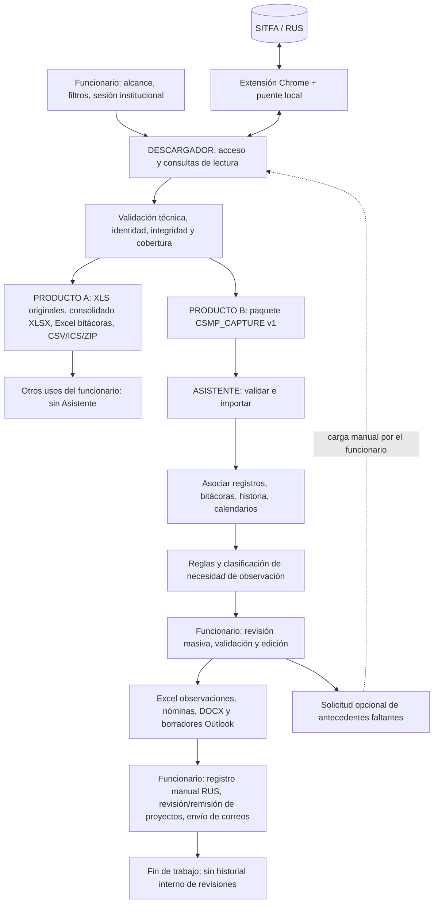

# ESPECIFICACIÓN DEL FLUJO DE TRABAJO INTEGRADO RUS/SITFA → DESCARGADOR → ASISTENTE CSMP

**Documento:** F-CSMP-04 · **Tipo:** especificación funcional, operativa y de integración entre herramientas  
**Fecha de referencia:** 8 de octubre de 2026 · **Estado:** diseño objetivo para implementación; no representa una aceptación en producción  
**Repositorio de referencia:** [MatiGaete2023/NuRus](https://github.com/MatiGaete2023/NuRus)  
**Rama examinada:** `experimento/plan-integral-csmp-20261002` · **Commit fijado:** `fba9ffea79ef1040a7e161270398ebeaafeaf72f`  
**Documentos que complementa (leer en conjunto):**

1. [`01_ESPECIFICACION_DESCARGADOR_RUS_SITFA.md`](01_ESPECIFICACION_DESCARGADOR_RUS_SITFA.md): captura, controles técnicos, Excel autónomos, paquete de intercambio.
2. [`02_ESPECIFICACION_TECNICA_ASISTENTE_CSMP.md`](02_ESPECIFICACION_TECNICA_ASISTENTE_CSMP.md): arquitectura, importación, interfaz, edición y productos del Asistente.
3. [`03_REGLAS_ANALISIS_OBSERVACIONES_CSMP.md`](03_REGLAS_ANALISIS_OBSERVACIONES_CSMP.md): catálogo de reglas actuales, análisis temporal/contextual y clasificación. **Este documento no redefine sus umbrales ni textos.**

> **Cómo leer el estado de una función:** `[CÓDIGO]` = localizada mediante inspección estática de la rama; `[REQUISITO]` = diseño exigido para el producto objetivo; `[PENDIENTE]` = por implementar o comprobar; `[CONFLICTO_ABIERTO]` = falta evidencia o decisión para fijarla. Los ejemplos de este texto son **ficticios**. «Existe en código» no equivale a «validado en RUS real».

---

## 1. Propósito, resultado buscado y alcance

El sistema debe permitir que un funcionario obtenga antecedentes desde las pantallas autorizadas de RUS/SITFA, los conserve en Excel para usos independientes, envíe un **paquete de datos estructurado** al Asistente, obtenga un análisis contextual y masivo, revise las observaciones propuestas y prepare los productos operativos que correspondan: Excel revisable, nóminas a programas, proyectos Word y borradores Outlook. El **registro en RUS** y el **envío de correos** permanecen como actuaciones humanas.

**Objetivo de integración:** ninguna fase ordinaria puede exigir al funcionario renombrar columnas, copiar y pegar entre Excel, ajustar fechas o reconstruir archivos para que la siguiente herramienta pueda leerlos. La transformación es responsabilidad del software, mediante un contrato estable y validado.

**Fronteras inmodificables del diseño:**

- **Descargador:** interactúa con las pantallas de consulta de SITFA/RUS, recopila, comprueba, normaliza técnicamente y exporta. Funciona por sí solo. No aplica reglas de observación ni genera proyectos judiciales o correos.
- **Asistente:** recibe archivos locales preparados, asocia antecedentes, ejecuta reglas, clasifica causas, permite revisión humana masiva y genera productos. **No navega por RUS/SITFA, no inicia el Descargador ni accede a la sesión Chrome.**
- **Funcionario:** autentica su sesión, define los alcances, revisa el fondo de los antecedentes, valida/corrige observaciones, efectúa el registro oficial en RUS, revisa/remite los proyectos y envía los correos. No hay automatización institucional de escritura ni de envío.
- **No se crea un historial longitudinal de revisiones hechas por el funcionario.** A efectos operativos, «revisar una causa» y «formular la observación» forman un mismo concepto de trabajo; no se construye una base de fechas de apertura/revisión separada. La última observación del centro y los acontecimientos posteriores se obtienen de la **bitácora y otras fuentes descargadas**. Se permite guardar la sesión de trabajo para no perder correcciones y productos, pero ello **no equivale** a registrar un historial de revisiones por causa.
- **La descarga Excel antigua se mantiene**: los archivos individuales y consolidados son un fin autónomo del Descargador y no dependen de ejecutar el Asistente. El nuevo paquete se ofrece *además* del Excel; no lo sustituye.

**No son objeto de esta fase:** automatizar credenciales, enviar correos, registrar observaciones/remitir resoluciones mediante acciones institucionales no habilitadas, inventar comprobantes, descargar indiscriminadamente PDFs, utilizar IA o servicios externos con expedientes, sustituir evaluación jurídica, crear repositorios personales de antecedentes de NNA.

---

## 2. Mapa general: dos circuitos que comparten una misma captura



**Circuito autónomo:** `SITFA/RUS → Descargador → Excel/CSV/ICS/ZIP → usuario`. **Debe funcionar aunque el Asistente esté ausente.**  
**Circuito integrado:** `SITFA/RUS → Descargador → paquete → Asistente → validación humana → productos → actuaciones humanas`.  
**Circuito de antecedentes faltantes:** `Asistente → lista estructurada de consultas sugeridas → funcionario → Descargador → nuevo paquete → Asistente`. No se abre automáticamente un navegador desde el Asistente.

El diagrama no exige hacer todas las descargas ni emitir todos los productos en cada ejecución. Una descarga focalizada o un paquete que contenga solo registros es válido si declara exactamente su contenido y cobertura.

---

## 3. Matriz ejecutiva de etapas: quién hace qué, con qué y qué entrega

| ID | Etapa | Responsable de ejecución | Herramienta/fuente | Entrada | Entregable / condición de salida |
|---|---|---|---|---|---|
| F00 | Preparar sesión, autorización y alcance | Funcionario | Chrome, RUS/SITFA, Descargador | Acceso institucional habilitado y objetivo de consulta | Sesión iniciada por usuario, extensión enlazada y consulta definida |
| F01 | Planificar consultas y filtros | Descargador, bajo selección del funcionario | Catálogo real de SITFA, planificador de lotes | Tribunales, modalidades, pestañas, estados, fechas/meses | Plan explícito de consultas, alcance y número esperado; sin consultas redundantes |
| F02 | Consultar registros y reportes | Descargador + extensión | SITFA/RUS en modo lectura | Plan F01 | XLS/PDF originales de cada página o vacío comprobado; manifiestos y cobertura |
| F03 | Obtener bitácoras seleccionadas | Descargador + extensión | RUS / enlaces de ingreso | Ingresos con vínculo acreditado | Copias íntegramente verificadas, eventos, advertencias y control de lecturas |
| F04 | Obtener historia y referencias documentales | Descargador + extensión, **tras desarrollo y validación** | Historia SITFA | Causa/ingreso autorizado e identificable | Trámites, fechas, descripciones, referencias y estados de cobertura; PDFs solo si se solicitan y son permitidos |
| F05 | Verificar y consolidar datos de captura | Descargador | Validadores de consultas, Excel, hashes, identidad | F02–F04 y alcance | Fuentes conservadas, incidencias explícitas y estado de cobertura por consulta/ingreso |
| F06 | Entregar productos autónomos | Descargador | Exportadores locales XLSX/CSV/ICS/PDF/ZIP | Capturas verificadas | Excel originales, consolidados y de bitácoras/historia según alcance; sin abrir Asistente |
| F07 | Generar paquete de intercambio | Descargador | Exportador `CSMP_CAPTURE_V1` | Capturas F05 y selección de tablas | ZIP versionado, manifiesto, tablas, fuentes y hashes verificables |
| F08 | Importar y validar paquete | Asistente | Lector local de contrato v1 | F07, o Excel heredado explícito | Trabajo importado, error estructural controlado o advertencias de fuentes ausentes |
| F09 | Relacionar antecedentes | Asistente | Normalizador/relacionador por identidad | Registros, bitácoras, historia, calendarios, metadatos | Conjuntos por causa e ingreso, relaciones comprobadas y casos ambiguos aislados |
| F10 | Determinar secuencia de actuaciones | Asistente | Motor temporal contextual | Eventos asociados, cobertura de fuente, fecha de corte | Última observación comprobable del centro, eventos posteriores y límites de evidencia |
| F11 | Aplicar reglas y clasificar | Asistente | Motor versionado de reglas | F09–F10 y reglas aprobadas | Hallazgos, texto propuesto, acciones candidatas, clase de revisión y explicación |
| F12 | Revisar, editar y validar en lote | Funcionario asistido por Asistente | Bandeja de revisión y detalle | Propuestas F11 | Decisiones humanas y correcciones de la sesión, selección de productos |
| F13 | Elaborar productos operativos | Asistente | Excel, plantillas Word, Outlook en modo borrador | Decisiones F12 y fuentes suficientes | Excel revisable, nóminas, proyectos DOCX, borradores y resumen local |
| F14 | Realizar actuaciones institucionales | Funcionario | RUS/SITFA y Outlook/flujo institucional | Productos revisados F13 | Observaciones registradas manualmente, correos enviados por persona, proyectos revisados/remitidos según corresponda |
| F15 | Completar trabajo o pedir nueva captura | Funcionario, con sugerencia del Asistente | Descargador / Asistente | Incidencias o datos faltantes | Nueva captura acotada, nuevo análisis o fin sin declaración automática de subsanación |

Los responsables de las etapas F02–F07 y F08–F13 son los **componentes de software**, pero las decisiones de alcance, validación jurídica y actuación oficial son del funcionario. Las etapas F03 y F04 son **selectivas**, no requisitos de toda descarga.

---

## 4. Procedimiento operativo detallado por etapas y puertas de control

### F00 — Inicio de sesión y preparación del entorno

- **Ejecuta:** funcionario. **Con qué:** Chrome habitual, acceso institucional, extensión de la misma entrega y aplicación Descargador.
- **Pasos:** abrir sitio oficial; autenticarse personalmente; abrir la pantalla autorizada; enlazar extensión con código efímero del puente `127.0.0.1`; comprobar que la aplicación muestra conexión y versión/capacidades.
- **Recibe:** credenciales manejadas por el sitio/navegador y permisos de la cuenta (no por el Descargador).
- **Entrega:** una sesión de consulta utilizable; sin tokens/cookies/contraseñas en archivos de resultados.
- **Control F00:** formulario y sitio permitidos, extensión compatible, puente conectado, permisos mínimos; si fallan, no consultar.
- **Excepción:** si la sesión vence, detener, conservar lo verificado y pedir reconexión **manual**; prohibido intentar autenticación automática o reintentos ciegos.

### F01 — Selección, filtros y planificación del lote

- **Ejecuta:** Descargador según decisiones del funcionario. **Recibe:** consulta solicitada, tribunales visibles, modalidades (Residencia, Ambulatorio, FAE, DCE), pestañas, estados, filtros, fechas o meses.
- **Pasos:** leer catálogo efectivo; validar filtros para **esa** pantalla; expandir la selección a consultas explícitas; distinguir descarga general/focalizada; mostrar vista previa de número de consultas, no inventar una estimación de duración.
- **Entrega:** plan con `query_id`, fuente, tribunal, modalidad, pestaña, período/filtro activo, fecha planificada y alcance esperado. Un informe mensual por tribunal no debe descargarse innecesariamente una vez por modalidad si el sitio no lo divide así.
- **Control F01:** filtros realmente activados y enviados, orden del lote, no duplicaciones ni combinaciones inválidas; **preservar por escrito** que el alcance es parcial cuando hay filtro de causa/persona/centro.
- **Excepción:** cuando un filtro dependiente desaparece al cambiar modalidad, cancelar esa consulta e informar. Los favoritos no almacenan datos privados ni reemplazan la lectura del catálogo.

### F02 — Captura de registros, calendarios, órdenes, egresados e informes

- **Ejecuta:** Descargador/extensión. **Recibe:** plan F01. **Fuentes:** seguimiento Espera/Cumplimiento/Informes/Egresados, calendarios de informes y medidas, consulta litigantes/órdenes, reporte de carga; «informe general» pendiente de identificación contractual.
- **Pasos:** consultar de forma **secuencial**; comprobar formulario/URL, página y total, respuesta, identidad del listado; descargar Excel temporal de esa misma página **antes de la siguiente búsqueda**; cotejar respuesta con Excel y guardar sin modificar el original.
- **Entrega:** por consulta: archivos originales `.xls`/`.xlsx` u otras salidas oficiales comprobadas; PDF local de una consulta vacía cuando procede; estado, totales y pruebas de procedencia.
- **Control F02:** el Excel pertenece a la consulta y página esperadas; no falta ninguna página si se declara completa; preservación de filas repetidas legítimas; nombres/RIT como texto.
- **Excepción:** si el XLS no corresponde al listado, cambió el total o hay una página fallida, marcar `PARCIAL`/`FALLIDA`; **no anunciar descarga total**. Conservar los archivos ya verificados, sin reusar el Excel temporal del servidor.

### F03 — Lectura de bitácoras por ingreso

- **Ejecuta:** Descargador/extensión. **Recibe:** lista o conjunto de ingresos con identidad remota verificada: tribunal, causa, ingreso y parámetros de enlace.
- **Pasos:** identificar enlace real desde la respuesta del listado; abrir solo la bitácora de ese ingreso; comprobar IDs y respuesta; obtener HTML/entradas; almacenar fecha de captura, origen, texto íntegro, autor/tipo/etapa/respuesta cuando estén presentes; comprobar hash; registrar fallas.
- **Entrega:** captura HTML/tabla normalizada, `bitacoras.json` o manifiesto equivalente, estado por ingreso, texto íntegro y referencias; posteriormente Excel de bitácoras **generado por el propio Descargador**, con hojas de entradas, lecturas, consultas y advertencias.
- **Control F03:** una variación visual de RIT/nombre **no bloquea** si identidad remota y alcance coinciden, pero deja advertencia; respuesta de otro ingreso **se rechaza**. Sin vínculo inequívoco, `IDENTIDAD_INCIERTA`, no «bitácora vacía».
- **Excepción:** lectura fallida/vacía/parcial son estados diferentes. La documentación de la rama integral todavía exige aceptación real de lectura completa; no prometer todas las bitácoras disponibles.

### F04 — Historia SITFA y documentos relacionados (**capacidad nueva condicionada**)

- **Ejecuta:** Descargador/extensión cuando exista contrato validado. **Recibe:** vínculo `ShowHistoria` u otro enlace permitido, causa e ingreso verificables.
- **Pasos propuestos:** examinar navegación y estructura reales mediante captura autorizada; diseñar operación de **solo lectura** para trámites de historia; extraer por trámite fecha/hora si existe, tipo, descripción, referencia/folio, estado, enlace documental, identidad y página; comprobar paginación/orden y metadatos del documento.
- **Entrega objetivo:** `historia_tramites.csv` normalizado, **Excel autónomo de historia**, metadatos de documentos; PDF **solo a solicitud selectiva**, con permiso y comprobación de archivo/hash.
- **Control F04:** no inferir contenido de PDF desde su título, no convertir fecha de captura en fecha del trámite, no afirmar la relación NNA/ingreso cuando el sitio solo relaciona a nivel causa.
- **Excepción:** mientras no exista extractor verificado, entregar `NO_DISPONIBLE`/`NO_SOLICITADA` con causa y continuar análisis de fuentes sí disponibles. **No simular historia SITFA con el reporte de carga de firmas**.

### F05 — Validación, integridad y consolidación técnica de captura

- **Ejecuta:** Descargador. **Recibe:** artefactos F02–F04 y plan F01.
- **Pasos:** validar tipos reales XLS/OOXML, cabeceras y tipos; contrastar filas/páginas; validar archivos y SHA-256; construir índices de procedencia/identidad; registrar cobertura por consulta, pantalla, ingreso y periodo; agrupar solo esquemas compatibles.
- **Entrega:** inventario verificable y lista de incidentes con `query_id`, objeto, fase, código, severidad y acción sugerida. No interpreta la procedencia jurídica de una observación.
- **Control F05:** ausencia de consulta no equivale a ausencia de evento; total parcial no acredita estado general; no eliminar duplicados solo por nombre/RIT/fecha; no combinar esquemas incompatibles.
- **Excepción:** preservar originales incluso si falla la consolidación derivada; no marcar éxito técnico cuando no existe archivo verificable.

### F06 — Exportaciones autónomas del Descargador

- **Ejecuta:** Descargador. **Recibe:** captura validada. **No recibe:** decisiones del Asistente.
- **Entrega obligatoria según la consulta:** (1) XLS/XLSX individuales sin alterar; (2) `Consolidado.xlsx` con hojas por esquema, resumen, fuentes y vencimientos cuando aplica; (3) Excel de bitácoras con copia íntegra y controles; (4) Excel de historia una vez implementado; (5) PDF de búsqueda sin resultados cuando corresponda. Como opciones independientes: CSV UTF-8/BOM delimitado `;`, archivo ICS de fechas, comparación de lotes y ZIP archivístico.
- **Control F06:** abrir/interpretar sin Asistente; preservar nombres y formatos antiguos utilizables en Excel 2010; procedencia por fila; no truncar silenciosamente textos largos; mostrar estado `INCOMPLETO` en salidas parciales.
- **Excepción:** si falla una exportación derivada, la captura original permanece válida. No volver a consultar al servidor para construir otro formato.

### F07 — Paquete normalizado para análisis

- **Ejecuta:** Descargador. **Recibe:** capturas verificadas y selección de datos a incluir.
- **Pasos:** transformar desde las **fuentes comprobadas** a esquema `CSMP_CAPTURE_V1`; generar manifiesto con versión, filtros, consultas, cobertura, hashes y lista real de archivos; incorporar tablas pertinentes; registrar datos que no se pudieron extraer.
- **Entrega:** archivo `Captura_CSMP_<id>.zip` para transferencia **manual por archivo** o carpeta compartida autorizada, sin lanzar Asistente. Puede coexistir con Excel autónomos.
- **Control F07:** validación del paquete completo, coherencia hashes/filas/metadatos, rutas relativas, campos de identidad como cadenas, tablas vacías documentadas, no números cero ficticios; no se obliga a incluir fuentes no consultadas.
- **Excepción:** ZIP incompleto se rechaza o se publica **explícitamente como parcial** si conserva contrato e integridad de lo disponible. No ocultar errores bajo archivos vacíos.

### F08 — Importación y validación por el Asistente

- **Ejecuta:** Asistente. **Recibe:** paquete v1 producido por Descargador o Excel heredado de manera explícita.
- **Pasos:** elegir archivo o detectar paquetes en carpeta local autorizada; validar versión y estructura, firmas/hash, rutas internas, límites de recursos; mapear tablas; cargar un modelo de trabajo **sin modificar originales**.
- **Entrega:** `WorkBatch`/sesión de análisis reproducible; avisos de consultas faltantes, fuentes parciales y capacidades no disponibles. El usuario no edita manualmente CSV ni planillas antes de importar.
- **Control F08:** rechazar ZIP corrupto o identidad sin estructura; compatibilidad con Excel antiguo solo según lectores probados; nunca atribuir fuentes inexistentes al paquete.
- **Excepción:** en falla estructural, **no perder ni sobrescribir** el trabajo que ya estaba abierto. Sin Descargador instalado, el Asistente sigue pudiendo importar un paquete válido.

### F09 — Asociación por causa, ingreso y programa

- **Ejecuta:** Asistente. **Recibe:** datos F08.
- **Pasos:** conservar valor original y versión normalizada; agrupar según tribunal + causa remota + ingreso y, cuando corresponda, persona/centro/modalidad/etapa; asociar eventos y calendarios con pruebas suficientes; mantener eventos múltiples sin colapsarlos.
- **Entrega:** una unidad de trabajo por registro/ingreso evaluable, con lista de fuentes, eventos y hallazgos asociados; tablas separadas para relaciones inciertas.
- **Control F09:** **RIT + tribunal no siempre identifica ingreso/NNA**. Coincidencias de nombres, programa o similitud textual son señales de revisión, no autorización para unir automáticamente.
- **Excepción:** antecedentes a nivel causa sin vínculo inequívoco al ingreso se muestran como «de la causa / vinculación pendiente»; no se transfieren a otro ingreso.

### F10 — Análisis temporal sin historial interno de revisiones

- **Ejecuta:** Asistente. **Recibe:** eventos F09 con fechas, origen y cobertura.
- **Pasos:** localizar la **última observación efectiva del centro** dentro del universo consultado, no una fecha de sesión local; ordenar los trámites y hechos posteriores a ella; distinguir fecha de observación, fecha de trámite, fecha de captura, fecha de vencimiento y fecha del análisis.
- **Entrega:** referencia temporal comprobable, últimas actuaciones del centro que constan, hechos posteriores y advertencias sobre cobertura; si no hay antecedente suficiente, `ULTIMA_OBSERVACION_NO_ACREDITADA`, no una fecha inventada.
- **Control F10:** bitácora leída desde un periodo limitado no acredita inexistencia de observaciones anteriores; empate de eventos sin hora se conserva; no convertir proyecto preparado ni correo borrador en «actuación del centro en RUS».
- **Excepción:** con cobertura parcial, el análisis temporal es parcial; esto **no invalida automáticamente** reglas objetivas de otras fuentes, pero sí impide conclusiones que dependan de esa historia.

### F11 — Reglas de observación, análisis contextual y priorización

- **Ejecuta:** Asistente mediante motor versionado. **Recibe:** registros F09 y hechos F10, fecha de corte y configuración aprobada.
- **Pasos:** aplicar baseline de Espera/Cumplimiento/Informes; incorporar reglas contextuales **solo tras prueba y aprobación**; producir hallazgos con `rule_id`, evidencia y motivo; componer texto propuesto sin perder reglas complementarias; clasificar necesidad de trabajo humano.
- **Entrega:** por ingreso/registro: observación propuesta, hallazgos estructurados, asuntos no evaluables, candidatos a proyecto/correo/informe, clase (`EXHAUSTIVA`, `FOCALIZADA`, `ORDINARIA`, `SIN_INCIDENCIA_DETECTADA`, `NO_EVALUABLE`) y explicación.
- **Control F11:** texto propuesto ≠ observación registrada; ausencia de alerta ≠ causa en regla. Regla incompleta omite **esa** conclusión y deja incidencia. Un calendario por vencer por sí solo no acredita que falta enviar un informe.
- **Excepción:** ante conflicto entre fuentes, mostrar discrepancia al funcionario en vez de escoger silenciosamente. Los umbrales/textos exactos se definen **solo** en `03_REGLAS_ANALISIS_OBSERVACIONES_CSMP.md` y la configuración vigente aprobada.

### F12 — Revisión humana masiva y decisiones

- **Ejecuta:** funcionario, asistido por interfaz del Asistente.
- **Pasos:** filtrar por tribunal, programa, modalidad, prioridad, regla y necesidad de revisión; ver varias causas a la vez; abrir contexto individual solo cuando haga falta; editar propuestas, aceptar, posponer o descartar; seleccionar registros y actuaciones; revisar alcance de las operaciones por lote.
- **Entrega:** snapshot de decisiones del **trabajo actual**, texto y campos `OBSERVACION`, `FECHA_OBS`, `TT`, `CC`, `RES` según modelo vigente; elección de documentos/comunicaciones. La edición se guarda para recuperar esta sesión, **sin crear historial global por causa**.
- **Control F12:** `FECHA_OBS` precargada por procesamiento **no prueba registro efectivo en RUS**. Diferenciar valores locales/constancias históricas de fechas institucionales verificadas; `TT`, `CC` y `RES` no deben inventarse ni autopresumirse con carga por una regla. Una selección masiva muestra cuántas filas afectará y no altera ocultas sin elección explícita.
- **Excepción:** cambios manuales del funcionario prevalecen frente a nuevas propuestas; importación posterior debe detectar conflicto, no borrar ediciones en silencio.

### F13 — Preparación de productos del Asistente

- **Ejecuta:** Asistente. **Recibe:** datos y decisiones válidos F12. **Las nóminas de informes** pueden generarse desde calendarios/registros verificados aunque no exista nueva observación.
- **Entrega:** Excel revisable y de observaciones, nóminas de Espera/informes pendientes/por vencer/medidas según alcance, proyectos de resolución DOCX, borradores Outlook, resumen de resultados y, si procede, archivo de solicitudes focalizadas de antecedentes.
- **Control F13:** producto generado desde la versión vigente de la decisión humana y datos suficientes; comprobar plantillas, contactos/aliases, tribunal, programa, adjuntos, RIT/ingreso y fuente; `RES` es categórico cuando corresponde; ninguna dirección se inventa.
- **Excepción:** si Outlook COM no está disponible, el análisis y Excel siguen funcionando; no declarar «correo creado» si falló la creación. Si una fuente/corrección invalida el producto, marcar obsoleto y pedir regeneración, sin editar o enviar el antiguo silenciosamente.

### F14 — Ejecución humana de actuaciones

- **Ejecuta:** funcionario. **Con qué:** RUS/SITFA para registro, Outlook institucional para envío, circuito institucional para proyectos.
- **Pasos:** revisar resultados; registrar personalmente la observación cuando corresponda; revisar y remitir proyectos según procedimiento; abrir, verificar destinatarios y enviar por decisión humana los borradores.
- **Entrega:** actuaciones **efectivamente realizadas fuera de las aplicaciones**. El Asistente no las presume ni simula. El funcionario puede conservar constancias en los soportes institucionales y verificar la información en nueva captura cuando lo necesite.
- **Control F14:** no confundir «generado», «revisado», «borrador», «remitido», «dictado», «enviado» ni «registrado». Cada término se utiliza solo cuando exista evidencia del acto correspondiente.
- **Excepción:** no enviar automáticamente ante errores de contacto, no generar registros duplicados en RUS, no recalificar un borrador como actuación oficial. El sistema no necesita un «botón de registro automático».

### F15 — Fin de ciclo y nueva captura opcional

- **Ejecuta:** funcionario; Asistente solo propone requerimientos de datos.
- **Pasos:** consultar incidencias y fuentes faltantes; emitir `solicitud_antecedentes.json/csv` con causas/ingresos **verificados** y motivo; abrir **manualmente** Descargador cuando se necesite; producir paquete complementario; reanalizar preservando decisiones humanas compatibles.
- **Entrega:** trabajo terminado para ese ciclo y/o nuevos antecedentes puntuales. Cualquier conclusión sobre subsanación deberá fundarse en datos institucionales actuales, no en ausencia de una fila de una descarga parcial.
- **Control F15:** conservar las fuentes del ciclo en carpeta autorizada; no establecer por defecto una bitácora propia de «revisiones efectuadas», marcas de firmas revisadas entre sesiones ni seguimiento automático por causa.

---

## 5. Contrato de intercambio: puertas entre componentes

### 5.1. Entregas obligatorias (interfaces, no llamadas directas entre aplicaciones)

| Traspaso | Emisor → receptor | Artefacto | Datos mínimos | Qué valida el receptor | Si no valida |
|---|---|---|---|---|---|
| T01 | RUS/SITFA → Descargador | HTTP/HTML/XLS de consulta autorizada | Identidad de pantalla, parámetros, página/total, contenido y respuesta | Endpoint, sesión, paginación, correspondencia listado/archivo | Detiene consulta; conserva páginas válidas |
| T02 | Descargador → usuario | XLS originales, consolidado, Excel bitácoras, otros derivados | Datos originales, resumen, procedencia y estado | Legibilidad, formato, completitud declarada | Entrega parcial etiquetada o reporta falla |
| T03 | Descargador → Asistente | **`CSMP_CAPTURE_V1`** ZIP | Manifiesto, cobertura, esquema, tablas incluidas, hashes, fechas, identidad y fuente | Versión, bytes, SHA-256, rutas, relaciones, tipos y límites | Rechaza paquete corrupto; no borra sesión |
| T04 | Asistente → funcionario | Bandeja/Excel revisable | Registro, evidencia, observación propuesta, estado de evaluación y edición | Identidad, pertinencia, integridad y decisión jurídica | Corrige, pospone o descarta |
| T05 | Asistente → funcionario/programas (mediante persona) | XLS nóminas, DOCX proyectos, borradores Outlook | Alcance, destinatario/tribunal, fecha, fuente y elección | Revisión final de texto, datos, contactos, adjuntos y trámite | Regenera/corrige; nunca envío automático |
| T06 | Asistente → Descargador **mediado por funcionario** | JSON/CSV opcional de consultas focalizadas | ID verificado, fuente requerida, tribunal/causa/ingreso, motivo | Descargador vuelve a validar alcance contra sesión actual | No consultar ingreso no identificado |

Los artefactos T03 y T06 son **intercambio local y asíncrono**, sin compartir bases de datos de trabajo ni forzar que ambas aplicaciones estén ejecutándose al mismo tiempo.

### 5.2. Esquema base del paquete `CSMP_CAPTURE_V1` — requisito propuesto, pendiente de formalización y pruebas

```text
Captura_CSMP_<capture_id>.zip
├── manifest.json
├── data/
│   ├── consultas.csv
│   ├── registros.csv
│   ├── bitacoras.csv
│   ├── historia_tramites.csv
│   ├── documentos.csv
│   └── incidencias.csv
├── originales/          (inclusión autorizada y declarada)
└── evidencias/          (comprobantes disponibles y no sensibles)
```

No todas las tablas tienen que existir si el manifiesto declara cuáles se solicitaron, se completaron, quedaron parciales o no se ejecutaron. Las tablas presentes deben corresponder **exactamente** a lo inventariado. Cada archivo debe llevar `path` relativo, tipo, tamaño, filas y SHA-256 verdadero; prohibidas rutas `..` o absolutas.

**Identificadores canónicos recomendados (campo solo cuando exista):** `capture_id`, `query_id`, `source_system`, `court_code`, `court_name`, `rit_original`, `cause_id`, `ingreso_id`, `person_id`, `program_id`, `modality_raw`, `modality_code`, `tab`, `event_id`, `event_at`, `captured_at`, `original_file`, `original_sheet`, `original_row`, `source_sha256`, `coverage`. `RIT`, `RUT` e IDs **siempre texto**. Un identificador faltante queda vacío y explicado, **nunca `0` inventado**.

**Estados de cobertura propuestos:** `NO_SOLICITADA`, `EN_CURSO`, `COMPLETA`, `VACIA_COMPROBADA`, `PARCIAL`, `FALLIDA`, `CANCELADA`, `IDENTIDAD_INCIERTA`, `NO_DISPONIBLE`. Los estados legados `VALIDADA`, `SIN_RESULTADOS`, `LEIDA`, `SIN_VINCULO` no se equiparan sin una función de mapeo documentalmente definida. `COMPLETA` solo describe el alcance real consultado, **no necesariamente toda la historia vital de una causa**.

**Invariantes transversales:**

1. La captura se identifica con `capture_id`; una exportación XLS no adquiere otra identidad de origen por ser consolidada.
2. La misma captura alimenta Excel y paquete; no repetir consultas para fabricar formatos.
3. Todo hallazgo contextual debe poder rastrearse hasta consulta, fuente original, evento y fecha.
4. No se generan afirmaciones de inexistencia desde una cobertura parcial/fallida/no solicitada.
5. Los eventos de historia pertenecientes solo a una **causa** no se convierten automáticamente en eventos de **cada ingreso**.
6. El Asistente verifica la estructura que realmente importa; no confía ciegamente en las marcas de aptitud del exportador.
7. Los Excel derivados no reemplazan ni modifican sus originales; una exportación parcial se distingue visualmente.
8. Textos largos de bitácora/historia no se recortan silenciosamente por el límite de una celda Excel; usar partición o sidecar de texto documentado.
9. Los paquetes y productos contienen datos sensibles: almacenar únicamente en destinos institucionalmente autorizados; logs técnicos minimizados.
10. El contrato debe versionarse: cambios incompatibles exigen adaptación explícita, pruebas cruzadas y explicación al usuario.

### 5.3. Definiciones que el programador debe dejar cerradas antes de implementar T03

- Esquema formal (`JSON Schema` de manifiesto, diccionario de CSV, tipos, codificación, nulos, tamaños y cardinalidades).
- Unicidad de eventos y correspondencia del ingreso: ID remoto y huella derivada de respaldo cuando corresponda, sin deduplicación arriesgada.
- Reglas de cobertura y alcance por pestaña y fecha, incluidas diferencias entre fecha de filtro y de actuación.
- Representación de textos superiores a 32.767 unidades UTF-16 de Excel, metadatos de PDFs y fuentes HTML.
- Inclusión/exclusión de originales en ZIP bajo autorización, límites de peso y destino, política de eliminación de temporales.
- Códigos de error estables y mapeo de estados legados para compatibilidad retroactiva.

**No congelar `v1` solo porque el archivo pueda abrirse**: ejecutar primero fixtures de ida y vuelta entre Descargador y Asistente.

---

## 6. Delimitación por función y ubicación final

| Función | Dónde queda | Qué **no** corresponde hacer allí |
|---|---|---|
| Autenticación institucional | Funcionario/navegador | Ninguna aplicación almacena o gestiona contraseñas |
| Conexión a RUS/SITFA, Chrome y extensión | Descargador | Asistente no abre ni controla la sesión web |
| Catálogos y filtros de consultas | Descargador | Asistente no inventa códigos ni modifica filtros del formulario web |
| Descargas por páginas, búsquedas, calendarios y egresos | Descargador | Asistente no realiza peticiones HTTP institucionales |
| Bitácoras, historia y PDF vinculados | Descargador | Asistente no hace captura web; solo analiza **datos recibidos** |
| Validación del archivo original y cobertura técnica | Descargador | No determina pertinencia jurídica ni acciones |
| Excel descargados originales, consolidación y utilidades CSV/ICS | Descargador | No obligar a pasar por Asistente |
| Conversión a `CSMP_CAPTURE_V1` | Descargador | El Asistente solo **consume/valida**, no vuelve a capturar |
| Importación, normalización y asociación funcional | Asistente | No altera originales ni cambia identidad remota |
| Última observación y eventos posteriores | Asistente | No usa marcas locales históricas como sustituto de RUS |
| Reglas, clasificación, composición de propuestas | Asistente | Descargador no decide si observar o proponer proyecto |
| Bandeja masiva, edición, validación de texto | Asistente + funcionario | Sin registro institucional automático |
| Nóminas por programas, proyectos de resolución, borradores Outlook | Asistente | Descargador no crea productos jurídicos/operativos |
| Registro efectivo en RUS y envío de correos | Funcionario | Ambas aplicaciones sin ejecución automática de esos actos |
| Conservación de sesión y ediciones activas | Asistente | No constituye historial longitudinal de revisión por causa |
| Comparación técnica de lotes descargados | Descargador (opcional) | No se confunde con marca «causa revisada» ni acredita egreso |
| Solicitud de nuevos antecedentes | Asistente propone; funcionario la ejecuta con Descargador | No navegación autónoma ni procesos ocultos |

**Interpretación de «retirar»:** sacar del flujo e interfaz del Asistente los botones/servicios de iniciar Descargador o importar HAR para **capturar** desde RUS, mantener compatibilidad temporal cuando haga falta y borrar código solo después de inspeccionar referencias y aprobar regresiones. No suprimir sesiones, edición de textos, personalizaciones o borradores.

---

## 7. Matriz de productos esperados y condiciones de publicación

| Código | Producto | Lo emite | Formato | Uso / receptor | Requisito de aceptación |
|---|---|---|---|---|---|
| D-P01 | Archivos originales por consulta/página | Descargador | XLS/XLSX/PDF original verificable | Usuario/archivo de fuentes | Mismo contenido y esquema que la descarga; hash y procedencia |
| D-P02 | PDF de consulta sin registros | Descargador | PDF | Usuario/evidencia | Vista real, fecha y alcance verificables; cero registros no se confunde con error |
| D-P03 | Consolidado y resumen | Descargador | XLSX | Otros trabajos/usuario | Hojas por esquema, filtros, fuente por fila, informe de vacíos y parciales |
| D-P04 | Excel autónomo de bitácoras | Descargador | XLSX | Usuario | Entradas íntegras, controles Lecturas/Consultas, identidad y fallas |
| D-P05 | Excel de historia SITFA | Descargador | XLSX | Usuario | Solo tras extractor probado; una fila/trámite con referencias |
| D-P06 | CSV, ICS, comparación, ZIP | Descargador | CSV/ICS/XLSX/ZIP | Uso independiente | Opcionales; idoneidad y cobertura explícitas, sin datos innecesarios en ICS |
| D-P07 | Paquete para Asistente | Descargador | ZIP/CSV/JSON | Asistente | Versión, tablas, hashes y estados correctos; importa sin editar |
| A-P01 | Bandeja y Excel masivo revisable | Asistente | UI + XLSX | Funcionario | Múltiples registros, edición, fuentes, clasificación, formato operativo intacto |
| A-P02 | Observaciones propuestas para RUS | Asistente | UI + XLSX | Funcionario | Texto editable, registro inequívoco, TT/CC/RES según decisión; no se presenta como guardado |
| A-P03 | Nóminas por vencer/pedientes/Espera | Asistente | XLSX | Programas (vía funcionario) | Fuente, tribunal, programa, período y estado; puede no existir observación nueva |
| A-P04 | Proyectos de resolución | Asistente | DOCX | Funcionario/tribunal por conducto correspondiente | Plantilla correcta, variables verificadas, revisión humana |
| A-P05 | Borradores de correos | Asistente | Outlook draft | Funcionario | Destinatarios/CC reales, adjuntos, sin envío |
| A-P06 | Resumen local y solicitud adicional | Asistente | XLSX/CSV/JSON | Funcionario / Descargador por decisión humana | Estadísticas descriptivas no atribuyen gestiones no acreditadas |
| A-P07 | Sesión recuperable | Asistente | Archivos de trabajo locales | Funcionario | Conserva cambios de trabajo, no genera historial de revisión general |
| H-P01 | Observación registrada en RUS | Funcionario | Actuación en sistema institucional | RUS | Revisión y registro por persona; no «comprobante» inventado por Asistente |
| H-P02 | Correo enviado / proyecto remitido | Funcionario | Outlook / circuito institucional | Programa / tribunal | Solo tras actuación efectiva y validación del funcionario |

**Dependencias de producto:** D-P04 no depende de A-P01. D-P07 no exige D-P05 o PDF si no fueron pedidos/disponibles. A-P03 no necesita que A-P02 exista. A-P04/A-P05 se generan según reglas y decisiones, no de forma universal. H-P01/H-P02 **no** son acciones automáticas.

---

## 8. Matriz RACI de gobierno del flujo

**R:** ejecuta el trabajo; **A:** responde por la decisión/aceptación; **C:** participa aportando evidencia o criterios; **I:** informado. En labores de software, «Asistente» o «Descargador» en R significa que el componente ejecuta mecánicamente la operación, no que posee responsabilidad jurídica.

| Actividad | Funcionario | Descargador | Asistente | Programador/mantenedor |
|---|:---:|:---:|:---:|:---:|
| Definir necesidad, tribunal, período y filtros | A/R | C | I | I |
| Ejecutar y validar técnicamente consultas | A | R | — | C |
| Conservar originales y elaborar Excel autónomos | A | R | — | C |
| Construir paquete interoperable | A | R | C | C |
| Validar/importar paquete | A | C | R | C |
| Relacionar fuentes y detectar ambigüedades | A | C | R | C |
| Aplicar reglas aprobadas y priorizar | A | I | R | C |
| Aprobar y corregir observación propuesta | A/R | — | C | — |
| Preparar Excel operativos, nóminas, Word, borradores | A | — | R | C |
| Confirmar contactos, adjuntos y texto final | A/R | — | C | — |
| Registrar observación en RUS | A/R | — | — | — |
| Enviar correo / remitir proyecto | A/R | — | — | — |
| Mantener contratos y suites de regresión | A (aceptación) | C | C | R |
| Autorizar cambios sustantivos de reglas | A/R | — | C | C |

No delegar al programa la valoración jurídica ni el cumplimiento de trámites institucionales; si participan varios funcionarios, la asignación interna de revisión/remisión se ajusta al procedimiento del centro, no la determina este diseño.

---

## 9. Estados, errores, recuperación y puntos de suspensión

### 9.1. Principio de fallo controlado

Toda etapa debe producir **resultado**, **resultado parcial identificado** o **error explícito**. Ningún error se traduce a «sin observación», «cero registros», «historia vacía», «causa egresada» o «producto enviado» por defecto. Un fallo de una fuente no destruye capturas buenas ni obliga a repetirlas innecesariamente.

| Situación | Lo que debe hacer el Descargador | Lo que debe hacer el Asistente | Decisión humana |
|---|---|---|---|
| Sesión expirada o formulario cambió | Detener; conservar lo verificado; error de pantalla/sesión | Ninguna consulta web | Reconectar o replanificar |
| Consulta sin resultados **comprobados** | Marcar `VACIA_COMPROBADA`, conservar prueba del alcance | No crear falsos registros; distinguir consultas vacías | Revisar filtros si era inesperado |
| Página faltante/Excel erróneo | Lote `PARCIAL`/`FALLIDA`; no anunciar completo | Evaluar solo datos presentes con advertencias | Pedir reintento focalizado |
| Bitácora sin vínculo / otro ingreso | Advertir o rechazar, sin forzar RIT | No asociar evento al ingreso incorrecto | Verificar identidad |
| Bitácora no solicitada | Declarar `NO_SOLICITADA` | Aplicar reglas independientes; no inferir ausencia de actividad | Pedirla si modifica la decisión |
| Historia SITFA aún no disponible | Declarar fuente no disponible/no consultada | No ejecutar conclusiones dependientes de historia | Revisión convencional o diferir |
| Calendario por vencer sin estado de envío | Mantener dato de calendario como programado | No declarar automáticamente «informe pendiente» | Contrastar entrega cuando corresponda |
| ZIP corrupto, fuera de esquema o inseguro | Mantener los originales / reparar exportador | Rechazar sin perder trabajo activo | Usar Excel legado o regenerar |
| Conflicto de identidad o de fechas | Preservar valores originales e incidencia | Clasificar focalizada/exhaustiva/no evaluable | Resolver con fuente primaria |
| Falta contacto de programa | No compete | Borrador sin destinatario inventado o bloqueo localizado | Completar destinatario autorizado |
| Falta Outlook/Word | No compete | Mantener análisis y Excel; falla solo producto afectado | Reintentar cuando esté disponible |
| Cambio de observación tras generar producto | No compete | Marcar borrador/proyecto/lista como obsoleto, pedir regeneración | Revisar y regenerar |
| Cancelación del lote | Mantener estados y capturas terminadas | No opera hasta importar paquete coherente | Recuperar consultas pendientes |

### 9.2. Recuperación idempotente

**Descargador:** recuperar una descarga desde manifiesto y archivos con hashes; reconsultar solo consultas pendientes cuando corresponda, reiniciando una consulta desde página 1 si así exige su contrato. Nunca asumir que el XLS temporal del servidor anterior sigue siendo el correcto. Reutilizar capturas completas comprobadas, no resultados de otra selección.

**Asistente:** reimportar el mismo `capture_id` sin cambios en fecha de corte, parámetros y versión de reglas debe producir mismos hallazgos; no duplicar registros ni perder correcciones humanas. Una nueva captura complementaria se asocia por IDs probados y conserva la decisión anterior solo si sigue vinculada al mismo registro y no hay conflicto.

**Sesiones:** guardarlas para recuperación de trabajo y edición, **no** para establecer la última observación institucional ni una marca permanente de «revisado» por ingreso.

---

## 10. Controles de seguridad, exactitud y limitaciones comunes

1. **Acceso institucional:** uso solo con autorización y cuenta personal habilitada; sin credenciales automáticas, scraping fuera de alcance, bypass de autenticación ni escritura oculta a SITFA/RUS. La extensión de Chrome usa permisos limitados al dominio institucional y puente local, según contrato vigente.
2. **Datos de NNA:** no copiar a cuentas/nube personales, repositorios públicos, servicios externos de IA o telemetría sin autorización; no guardar identificadores personales en logs innecesarios ni fixtures. Política de conservación, accesos y copias de seguridad debe ser autorizada institucionalmente.
3. **Windows habitual:** compatible con Windows 10, sin requerir privilegios de administrador; Excel 2010 para entregables de trabajo; Outlook 365 solo cuando existe e integra correctamente para borradores. Python y dependencias deben empaquetarse o documentarse; no exigir al usuario instalar servicios externos.
4. **Origen y fidelidad:** preservar originales intactos; conservar hashes, posición, fechas y errores. Normalizar no significa cambiar el dato que devolvió SITFA.
5. **Identidad:** no fabricar RIT/RUT o ID, no asociar otros ingresos de la misma causa por similitud, no deduplicar actuaciones por textos semejantes.
6. **Fechas:** `as_of` reproducible, zona conocida o explícitamente desconocida, no mezclar fecha de proceso y actuación; no concluir que todo el historial está disponible por una ventana de lectura de cuatro meses.
7. **Cobertura:** «sin resultados» solo para consulta efectivamente completa y vacía; datos de una descarga parcial no son prueba de inexistencia general.
8. **Formatos:** validar XLS/OOXML, ZIP traversal/zip bombs, fórmulas en Excel/CSV, tamaños y expansiones; no truncar texto largo ocultamente; no ejecutar código o macros del documento de origen.
9. **Concurrencia:** consultas secuenciales cuando SITFA reutiliza Excel temporal; no operar exportaciones simultáneas en la misma sesión que pudieran invalidarse mutuamente.
10. **Control humano:** no ejecutar registros RUS, envío de mails, dictación o remisión automática de resoluciones. No afirmar una actuación por la existencia de una propuesta o borrador.
11. **Dependencias y ramas:** `main` y rama integral no están consolidadas; auditar diferencias antes de migrar. No retirar funciones hasta probar equivalencia de productos y sesiones, configuraciones y plantillas.
12. **Límites conocidos sujetos a revisión:** en el código revisado existen controles sobre respuestas de hasta 80 MB y exportaciones de hasta 200.000 filas; no ampliarlos ni eliminarlos sin mediciones, tests y análisis de seguridad.

---

## 11. Pruebas integrales: aceptación de la concatenación completa

Cada caso debe registrarse como `PASÓ`, `FALLÓ`, `NO EJECUTADO` o `NO APLICA`, adjuntando evidencia, versión, datos ficticios y limitaciones. Ejecutar primero offline y con Chrome ficticio, después pruebas institucionales autorizadas. No presentar CI o fixtures como validación remota.

| Caso | Escenario y entrada | Salidas/control verificables | Aceptación |
|---|---|---|---|
| INT-01 | Descarga Espera de dos tribunales/varias modalidades | Originales y consolidado; fuentes completas; Asistente cerrado | Excel autónomos válidos y sin dependencia de CSMP |
| INT-02 | Igual captura con paquete v1 | XLS y paquete derivan de mismas fuentes/hashes | Asistente importa sin editar datos |
| INT-03 | Descarga de Calendarios por mes/año | XLS por tribunal, vencimientos y paquete | Sin duplicar calendario por modalidad improcedente |
| INT-04 | Litigantes/órdenes con filtros activos | Datos de consulta y filtros verificados | No presenta consulta parcial como universo completo |
| INT-05 | Egresados y variantes de informes | Pestañas/esquemas reconocidos | Sin confundir consulta de egresados con egreso efectivo de otro universo |
| INT-06 | Lote interrumpido y recuperado | Manifiesto parcial, errores, archivos anteriores | No repite páginas comprobadas de otro alcance ni declara completo |
| INT-07 | Consulta vacía comprobada | PDF/evidencia y estado correspondiente | Distinto de falla o sin consulta |
| INT-08 | Bitácora con RIT visible diferente pero mismo ingreso remoto | Entrada asociada con advertencia | Identidad remota prevalece; no rechazar solo por formato visual |
| INT-09 | Bitácora de ingreso distinto o vínculo ausente | Evento excluido o identidad incierta | Ninguna asociación cruzada |
| INT-10 | Bitácora con texto largo, respuesta y fechas incompletas | Excel de bitácora + sidecar cuando necesite | Sin truncamiento ni fecha fabricada |
| INT-11 | Historia SITFA y documentos | Lista trámites, referencias, Excel de historia | **PENDIENTE** hasta capturas/contrato remotos; no aprobar sin prueba |
| INT-12 | Paquete sin bitácora/historia | Reglas de planilla disponibles, alertas de falta | Sin afirmaciones sobre actuaciones inexistentes |
| INT-13 | Calendario por vencer + posible escrito SITFA | Caso focalizado por contradicción | No clasificar como informe efectivamente pendiente sin comprobar |
| INT-14 | Última observación real del centro + actuaciones posteriores | Temporalidad y evidencias por evento | Orden verificable, sin usar marcas locales |
| INT-15 | Varias incidencias por un ingreso | Bandeja masiva y detalle múltiple | No perder incidencia ni duplicar filas inadvertidamente |
| INT-16 | Propuestas revisadas en lote | Correcciones, TT/CC/RES y selección | El funcionario controla cada decisión y su alcance |
| INT-17 | Nómina de informes por vencer sin nueva observación | Excel por programa/tribunal/período | Producto generado desde fuente, no sujeto a regla de observación nueva |
| INT-18 | Proyecto Word y borrador Outlook | Plantillas, variables, contactos, adjuntos | Word editable; Outlook **borrador**, no enviado |
| INT-19 | Falta Outlook o contacto | Excel/Word no afectados; error de correo | No direcciones inventadas ni envío |
| INT-20 | Paquete corrupto o ZIP con ruta `../` | Rechazo seguro sin tocar trabajo abierto | Integridad y seguridad comprobadas |
| INT-21 | Excel legado sin paquete | Análisis y productos tradicionales | Igual baseline de observaciones cuando no hay reglas contextuales |
| INT-22 | Doble importación misma captura | Misma salida determinista, sin duplicados | Ediciones humanas no se pisan |
| INT-23 | Modificar una observación después de preparar productos | Producto obsoleto / regeneración | No reutilizar Word o adjunto desactualizado |
| INT-24 | Asistente sin extensión/Descargador | Importar paquete y generar productos | Independencia técnica real |
| INT-25 | Descargador sin Asistente | XLS originales, consolidación, bitácoras Excel | Independencia técnica real |
| INT-26 | Revisión manual en RUS y envío posterior | No hay ruta de escritura/envío automatizada | Ninguna actuación se da por ejecutada por la aplicación |
| INT-27 | Regresión `main` vs rama integral | Comparación de UI, reglas, editor, plantillas, Outlook y Excel | No pérdida funcional no aprobada |

**Evidencia mínima por prueba:** comando/operación; commit; entrada ficticia/fuente autorizada; salida exacta; estado; hashes o comparación de contenido; pantalla cuando afecte UX; discrepancias. Para cambios en RUS reales, obtener autorización y probar solo consultas de lectura hasta que exista política distinta.

---

## 12. Plan de implementación conjunto sin refactorizaciones prematuras

La regla es **definir el contrato común una vez**, después adaptar **las dos aplicaciones** por etapas, conservar todo lo útil y activar reglas nuevas al final.

| Orden | Trabajo del programador | Archivos / responsables principales | Entregable verificable y puerta de salida |
|---|---|---|---|
| 0 | Congelar baseline, comparar rama con `main`, mapear funcionalidades reales | Ambos proyectos; CI, tests | Inventario/diff y fixtures de Excel/Word/correos que no deben cambiar |
| 1 | Especificar `CSMP_CAPTURE_V1`, estados y claves | Contrato compartido versionado; ambos equipos | JSON Schema y diccionario CSV con pruebas productor-consumidor |
| 2 | Adaptar exportador del Descargador sin perder Excel | `descargador/resultados.py`, lotes/manifest | Originales + XLSX consolidados + ZIP importable, sin reconsultar |
| 3 | Hacer Excel bitácoras autónomo y aceptar identidad | `descargador/lectura_bitacoras.py`, exportador; extensión | Prueba de bitácora completa/fallida, advertencia RIT visual, Excel autónomo |
| 4 | Crear importador y modelos asociados en Asistente | `personal/importing.py`, `sitfa.py`, `work.py` | Paquete v1 importado, Excel legado intacto, asociaciones seguras |
| 5 | Retirar conexiones de captura desde Asistente del flujo principal | `download_link.py`, `bitacora_link.py`, UI de Resultados, gates | Asistente opera sin Chrome/Descargador; recuperación de sesiones no se pierde |
| 6 | Integrar análisis temporal y clasificación sin modificar baseline | Motor actual + nuevos adaptadores | Casos temporales trazables; razones de cobertura; regresión de reglas existente |
| 7 | Integrar bandeja masiva y productos del trabajo | Editor, `outputs.py`, `resolutions.py`, plantillas | Excel, informes, DOCX y borradores correctos, revisión humana preservada |
| 8 | Implementar extractor de historia y metadatos PDF **si hay contrato probado** | Extensión/Descargador; luego importador y motor | Trámites y Excel historia verificados; documentos selectivos autorizados |
| 9 | Activar reglas contextuales nuevas **solo con aprobación** | Catálogo funcional y tests | Evidencia de impacto, casos límite, aceptación jurídica/operativa |
| 10 | Validación integral y distribución Windows | CI + aceptación real autorizada | Artefactos, manuales, matriz de pruebas, límites y reporte de no regresión |

La historia SITFA puede desarrollarse en paralelo después de definir el contrato v1, pero **no bloquea** la entrega del paquete de registros/calendarios/bitácoras. La captura y Excel propios de bitácoras sí requieren una prueba de aceptación real antes de declararlos completamente operativos.

**No fusionar ramas ni publicar nuevas distribuciones por el solo hecho de pasar tests offline.** Debe existir decisión explícita de publicación y evidencia de aceptación para las capacidades que se anuncien.

---

## 13. Conflictos abiertos y decisiones que el programador NO debe inventar

| Código | `[CONFLICTO_ABIERTO]` | Efecto | Evidencia o decisión para resolver |
|---|---|---|---|
| CA-01 | «Informe general» no identificado en catálogo independiente | Puede faltar una consulta solicitada | Captura real de pantalla, HAR y opción/parámetros de informe en RUS/SITFA |
| CA-02 | Cobertura real de bitácoras y límite temporal | Riesgo de falsa última observación / de ausencia de actos | Pruebas autorizadas de ingresos reales, periodos, respuestas, identidad y texto |
| CA-03 | Historia SITFA, trámites y PDF sin extractor completo | No es posible activar reglas que dependen de esa fuente | Capturas reales del popup, paginación, campos, referencias, PDFs y permisos |
| CA-04 | Rama integral y `main` sin consolidación | Posible pérdida de mejoras de interfaz, Outlook, Word o reglas | Diff, pruebas de paridad y decisión de merge |
| CA-05 | Motores superpuestos `personal/motor` y `nurus/rus/rules.py` | Riesgo de cambiar redacción/umbrales al «unificar» | Comparación entrada/salida por cada regla y corte; escoger implementación tras evidencia |
| CA-06 | Estructura definitiva del contrato v1 | Incompatibilidad entre aplicaciones si varía sin versión | Esquema formal validado con ida/vuelta y errores, aprobación de cambio |
| CA-07 | Cobertura del reporte de firmas/carga | No permite afirmar historia de firmas completa | Validar qué fecha filtra y qué alcance acredita en RUS real |
| CA-08 | Asociación de trámites SITFA a ingreso o solo a causa | Podría atribuir actuación a NNA distinto | Comprobar IDs enlazados, origen y granularidad en capturas |
| CA-09 | Decisiones sustantivas sobre nuevas reglas | Riesgo de modificar observaciones tradicionales sin aprobación | Catálogo A-CSMP-02, casos de prueba y aprobación del funcionario responsable |
| CA-10 | Política de retención de originales sensibles / inclusión ZIP | Riesgo de exposición de datos | Autorización institucional para carpeta, destinatarios, conservación y cifrado cuando corresponda |

Si un conflicto afecta solo una fuente opcional, aislar su funcionalidad y seguir entregando productos confiables del resto; si afecta identidad o integridad del paquete, **bloquear la importación/asociación que pudiera producir errores**.

---

## 14. Definición de terminado, entrega y transferencia a otro programador

### 14.1. El flujo estará funcionalmente completo cuando

1. El Descargador produzca **sin Asistente** sus Excel individuales y consolidados, con filtros vigentes, paginación y bitácoras exportables una vez aceptadas.
2. En la misma captura genere el paquete **versionado**, sin manipulación manual de columnas y con procedencia verificable.
3. El Asistente importe el paquete **sin Chrome ni Descargador**, relacione ingresos correctamente y degrade el análisis de forma explícita ante fuentes faltantes.
4. El motor conserve paridad de reglas tradicionales hasta autorización de cambio, explique qué hechos y reglas generan una propuesta y clasifique necesidad de revisión humana masiva.
5. Las ediciones y selecciones humanas se conserven en el trabajo y generen Excel, nóminas, Word y borradores Outlook correctos sin atribuir actuaciones externas no acreditadas.
6. **No** exista historial de revisiones institucionales fabricado localmente, ni registro automático en RUS, ni envío automático de correos.
7. Las pruebas de integración, seguridad, regresión, distribución Windows y aceptación autorizada estén documentadas por etapa; capacidades no probadas sigan rotuladas como pendientes.

### 14.2. Paquete de entrega del programador

- Código fuente y commits referenciados; inventario «conservado / adaptado / movido / desactivado / eliminado» por archivo.
- Contrato `CSMP_CAPTURE_V1`, JSON Schema, diccionario de columnas, tabla de estados, ejemplos **ficticios** y validadores de ambos lados.
- Matriz de consultas/pantallas y capacidad real de la extensión, pruebas de identidad, integridad, cobertura, fechas y recuperación.
- Tests unitarios/integración y resultados por código `INT-01`–`INT-27`, más las suites D/A del resto de especificaciones.
- Comparación de productos antes/después: Excel 2010, nombres de archivos, hojas, columnas, observaciones, DOCX y borradores de Outlook.
- Manual de uso operativo del Descargador autónomo y del Asistente desacoplado; procedimiento de instalación sin administrador o indicación expresa de dependencia excepcional.
- Registro de conflictos pendientes con efecto y criterio de resolución; lista de funciones anunciables vs no validadas, versión y commit de la entrega.

### 14.3. Regla de interpretación entre los cuatro documentos

- **Este documento (F-CSMP-04)** fija *el orden del trabajo y los traspasos entre actores/herramientas*.
- **D-CSMP-01** fija *cómo implementa cada etapa el Descargador y qué Excel/paquetes entrega*.
- **A-CSMP-01** fija *cómo implementa cada etapa el Asistente y qué productos genera*.
- **A-CSMP-02** fija *las reglas sustantivas, prioridades y criterios que sustentan las observaciones*.

Si detectas contradicción entre instrucciones de arquitectura y un módulo legado, **no cambies la regla jurídica para «hacer funcionar» el código**. Registra el conflicto, conserva el baseline comprobado, crea una prueba y solicita decisión explícita donde corresponda.

---

## 15. Fuentes del repositorio fijadas para trazabilidad

- [README del Descargador](https://github.com/MatiGaete2023/NuRus/blob/fba9ffea79ef1040a7e161270398ebeaafeaf72f/descargador/README.md).
- [`descargador/perfiles.py`: pestañas, pantallas y filtros](https://github.com/MatiGaete2023/NuRus/blob/fba9ffea79ef1040a7e161270398ebeaafeaf72f/descargador/perfiles.py).
- [`descargador/lotes.py`: plan y descarga por páginas](https://github.com/MatiGaete2023/NuRus/blob/fba9ffea79ef1040a7e161270398ebeaafeaf72f/descargador/lotes.py).
- [`descargador/resultados.py`: consolidación y productos autónomos](https://github.com/MatiGaete2023/NuRus/blob/fba9ffea79ef1040a7e161270398ebeaafeaf72f/descargador/resultados.py).
- [`descargador/lectura_bitacoras.py`: captura de bitácoras](https://github.com/MatiGaete2023/NuRus/blob/fba9ffea79ef1040a7e161270398ebeaafeaf72f/descargador/lectura_bitacoras.py).
- [`descargador/vinculos.py`: enlaces de observaciones e historia](https://github.com/MatiGaete2023/NuRus/blob/fba9ffea79ef1040a7e161270398ebeaafeaf72f/descargador/vinculos.py).
- [`src/nurus/personal/download_link.py` y `bitacora_link.py`: integración vigente a desacoplar](https://github.com/MatiGaete2023/NuRus/tree/fba9ffea79ef1040a7e161270398ebeaafeaf72f/src/nurus/personal).
- [`src/nurus/personal/work.py`: motor de trabajo y análisis](https://github.com/MatiGaete2023/NuRus/blob/fba9ffea79ef1040a7e161270398ebeaafeaf72f/src/nurus/personal/work.py).
- [`src/nurus/personal/outputs.py`, `resolutions.py`: borradores y Word](https://github.com/MatiGaete2023/NuRus/tree/fba9ffea79ef1040a7e161270398ebeaafeaf72f/src/nurus/personal).
- [`docs/REFERENCIA_CATALOGO_ASISTENTE.md`: catálogo base de reglas](https://github.com/MatiGaete2023/NuRus/blob/fba9ffea79ef1040a7e161270398ebeaafeaf72f/docs/REFERENCIA_CATALOGO_ASISTENTE.md).
- [`docs/RESUMEN_PROYECTO_20261008.md`: límites de aceptación y ramas](https://github.com/MatiGaete2023/NuRus/blob/fba9ffea79ef1040a7e161270398ebeaafeaf72f/docs/RESUMEN_PROYECTO_20261008.md).

**Fin del documento — especificación para implementación, no certificación de operación institucional.**
