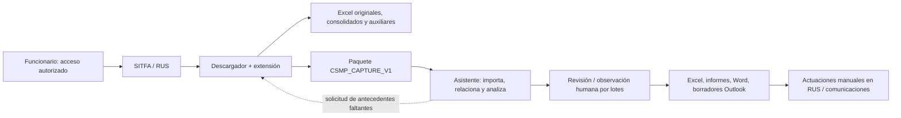
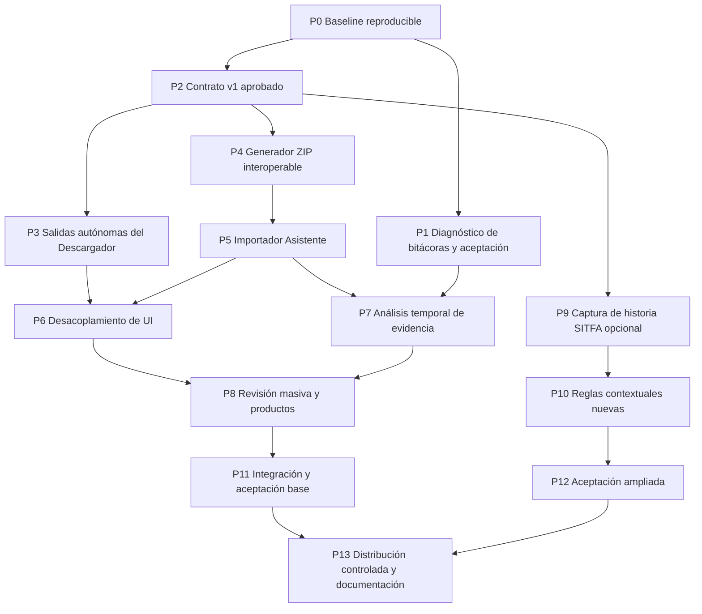

# PLAN MAESTRO DE EJECUCIÓN — NURUS / DESCARGADOR SITFA-RUS / ASISTENTE CSMP

**Identificador:** PE-CSMP-05  
**Fecha:** 8 de octubre de 2026  
**Estado:** plan de desarrollo propuesto para ejecución por otro programador o IA; **no es constancia de implementación**.  
**Repositorio:** https://github.com/MatiGaete2023/NuRus  
**Rama base vinculante para el código:** [`feat/consolidacion-bitacoras-20261008`](https://github.com/MatiGaete2023/NuRus/tree/feat/consolidacion-bitacoras-20261008)  
**SHA de partida verificado:** `251d5c4025749edd4767183ebd3d2baf3bb9baed` (8-10-2026, 18:40:55 UTC).  
**Versiones descritas por el repositorio:** CSMP Assistant `0.5.0.dev4`; Descargador y extensión `2.7.2`.  
**Referencias de especificación:** `01_ESPECIFICACION_DESCARGADOR_RUS_SITFA.md` (D-CSMP-01); `02_ESPECIFICACION_TECNICA_ASISTENTE_CSMP.md` (A-CSMP-01); `03_REGLAS_ANALISIS_OBSERVACIONES_CSMP.md` (A-CSMP-02); `04_FLUJO_TRABAJO_INTEGRADO_CSMP.md` (F-CSMP-04).  
**Producto final esperado:** dos herramientas operativamente autónomas, interoperables mediante un contrato de datos único, con salidas Excel del Descargador conservadas y productos del Asistente sujetos a revisión humana.

> **Convención probatoria:** `COMPROBADO_CÓDIGO` significa inspección de código/estructura; `COMPROBADO_CI` significa resultado publicado de pruebas automatizadas para el SHA indicado; `DOCUMENTADO` significa afirmación del repositorio aún no aceptada remotamente; `REQUISITO` es una decisión funcional fijada por el usuario; `PENDIENTE` exige desarrollo o validación; `[CONFLICTO_ABIERTO]` exige evidencia o decisión. No equiparar CI exitoso con aceptación de lectura real de RUS/SITFA.

---

## 1. Decisión de ejecución y alcance

### 1.1 Objetivo rector

Transformar el conjunto existente en un flujo desacoplado:



**Descargador:** único programa que consulta directamente las interfaces institucionales. Selecciona consultas; descarga registros, calendarios, informes, egresados, litigantes/órdenes, bitácoras y, previa validación, historia SITFA y documentos seleccionados. Verifica identidad, integridad, origen, cobertura y errores; entrega **Excel autónomos** y un **paquete estructurado** sin duplicar peticiones.

**Asistente:** importa el paquete —o Excel legado— de forma autónoma, relaciona cada ingreso con sus fuentes, aplica reglas, identifica la última observación del centro **solo si la fuente lo acredita**, determina eventos posteriores y necesidad de revisión humana, permite edición masiva y genera productos de trabajo. No consulta SITFA/RUS ni abre automáticamente el Descargador en el flujo final.

**Funcionario:** valida observaciones/proyectos, registra en RUS y envía las comunicaciones que procedan. «Revisar» y «formular observación» constituyen **una misma actividad operativa** para este proceso, aunque los estados `propuesta`, `validada` y `registrada en RUS` sigan siendo hechos distintos.

### 1.2 Exclusiones obligatorias

- **No** crear historial longitudinal local de revisiones o marcas persistentes de «firmas ya revisadas» como fuente para decidir actuaciones; **sí** conservar la sesión actual, correcciones humanas, borradores, preferencias, recuperación técnica de lotes y comprobantes necesarios.
- **No** escribir observaciones ni otras actuaciones automáticamente en RUS; **no** modificar SATURNO; **no** enviar correos automáticamente; Outlook solo debe crear borradores.
- **No** automatizar credenciales, copiar cookies/tokens, desactivar mecanismos institucionales, inventar identidades, rellenar RIT/RUT/IDs faltantes con cero ni inferir egresos o subsanaciones por desaparición de una fila.
- **No** obligar al usuario a abrir el Asistente para exportar Excel ni a ejecutar el Descargador para reanalizar un paquete ya obtenido.
- **No** reformular reglas tradicionales, umbrales o redacciones para adaptarse a un código nuevo sin prueba de paridad y autorización funcional.
- **No** publicar en GitHub datos reales de NNA, bitácoras, HTML, HAR, documentos, credenciales ni diagnósticos no anonimizados.

### 1.3 Definición del primer producto utilizable (MVP)

La primera entrega funcional —independiente de historia SITFA— debe permitir:

1. Ejecutar consultas existentes y obtener **todos los Excel anteriores** con sus nombres, hojas, columnas, filtros, paginación y consolidación.
2. Exportar bitácoras de manera autónoma desde el Descargador con reporte de errores; su uso como evidencia **real** queda condicionado a la prueba institucional de identidad y contenido.
3. Generar el ZIP normalizado `CSMP_CAPTURE_V1` de registros, calendarios y bitácoras disponibles, identificando claramente faltantes y cobertura.
4. Abrir ese ZIP en el Asistente sin Chrome/Descargador, ejecutar las reglas tradicionales sin cambios, presentar una bandeja masiva y generar Excel de observaciones, nóminas, Word y borradores Outlook, según autorización humana.
5. Permitir operar independientemente con Excel legado y recuperar modificaciones del trabajo actual.

**No bloquear este MVP** por no disponer aún de extractor de historia SITFA, metadatos PDF o nuevas reglas contextuales. Esas capacidades tendrán entregas y condiciones de aprobación propias.

---

## 2. Fotografía de partida: hechos y diferencias respecto de los cuatro informes

### 2.1 Base efectiva

| Aspecto | Estado de esta rama | Implicación para el plan |
|---|---|---|
| Rama `feat/consolidacion-bitacoras-20261008` | `COMPROBADO_CÓDIGO`: SHA `251d5c4…` | Congelar SHA antes de editar; no reutilizar descripciones antiguas como si fueran estado actual |
| CSMP Assistant | `0.5.0.dev4` en `pyproject.toml` | Preservar la UI y los productos de `main` con mejoras dev4 |
| Descargador/extensión | `2.7.2` en `contrato_integral.py` y `extension/manifest.json` | Probar y distribuir ejecutable + extensión concordantes |
| Acceso directo desde Asistente | Aún existen `bitacora_link.py` y UI que inicia consulta RUS | Retirar **después** de tener importación autónoma; no antes |
| Excel del Descargador | `resultados.py` crea XLSX consolidado, CSV, ICS, ZIP; conserva originales | No rehacer ni romper estas salidas |
| Bitácoras | `lectura_bitacoras.py` mantiene `bitacoras.json` y `diagnostico_bitacoras.json` | Completar diagnóstico y aceptación antes de anunciar fiabilidad universal |
| Excel de bitácoras | Se produce todavía en `personal/bitacora_lote.py` + `bitacoras.py` | Trasladar/adaptar exportador al Descargador sin duplicar reglas |
| Historia SITFA | `vinculos.py` conoce `ShowHistoria`; no consta extracción general terminada | Requiere captura de contrato de lectura independiente |
| Contrato `CSMP_CAPTURE_V1` | Propuesto por los cuatro informes; **no implementado ni aprobado** | Formalizar esquema y pruebas productor/consumidor antes de integrar |
| CI del SHA | **Dos runs exitosos** en GitHub Actions, CSMP y Descargador | Baseline automatizado favorable; falta aceptación institucional |

Evidencia CI del SHA: [Descargador, run 37826176379](https://github.com/MatiGaete2023/NuRus/actions/runs/37826176379); [CSMP, run 37826176465](https://github.com/MatiGaete2023/NuRus/actions/runs/37826176465). Este estado pertenece **solo** al SHA congelado, no a commits futuros.

### 2.2 Divergencia de ramas: conflicto que cambia la estrategia

`COMPROBADO_CÓDIGO`: la comparación del conector muestra que `feat/consolidacion-bitacoras-20261008` está **11 commits por delante de `main` y 0 detrás**, mientras que frente a `experimento/plan-integral-csmp-20261002` está **divergida** (47 commits adelante / 11 detrás en esa comparación de referencias). Por tanto:

- **NO fusionar ciegamente** la rama experimental histórica en la rama de trabajo; podría sobreescribir CSMP dev4, su UI, sus tests o sus salidas.
- Comparar por **capacidad y archivo** únicamente aquellas funcionalidades que falten, apoyándose en los cuatro informes para conocer el diseño deseado.
- Crear ramas cortas a partir del SHA de `feat/...`, con cambios verificables e integraciones por PR. Solo hacer una eventual fusión a `main` luego de aprobación expresa y aceptación.

`[CONFLICTO_ABIERTO]` Los informes 01–04 fueron redactados cuando la referencia era la rama experimental (`0.4.0.dev23 / 2.7.1`), mientras que la base actual es `0.5.0.dev4 / 2.7.2`. **Efecto:** referencias de versiones y algunos módulos/UI no coinciden. **Resolución:** considerar los cuatro informes fuente de requisitos funcionales, no foto definitiva de código, y registrar toda actualización de rutas y versiones en la matriz de trazabilidad de la fase P0.

### 2.3 Bloqueadores reales documentados

La documentación vigente `docs/INTEGRACION_FINAL_20261008.md` distingue errores pendientes: un lote Ambulatorio/Espera registró 98/98 `SIN_VINCULO`; existen antecedentes anteriores de Residencia con 10/12 lecturas y DCE con 2/22, sin evidencia suficiente para atribuirlos a la versión integral actual. Se debe probar con ejecutables y extensión de **un mismo artefacto aprobado**, leer el diagnóstico anónimo y verificar en el entorno autorizado. No se debe declarar la corrección lograda en la sesión real por el solo hecho de pasar tests ficticios.

---

## 3. Documentos rectores, precedencia y control de modificaciones

| Prioridad | Fuente | Función |
|---|---|---|
| 1 | Decisiones expresas del usuario registradas en este encargo | Alcance, límites, prioridades y responsabilidad humana |
| 2 | `04_FLUJO_TRABAJO_INTEGRADO_CSMP.md` | Secuencia F00–F15, puertas entre actores y RACI |
| 3 | `01_ESPECIFICACION_DESCARGADOR_RUS_SITFA.md` | Captura, Excel, integridad, estructura `CSMP_CAPTURE_V1` |
| 4 | `02_ESPECIFICACION_TECNICA_ASISTENTE_CSMP.md` | Arquitectura, entradas, salidas, interfaces y preservación de trabajo |
| 5 | `03_REGLAS_ANALISIS_OBSERVACIONES_CSMP.md` + catálogo de reglas vigente | Reglas sustantivas, condiciones, clasificación contextual y textos |
| 6 | Código y pruebas **del SHA congelado** | Baseline técnico que se modifica conservando comportamientos aprobados |

Las reglas jurídicas/funcionales del punto 5 prevalecen sobre una simplificación de software, pero **la configuración personal vigente** debe identificarse primero: no presumir que el catálogo histórico reemplaza cambios posteriores del usuario. En caso de diferencias, activar `[CONFLICTO_ABIERTO]`, mostrar resultado actual vs propuesto y pedir decisión; no escoger un texto mediante preferencia del programador.

Cada PR debe indicar: versión de los cuatro documentos consultada; requisitos afectados; archivos modificados; tests nuevos y resultados; salida antes/después; cambios de permisos; asuntos pendientes; SHA de origen y SHA resultante.

---

## 4. Organización del trabajo y mecanismo de ejecución

### 4.1 Roles

- **Programador integrador:** mantiene rama, contrato, pruebas end-to-end, empaquetado, decisiones técnicas reversibles y registro de compatibilidad.
- **Programador Descargador:** extensiones/perfiles, captura/validación, salidas Excel y construcción de paquete.
- **Programador Asistente:** importador, modelo de trabajo, UI masiva, productos y desacoplamiento.
- **Responsable funcional CSMP:** confirma reglas, umbrales, textos, acciones, prioridades y criterios de aceptación de observaciones.
- **Operador institucional autorizado:** verifica consultas reales de solo lectura y coteja las salidas con pantallas de RUS/SITFA bajo políticas aplicables.

Una persona puede desempeñar varios roles; la **validación funcional y la aceptación institucional no pueden reemplazarse por una prueba simulada**.

### 4.2 Reglas de rama y PR

1. Congelar `251d5c4…` como `baseline-20261008` **solo si el responsable autoriza crear el tag**; de lo contrario, documentarlo como SHA de referencia sin mutar GitHub.
2. Crear `feat/csmp-contrato-v1`, `feat/descargador-exportacion-autonoma`, `feat/csmp-importacion-v1`, etc., **a partir del SHA** y preferir PR pequeños, secuenciales y con rollback.
3. No modificar directamente `main`; no borrar ramas anteriores; no usar `git push --force`; no publicar releases sin autorización expresa.
4. Para cada PR, comparar contra la base seleccionada, ejecutar pruebas locales/CI, conservar artefactos y actualizar la matriz de aceptación. No esconder una prueba fallida eliminándola.
5. Una incompatibilidad técnica sin decisión funcional se resuelve por **adaptador temporal**, no alterando el contrato unilateralmente.

### 4.3 Entorno y advertencias

- Objetivo de despliegue: **Windows 10**, uso normal **sin permisos de administrador**, Excel 2010 y Outlook 365 cuando estén disponibles.
- La rama actual declara Python `>=3.12,<3.15` y CI del Asistente con 3.12, 3.13 y 3.14. **No imponer Python 3.14 ni migración de Excel/Office** como requisito del usuario; validar 3.12 como base reproducible y ofrecer EXE autocontenido.
- El Descargador fija versiones de dependencias en `descargador/requirements.txt`; la extensión utiliza Chrome y permisos explícitos a `familia.pjud.cl` y `127.0.0.1`. Su instalación local como extensión sin empaquetar puede depender de políticas institucionales: comprobar antes, sin proponer eludirlas.
- Playwright, Node y PyInstaller se utilizan en desarrollo/CI; no deberían convertirse en dependencias de la instalación diaria salvo justificación probada. Inno Setup solo para construir instalador en CI/entorno de compilación, no en el equipo de oficina.
- Outlook COM y Excel COM son **opcionales**: si no están presentes, debe continuar el análisis y la exportación portable, con degradación indicada en los productos afectados.
- Datos de prueba en repositorio y CI: exclusivamente ficticios, sintéticos o anonimizados de forma irreversible. No transferir datos judiciales personales fuera de los canales institucionalmente autorizados.

---

## 5. Estrategia de entregas y dependencias



**Camino crítico del MVP:** P0 → P2 → P4 → P5 → P6 → P8 → P11 → P13. P1 debe superarse para afirmar que la parte de bitácoras funciona con RUS real y antes de usar sus datos como hechos confiables en P7. P9–P10 forman una ampliación optativa condicionada; no detienen el MVP tabular.

La duración de fases no se inventa en semanas/días sin medir esfuerzo y dependencias. Cada fase tiene una **puerta de salida binaria** documentada. No implementar «porcentaje terminado» a partir de tareas sin aceptación.

---

## 6. Backlog ejecutable por fases

### P0 — Congelamiento de baseline, inventario y no regresión

**Objetivo:** fijar qué hace exactamente el código del SHA antes de modificarlo. **Responsable:** integrador. **Entradas:** rama, workflows, cuatro informes, reglas/plantillas/configuración. **No se cambian funciones de usuario en esta fase.**

| ID | Tarea ejecutable | Archivos/áreas a inspeccionar | Evidencia y producto |
|---|---|---|---|
| P0.01 | Fijar SHA, versiones y estado real de CI; registrar divergencia con ramas históricas | Git metadata, `.github/workflows/*`, `pyproject.toml`, `descargador/contrato_integral.py` | `baseline.md` con SHA, runs, capacidad y límites |
| P0.02 | Ejecutar suite actual y registrar número de pruebas, fallas/skips, dependencias y artefactos | `tests/`, `descargador/test_*.py`, `tools/` | `baseline_tests.md`, sin maquillar fallos |
| P0.03 | Inventario de entradas, filtros, pestañas, modalidades, salidas y clases de error | `descargador/{perfiles,lotes,motor,resultados}.py`, extensión | `inventario_descargador.csv/md` |
| P0.04 | Inventario Asistente y grafo de imports; identificar dependencias de utilidades y componentes heredados | `src/nurus/personal/`, `src/nurus/rus/`, `src/nurus/services/` | `matriz_modulos.md`: conservar/adaptar/reubicar/desactivar/retirar |
| P0.05 | Capturar resultados baseline con **fixtures ficticias**: Espera, Cumplimiento, Informes, Excel, Word, nóminas y borradores; anotar config | `tools/showcase_products.py`, `tools/smoke_personal_gui.py`, tests existentes | Golden files y comparador de salidas (sin información judicial) |
| P0.06 | Verificar configuración y compatibilidad de versiones sin perder cambios del usuario | `config.py`, sesiones, plantillas, instalador | Mapa de migración reversible; respaldo en entorno de prueba |

**Gate G0:** inventario aprobado, todas las suites previas corridas o limitación señalada, golden files registrados, sin alteraciones funcionales. **Rollback:** seguir usando artefacto baseline del SHA fijado.

**P0.07 — decisión de alcance:** identificar estado del inspector RUS y utilidades auxiliares compiladas en la rama. No eliminarlas por no aparecer en los cuatro informes; aislarlas del nuevo flujo y conservar su comportamiento salvo decisión expresa.

### P1 — Estabilización y aceptación de lectura de bitácoras (rama paralela)

**Objetivo:** resolver **errores observados**, especialmente `SIN_VINCULO` y falta de correspondencia de versiones, antes de tratar bitácoras como insumo confiable. **Responsable:** Descargador + operador autorizado. **Fuentes:** `docs/INTEGRACION_FINAL_20261008.md`, `descargador/{lectura_bitacoras,vinculos,contrato_integral}.py`, `descargador/extension/pagina.js`, `src/nurus/bitacora_html.py`.

| ID | Trabajo | Evidencia/gate |
|---|---|---|
| P1.01 | Comprobar que EXE, extensión y metadatos pertenecen al mismo SHA y anuncian versiones/capacidades coherentes | Pantalla técnica/versiones y manifiesto anónimo; no aceptar mezcla 2.7.0/2.7.2 |
| P1.02 | Reproducir los casos conocidos `SIN_VINCULO` mediante fixture y **contraste institucional local autorizado** | Diagnóstico categórico, etapa de error, tabla visible cotejada, sin divulgar NNA |
| P1.03 | Ajustar vínculo `ShowObservaciones`/`ShowHistoria` sin fabricar causa/ingreso por RIT; comprobar diferencias visuales tolerables | Mismo ID remoto + texto distinto → advertencia; ingreso distinto → rechazo |
| P1.04 | Validar paginación, fechas, respuestas, fuentes y reintentos; comprobar exportación de textos largos | Controles de cobertura, hashes y errores; fallo ≠ «bitácora vacía» |
| P1.05 | Ejecutar batería institucional por modalidades y pestañas permitidas; documentar alcance real | Comparación visual de entradas/fecha/autor/tipo/texto/CC, con evidencia autorizada y sin publicación |

**Gate G1:** pruebas automatizadas más prueba real documentada para las variantes que se anuncien. Si no se alcanza, conservar soporte de **fuente faltante/parcial** y permitir que el MVP siga con tablas, sin análisis temporal concluyente basado en bitácoras no acreditadas.

### P2 — Formalización del contrato de intercambio `CSMP_CAPTURE_V1`

**Objetivo:** fijar una sola API de archivos independiente de UI/Chrome. **Responsables:** integrador + ambos programas. **Dependencia:** G0. **No requiere acceso institucional.**

**Entregables exigidos:**

- Especificación `contracts/csmp_capture_v1/README.md` con semántica, versiones, compatibilidad, claves de consulta/fila/ingreso, validación de esquema y reglas de contenido opcional.
- `manifest.schema.json` (JSON Schema) y diccionario **por tabla** con tipos, nulos, cardinalidad, valores permitidos, claves ajenas, reglas de normalización y ejemplos ficticios.
- Definir exportación ZIP con `manifest.json`, `data/consultas.csv`, `registros.csv`, `bitacoras.csv`, `historia_tramites.csv`, `documentos.csv`, `incidencias.csv`, y carpeta de originales **solo cuando su inclusión esté autorizada**. Las fuentes opcionales pueden omitirse; su omisión debe estar declarada.
- Estados separados **por consulta, por archivo, por registro y por evento**, por ejemplo `COMPLETA`, `VACIA_COMPROBADA`, `PARCIAL`, `FALLIDA`, `NO_CONSULTADA`; no mezclar ausencia de filas, fallo y cobertura incompleta.
- Canonicalización de fecha y zona **sin inventar zona horaria** para eventos que carezcan de ella. Si faltan hora o fecha, dejar incertidumbre explícita. RIT/RUT/IDs remotos como texto.
- Trazabilidad original por `source_system`, `query_id`, tribunal, ingreso, modalidad, origen, archivo, hoja, fila, hash y fecha de captura; **no** confiar en RIT+nombre como clave única.
- Formato de textos extensos fuera del límite de celda Excel, con sidecar/split documentado, evitando truncamiento silencioso y preservando integridad.
- Contrato de solicitud opcional de nuevas consultas desde el Asistente hacia el Descargador: **archivo declarativo**, nunca instrucciones ejecutables, navegación directa ni llamadas a escritura.
- Validación contra ZIP slip (`../`), symlinks, rutas absolutas, colisiones, archivos falsos, expansión desproporcionada, hash incorrecto, CSV fórmulas, encoding, registros duplicados y IDs cruzados. Establecer límites cuantificados tras medir fixtures y la memoria disponible.
- Compatibilidad `1.x`: campos opcionales aditivos; cualquier cambio semántico incompatible requiere nueva versión mayor y migrador probado.

**Decisiones bloqueantes P2:** codificación (CSV UTF-8 y delimitador explícito), tablas opcionales vs vacías, representación null, serialización de fecha/hora, nombres finales, política de originales sensibles en ZIP, límites máximos, identificadores compuestos y estrategia de sidecar.

**Gate G2:** esquema validable, productor y consumidor de referencia sobre fixtures, aceptación de faltantes, y pruebas de rechazo de paquetes maliciosos. **La generación real queda para P4/P5.**

### P3 — Autonomía del Descargador y Excel de bitácoras

**Objetivo:** mantener TODOS sus productos sin depender de CSMP. **Responsable:** Descargador. **Dependencias:** G0 y coordinación con G2. **Archivos:** `descargador/{descargador,resultados,ventana_resultados,lectura_bitacoras,flujo_csmp,excel_presentacion}.py`; funciones de exportación que hoy están en `src/nurus/personal/{bitacora_lote,bitacoras,bitacora_har}.py`.

| ID | Cambio concreto | No regresión |
|---|---|---|
| P3.01 | Mantener intacta la captura individual por pantalla, modalidad, estado, fechas y paginación | Misma cantidad de hojas/páginas/originales y nombres esperados |
| P3.02 | Mantener consolidado XLSX, CSV, ICS, ZIP, comparador de lotes, favoritos, controles y evidencias de consultas vacías | Los originales no se editan; los derivados conservan procedencia |
| P3.03 | Hacer disponible `Bitacoras_RUS.xlsx` desde la ventana del Descargador, con hojas de lecturas, consultas, copia íntegra y errores | Se genera con el Asistente **sin instalar/cerrado**, también ante capturas parciales debidamente señaladas |
| P3.04 | Compartir parser de bitácoras con Asistente sin importar paquetes exclusivos de UI de CSMP; mantener `nurus.bitacora_html` reutilizable | Misma entrada produce misma lectura y advertencias en ambos contextos |
| P3.05 | Separar selección de exportaciones: «Excel habitual», «Excel bitácoras» y «Paquete CSMP» | No obligar una salida para conseguir otra; una misma captura alimenta múltiples exportaciones |
| P3.06 | Desactivar dependencia del menú de «configurar CSMP» como requisito de trabajo; preservar compatibilidad de intercambio legado en fase transitoria | No abrir ni buscar ejecutable CSMP para exportar Excel |
| P3.07 | Conservar controles de pausa, cancelación, resultado parcial y recuperación de consultas | No rehacer consultas completas o alterar fuentes comprobadas sin necesidad |

**Gate G3:** D-T01–D-T11, D-T14, D-T17–D-T20 y pruebas INT-01, INT-03, INT-06, INT-07, INT-25 superadas cuando sean aplicables; Excel de bitácoras autónomo con resultados de prueba real **solo si G1 aprobado**. Si P3 debe entregarse antes de G1, rotular estado de aceptación real como pendiente.

### P4 — Exportador `CSMP_CAPTURE_V1` en Descargador

**Objetivo:** construir un ZIP directamente desde consultas ya verificadas, sin reconsultar SITFA ni usar como única fuente el Excel consolidado. **Responsable:** Descargador. **Dependencias:** G2, captura baseline de P0. **Archivos:** preferir módulo aislado `descargador/export_csmp_capture.py`, adaptadores a `resultados.py`, manifiestos de `lotes.py` y `lectura_bitacoras.py`.

1. Obtener inventario de consultas y original/hashes; conservar fuente primaria y mapeos estables.
2. Transformar solo datos con lector validado; preservar originales junto a normalizados y registrar los problemas por fila.
3. Producir tablas con claves de captura/consulta/ingreso; permitir fuentes no consultadas sin archivos falsos.
4. Guardar primero en carpeta temporal, validar y publicar con escritura atómica; no sobrescribir paquete previo.
5. Si una consulta está parcialmente fallida, etiquetar explícitamente la cobertura; no declarar total y no deducir desapariciones.
6. Permitir abrir/reexportar un lote previo sin volver a acceder a RUS; hash y metadatos sin mutaciones silenciosas.

**Gate G4:** D-T15/D-T16 y productor-contrato; paquete fixture completo y parcial leído por validador de referencia; originales y Excel previos idénticos para mismas fuentes.

### P5 — Importador, identidad y modelo interno del Asistente

**Objetivo:** importar ZIP y analizarlo **sin invocar Chrome**. **Responsable:** Asistente. **Dependencias:** G2 y G4. **Archivos:** `src/nurus/personal/{importing,sitfa,work,app_base,app}.py`, módulo nuevo de contrato/entrada y `src/nurus/rus/reader.py` donde corresponda.

| ID | Tarea | Evidencia |
|---|---|---|
| P5.01 | Validar esquema, hash, tamaño, rutas ZIP y tipos antes de alterar la sesión actual | Paquete corrupto rechazado sin pérdida de trabajo |
| P5.02 | Importar fuentes disponibles por tabla y registrar consultas no realizadas/errores | No se generan inferencias por datos ausentes |
| P5.03 | Modelo de identidad por causa + ingreso + persona/programa cuando corresponda; relación por ID remoto verificado | Dos ingresos en mismo RIT no mezclan eventos |
| P5.04 | Normalizar eventos de bitácora y calendario, con metadatos de fuente y cobertura | Detalle y fila originales rastreables |
| P5.05 | Mantener importación de Excel legado y misma evaluación/observación tradicional con golden files | Paridad sin cambio de regla |
| P5.06 | Reimportar misma captura y recuperar sesión/ediciones de forma explícita | Sin duplicación ni pérdida de cambios humanos |
| P5.07 | UI «Importar paquete» y reporte legible de integridad/cobertura antes de aceptar el trabajo | Análisis reproducible sin extensiones o Descargador |

**Gate G5:** A-T01–A-T06, A-T14, A-T17, A-T19, INT-02, INT-09, INT-12, INT-20, INT-21, INT-22 y golden files sin divergencia no autorizada.

### P6 — Desacoplar la ejecución y separar módulos de interfaz

**Objetivo:** eliminar del **flujo operativo** del Asistente las funciones de iniciar Descargador/consultar RUS, sin borrar indebidamente mecanismos compartidos. **Responsable:** Asistente e integrador. **Dependencias:** G3 + G5.

- Modificar `src/nurus/personal/results_view.py`: la lectura/descarga directa de bitácoras será **opción del Descargador**, no botón operativo de CSMP. Los Excel de bitácoras se producen allí; CSMP conserva **importación/análisis**.
- Desacoplar `src/nurus/personal/bitacora_link.py`, `download_link.py`, `download_transfer.py` y `integral_contract.py` del camino principal. No eliminarlos antes de comprobar grafo de imports, recuperación de solicitudes antiguas y rutas de UI heredadas.
- Evitar que `app_base.py` lance ejecutables externos para iniciar trabajo nuevo; mantener `Abrir Excel legado` y `Importar paquete`.
- Analizar otras utilidades duplicadas: exportaciones de fuentes en Descargador; propuestas, Word, Outlook y editor en Asistente; herramientas independientes se conservan fuera del flujo o se integran por un adaptador explícito.
- Distinguir una sesión de trabajo recuperable de un historial de revisiones institucionales. Retirar/dejar inactiva **solo** la persistencia de marcas locales como autoridad temporal; conservar edición, borradores, sesiones y comprobantes técnicos.

**Gate G6:** A-T15/A-T16/A-T19, INT-24/INT-25; Asistente sin Chrome y Descargador sin CSMP, probados en instalaciones separadas. Auditoría de imports sin referencias rotas y migración reversible de preferencias.

### P7 — Cruce temporal basado en fuentes, sin historial interno

**Objetivo:** identificar la última observación del centro dentro del alcance probado y acontecimientos posteriores por el **mismo ingreso**, con evidencia. **Responsable:** Asistente + responsable funcional. **Dependencias:** G5; para fiabilidad real de bitácoras requiere G1.

1. Discriminar observaciones del centro, observaciones de otros actores, respuesta del tribunal, trámite SITFA, firma y calendario; no confundir fuentes.
2. Determinar `ultima_observacion_centro` **solo** entre entradas con identidad remota y origen suficientemente acreditado; fecha/hora sin inventar y respetando cobertura consultada.
3. Comparar eventos posteriores por fecha; ante empate sin hora, orden desconocido o campo ambiguo, mostrar incertidumbre y solicitar revisión focalizada.
4. Mostrar estado de cobertura y hecho literal que sustenta cada hallazgo. No equivaler registro previo a trabajo recién ejecutado.
5. Aplicar reglas tradicionales exactamente como baseline mientras las nuevas capas de contexto actúan solo como señales auxiliares controladas.
6. Clasificar causas en `EXHAUSTIVA`, `FOCALIZADA`, `ORDINARIA`, `SIN_INCIDENCIA_DETECTADA` o `NO_EVALUABLE`, con razones visibles; los criterios nuevos se aprobarán en P10.

**Gate G7:** R-T17–R-T26, A-T02/A-T04, INT-08/INT-09/INT-12–INT-15. Sin G1, limitar la activación contextual a evidencia ficticia y resultados etiquetados `NO_EVALUABLE`/`PARCIAL` según corresponda.

### P8 — Revisión masiva, productos y consistencia transaccional

**Objetivo:** convertir resultados del Asistente en trabajo utilizable sin alterar el editor ni los productos existentes. **Responsable:** Asistente. **Dependencias:** G5/G6; aprovecha G7 cuando esté aprobado.

- Preservar páginas Trabajo, Correos, Resoluciones, Resultados y Configuración, editor de observaciones, filtros, selección múltiple, guardado y recuperación.
- Una fila de bandeja por registro/ingreso, con múltiples hallazgos relacionados; todas las incidencias deben poder consultarse sin generar duplicaciones erróneas en Excel.
- Mantener/reconciliar `OBSERVACION`, `FECHA_OBS`, `TT`, `CC`, `RES` y decisiones humanas. Ningún cambio de reglas puede reemplazar texto editado sin consentimiento.
- Producir Excel revisable y adjuntos de informes por vencer/pendientes **desde datos fuente válidos**, incluso si no se formula una observación nueva; agrupar según programa/tribunal/período.
- Mantener `outputs.py`, `resolutions.py`, `manual_products.py` y `adapters/outlook.py` como productores de Word y borradores sin envío; resolver destinatarios solo desde contactos comprobados, dejar desconocidos vacíos y generar error legible.
- Invalidar/regenerar productos preparados cuando cambie su fuente o decisión humana, sin afectar documentos ya exportados ajenos.
- Mantener funciones auxiliares de edición libre y productos manuales si aún se utilizan; no eliminar porque no formen parte del flujo principal.

**Gate G8:** A-T07–A-T13, A-T17/A-T18, R-T27–R-T32, INT-15–INT-19, INT-23. Comparación estructural de XLSX, DOCX y borradores; prueba de Excel 2010/Outlook 365 cuando estén disponibles.

### P9 — Historia de la causa SITFA y referencias documentales (ampliación opcional)

**Objetivo:** incorporar datos de trámites y referencias **sin** asumir que el vínculo `ShowHistoria` equivale a un extractor. **Responsable:** Descargador + operador autorizado. **Dependencia:** G2; no bloquea P3–P8.

1. Capturar localmente y bajo autorización ejemplos de ventana «Información de la causa» e historia SITFA: tabla real, fecha, descripción, referencia, identificador remoto, parámetros, paginación y estados.
2. Identificar nivel de identidad: **causa** vs **ingreso/persona**; impedir atribución al NNA equivocado si el trámite solo identifica la causa.
3. Desarrollar lectura secuencial `history_open`/equivalente únicamente sobre endpoint y parámetros auditados, sin permisos extra innecesarios.
4. Exportar `Historia_SITFA.xlsx` de modo autónomo y `historia_tramites.csv` para el paquete, preservando texto y referencias.
5. Registrar vínculos de documentos y estado; habilitar PDF **solo por selección explícita**, control de origen/identidad/tipo/tamaño/hash y política institucional. Un PDF no disponible **no** invalida la historia tabular comprobada.
6. Incorporar fuentes SITFA al importador del Asistente y mostrar contraste sin cambiar automáticamente resultados de reglas.

**Gate G9:** D-T12/D-T13, INT-11, pruebas reales supervisadas y autorización de uso. Sin evidencia del contrato remoto, **mantener P9 como PENDIENTE**, no sustituir por HTML inventado ni capturas insuficientes.

### P10 — Nuevas reglas contextuales y prioridad de revisión (activación gradual)

**Objetivo:** implementar las reglas propuestas en `03_REGLAS_ANALISIS_OBSERVACIONES_CSMP.md` **sin cambiar el baseline** hasta aprobación explícita. **Responsable:** Asistente + responsable funcional. **Dependencias:** G7, G8 y G9 para reglas que exigen historia.

- Crear matriz `regla → dato requerido → fuente → cobertura → condición → fragmento/acción → prioridad → incertidumbre`.
- Mantener el catálogo vigente y parámetros de `config.py`/personalizaciones; congelar golden files antes/después y registrar diferencias exactas.
- Introducir `CT-xx` como **desactivadas** por defecto, con versión, fixtures ficticios, explicación, consentimiento para activar y rollback por regla.
- Evitar que una glosa de bitácora «informe enviado» pruebe por sí sola recepción, trámite correcto o subsanación; clasificar `PENDIENTE_VERIFICACION`.
- No automatizar con/sin carga ni `TT/CC/RES` por simple coincidencia textual. No extender reglas jurídicas específicas de Laja/Mulchén/Tomé a otros tribunales sin catálogo nuevo.
- Validar estados `NO_EVALUABLE` cuando falta fuente o identidad, y `SIN_INCIDENCIA_DETECTADA` como resultado **acotado**, no certificado de regularidad integral.

**Gate G10:** R-T01–R-T32, tabla de paridad para todas las reglas tradicionales, aprobación del funcionario responsable para cada regla nueva y evidencia del alcance aplicable. El programador **no** toma decisiones jurídicas faltantes.

### P11 — Pruebas integrales y aceptación del MVP

**Objetivo:** comprobar concatenación sin que una herramienta «arregle» manualmente la salida de otra. **Responsable:** integrador. **Dependencias:** G3–G8, con G1 según cobertura de bitácoras que se anuncie.

Reproducir F00–F15 con fixtures ficticias y, donde exista autorización, probar en sitio solo capturas de lectura. Ejecutar **INT-01–INT-27** consignando `PASÓ / FALLÓ / NO EJECUTADO / NO APLICA` con evidencias. Las pruebas INT-11 (historia) y las dependientes de P9/P10 pueden quedar `NO EJECUTADO` en MVP **solo si la entrega indica expresamente que la ampliación no está incluida**.

**Gate G11:** funcionalidades anunciadas aprobadas, D/A/INT correspondientes superadas, no regresiones y operación independiente de herramientas. No usar `NO EJECUTADO` como sinónimo de `PASÓ`.

### P12 — Aceptación ampliada de historia y reglas contextuales

**Objetivo:** certificar únicamente las capacidades P9/P10 realmente implementadas y probadas. **Responsables:** integrador + operador autorizado + responsable funcional.

**Gate G12:** trazabilidad por evento y fuente, pruebas reales sobre variantes pertinentes, matriz de impacto jurídico/funcional aprobada, diferencia antes/después explicable, PDF selectivos seguros donde aplique. Si no se cumple, conservar el MVP como producto liberable y publicar la ampliación solo más adelante.

### P13 — Entrega Windows, documentación y promoción controlada

**Objetivo:** distribuir una versión reproducible, no solo un cambio en GitHub. **Responsable:** integrador + aceptación del usuario. **Dependencias:** G11; G12 solo si se incluye alcance ampliado.

1. Construir artefactos con metadatos de versión y SHA, incluyendo ejecutable Descargador, extensión 2.7.2 o nueva versión coherente y ejecutable Asistente; **preferir paquete conjunto para distribución**, aunque operen autónomamente.
2. Verificar arranque desde carpeta nueva sin admin, configuración local migrable, preservación de datos al reinstalar y capacidad de volver a la versión anterior.
3. Confirmar en Windows 10 el análisis/exportación sin Office; luego con Excel 2010 y Outlook 365 cuando corresponda. No presumir disponibilidad de COM en CI.
4. Entregar manuales separados, diagramas, notas de versión, criterios de soporte, riesgos residuales, lista de `NO_EJECUTADO` y limitaciones reales.
5. Realizar aceptación explícita del usuario antes de fusionar ramas, publicar release/instalador final o sustituir la versión en uso.

**Gate G13:** paquete identificable con SHA, pruebas reproducibles, rollback demostrado, documentación y aceptación. Las capacidades pendientes no aparecerán como terminadas en la portada ni en los botones.

---

## 7. Matriz consolidada de archivos y destino

| Módulo base (SHA congelado) | Tratamiento | Entrega prevista | Fase |
|---|---|---|---|
| `descargador/descargador.py`, `perfiles.py`, `lotes.py`, `motor.py`, `puente.py` | Conservar y modificar solo interfaces necesarias | Capturas, filtros, secuencias verificadas | P0/P1/P3 |
| `descargador/extension/*` | Conservar permisos mínimos; corregir lector, añadir historia solo validada | Descargas de solo lectura con versión/capacidades | P1/P9 |
| `descargador/vinculos.py`, `lectura_bitacoras.py` | Corregir y ampliar diagnósticos; sin identidades por RIT | Bitácoras vinculadas o incidencias explícitas | P1/P3 |
| `descargador/resultados.py`, `ventana_resultados.py`, `excel_presentacion.py` | Conservar exportaciones; sumar producto autónomo bitácoras y paquete | Excel/CSV/ICS/ZIP habituales + Excel bitácoras + ZIP CSMP | P3/P4 |
| `descargador/flujo_csmp.py` | Mantener compatibilidad y desacoplar obligación de flujo conjunto rígido | Flujos configurables, recuperación | P3/P4 |
| `descargador/contrato_integral.py` | No eliminar check versión; añadir capacidad de contrato independiente | Capabilities de componentes verificables | P2/P4 |
| `src/nurus/bitacora_html.py` | Compartir parser con empaquetado correcto | Lectura igual en ambos ejecutables | P1/P3 |
| `src/nurus/personal/bitacora_lote.py`, `bitacora_har.py`, `bitacoras.py` | Extraer utilidades puras sin desplazar análisis sustantivo | Exportador autónomo Descargador + análisis Asistente | P3/P7 |
| `src/nurus/personal/{importing,sitfa,work}.py` | Extender mediante adaptadores y modelo normalizado | Importador de paquete y Excel antiguo | P5 |
| `src/nurus/personal/{app,app_base,results_view}.py` | Mostrar importación; retirar lanzamiento remoto **después** de migración | UI Asistente independiente | P5/P6 |
| `src/nurus/personal/{download_link,bitacora_link,download_transfer,integral_contract}.py` | Desacoplar flujo principal, mantener recuperación temporal, borrar solo tras prueba de dependencias | Sin navegación/descarga desde CSMP | P6 |
| `src/nurus/personal/motor/*`, `src/nurus/rus/rules.py` | Conservar baseline; inventariar motores concurrentes antes de unificación | Reglas tradicionales sin regresión y CT versionadas | P0/P7/P10 |
| `src/nurus/personal/{outputs,resolutions,manual_products,session,sync,product_state}.py` | Conservar y adaptar entrada, no rehacer | Word, Excel, Outlook, sesión y ediciones | P5/P8 |
| `src/nurus/personal/review_store.py` si existe/está usado en el SHA | Auditar imports y desactivar **solo** marcas persistentes no requeridas | Sin historial longitudinal de revisiones | P0/P6 |
| `src/nurus/personal/registration.py` y utilidades de registro remoto si existen | No activar escritura ni borrar dependencias sin auditoría | Funcionalidad fuera de alcance o inhabilitada | P0/P6 |
| Workflows, instalador y pruebas | Conservar y ampliar; no renombrar arbitrariamente artefactos | Regresión y empaquetado identificables | Todas/P13 |

**Advertencia:** el destino de un archivo se decide por su **función y grafo de imports actual**, no por el nombre. No se ejecutan «limpiezas» de código que carezcan de efecto contractual en esta tarea.

---

## 8. Contratos de entrega y controles entre actores

| Transferencia | Emisor → Receptor | Entradas mínimas | Salida y evidencia | Rechazar si |
|---|---|---|---|---|
| H1 consulta | Usuario → Descargador | Sesión Chrome autorizada, pantalla, filtros, lote | Plan congelado, alcance, opciones existentes | Falta sesión/catálogo, filtro no disponible, combinación inválida |
| H2 captura | Extensión → Descargador | Petición autorizada, respuesta, identidad/cobertura | Original XLS/HTML/PDF y hash, manifiesto técnico | Respuesta ajena, ID no verificado, página falsa, cambio inesperado |
| H3 Excel | Descargador → Usuario | Fuentes comprobadas | Excel originales, consolidados y bitácoras disponibles | Archivo corrupto, duplicación incompatible, origen no verificable |
| H4 paquete | Descargador → Asistente | Captura y contrato aprobados | ZIP + manifiesto + tablas por fuente + hash | ZIP inseguro, esquema incorrecto, identidad mezclada, falsa cobertura |
| H5 análisis | Importador → Motor CSMP | Datos normalizados, reglas versionadas, `as_of` | Hallazgos, observación propuesta, evidencia y cobertura | Fuente ilegible, falta dato indispensable para regla concreta |
| H6 decisión | Asistente → Funcionario | Bandeja y antecedentes | Selecciones, textos/TT/CC/RES revisables | Modificación humana perdida o atribución errónea |
| H7 productos | Asistente → Funcionario | Decisiones y plantillas/contactos | Excel/Word/borradores correctos, estado `preparado` | Destinatario inventado, producto obsoleto, plantilla incompatible |
| H8 actuación | Funcionario → RUS/programa/tribunal | Producto revisado | Registro/envío **manual** en sistema oficial | No autorización/validación; el Asistente no ejecuta H8 |

**El incumplimiento de identidad o integridad de H2/H4 bloquea el dato peligroso; el incumplimiento de cobertura de una fuente opcional bloquea solo las inferencias que dependen de ella**, no necesariamente las reglas fiables de otras tablas.

---

## 9. Plan de pruebas y evidencia que debe entregar cada PR

**Suites existentes a ejecutar (adaptar nombres si cambian durante el desarrollo):**

```powershell
# En una copia de trabajo del repositorio, Python 3.12 recomendado como referencia:
python -m pip install ".[dev,excel-legacy,excel-native,outlook]"
python -m pytest -q -o faulthandler_timeout=90
python -m compileall -q src tests tools

# Dependencias del Descargador en ambiente de desarrollo:
python -m pip install -r descargador/requirements.txt
python -m pytest descargador -q
node descargador/test_bitacoras_extension.cjs

# Generar productos ficticios y humo de la GUI, cuando existan condiciones de escritorio:
python tools/showcase_products.py
python tools/smoke_personal_gui.py
```

> Los comandos son **procedimientos sugeridos a ejecutar**, no resultados de esta auditoría. Instalar dependencias/Node/Playwright puede exigir acceso de red; en equipos institucionales sin privilegios usar venv local o los EXE empaquetados. Para probar con Chrome ficticio, seguir los workflows CI actuales; no ejecutar scripts que consulten RUS sin autorización y sesión legítima.

**Pruebas que se reutilizarán:** `D-T01..D-T20` del informe 01; `A-T01..A-T20` del informe 02; `R-T01..R-T32` del informe 03; `INT-01..INT-27` del informe 04. Cada PR indica subconjunto aplicable. P13 exige matriz acumulativa sin pruebas perdidas.

**Regla para evidencia:**

```text
Caso: INT-XX
Commit de código: <SHA real>
Versión Descargador/extensión/Asistente: <versiones efectivas>
Tipo de entorno: fixture / navegador ficticio / sesión institucional autorizada
Entrada: identificador ficticio o referencia interna segura (no datos NNA publicados)
Pasos ejecutados: ...
Resultado esperado: ...
Resultado observado: ...
Estado: PASÓ | FALLÓ | NO EJECUTADO | NO APLICA
Salidas: nombres y SHA-256 comprobados
Diferencia autorizada: Sí/No + aprobador
Bloqueo/limitación: ...
```

**No regresión mínima:** comparar cardinalidad de filas por fuente, identidad, número de hojas, encabezados, identificadores como texto, fechas, límites de Excel 2010, texto literal de observaciones, correspondencia TT/CC/RES, borradores con destinatarios y adjuntos, plantillas DOCX, sesión recuperada y errores conocidos.

**Métricas de calidad (sin umbrales arbitrarios inventados):** tasa de filas sin vínculo por consulta, fallas por fase, cobertura efectiva, diferencia de filas/hojas frente al baseline, tiempo real por lote, consultas ejecutadas, cantidad de reintentos y volumen de archivos. Comparar en entornos/fixtures equivalentes. Los umbrales cuantitativos de rendimiento se fijarán tras obtener medición del baseline.

---

## 10. Matriz de riesgos y conflictos abiertos

| Código | Riesgo / conflicto | Consecuencia | Contención y requisito de cierre |
|---|---|---|---|
| C01 | `[CONFLICTO_ABIERTO]` Informes 01–04 describen rama anterior y componentes UI dev23 | Cambios erróneos o pérdida de dev4 | Actualizar matriz P0 por SHA actual; no usar rutas antiguas sin comprobar |
| C02 | `[CONFLICTO_ABIERTO]` 98/98 `SIN_VINCULO` en lote real Ambulatorio/Espera, y otras fallas históricas con binarios antiguos | Bitácoras no disponibles o atribuidas incorrectamente | P1: mismo artefacto 2.7.2, diagnóstico anónimo + contraste local real |
| C03 | `[CONFLICTO_ABIERTO]` Historial y límite de consulta de bitácoras no prueban toda la causa | Falsa «última observación» del centro | Cobertura limitada y `NO_EVALUABLE` cuando corresponda; ampliar solo tras prueba |
| C04 | `[CONFLICTO_ABIERTO]` `ShowHistoria` existe pero no extractor de historia acreditado | Trámites/PDF no fiables | P9: capturas reales, contratos, granularidad y pruebas por fuente |
| C05 | `[CONFLICTO_ABIERTO]` «Informe general» no tiene catálogo de pantalla confirmado | Posible consulta requerida ausente | Captura institucional de pantalla, campos y respuesta; agregar perfil después |
| C06 | `[CONFLICTO_ABIERTO]` Motores de reglas múltiples y textos personalizables | Cambio involuntario de observaciones | Matriz paridad + golden files + aprobación funcional |
| C07 | `[CONFLICTO_ABIERTO]` Política de originales y datos sensibles en ZIP/retención | Exposición de NNA | Definir autorización, almacenamiento local permitido, respaldo, permisos y política de limpieza |
| C08 | `[CONFLICTO_ABIERTO]` Identidad de historia puede ser solo por causa, no por ingreso | Atribución incorrecta entre hermanos/personas | Guardar `scope=CAUSA` y exigir atribución adicional antes de vincular a NNA |
| C09 | `[CONFLICTO_ABIERTO]` Fechas/respuestas/firmas con cobertura parcial | Conclusiones equivocadas de subsanación | Evidencia exacta + clasificación focalizada/no evaluable |
| C10 | `[CONFLICTO_ABIERTO]` Qué nuevo texto o actuación corresponde al detectar historia reciente | Cambio jurídico sin consentimiento | A-CSMP-02 + aceptación humana antes de activar regla |
| C11 | Sesiones, favoritos, preferencias y formatos Office pueden variar en Windows 10 | Instalación o uso no reproducible | Probar sin admin y con/ sin Excel/Outlook; versiones congeladas |
| C12 | Mezcla de extensiones y ejecutables de distintas entregas | Error de comunicación e identidad | Verificar capacidades, build SHA y versión; paquete coherente |

**Criterio de escalamiento:** si un conflicto afecta **solo** una fuente opcional, aislarla y avanzar con las demás; si afecta identidad remota, integridad o reglas tradicionales, detener esa parte del flujo y resolver antes de publicar.

---

## 11. Ruta de aceptación institucional de solo lectura

La evaluación remota se ejecutará solo en un entorno institucional autorizado; la persona operadora controla el acceso y nunca transmite claves ni datos identificables a terceros no autorizados. Antes de cada sesión:

1. Confirmar permiso, alcance, modalidad y cantidad de registros; activar única extensión versión aprobada y binarios del mismo build.
2. Elegir muestra representativa **por tipo de contrato**: Espera, Cumplimiento, Informes, Egresados, calendarios, litigantes/órdenes, bitácoras y, cuando esté listo, historia. No inventar que todas las pantallas responden igual.
3. Cotejar una muestra en la interfaz original contra archivos locales: identidad, páginas, registros, fechas, campos, textos completos y cobertura. Documentar resultado sin adjuntar datos de NNA a GitHub.
4. Provocar solo fallas seguras simuladas: cancelar una consulta, desconectar extensión, leer lote incompleto. **No** manipular datos institucionales ni enviar escrituras de prueba.
5. Cerrar el informe de aceptación indicando versiones, datos cifrados/locales referenciados bajo control institucional, fuentes probadas y variantes pendientes.

Si no se cuenta con acceso autorizado, la fase queda **no ejecutada**, aunque los tests locales sean exitosos. El desarrollador no debe pedir credenciales ni eludir políticas de navegación o seguridad.

---

## 12. Plan de salida, compatibilidad y rollback

**Versionamiento:** preservar compatibilidad del `CSMP_CAPTURE_V1` y distinguir versión del protocolo de la versión binaria. Publicar notas de cambio por interfaz y motor de reglas. Para nuevas lecturas `history_open`, negociar capacidades independientes sin requerir obligatoriamente una característica aún no presente.

**Rollback por PR:** cada unidad modifica un área acotada y dispone de fixture anterior, commit reversible y opción de desactivar la función nueva. No cambiar datos de usuario durante migración sin respaldos y pruebas. Si una nueva regla modifica observaciones no autorizadas, desactivarla; no forzar una importación que requiera sobrescribir decisiones humanas.

**Rollback de instalación:** conservar artefactos baseline y una copia de configuración/sesión de prueba. Preferir despliegue en carpeta nueva, comprobar que nuevas versiones reconocen o aíslan sesiones antiguas, y que reinstalación/desinstalación no destruye datos de usuario. No prometer vuelta a versión antigua si se convirtió irreversiblemente un formato; diseñar migración reversible antes.

**Compatibilidad con trabajos existentes:** los Excel ya exportados siguen utilizables. La incorporación del nuevo paquete es aditiva; no retirar lectores anteriores hasta que el programa pueda abrir ficheros representativos. No cambiar nombres de archivos externos que se empleen en flujos manuales sin aprobación.

**Seguridad:** paquetes con datos sensibles permanecen en rutas autorizadas. No enviar a servicios de IA/nube externos ni usar GitHub Issues para material bruto de RUS. `diagnostico_bitacoras.json` puede ser apto para soporte solo tras inspección de anonimización efectiva.

---

## 13. Instrucciones de puesta en marcha para el siguiente programador

1. Leer este plan y las cuatro especificaciones; no arrancar por P9 ni P10.
2. Verificar que se trabaja en `251d5c4025749edd4767183ebd3d2baf3bb9baed`; si la rama avanzó, elaborar una **diferencia desde ese SHA** y actualizar baseline, sin adivinar que el estado previo aún vale.
3. Inspeccionar `docs/INTEGRACION_FINAL_20261008.md`, archivos de versión y los dos runs CI; preparar el inventario P0 y la suite reproducible.
4. Crear una matriz que marque, para cada requisito de los informes 01–04: `IMPLEMENTADO`, `PARCIAL`, `NO IMPLEMENTADO`, `BLOQUEADO POR PRUEBA REAL`, con ruta y prueba de respaldo.
5. Comenzar P2 únicamente con un **contrato de muestra**, diccionario de datos y validador, sin tocar reglas, UI ni capturas.
6. Ejecutar un corte vertical con **una consulta ficticia Espera y una bitácora ficticia**: exportador ZIP (P4) → importador (P5) → análisis tradicional → Excel, sin abrir navegador. Registrar comparaciones automáticas.
7. Completar autonomía del Excel de bitácoras (P3) y P1 de aceptación de lectura; entonces eliminar los lanzamientos de descarga desde CSMP (P6).
8. Habilitar integración temporal (P7), revisión masiva/productos (P8), y empaquetado MVP tras aceptación (P11/P13).
9. Mantener P9/P10 en tareas separadas; solo integrarlas con su propia aceptación de historia y reglas.
10. Entregar siempre **código + artefactos + evidencia + límites + siguiente acción verificable**, no solo un mensaje «terminado».

### Primera tarea concreta sugerida

**P0.01–P0.05: generar `docs/EJECUCION_BASELINE_20261008.md` y la matriz funcional por SHA.** Debe incluir las cuatro especificaciones en un índice, la comparación `main`/`feat`/rama experimental, los resultados de CI del SHA, los módulos reutilizables, las funciones que deben desacoplarse, golden files ficticios y las **preguntas que bloquean el contrato P2**. Una vez aprobada esa matriz, la primera modificación de código será el validador del contrato v1, no una reescritura de GUI.

---

## 14. Definiciones de terminado por producto

| Producto | Condición objetiva |
|---|---|
| **Descargador autónomo** | Con Asistente ausente crea Excel originales/consolidados y bitácoras Excel de fuentes válidas sin dependencia externa de la app CSMP |
| **Paquete `CSMP_CAPTURE_V1`** | Validador pasa, hashes y límites coherentes, cobertura por consulta, tablas opcionales declaradas, identidad comprobada, ZIP seguro |
| **Asistente autónomo** | Importa ZIP sin Chrome; Excel legado igual al baseline; no inicia Descargador ni usa red institucional |
| **Análisis contextual** | Última observación del centro y hechos posteriores sustentados por fuente/fecha/ingreso; incertidumbre no disimulada |
| **Bandeja masiva** | Multiplicidad de hallazgos por ingreso, edición humana preservada, selección por lotes y exportación reproducible |
| **Productos del Asistente** | Excel/informes/Word/borradores correctos; no se confunde preparación con remisión, registro o envío |
| **Historia y PDF (opcional)** | Trámites/fechas/referencias cotejados en RUS/SITFA; descargas PDF selectivas autorizadas y vinculadas con identidad segura |
| **Reglas nuevas (opcional)** | Aprobación funcional individual y pruebas de paridad; habilitación reversible y decisiones explicables |
| **Release** | CI y aceptación institucional de las capacidades anunciadas, artefactos consistentes en Windows 10, manuales, regresión, rollback y autorización explícita |

### Puerta final GO / NO-GO

**GO (MVP):** G0, G2, G3, G4, G5, G6, G8, G11 y G13 aprobados; G1 aprobado para anunciar bitácoras fiables; límites de fuente opcional indicados. **NO-GO:** identidades dudosas asociadas automáticamente, paquetes inseguros, pérdida de observaciones personalizadas, regresión de Excel, envío/escritura institucional automatizado, versiones cruzadas o resultados no probados anunciados como confirmados.

**GO (ampliado):** GO del MVP + G7, G9, G10 y G12 aprobados para las reglas y fuentes que se anuncian. La falta de G9 o G10 **no impide publicar el MVP** si las capacidades ampliadas no se incluyen ni se anuncian.

---

## 15. Matriz de seguimiento para ejecución por etapas

Se actualizará por diferencias, sin reconstruir todo el historial. Plantilla:

| Fase | Estado inicial | Estado de ejecución | Evidencia | Dependencia abierta | Próximo paso |
|---|---|---|---|---|---|
| P0 | Sin nueva corrida local documentada para este encargo | `PENDIENTE` | CI SHA de partida disponible | Ninguna | Inventario y golden files |
| P1 | Errores remotos documentados | `PENDIENTE` | Diagnósticos y código 2.7.2 | Sesión autorizada | Verificar binarios/identidad |
| P2 | Contrato propuesto, no implementado | `PENDIENTE` | Informes 01–04 | Decisiones de esquema | Diccionario y validador |
| P3–P4 | Exportaciones habituales existentes | `PENDIENTE` | `resultados.py` y lector bitácoras | G0/G2 | Autonomía Excel + ZIP |
| P5–P8 | CSMP dev4 existente | `PENDIENTE` | `work.py`, UI, Word/Outlook | G2/G4 | Importador sin red |
| P9–P10 | Capacidad opcional sin contrato real cerrado | `BLOQUEADA_POR_EVIDENCIA` | `ShowHistoria` reconocido | Capturas y aprobación | Muestreo institucional |
| P11–P13 | CI baseline exitoso, release nuevo no generado | `PENDIENTE` | Workflows vigentes | Gates anteriores | Aceptación y paquete |

**Estados permitidos:** `PENDIENTE`, `EN_CURSO`, `BLOQUEADA_POR_EVIDENCIA`, `FALLÓ_PRUEBA`, `IMPLEMENTADA_PENDIENTE_ACEPTACION`, `ACEPTADA`. Documentar motivo/resultado por commit y fase. No asignar progreso porcentual sin entregables verificados.

---

## 16. Referencias de repositorio fijadas al SHA

- [Código y documentación de la rama base, commit 251d5c4](https://github.com/MatiGaete2023/NuRus/tree/251d5c4025749edd4767183ebd3d2baf3bb9baed).
- [Integración vigente de CSMP/Descargador](https://github.com/MatiGaete2023/NuRus/blob/251d5c4025749edd4767183ebd3d2baf3bb9baed/docs/INTEGRACION_FINAL_20261008.md).
- [Descargador: interfaz y lotes](https://github.com/MatiGaete2023/NuRus/blob/251d5c4025749edd4767183ebd3d2baf3bb9baed/descargador/descargador.py).
- [Descargador: resultados](https://github.com/MatiGaete2023/NuRus/blob/251d5c4025749edd4767183ebd3d2baf3bb9baed/descargador/resultados.py).
- [Descargador: lectura de bitácoras y diagnóstico](https://github.com/MatiGaete2023/NuRus/blob/251d5c4025749edd4767183ebd3d2baf3bb9baed/descargador/lectura_bitacoras.py).
- [Descargador: identidad de vínculos](https://github.com/MatiGaete2023/NuRus/blob/251d5c4025749edd4767183ebd3d2baf3bb9baed/descargador/vinculos.py).
- [Extensión Chrome manifest](https://github.com/MatiGaete2023/NuRus/blob/251d5c4025749edd4767183ebd3d2baf3bb9baed/descargador/extension/manifest.json).
- [Asistente: lectura y motor de trabajo](https://github.com/MatiGaete2023/NuRus/blob/251d5c4025749edd4767183ebd3d2baf3bb9baed/src/nurus/personal/work.py).
- [Asistente: importación de lote de bitácoras](https://github.com/MatiGaete2023/NuRus/blob/251d5c4025749edd4767183ebd3d2baf3bb9baed/src/nurus/personal/bitacora_lote.py).
- [Asistente: Resultados (UI)](https://github.com/MatiGaete2023/NuRus/blob/251d5c4025749edd4767183ebd3d2baf3bb9baed/src/nurus/personal/results_view.py).
- [Reglas y parámetros configurables](https://github.com/MatiGaete2023/NuRus/blob/251d5c4025749edd4767183ebd3d2baf3bb9baed/src/nurus/personal/config.py).
- [Workflow CSMP](https://github.com/MatiGaete2023/NuRus/blob/251d5c4025749edd4767183ebd3d2baf3bb9baed/.github/workflows/tests.yml).
- [Workflow Descargador integral](https://github.com/MatiGaete2023/NuRus/blob/251d5c4025749edd4767183ebd3d2baf3bb9baed/.github/workflows/descargador-integral.yml).

### Anexo A. Índice de las especificaciones locales del encargo

1. `01_ESPECIFICACION_DESCARGADOR_RUS_SITFA.md` — catálogo de funciones, Excel/paquete y pruebas D-T01..D-T20.
2. `02_ESPECIFICACION_TECNICA_ASISTENTE_CSMP.md` — importador, UI, productos y pruebas A-T01..A-T20.
3. `03_REGLAS_ANALISIS_OBSERVACIONES_CSMP.md` — baseline sustantivo, nuevas propuestas, reglas contextuales y R-T01..R-T32.
4. `04_FLUJO_TRABAJO_INTEGRADO_CSMP.md` — F00..F15, responsables, H1..H8 y INT-01..INT-27.
5. **Este documento** — fases P0..P13, dependencias/gates, riesgos, pruebas y primera tarea ejecutable.

### Anexo B. Alcance no certificado

No se ha ejecutado en esta elaboración una instalación local del repositorio, pruebas de RUS/SITFA autenticado, validación Excel 2010/Outlook 365, extracción de historia ni modificación del código. Se consultó código y documentación del SHA vinculado y los estados publicados de CI; las pruebas reportadas de CI **no** son pruebas propias de ejecución del presente plan.
